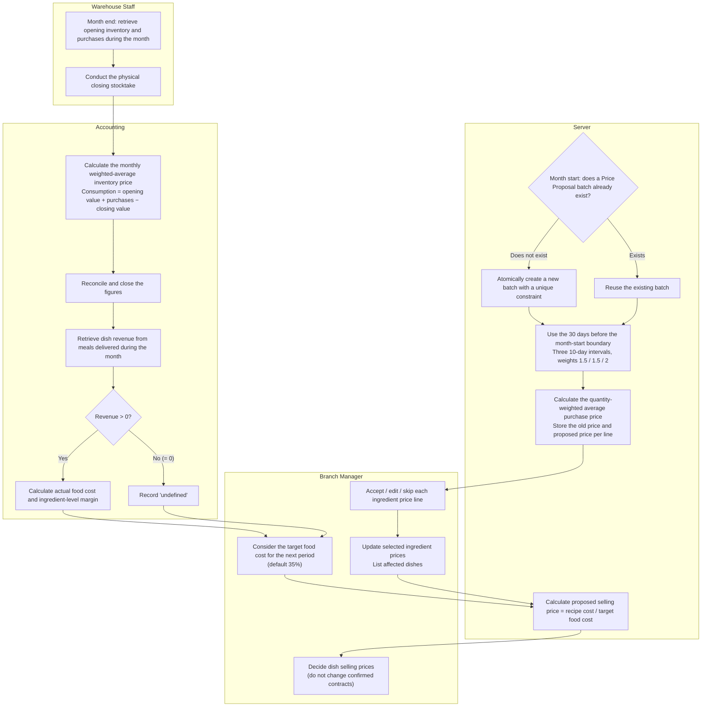

# Stocktake, Food Cost, and Monthly Price Proposal

## Scope

Related UCs: UC-KHO-01, UC-KHO-02, UC-KHO-03, UC-KHO-04, UC-DM-01, UC-DM-03, UC-BC-02. See the [main catalogue](../index.md). Rules are in the [specification](../../specification.md); classes are in the [class model](../class.md).

## Notes and Limitations

- The two flows operate independently: inventory valuation calculates the actual month-end food cost, while the Price Proposal derives current prices from the previous 30 days of purchase history at the start of the month.
- Do not use proposed prices to replace stocktake inventory values (or vice versa).
- The month-start Price Proposal batch initialization mechanism (by cron job or catch-up check) guarantees atomicity: each month has exactly one proposal batch, and its calculation boundary is always the first day of the month even when catch-up processing runs late.
