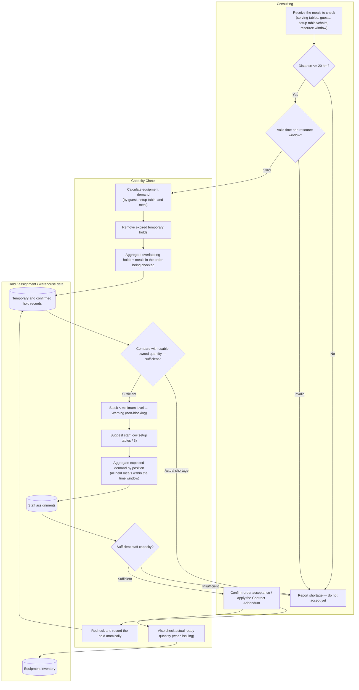

# Capacity Check

## Scope

Related UCs: UC-DT-04, UC-DT-05, UC-HD-05, UC-NS-02, UC-KHO-06. See the [main catalogue](../index.md). Rules are in the [specification](../../specification.md); classes are in the [class model](../class.md).

## Notes and Limitations

- The check excludes transport vehicles, weather, health certificates, individual leave schedules, an automated maps API, and ingredient inventory (it checks only Equipment and staff).
- A hold whose equipment has already been physically issued is not deducted twice from available capacity (in accordance with the invariant in [`class.md`](../class.md)).
- The minimum stock threshold is only a Dashboard warning; an order is rejected only when the actual available quantity is below the required quantity.
