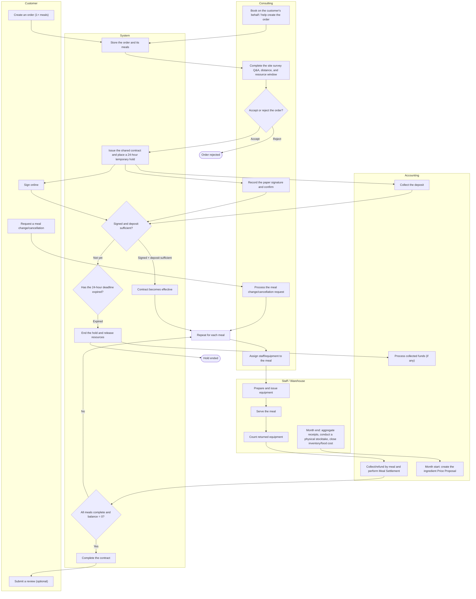

# Overall Booking Workflow

## Scope

Related UCs: UC-DT-02, UC-DT-03, UC-DT-04, UC-DT-05, UC-HD-01, UC-HD-02, UC-HD-03, UC-HD-04, UC-NS-02, UC-KHO-06, UC-KHO-07, UC-HD-08. See the [main catalogue](../index.md). Rules are in the [specification](../../specification.md); classes are in the [class model](../class.md).

## Notes and Limitations

- The diagram omits on-site operational steps (check-in, paper handover signatures, condition photographs, or equipment returned in multiple batches).
- Party cancellation and Contract Addendum branches are detailed in their corresponding sequence diagrams.
