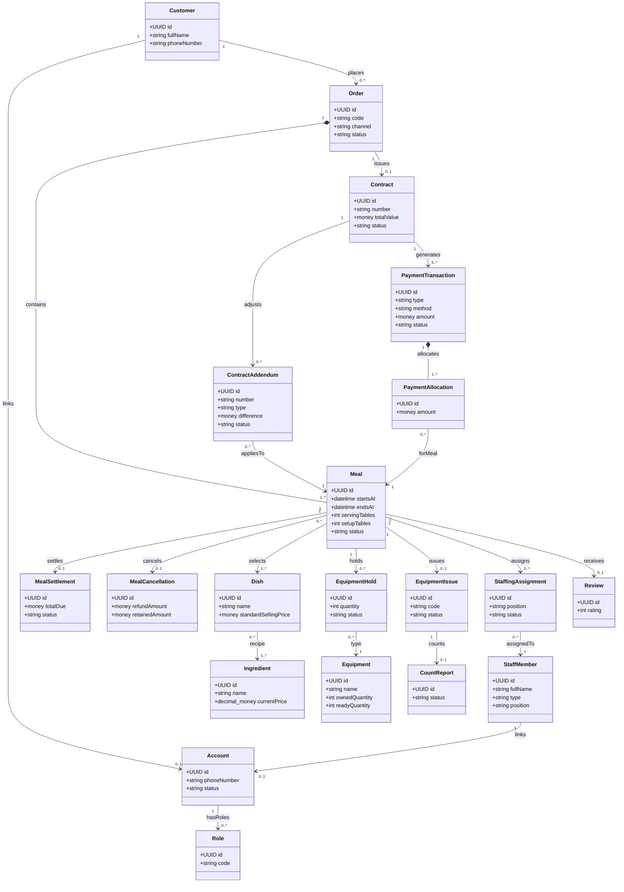
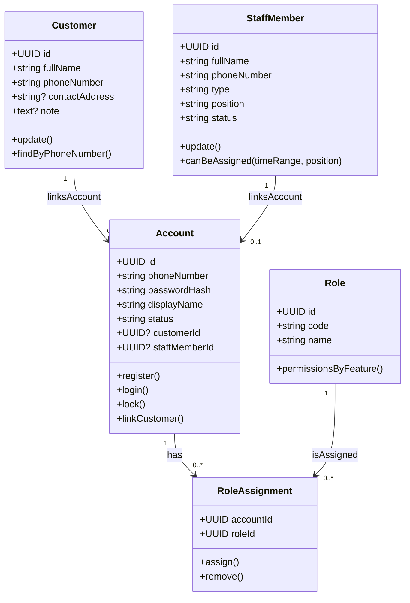
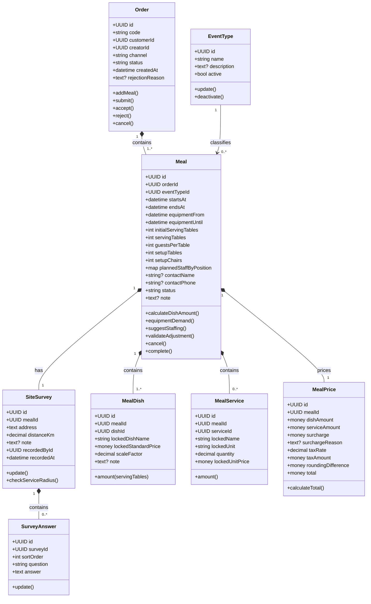
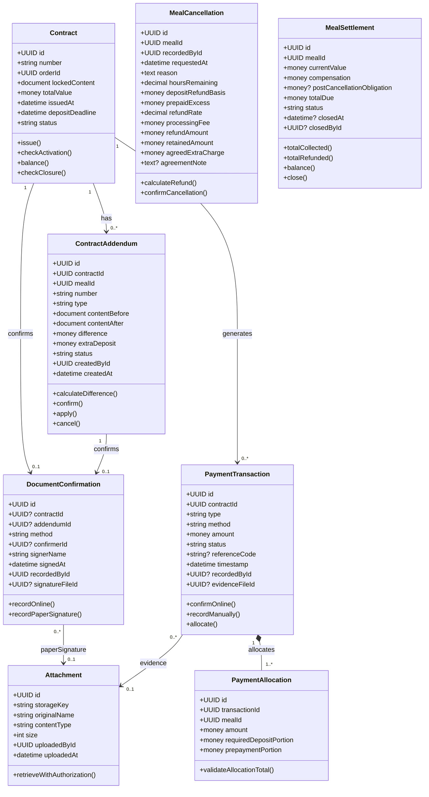
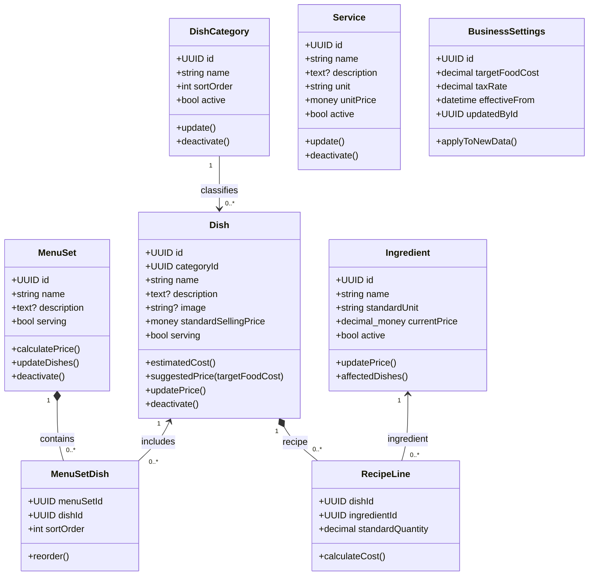
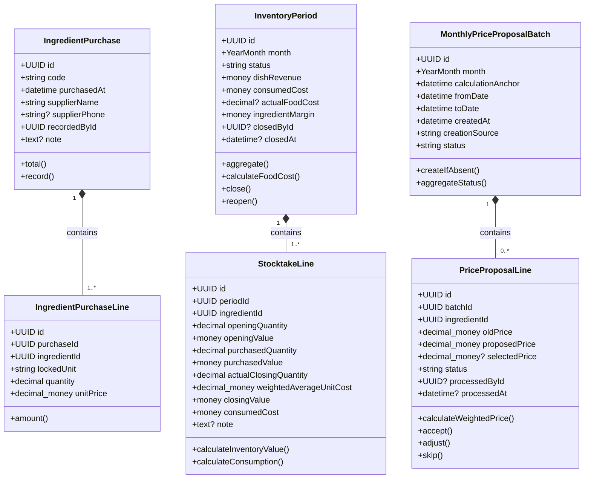
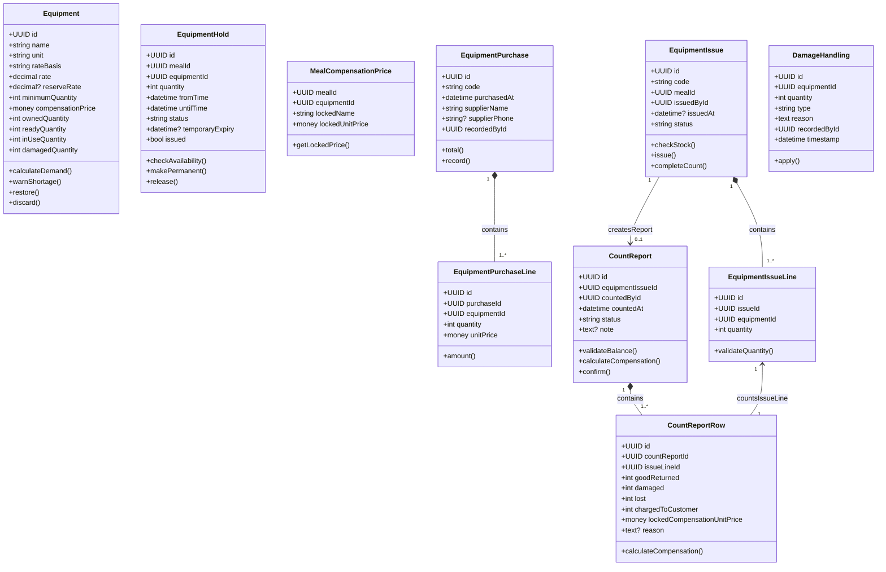
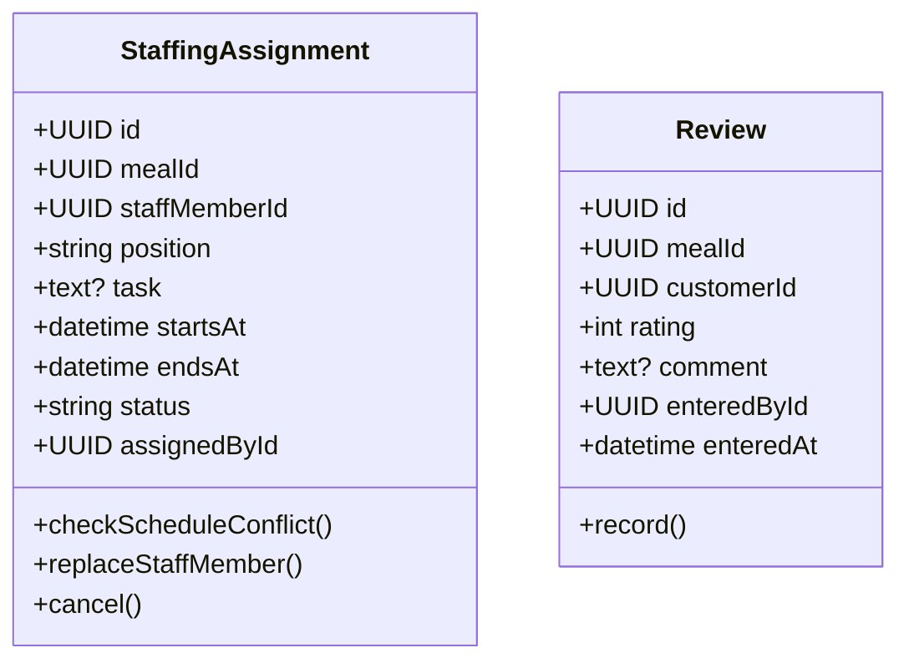
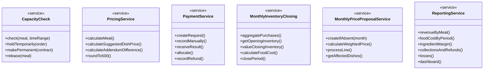

# Detailed Class Model

This document provides the detailed class model and business specification. [Software Specification](../specification.md) is the source of truth for BR rules. Do not duplicate the model in the specification.

## Conventions

- `UUID`: identifier; `?`: optional; `money`: whole VND amount; `decimal-money`: price/unit value that requires precision before rounding; `decimal`: precise quantity/ratio; `datetime`: time-zone-aware timestamp.
- `YearMonth`: a month in Vietnam time. Ratios are stored consistently as decimals and displayed as percentages in the interface.
- Derived attributes may be calculated when read; if a locked snapshot is stored, it must be updated atomically and must not be treated as a second source of monetary truth.
- The following models are domain models; they do not require every class to map to a table or automatically expose CRUD operations for every class.
- Locked prices and content are historical data and are not dynamically linked to later catalog changes.

## Overview Class Diagram

The overview diagram shows the domain architecture and the core relationships among subsystems:

## Accounts and Customers

### Business Constraints

- **Account**: An account is not required to store a customer profile or a staff profile.
- **Role**: System roles are fixed by the specified permissions table; there is no dynamic role-approval workflow.
- **RoleAssignment**: Each account–role pair is unique; a user's permissions are the union of the assigned roles.
- **Customer**: The profile identity key is the normalized phone number. A customer who registers a new account with the same phone number is automatically linked to the customer profile previously created through an on-behalf order.
- **StaffMember**: Professional positions (Cook, Server, Driver, Counter) are business data for shift assignments, not system account roles. Timekeeping and payroll are not managed.

## Orders, Meals, and Surveys

### Business Constraints

- **Order**: An order supports one or more meals; an unsubmitted draft is stored only in the browser, and the system stores it only when the user submits the order (`ChoXacNhan`).
- **Meal**: Serving tables and the actual setup tables/chairs are explicitly distinct. Resource-use time ranges are entered manually. Menu, survey, and staffing assignments are independent for each meal.
- **EventType**: Event types support management and reporting and do not automatically suggest dishes based on spiritual or cultural assumptions.
- **SiteSurvey & SurveyAnswer**: Each meal has its own site survey; questions and answers are stored directly with that survey, and answers are not shared across meals.
- **MealDish & MealService**: Store the meal's fixed, locked list of dishes and services; they do not dynamically follow the current catalog after the contract is issued.
- **MealPrice**: Exactly one current pricing breakdown exists for each meal. Prices locked in the contract are immutable historical data.

## Contracts, Adjustments, and Money

### Business Constraints

- **Contract**: One contract covers all meals in the order. Its stored content includes the complete meal list, locked unit prices, and terms; it does not depend on later catalog changes.
- **DocumentConfirmation**: Links to exactly one Contract or ContractAddendum; a paper-signature method requires an attached scan of the signed document. Online confirmation records the customer account and does not use OTP.
- **ContractAddendum**: One addendum applies to exactly one meal and cannot move the meal date. Each meal may have at most one unresolved addendum to prevent data conflicts.
- **MealCancellation**: Stores the refund result and basis independently for each meal; cancelling an entire contract creates a result for every corresponding meal.
- **PaymentTransaction & PaymentAllocation**: Every transaction amount is positive (type `Hoan` determines the cash-flow direction). The total allocated across meals must exactly equal the transaction amount.
- **MealSettlement**: Collected/refunded amounts and the balance are calculated from successful transactions. For a cancelled meal, the post-cancellation payment obligation replaces the service amount.

## Dish and Ingredient Catalog

### Business Constraints

- **DishCategory & Dish**: Group dishes for catalog filtering; a custom menu requires at least 6 dishes for one meal. The standard unit price applies to a standard 10-person serving table.
- **MenuSet**: A set's price is the sum of its component dish prices, without adding a second profit margin. The meal stores its locked dish list and does not dynamically point to the set.
- **MenuSetDish**: Each menu-set–dish pair is unique.
- **Ingredient & RecipeLine**: A recipe line defines the ingredient quantity for one standard 10-person serving table (each dish–ingredient pair is unique). The current unit price is used to calculate estimated cost and suggest the dish selling price.
- **Service**: Services are provided directly by the business (decoration, sound system, etc.); outsourced providers are not managed.
- **BusinessSettings**: System-wide business parameters (target food cost, tax rate, etc.) apply to calculations and newly created orders.

## Purchases, Stocktakes, and Food Cost

### Business Constraints

- **IngredientPurchase & IngredientPurchaseLine**: Record actual purchased quantities and unit prices; they do not have to link directly to a meal. Quantity $>0$, unit price $\ge 0$.
- **InventoryPeriod & StocktakeLine**: Stocktake and period closing are monthly. Consumption = Opening value + Purchases − Closing value. Ingredient inventory is not issued or deducted after each meal.
- **MonthlyPriceProposalBatch & PriceProposalLine**: Use the first day of the month as the calculation anchor; calculate a weighted average over the preceding 30 days (three 10-day windows weighted 1.5; 1.5; 2). The proposed price is independent of inventory valuation.

## Equipment and Resources

### Business Constraints

- **Equipment**: Ownership invariant: $\text{Owned} = \text{Ready} + \text{In use} + \text{Damaged}$. Minimum stock is a replenishment-warning threshold and does not hard-block the workflow when enough usable quantity remains.
- **EquipmentHold**: A hold is temporary (24 hours) or permanent; it is explicitly distinct from a physical issue to prevent inventory from being deducted twice from future availability.
- **MealCompensationPrice**: The compensation unit price is locked in the contract before the meal and does not use the market price at count time.
- **EquipmentPurchase & EquipmentPurchaseLine**: A purchase directly increases both ready and owned quantities.
- **EquipmentIssue, CountReport & CountReportRow**: Each meal has at most one issue and one complete count report. Required balance: $\text{Good} + \text{Damaged} + \text{Lost} = \text{Issued}$; $0 \le \text{Charged to customer} \le \text{Damaged} + \text{Lost}$.
- **DamageHandling**: Records restored quantity (moved to ready) or discarded quantity (reduces both damaged and owned quantities).

## Staffing Assignments and Reviews

### Business Constraints

- **StaffingAssignment**: Work hours may encompass or differ from the meal's serving hours. Assignment blocks schedule overlaps for a specific person. Overall staffing capacity is reserved by position for held meals before named staff members are assigned.
- **Review**: Each meal has at most one review (rating 1–5), available only after the meal reaches status `HoanTat`. The reviewer must be the customer who placed the order containing that meal.

## Domain Services

## Domain Invariants

1. Meals, addenda, payment allocations, settlements, and resource holds must not reference entities across two contracts.
2. Online customers may view only the profile linked to their phone number; internal permissions are determined by the role-permissions table.
3. Total collections/refunds are calculated from successful transactions; total meal allocations must exactly equal the transaction amount; the balance counts the deposit only once.
4. Cancelling one meal releases only that meal's resource holds and staffing assignments and does not affect other meals in the same order.
5. Future availability is calculated from total usable ownership minus overlapping holds; at issue time, actual ready quantity is also checked. A hold whose equipment has been issued is not deducted twice.
6. Ingredient inventory is stocktaken only on a monthly cycle and stores purchase records; it has no inventory-issue records or detailed per-meal ingredient consumption.
7. Inventory value uses the monthly weighted-average unit cost; the current ingredient price uses the 30-day weighted-average proposed price; the two values are not interchangeable.
8. A price-proposal batch is unique per month; an inventory period is unique per month; a review is unique per meal; a provider-side payment transaction reference is unique.
9. Catalog items with historical records may only be deactivated, not deleted. Confirmed contract/addendum content and successful transactions must not be overwritten.
