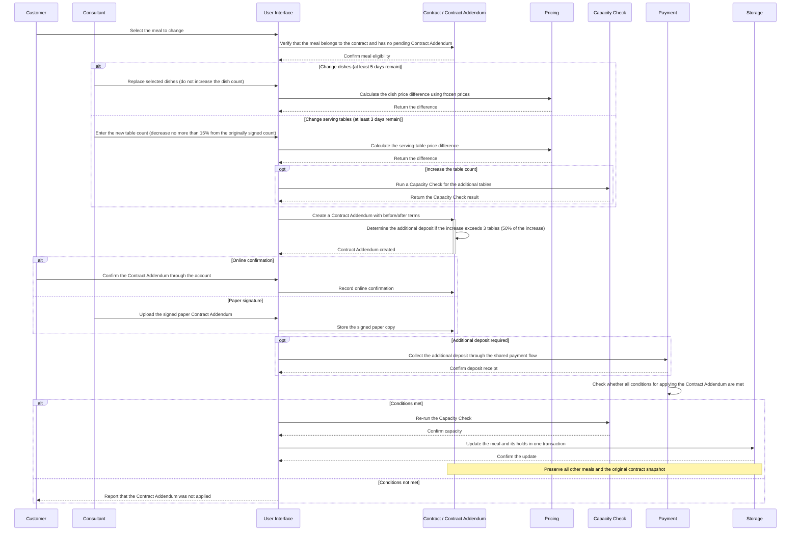

# Per-Meal Contract Addendum

## Scope

Related UCs: UC-HD-05, UC-HD-03, UC-HD-04. See the [main catalogue](../index.md). Rules are in the [specification](../../specification.md); classes are in the [class model](../class.md).

## Notes and Limitations

- A Contract Addendum cannot reschedule the meal date.
- Changing dishes requires $≥ 5$ days before the meal (replace dishes only; do not increase the dish count). Changing serving tables requires $≥ 3$ days before the meal (maximum decrease: 15%).
- A deposit surplus caused by reducing tables is retained and offset during Meal Settlement (not refunded immediately and does not cancel the contract).
