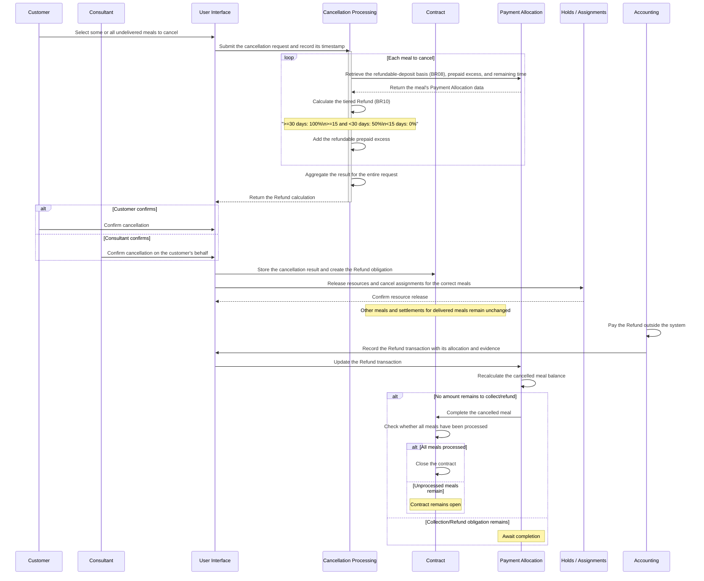

# Per-Meal Cancellation and Refund

## Scope

Related UCs: UC-HD-06, UC-HD-07. See the [main catalogue](../index.md). Rules are in the [specification](../../specification.md); classes are in the [class model](../class.md).

## Notes and Limitations

- Deposit Refund tiers are based on the days remaining until the meal: $≥ 30$ days returns 100%; from $15$ to under $30$ days returns 50%; under $15$ days returns 0%. Any prepaid amount above the deposit is refunded in full at 100%.
- Cancellation before a deposit is paid incurs no charge.
- A customer no-show is recorded separately and is not treated as a customer-requested cancellation.
- Accounting pays and records the Refund directly; there is no complex multi-level approval workflow.
