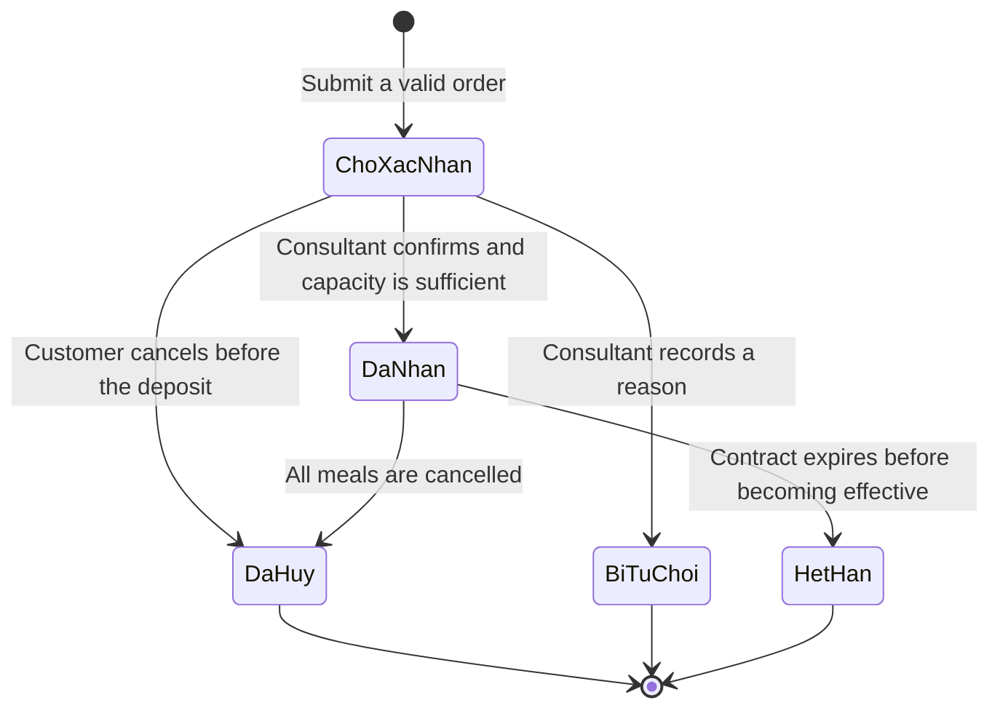
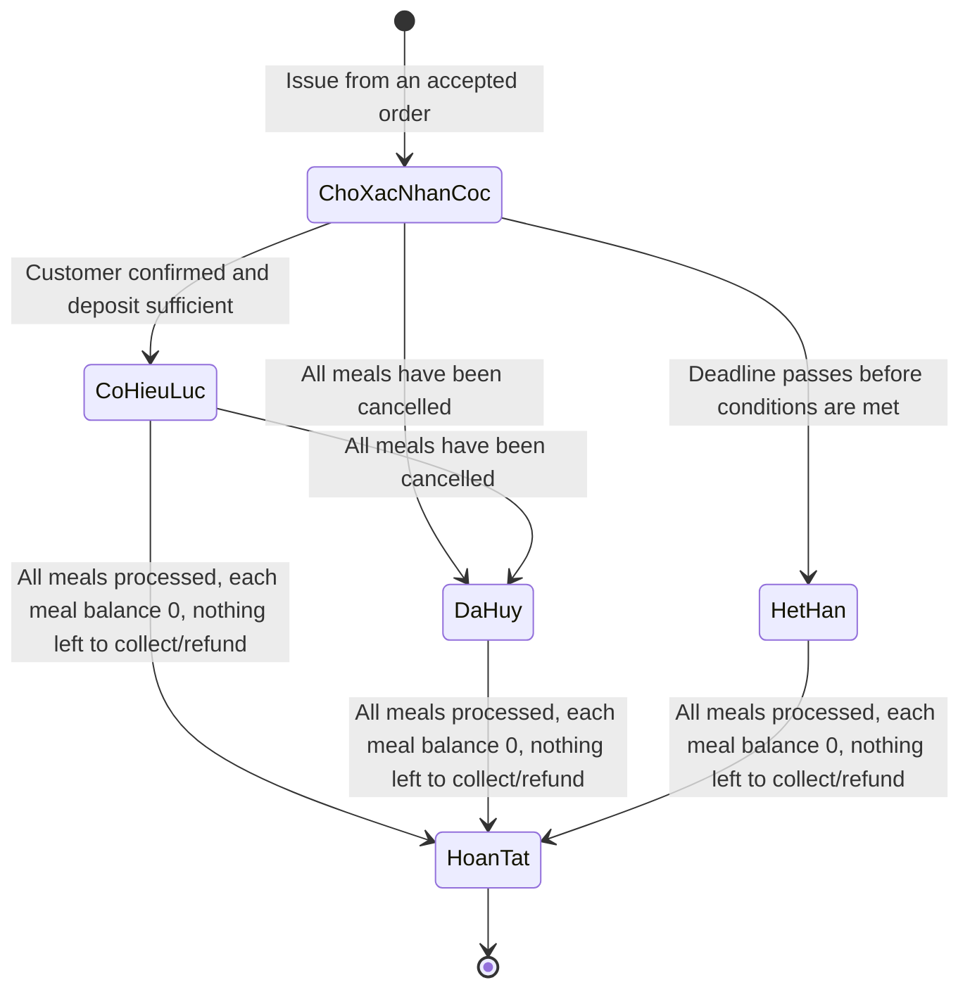
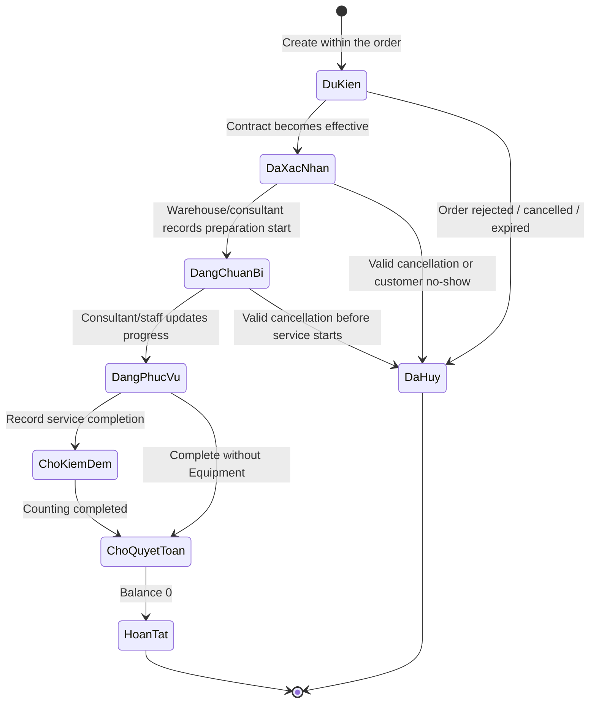

# Order, Contract, and Meal States

## Scope

UC-DT-02, UC-DT-03, UC-DT-04, UC-DT-05, UC-HD-01, UC-HD-02 through UC-HD-08, UC-VH-01, UC-KHO-07. Rules are in the [specification](../../specification.md); data is in the [class model](../class.md).

## Notes and State-Transition Rules

- **Independent progress**: Do not collapse each meal's progress into the overall contract state. The first meal may be complete while the second has not yet taken place.
- **Meal cancellation**: A cancelled meal does not change the contract state to `DaHuy` while other meals continue. The contract changes to `DaHuy` only when all meals are cancelled.
- **Contract closure**: The contract changes to `HoanTat` when every meal has been processed (delivered or cancelled) and each meal's outstanding balance is 0 (no further collection or Refund obligation).
- **Payment transaction**: State `Cho` → `ThanhCong` or `ThatBai`. A Refund transaction is a new record; it does not mutate a collection transaction.
- **Contract Addendum**: `ChoXacNhan` → `ChoCocBoSung` (when the increase exceeds 3 tables) → `DaApDung` (or `DaHuy` if the customer declines/capacity is insufficient). Do not overwrite a signed Contract Addendum.
