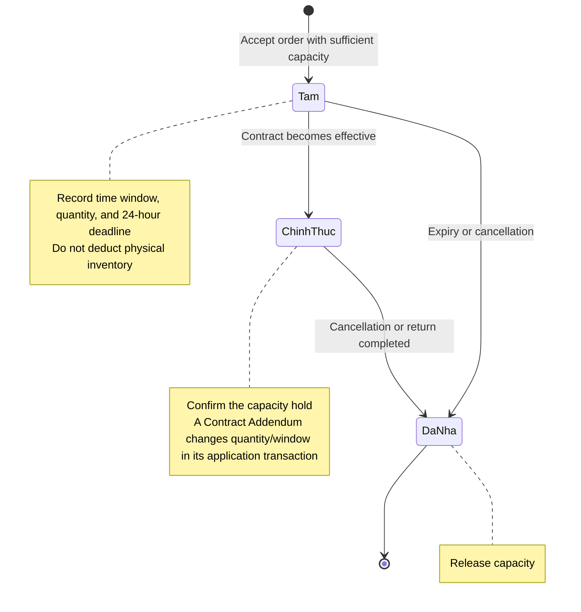

# Equipment Hold, Issue, and Return States

```mermaid
stateDiagram-v2
    [*] --> Nhap : Create the issue note
    Nhap --> DaXuat : Sufficient ready quantity without consuming another meal's hold
    Nhap --> DaHuy : Cancel before issue
    DaXuat --> DaKiemDem : Good + damaged + lost = issued; confirm counting record
    DaKiemDem --> [*]
    DaHuy --> [*]

    note right of DaXuat
        Ready decreases; in use increases
    end note
    note right of DaKiemDem
        Good → ready
        Damaged → damaged quantity
        Lost → reduce owned quantity
    end note
    note left of Nhap
        Invariant: owned = ready + in use + damaged
    end note
```

## Scope

UC-DT-04, UC-DT-05, UC-HD-05, UC-HD-06, UC-KHO-05 through UC-KHO-08. See [BR07, BR13](../../specification.md) and the [class model](../class.md).

## Notes and Equipment-Inventory Invariants

- **Quantity invariant**: $\text{Owned} = \text{Ready} + \text{In use} + \text{Damaged}$.
- **Equipment state movements**:
  - New purchase: Increase ready and owned quantities.
  - Issue: Ready $\rightarrow$ In use (issue exactly once for the whole meal).
  - Good return: In use $\rightarrow$ Ready.
  - Damaged return: In use $\rightarrow$ Damaged (temporarily unavailable).
  - Lost return: Reduce in use and owned quantities.
  - Repair damaged Equipment: Damaged $\rightarrow$ Ready.
  - Dispose of damaged Equipment: Reduce damaged and owned quantities.
- **Hold versus issue**: Temporary/confirmed holds and physical issue are independent concepts; equipment already issued against a hold is not deducted twice from available capacity. If a meal is cancelled after Equipment has been physically issued, an Equipment return/counting record is still mandatory.
