# General Use Case Diagram

The diagram shows the MasterCookVN system boundary, its actors, and the relationships between Use Case packages. See the [Use Case Catalog](./index.md) and [Detailed Use Case Specifications](./use-cases/index.md) for the canonical codes and names.

```mermaid
flowchart LR
    KH["👤 Customer"]
    NVNb["👤 Internal Employee\n(abstract)"]
    NVTV["👤 Consultant"]
    KeToan["👤 Accountant"]
    ThuKho["👤 Storekeeper"]
    QLNS["👤 HR Manager"]
    QLCS["👤 Branch Manager"]
    DVTT["⚙️ Payment Service"]

    NVTV -->|inherits| NVNb
    KeToan -->|inherits| NVNb
    ThuKho -->|inherits| NVNb
    QLNS -->|inherits| NVNb
    QLCS -->|inherits| NVTV
    QLCS -->|inherits| KeToan
    QLCS -->|inherits| ThuKho
    QLCS -->|inherits| QLNS

    subgraph TK["📦 Account Package"]
        TK01(["UC-TK-01: Register a Customer Account"])
        TK02(["UC-TK-02: Sign In, Sign Out, and Change Password"])
        TK03(["UC-TK-03: Manage Internal Accounts and Permissions"])
    end

    subgraph DM["📦 Catalog Package"]
        DM01(["UC-DM-01: Manage Dish Categories and Dishes"])
        DM02(["UC-DM-02: Manage Menu Sets"])
        DM03(["UC-DM-03: Manage Ingredients and Dish Quantities"])
        DM04(["UC-DM-04: Manage Services"])
        DM05(["UC-DM-05: Manage the Equipment Catalog"])
        DM06(["UC-DM-06: Manage Event Types"])
        DM07(["UC-DM-07: Manage Business Parameters"])
    end

    subgraph DT["📦 Booking Package"]
        DT01(["UC-DT-01: Browse the Catalog and Estimate a Price"])
        DT02(["UC-DT-02: Create a Catering Order"])
        DT03(["UC-DT-03: Survey the Venue"])
        DT04(["UC-DT-04: Check Service Capacity"])
        DT05(["UC-DT-05: Accept or Reject an Order"])
        DT06(["UC-DT-06: Look Up Orders, Contracts, and Payment History"])
    end

    subgraph HD["📦 Contract and Payment Package"]
        HD01(["UC-HD-01: Draft and Issue a Contract"])
        HD02(["UC-HD-02: Confirm a Contract"])
        HD03(["UC-HD-03: Pay Online"])
        HD04(["UC-HD-04: Record a Manual Payment"])
        HD05(["UC-HD-05: Adjust a Meal with a Contract Addendum"])
        HD06(["UC-HD-06: Cancel a Meal or Contract"])
        HD07(["UC-HD-07: Record a Refund"])
        HD08(["UC-HD-08: Settle a Meal and Complete a Contract"])
    end

    subgraph NS["📦 HR and Operations Package"]
        NS01(["UC-NS-01: Manage Personnel Profiles"])
        NS02(["UC-NS-02: Assign Personnel to a Meal"])
        VH01(["UC-VH-01: Update Meal Progress"])
    end

    subgraph KHO["📦 Ingredients and Equipment Package"]
        KHO01(["UC-KHO-01: Record an Ingredient Receipt"])
        KHO02(["UC-KHO-02: Perform the Month-End Ingredient Stocktake"])
        KHO03(["UC-KHO-03: Close the Period and Calculate Monthly Food Cost"])
        KHO04(["UC-KHO-04: Process Monthly Ingredient Price Proposals"])
        KHO05(["UC-KHO-05: Purchase Equipment"])
        KHO06(["UC-KHO-06: Issue Equipment for a Meal"])
        KHO07(["UC-KHO-07: Recover, Count, and Compensate for Equipment"])
        KHO08(["UC-KHO-08: Restore or Dispose of Damaged Equipment"])
    end

    subgraph BC["📦 Reviews and Reports Package"]
        CS01(["UC-CS-01: Record a Post-Meal Review"])
        BC01(["UC-BC-01: View the Dashboard and Alerts"])
        BC02(["UC-BC-02: View Revenue and Food-Cost Reports"])
        BC03(["UC-BC-03: View Equipment Reports"])
    end

    %% Actors connected to Use Cases
    KH --- TK01
    KH --- TK02
    KH --- DT01
    KH --- DT02
    KH --- DT06
    KH --- HD02
    KH --- HD03
    KH --- HD05
    KH --- HD06
    KH --- CS01

    NVNb --- TK02
    NVNb --- BC01

    NVTV --- DT02
    NVTV --- DT03
    NVTV --- DT04
    NVTV --- DT05
    NVTV --- DT06
    NVTV --- HD01
    NVTV --- HD02
    NVTV --- HD05
    NVTV --- HD06
    NVTV --- VH01
    NVTV --- CS01

    KeToan --- DT06
    KeToan --- HD04
    KeToan --- HD07
    KeToan --- HD08
    KeToan --- KHO03
    KeToan --- BC02

    ThuKho --- DM05
    ThuKho --- VH01
    ThuKho --- KHO01
    ThuKho --- KHO02
    ThuKho --- KHO05
    ThuKho --- KHO06
    ThuKho --- KHO07
    ThuKho --- KHO08
    ThuKho --- BC03

    QLNS --- NS01
    QLNS --- NS02

    QLCS --- TK03
    QLCS --- DM01
    QLCS --- DM02
    QLCS --- DM03
    QLCS --- DM04
    QLCS --- DM05
    QLCS --- DM06
    QLCS --- DM07
    QLCS --- KHO04
    QLCS --- BC02
    QLCS --- BC03

    DVTT --- HD03

    %% Include and extend relationships
    DT05 -.->|&laquo;include&raquo;| DT04
    HD05 -.->|&laquo;include&raquo;| DT04
    HD04 -.->|&laquo;extend&raquo;| HD03
    HD07 -.->|&laquo;extend&raquo;| HD06
    HD07 -.->|&laquo;extend&raquo;| HD08
```

## Actors

| Actor             | Type                                | Notes                                                                                      |
| ----------------- | ----------------------------------- | ------------------------------------------------------------------------------------------ |
| Customer          | Person                              | Can browse the catalog and estimate a price without signing in (UC-DT-01).                 |
| Internal Employee | Abstract                            | Common parent role for internal personnel (UC-TK-02, UC-BC-01).                            |
| Consultant        | Person; inherits Internal Employee  | Receives orders, surveys venues, and drafts contracts and addenda.                         |
| Accountant        | Person; inherits Internal Employee  | Confirms receipts, records refunds, closes stocktake periods, and performs settlement.     |
| Storekeeper       | Person; inherits Internal Employee  | Receives, issues, and recovers equipment; receives ingredients; performs stocktakes.       |
| HR Manager        | Person; inherits Internal Employee  | Manages personnel profiles and assigns work shifts to each Meal.                           |
| Branch Manager    | Person; inherits all internal roles | Administers the system, processes monthly ingredient-price proposals, and adjusts parameters. |
| Payment Service   | External system                     | Online payment gateway that processes transaction webhooks (UC-HD-03).                     |

## Include and Extend Relationships

| Relationship | From                                     | To                                  | Notes                                                                                   |
| ------------ | ---------------------------------------- | ----------------------------------- | --------------------------------------------------------------------------------------- |
| `«include»`  | UC-DT-05 Accept an Order                 | UC-DT-04 Check Service Capacity     | Resources are always checked before an Order is accepted and capacity is reserved.      |
| `«include»`  | UC-HD-05 Adjust with a Contract Addendum | UC-DT-04 Check Service Capacity     | Resources must be rechecked when an adjustment increases the number of serving tables.  |
| `«extend»`   | UC-HD-04 Record a Manual Payment         | UC-HD-03 Pay Online                 | Applies when the Customer pays directly by cash or by an out-of-flow bank transfer.     |
| `«extend»`   | UC-HD-07 Record a Refund                 | UC-HD-06 Cancel a Meal or Contract  | Applies when cancellation creates a deposit-refund obligation.                          |
| `«extend»`   | UC-HD-07 Record a Refund                 | UC-HD-08 Meal Settlement            | Applies when the Meal Settlement balance is negative.                                   |
