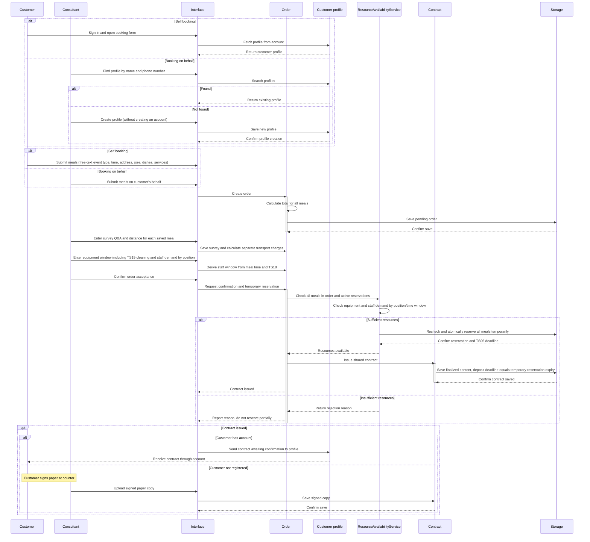

# Booking and Booking on Behalf

<!-- diagram id="vitepress-plugin-digrams-sequence-booking-and-on-behalf" -->

## Scope

UC liên quan: UC-DT-01, UC-DT-02, UC-DT-03, UC-DT-04, UC-DT-05, UC-HD-01, UC-HD-02. Tra tại [danh mục chung](../use-case-catalog.md).

## Notes and Constraints

- Hai nhánh tự đặt/đặt hộ hợp nhất trước khi lưu đơn; hai nhánh ký online/ký giấy hợp nhất tại ghi xác nhận.
- Thiếu tài nguyên thực tế thì không nhận và không giữ một phần đơn; khoảng cách do tư vấn tự đánh giá.
- Giao tiếp qua điện thoại/Zalo được thực hiện thủ công ngoài hệ thống, không qua API tự động.
