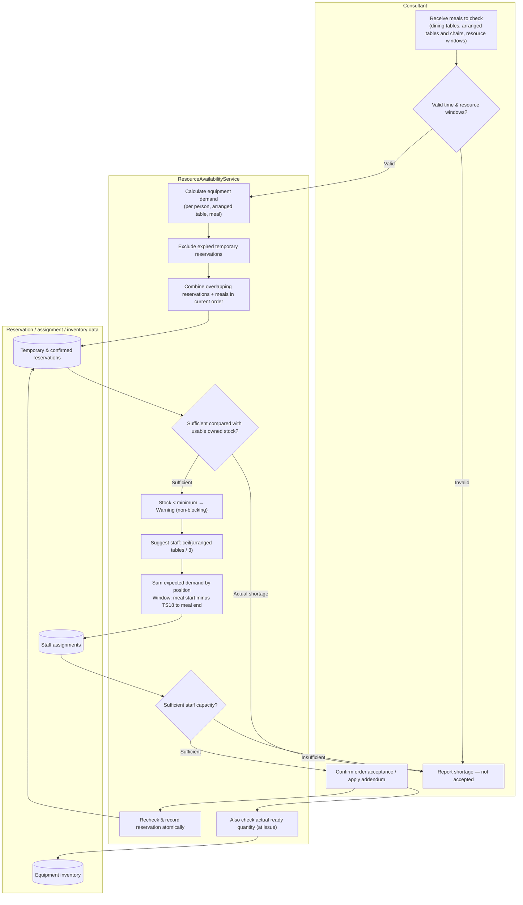

# Service Availability Check

<!-- diagram id="vitepress-plugin-digrams-flowchart-service-capacity" -->

## Scope

UC liên quan: UC-DT-04, UC-DT-05, UC-HD-05, UC-NS-02, UC-KHO-06. Tra tại [danh mục chung](../use-case-catalog.md).

## Notes and Constraints

- Không kiểm tra xe vận chuyển, thời tiết, giấy chứng nhận sức khỏe, lịch nghỉ phép cá nhân, API bản đồ tự động hoặc tồn kho nguyên liệu (chỉ kiểm tra dụng cụ và nhân sự).
- Không tự kiểm tra khoảng cách theo mốc tham khảo; tư vấn tự đánh giá địa điểm. Dụng cụ theo người được tính theo số bàn ăn × 10 suất chuẩn.
- Lượng giữ chỗ đã xuất kho thực tế không bị trừ hai lần vào năng lực khả dụng (tuân thủ bất biến tại [`domain-model.md`](../../models/domain-model.md)).
- Ngưỡng tồn tối thiểu chỉ đóng vai trò cảnh báo trên Dashboard; chỉ khi thiếu thực tế so với sở hữu khả dụng mới từ chối nhận đơn.
