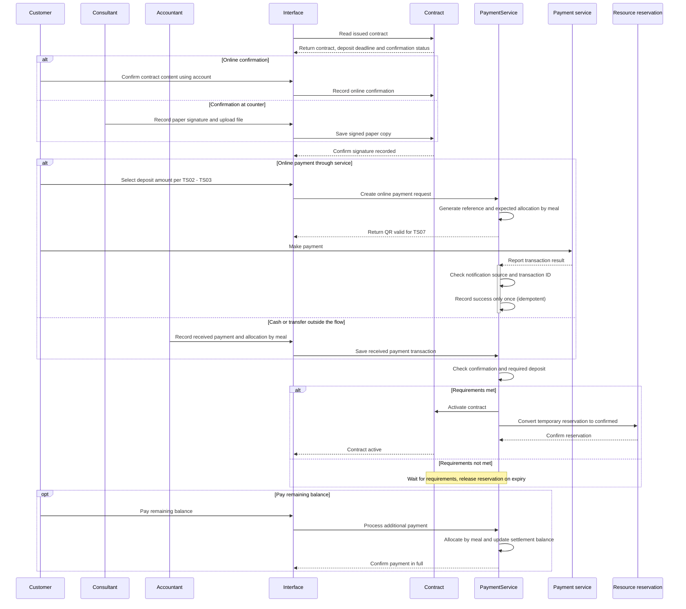

# Confirmation, Deposit and Payment

## Scope

UC liên quan: UC-HD-02, UC-HD-03, UC-HD-04. Tra tại [danh mục chung](../use-case-catalog.md).

## Notes and Constraints

- Tách biệt việc ký hợp đồng và thu tiền; thứ tự có thể linh hoạt nhưng phải thỏa mãn cả hai điều kiện để hợp đồng có hiệu lực.
- Chống ghi nhận trùng lặp giao dịch (idempotency qua mã tham chiếu).
- Hết hạn giữ chỗ mà chưa đủ cọc sẽ tự động nhả tài nguyên; tiền nhận muộn được chuyển kế toán xử lý hoàn trả, không tự ý khôi phục chỗ.
