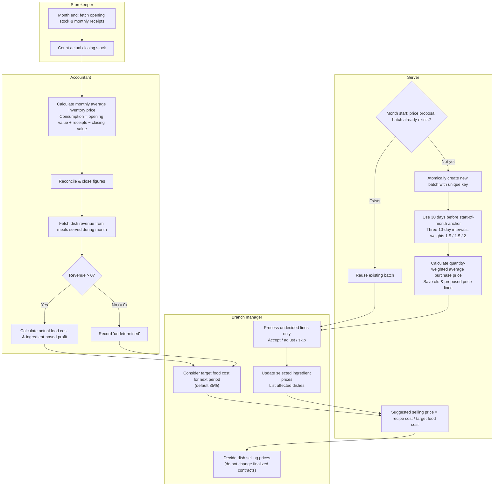

# Inventory, Food Cost and Monthly Price Proposals

## Scope

UC liên quan: UC-KHO-01, UC-KHO-02, UC-KHO-03, UC-KHO-04, UC-DM-01, UC-DM-03, UC-BC-02. Tra tại [danh mục chung](../use-case-catalog.md).

## How Food Cost Relates to Dishes

- **Food cost mục tiêu** là tỷ lệ chung dùng để gợi ý giá bán cho từng món. Hệ thống lấy định lượng và giá hiện hành của các nguyên liệu để ước tính chi phí món, rồi chia cho food cost mục tiêu. Quản lý quyết định giá bán, không tự động đổi giá.
- **Food cost thực tế** là tỷ lệ chung của tháng: tổng chi phí nguyên liệu tiêu thụ chia cho doanh thu món của các bữa đã thực hiện trong tháng. Hệ thống không tính chi phí thực tế riêng cho từng món hoặc từng bữa.
- Sau khi chốt tháng, quản lý có thể dùng food cost thực tế làm mục tiêu tháng sau, hoặc giữ/chỉnh mục tiêu khác. Hệ thống không tự ghi đè.

Ví dụ: một món có chi phí nguyên liệu ước tính 70.000 đồng/bàn chuẩn; mục tiêu 35% cho giá gợi ý 70.000 / 0,35 = 200.000 đồng. Quản lý chọn giá bán. Cuối tháng, nếu toàn cơ sở tiêu thụ 35 triệu đồng nguyên liệu và doanh thu món của các bữa đã thực hiện là 100 triệu đồng, food cost thực tế là 35%. Quản lý quyết định có dùng 35% làm mục tiêu tháng sau hay không.

## Notes and Constraints

- Hai luồng hoạt động độc lập: Định giá tồn kho để tính food cost thực tế cuối tháng, và Đề xuất giá hiện hành từ lịch sử nhập mua 30 ngày gần nhất đầu tháng.
- Không dùng giá đề xuất để thay thế giá trị tồn kho kiểm kê (và ngược lại).
- Cơ chế khởi tạo đợt đề xuất giá đầu tháng (bằng cron job hoặc kiểm tra bù) đảm bảo tính nguyên tử: mỗi tháng chỉ có duy nhất một đợt đề xuất, mốc tính luôn lấy ngày đầu tháng dù chạy bù trễ.
