# Use Case Overview

Sơ đồ thể hiện ranh giới hệ thống MasterCookVN, các tác nhân và quan hệ giữa các gói Use Case. Mã và tên chi tiết tra cứu tại [Use Case Catalog](./use-case-catalog.md) và [Business](./index.md).

```mermaid
flowchart LR
    customer["👤 Customer"]
    internalStaff["👤 Internal staff\n(abstract)"]
    consultant["👤 Consultant"]
    accountant["👤 Accountant"]
    storekeeper["👤 Storekeeper"]
    hrManager["👤 HR manager"]
    branchManager["👤 Branch manager"]
    paymentService["⚙️ Payment service"]

    consultant -->|inherits| internalStaff
    accountant -->|inherits| internalStaff
    storekeeper -->|inherits| internalStaff
    hrManager -->|inherits| internalStaff
    branchManager -->|inherits| consultant
    branchManager -->|inherits| accountant
    branchManager -->|inherits| storekeeper
    branchManager -->|inherits| hrManager

    subgraph accounts["📦 Accounts"]
        ucTk01(["UC-TK-01: Register customer account"])
        ucTk02(["UC-TK-02: Sign in, sign out and change password"])
        ucTk03(["UC-TK-03: Manage internal accounts and permissions"])
    end

    subgraph catalog["📦 Catalog"]
        ucDm01(["UC-DM-01: Manage dish categories and dishes"])
        ucDm02(["UC-DM-02: Manage menu sets"])
        ucDm03(["UC-DM-03: Manage ingredients and recipes"])
        ucDm04(["UC-DM-04: Manage services"])
        ucDm05(["UC-DM-05: Manage equipment catalog"])
        ucDm07(["UC-DM-07: Manage business settings"])
    end

    subgraph booking["📦 Booking"]
        ucDt01(["UC-DT-01: Browse catalog and estimate price"])
        ucDt02(["UC-DT-02: Create catering order"])
        ucDt03(["UC-DT-03: Survey site"])
        ucDt04(["UC-DT-04: Check service availability"])
        ucDt05(["UC-DT-05: Accept or reject order"])
        ucDt06(["UC-DT-06: View orders, contracts and payment history"])
    end

    subgraph contracts["📦 Contracts and payments"]
        ucHd01(["UC-HD-01: Prepare and issue contract"])
        ucHd02(["UC-HD-02: Confirm contract"])
        ucHd03(["UC-HD-03: Pay online"])
        ucHd04(["UC-HD-04: Record manual payment"])
        ucHd05(["UC-HD-05: Adjust meal by addendum"])
        ucHd06(["UC-HD-06: Cancel meal or contract"])
        ucHd07(["UC-HD-07: Record refund"])
        ucHd08(["UC-HD-08: Settle meal and complete contract"])
    end

    subgraph staffing["📦 Staffing and operations"]
        ucNs01(["UC-NS-01: Manage staff profiles"])
        ucNs02(["UC-NS-02: Assign staff to meals"])
        ucVh01(["UC-VH-01: Update meal progress"])
    end

    subgraph inventory["📦 Ingredients and equipment"]
        ucKho01(["UC-KHO-01: Record ingredient purchase"])
        ucKho02(["UC-KHO-02: Count ingredients at month end"])
        ucKho03(["UC-KHO-03: Close period and calculate monthly food cost"])
        ucKho04(["UC-KHO-04: Process monthly ingredient price proposals"])
        ucKho05(["UC-KHO-05: Purchase equipment"])
        ucKho06(["UC-KHO-06: Issue equipment for meal"])
        ucKho07(["UC-KHO-07: Recover and count equipment and assess compensation"])
        ucKho08(["UC-KHO-08: Restore or dispose of damaged equipment"])
    end

    subgraph reports["📦 Reviews and reports"]
        ucCs01(["UC-CS-01: Record post-meal review"])
        ucBc01(["UC-BC-01: View dashboard and alerts"])
        ucBc02(["UC-BC-02: View revenue and food cost reports"])
        ucBc03(["UC-BC-03: View equipment reports"])
    end

    %% Actor connections
    customer --- ucTk01
    customer --- ucTk02
    customer --- ucDt01
    customer --- ucDt02
    customer --- ucDt06
    customer --- ucHd02
    customer --- ucHd03
    customer --- ucHd05
    customer --- ucHd06
    customer --- ucCs01

    internalStaff --- ucTk02
    internalStaff --- ucBc01

    consultant --- ucDt02
    consultant --- ucDt03
    consultant --- ucDt04
    consultant --- ucDt05
    consultant --- ucDt06
    consultant --- ucHd01
    consultant --- ucHd02
    consultant --- ucHd05
    consultant --- ucHd06
    consultant --- ucVh01
    consultant --- ucCs01

    accountant --- ucDt06
    accountant --- ucHd04
    accountant --- ucHd07
    accountant --- ucHd08
    accountant --- ucKho03
    accountant --- ucBc02

    storekeeper --- ucDm05
    storekeeper --- ucVh01
    storekeeper --- ucKho01
    storekeeper --- ucKho02
    storekeeper --- ucKho05
    storekeeper --- ucKho06
    storekeeper --- ucKho07
    storekeeper --- ucKho08
    storekeeper --- ucBc03

    hrManager --- ucNs01
    hrManager --- ucNs02

    branchManager --- ucTk03
    branchManager --- ucDm01
    branchManager --- ucDm02
    branchManager --- ucDm03
    branchManager --- ucDm04
    branchManager --- ucDm05
    branchManager --- ucDm07
    branchManager --- ucKho04
    branchManager --- ucBc02
    branchManager --- ucBc03

    paymentService --- ucHd03

    %% Include and extend relationships
    ucDt05 -.->|&laquo;include&raquo;| ucDt04
    ucHd05 -.->|&laquo;include&raquo; when increasing tables| ucDt04
    ucHd07 -.->|&laquo;extend&raquo;| ucHd06
    ucHd07 -.->|&laquo;extend&raquo;| ucHd08
```

## Actors

| Actor           | Type                                | Notes                                                                       |
| --------------- | ----------------------------------- | --------------------------------------------------------------------------- |
| Customer        | Person                              | Không cần đăng nhập vẫn xem danh mục và tạm tính (UC-DT-01).                |
| Internal staff  | Abstract                            | Vai trò cha chung cho nhân sự nội bộ (UC-TK-02, UC-BC-01).                  |
| Consultant      | Person, inherits Internal staff     | Tiếp nhận đơn, khảo sát địa điểm, lập hợp đồng và phụ lục.                  |
| Accountant      | Person, inherits Internal staff     | Xác nhận thu tiền, ghi nhận hoàn tiền, chốt kỳ kiểm kê, quyết toán.         |
| Storekeeper     | Person, inherits Internal staff     | Nhập/xuất/thu hồi dụng cụ, nhập nguyên liệu, kiểm kê cuối tháng.            |
| HR manager      | Person, inherits Internal staff     | Quản lý hồ sơ nhân viên, phân công ca làm việc theo từng bữa tiệc.          |
| Branch manager  | Person, inherits all internal roles | Quản trị hệ thống, xử lý đề xuất giá nguyên liệu tháng, điều chỉnh tham số. |
| Payment service | External system                     | Cổng thanh toán trực tuyến xử lý webhook giao dịch (UC-HD-03).              |

## Include and Extend Relationships

| Relationship | From                             | To                                         | Notes                                                          |
| ------------ | -------------------------------- | ------------------------------------------ | -------------------------------------------------------------- |
| `«include»`  | UC-DT-05 Accept or reject order  | UC-DT-04 Check service availability        | Luôn kiểm tra tài nguyên trước khi nhận đơn và giữ chỗ         |
| `«include»`  | UC-HD-05 Adjust meal by addendum | UC-DT-04 Check service availability        | Bắt buộc kiểm tra lại tài nguyên khi điều chỉnh tăng số bàn ăn |
| `«extend»`   | UC-HD-07 Record refund           | UC-HD-06 Cancel meal or contract           | Mở rộng kích hoạt khi phát sinh nghĩa vụ hoàn tiền cọc         |
| `«extend»`   | UC-HD-07 Record refund           | UC-HD-08 Settle meal and complete contract | Mở rộng kích hoạt khi số dư quyết toán của bữa là âm           |

UC-HD-03 và UC-HD-04 là hai phương án thanh toán độc lập. Thanh toán thủ công không phải `«extend»` của thanh toán online và không cần tạo QR trước. Loại tiệc là chuỗi nhập tại từng bữa trong UC-DT-02, không còn UC quản lý danh mục riêng.
