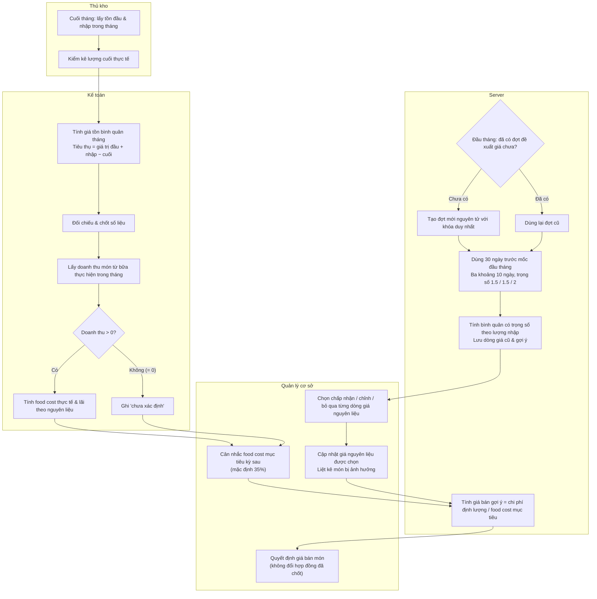

# Kiểm kê, food cost và đề xuất giá tháng

## Phạm vi

UC liên quan: UC-KHO-01, UC-KHO-02, UC-KHO-03, UC-KHO-04, UC-DM-01, UC-DM-03, UC-BC-02. Tra tại [danh mục chung](../index.md). Quy tắc tại [đặc tả](../../specification.md); lớp tại [mô hình](../class.md).

## Thành phần

Thủ kho — Kế toán — server — Quản lý cơ sở.

## Nội dung cần thể hiện

1. Cuối tháng: lấy tồn đầu và nhập trong tháng; thủ kho kiểm kê lượng cuối, không lập xuất theo từng bữa.
2. Tính giá tồn bình quân tháng và tiêu thụ = giá trị đầu + nhập − cuối; kế toán đối chiếu/chốt.
3. Lấy doanh thu món từ bữa thực hiện trong tháng; nếu >0 tính food cost, nếu 0 ghi chưa xác định. Tính lãi theo nguyên liệu.
4. Quản lý cân nhắc food cost mục tiêu kỳ sau; mặc định ban đầu 35%, không tự thay bằng tỷ lệ thực tế.
5. Đầu tháng: cron hoặc kiểm tra bù hỏi đã có đợt theo tháng chưa; có thì dùng lại, chưa thì tạo nguyên tử với khóa duy nhất.
6. Dùng 30 ngày trước mốc đầu tháng, ba khoảng 10 ngày trọng số 1,5;1,5;2, tính bình quân có trọng số theo lượng nhập; lưu dòng giá cũ/gợi ý.
7. Quản lý chọn chấp nhận, chỉnh hoặc bỏ qua từng dòng; cập nhật giá nguyên liệu được chọn, liệt kê món bị ảnh hưởng.
8. Tính giá bán gợi ý món bằng chi phí định lượng / food cost mục tiêu; quản lý quyết định giá món, không đổi hợp đồng chốt.

## Nhánh và giới hạn

Vẽ hai nhánh rõ: định giá tồn để tính food cost và đề xuất giá hiện hành từ lịch sử mua. Không dùng giá đề xuất thay giá tồn. Cron chạy muộn vẫn dùng mốc đầu tháng; hai lần gọi chỉ có một đợt.
