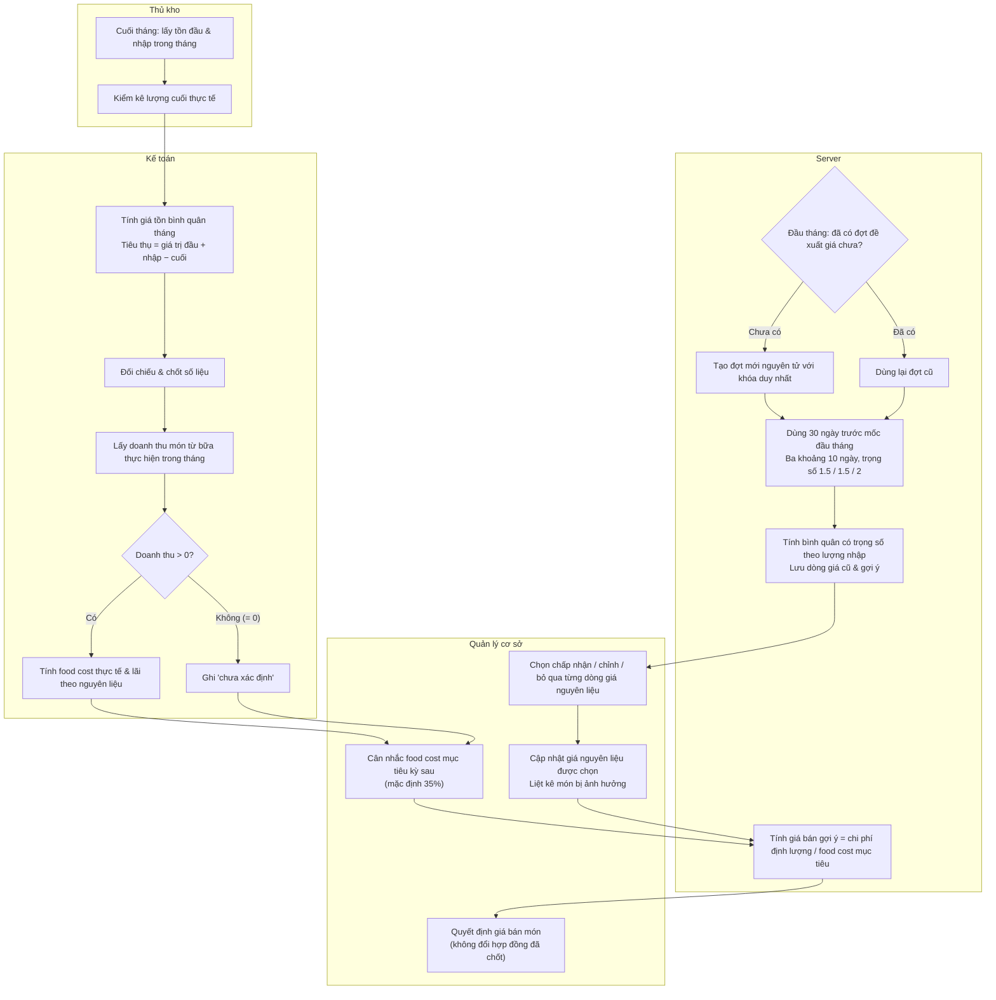

# Kiểm kê, food cost và đề xuất giá tháng

## Phạm vi

UC liên quan: UC-KHO-01, UC-KHO-02, UC-KHO-03, UC-KHO-04, UC-DM-01, UC-DM-03, UC-BC-02. Tra tại [danh mục chung](../index.md). Quy tắc tại [đặc tả](../../specification.md); lớp tại [mô hình](../class.md).

## Lưu ý và giới hạn

- Hai luồng hoạt động độc lập: Định giá tồn kho để tính food cost thực tế cuối tháng, và Đề xuất giá hiện hành từ lịch sử nhập mua 30 ngày gần nhất đầu tháng.
- Không dùng giá đề xuất để thay thế giá trị tồn kho kiểm kê (và ngược lại).
- Cơ chế khởi tạo đợt đề xuất giá đầu tháng (bằng cron job hoặc kiểm tra bù) đảm bảo tính nguyên tử: mỗi tháng chỉ có duy nhất một đợt đề xuất, mốc tính luôn lấy ngày đầu tháng dù chạy bù trễ.
