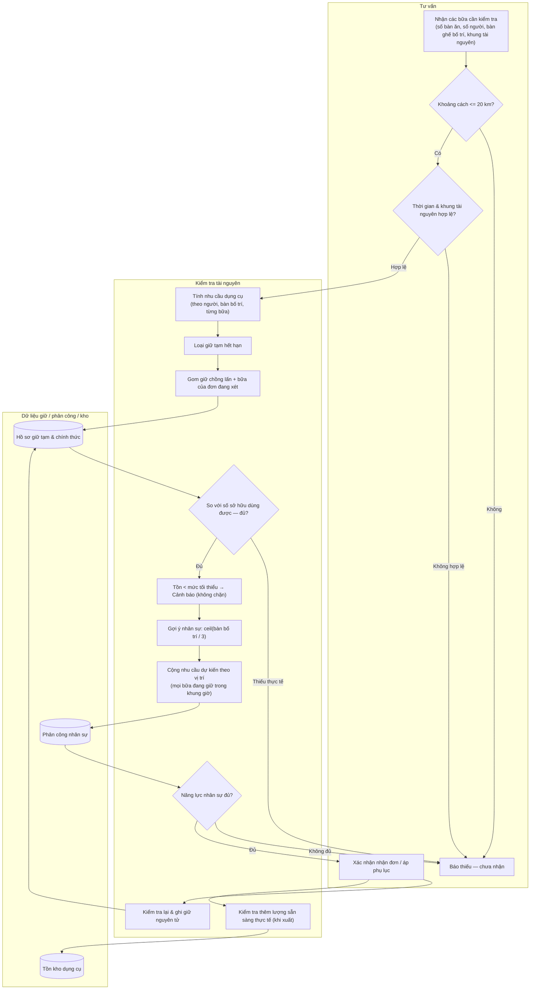

# Kiểm tra khả năng phục vụ

## Phạm vi

UC liên quan: UC-DT-04, UC-DT-05, UC-HD-05, UC-NS-02, UC-KHO-06. Tra tại [danh mục chung](../index.md). Quy tắc tại [đặc tả](../../specification.md); lớp tại [mô hình](../class.md).

## Thành phần

Tư vấn — kiểm tra tài nguyên — dữ liệu giữ/phân công/kho.

## Nội dung cần thể hiện

1. Nhận các bữa cần kiểm tra với số bàn ăn, số người, bàn ghế bố trí và khung sử dụng tài nguyên.
2. Kiểm tra khoảng cách thủ công <=20 km; thời gian kết thúc sau bắt đầu, khung tài nguyên bao phủ việc phục vụ.
3. Tính nhu cầu dụng cụ theo người/bàn bố trí/bữa và dự trù riêng từng loại; không lấy số bàn ăn làm số bàn ghế.
4. Loại giữ tạm hết hạn; gom mọi giữ chồng lấn và các bữa của chính đơn đang xét, so với số sở hữu dùng được.
5. Gợi ý người phục vụ theo ceil(bàn bố trí/3); cộng nhu cầu dự kiến theo vị trí của mọi bữa đang giữ trong khung giờ, gồm bữa chưa phân công tên; đối chiếu năng lực nhân sự đang làm. Khi phân công người cụ thể, chặn lịch chồng lấn.
6. Trả đủ hoặc danh sách thiếu. Tồn tối thiểu chỉ là cảnh báo; thiếu thực tế thì chưa nhận.
7. Khi xác nhận nhận/áp phụ lục: kiểm tra lại và ghi giữ nguyên tử để hai thao tác không chiếm cùng năng lực. Khi xuất: kiểm tra thêm lượng sẵn sàng thực tế.

## Nhánh và giới hạn

Không kiểm tra xe, thời tiết, giấy sức khỏe, lịch nghỉ phép, bản đồ hoặc nguyên liệu thiếu. Đặt giữ đã xuất không bị trừ hai lần vào khả dụng; xem bất biến class.md.
