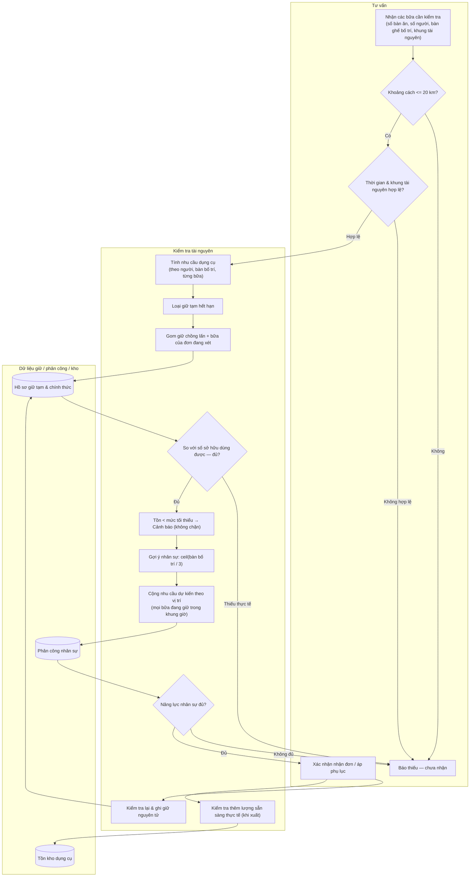

# Kiểm tra khả năng phục vụ

## Phạm vi

UC liên quan: UC-DT-04, UC-DT-05, UC-HD-05, UC-NS-02, UC-KHO-06. Tra tại [danh mục chung](../index.md). Quy tắc tại [đặc tả](../../specification.md); lớp tại [mô hình](../class.md).

## Lưu ý và giới hạn

- Không kiểm tra xe vận chuyển, thời tiết, giấy chứng nhận sức khỏe, lịch nghỉ phép cá nhân, API bản đồ tự động hoặc tồn kho nguyên liệu (chỉ kiểm tra dụng cụ và nhân sự).
- Lượng giữ chỗ đã xuất kho thực tế không bị trừ hai lần vào năng lực khả dụng (tuân thủ bất biến tại [`class.md`](../class.md)).
- Ngưỡng tồn tối thiểu chỉ đóng vai trò cảnh báo trên Dashboard; chỉ khi thiếu thực tế so với sở hữu khả dụng mới từ chối nhận đơn.
