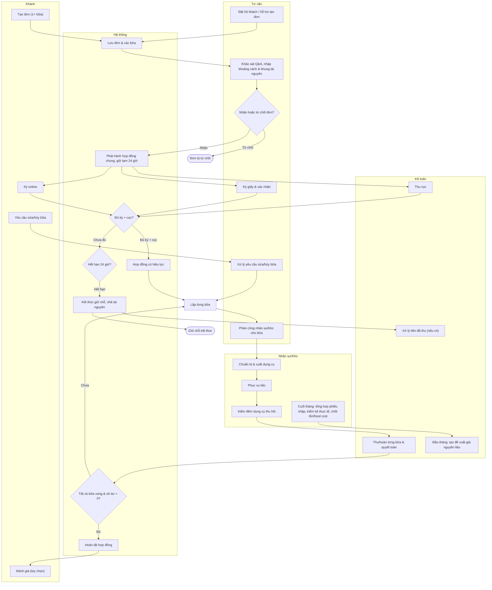

# Quy trình tổng thể

## Phạm vi

UC liên quan: UC-DT-02, UC-DT-03, UC-DT-04, UC-DT-05, UC-HD-01, UC-HD-02, UC-HD-03, UC-HD-04, UC-NS-02, UC-KHO-06, UC-KHO-07, UC-HD-08. Tra tại [danh mục chung](../index.md). Quy tắc tại [đặc tả](../../specification.md); lớp tại [mô hình](../class.md).

## Thành phần

Các lane: Khách — Tư vấn — Hệ thống — Nhân sự/Kho — Kế toán.

## Nội dung cần thể hiện

1. Tạo đơn một hoặc nhiều bữa, khách tự đặt hoặc tư vấn đặt hộ.
2. Khảo sát Q&A, nhập khoảng cách và khung tài nguyên; nhận hoặc từ chối đơn.
3. Phát hành hợp đồng chung, giữ tạm 24 giờ; hai nhánh ký online/ký giấy và thu cọc hội tụ tại điều kiện đủ ký+cọc.
4. Hết hạn chưa đủ: kết thúc giữ chỗ, nhả tài nguyên, kế toán xử lý tiền đã thu nếu có. Đủ: có hiệu lực.
5. Lặp theo từng bữa: phân công, chuẩn bị và xuất dụng cụ, phục vụ, kiểm đếm, thu/hoàn và hoàn tất.
6. Có yêu cầu sửa/hủy trước tiệc thì xử lý đúng bữa theo quy tắc, không dừng các bữa còn lại.
7. Tất cả bữa xử lý xong và số dư hợp đồng 0 thì hoàn tất. Đánh giá tùy chọn theo bữa.
8. Luồng cuối tháng độc lập: tổng hợp phiếu nhập, kiểm kê thực tế, chốt tồn/food cost. Đầu tháng tạo đề xuất giá.

## Nhánh và giới hạn

Không vẽ các bước tại hiện trường như check-in, ký bàn giao, chụp ảnh hay thu hồi một phần. Hủy/sửa tham chiếu sequence riêng, không mở rộng mọi nhánh tại đây.
