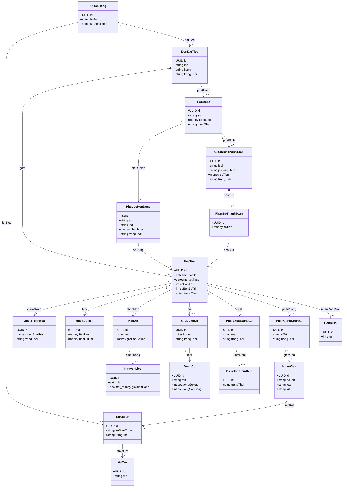
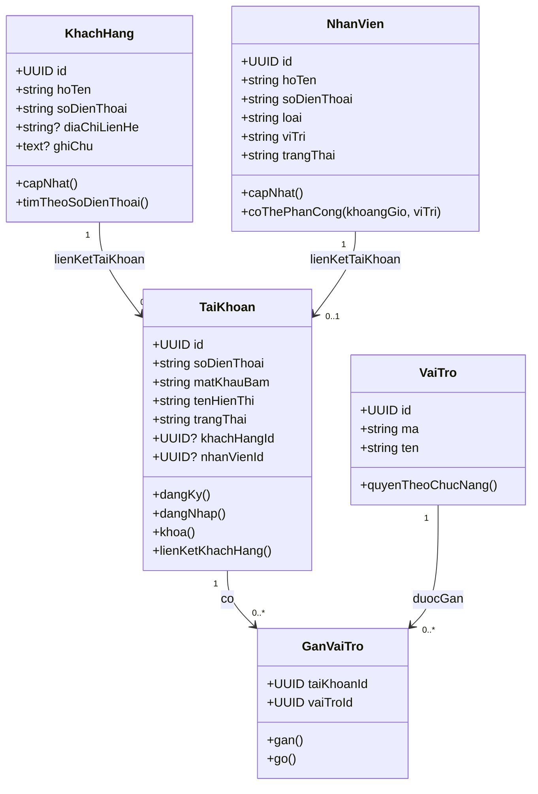
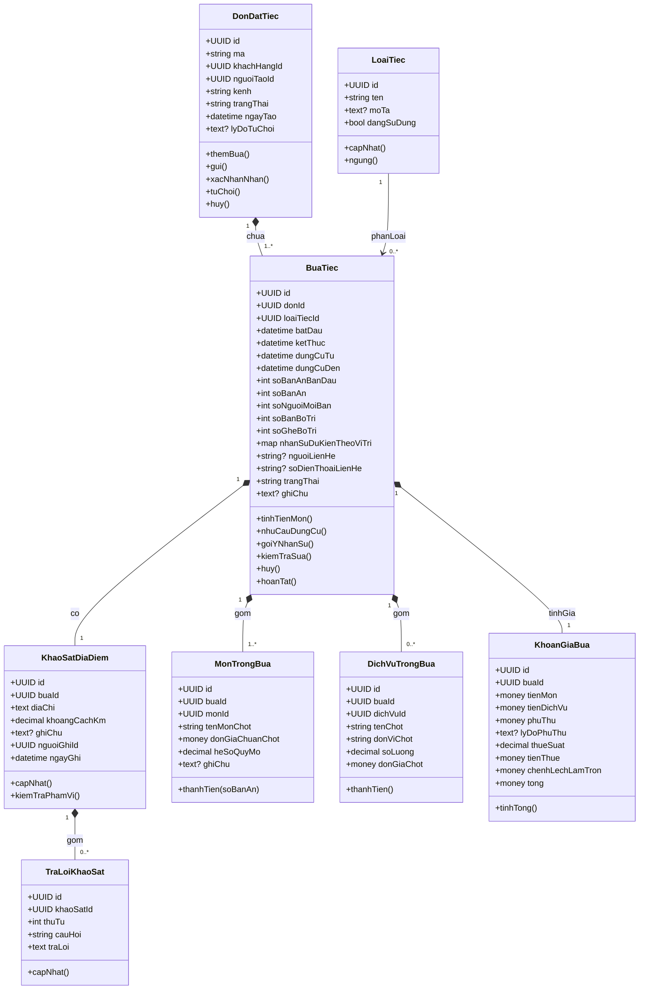
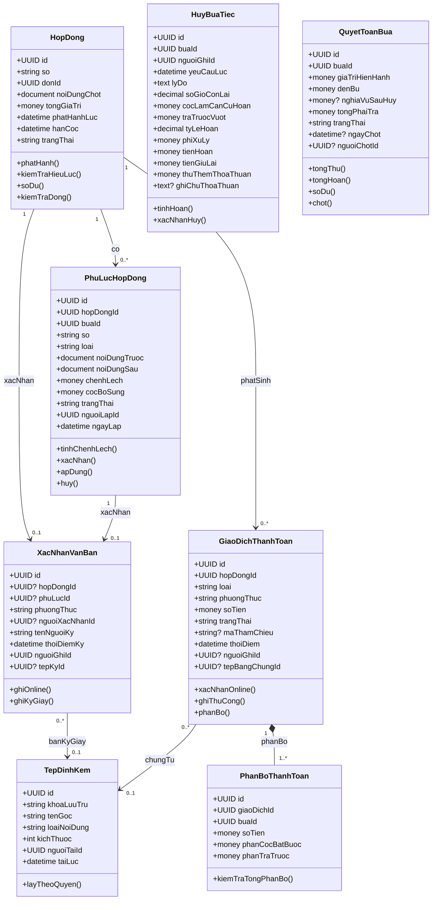
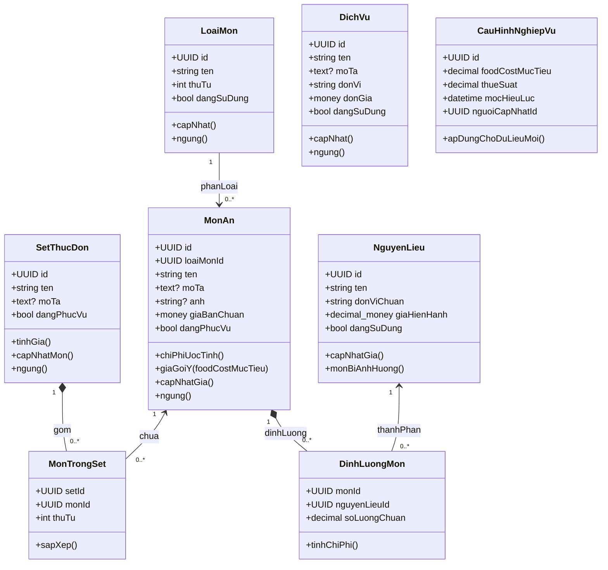
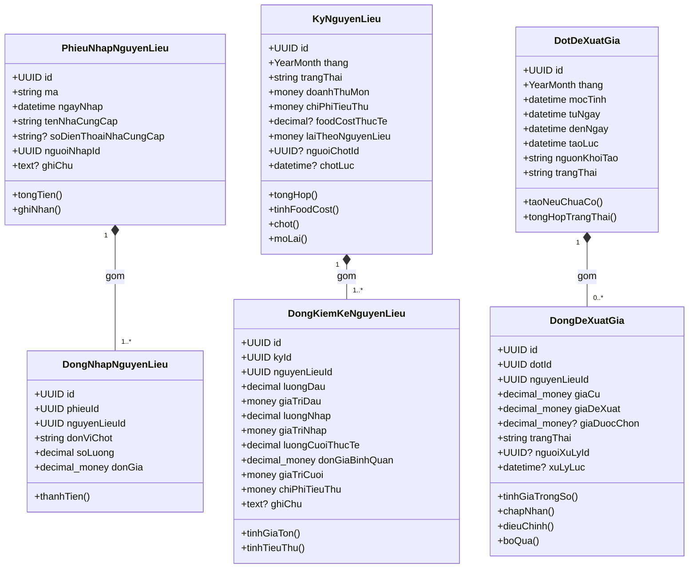
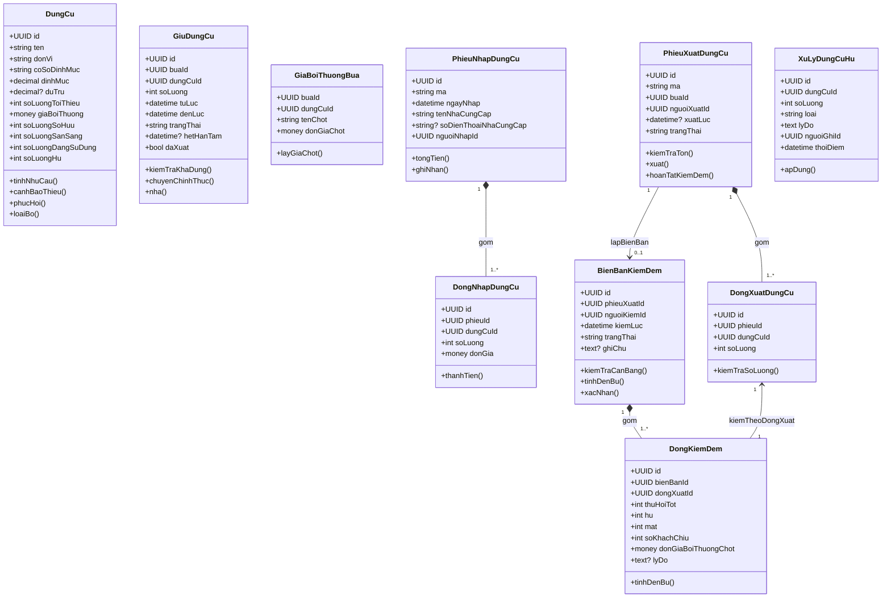
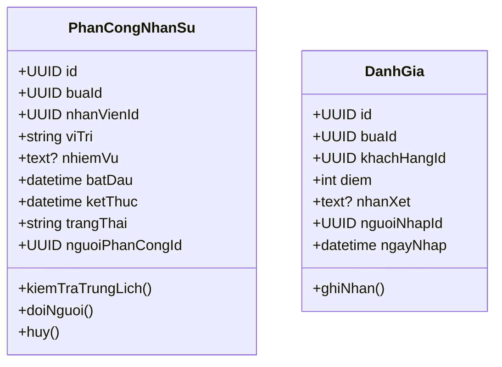

# Mô hình lớp chi tiết

Đây là mô hình lớp chi tiết và đặc tả nghiệp vụ. [Đặc tả phần mềm](../specification.md) làm gốc quy tắc BR. Không sao chép mô hình sang spec.

## Quy ước

- `UUID`: định danh; `?`: tùy chọn; `money`: tiền VNĐ nguyên; `decimal-money`: giá/đơn vị cần độ chính xác trước khi làm tròn; `decimal`: lượng/tỷ lệ chính xác; `datetime`: thời điểm có múi giờ.
- `YearMonth`: tháng theo giờ Việt Nam. Tỷ lệ trong lưu trữ thống nhất dạng thập phân, giao diện hiển thị %.
- Thuộc tính tổng hợp có thể tính khi đọc; nếu lưu bản chốt phải cập nhật nguyên tử và không coi là nguồn tiền thứ hai.
- Các model sau là mô hình miền, không yêu cầu mỗi lớp tương ứng một bảng hoặc tự tạo CRUD cho mọi lớp.
- Các giá và nội dung chốt là dữ liệu lịch sử, không liên kết động để thay đổi theo danh mục mới.

## Sơ đồ lớp tổng quan

Sơ đồ tổng quan thể hiện kiến trúc miền (domain model) và mối liên kết cốt lõi giữa các phân hệ:

## Tài khoản và khách hàng

### Ràng buộc nghiệp vụ

- **TaiKhoan**: Không bắt buộc phải có tài khoản để lưu hồ sơ khách hàng hoặc hồ sơ nhân sự.
- **VaiTro**: Vai trò hệ thống cố định theo bảng quyền đặc tả, không có quy trình phê duyệt cấp quyền động.
- **GanVaiTro**: Cặp tài khoản–vai trò là duy nhất; quyền của người dùng là hợp các vai trò được gán.
- **KhachHang**: Khóa định danh hồ sơ là số điện thoại chuẩn hóa. Khách hàng đăng ký tài khoản mới cùng số điện thoại sẽ tự động liên kết với hồ sơ khách đã tạo qua đặt hộ trước đó.
- **NhanVien**: Vị trí chuyên môn (Bếp, Phục vụ, Vận chuyển, Kiểm đếm) là thông tin nghiệp vụ phân công ca, không phải vai trò tài khoản hệ thống. Không quản lý chấm công/lương.

## Đơn, bữa và khảo sát

### Ràng buộc nghiệp vụ

- **DonDatTiec**: Đơn tiệc hỗ trợ một hoặc nhiều bữa tiệc; bản nháp chưa gửi chỉ lưu ở trình duyệt, hệ thống chỉ lưu khi người dùng gửi đơn (`ChoXacNhan`).
- **BuaTiec**: Phân biệt rõ số bàn ăn và số bàn ghế bố trí thực tế. Khung thời gian sử dụng tài nguyên được nhập thủ công. Thực đơn, khảo sát và phân công độc lập theo từng bữa.
- **LoaiTiec**: Phân loại phục vụ quản lý và thống kê, không tự động gợi ý món tâm linh/văn hóa.
- **KhaoSatDiaDiem & TraLoiKhaoSat**: Mỗi bữa tiệc có một bản khảo sát địa điểm riêng; câu hỏi và câu trả lời lưu trực tiếp tại khảo sát, không dùng chung câu trả lời giữa các bữa.
- **MonTrongBua & DichVuTrongBua**: Lưu danh sách món và dịch vụ chốt cố định của bữa tiệc, không liên kết động theo danh mục hiện hành sau khi hợp đồng phát hành.
- **KhoanGiaBua**: Đúng một bảng tính giá hiện hành cho mỗi bữa tiệc. Giá trong hợp đồng chốt là dữ liệu lịch sử bất biến.

## Hợp đồng, điều chỉnh và tiền

### Ràng buộc nghiệp vụ

- **HopDong**: Một hợp đồng bao phủ tất cả các bữa tiệc của đơn. Nội dung lưu đủ danh sách bữa, đơn giá và điều khoản chốt; không phụ thuộc thay đổi danh mục sau này.
- **XacNhanVanBan**: Gắn với đúng một Hợp đồng hoặc Phụ lục; phương thức ký giấy bắt buộc đính kèm tệp văn bản ký scan. Ký online lưu tài khoản khách hàng, không dùng OTP.
- **PhuLucHopDong**: Một phụ lục cho đúng một bữa tiệc; không cho phép dời ngày tiệc. Mỗi bữa chỉ có tối đa một phụ lục chưa xử lý để tránh xung đột dữ liệu.
- **HuyBuaTiec**: Lưu kết quả và căn cứ hoàn tiền độc lập cho từng bữa tiệc; hủy toàn hợp đồng tạo kết quả cho từng bữa tương ứng.
- **GiaoDichThanhToan & PhanBoThanhToan**: Mọi số tiền giao dịch là số dương (loại `Hoan` quyết định chiều chi). Tổng tiền phân bổ cho các bữa phải bằng chính xác số tiền giao dịch.
- **QuyetToanBua**: Số tiền đã thu/hoàn và số dư tính từ các giao dịch thành công. Bữa tiệc bị hủy thay thế tiền phục vụ bằng nghĩa vụ thanh toán sau hủy.

## Danh mục món và nguyên liệu

### Ràng buộc nghiệp vụ

- **LoaiMon & MonAn**: Phân nhóm để lọc danh mục; món ăn tự chọn tối thiểu 6 món cho một tiệc. Đơn giá chuẩn áp dụng cho bàn ăn chuẩn 10 người.
- **SetThucDon**: Đơn giá set tính bằng tổng đơn giá các món thành phần, không cộng thêm biên lợi nhuận kép. Bữa tiệc lưu danh sách món chốt, không trỏ động vào set.
- **MonTrongSet**: Cặp set–món là duy nhất.
- **NguyenLieu & DinhLuongMon**: Định lượng xác định lượng nguyên liệu cho 1 bàn ăn chuẩn 10 người (cặp món–nguyên liệu là duy nhất). Đơn giá hiện hành dùng để tính chi phí ước tính và đề xuất giá bán món.
- **DichVu**: Do cơ sở tự cung cấp (trang trí, âm thanh,...); không quản lý đối tác thuê ngoài.
- **CauHinhNghiepVu**: Tham số nghiệp vụ toàn hệ thống (food cost mục tiêu, thuế suất,...), áp dụng cho các tính toán và đơn tiệc tạo mới.

## Nhập, kiểm kê và food cost

### Ràng buộc nghiệp vụ

- **PhieuNhapNguyenLieu & DongNhapNguyenLieu**: Ghi nhận lượng và đơn giá thực mua; không bắt buộc gắn trực tiếp với bữa tiệc. Lượng $>0$, đơn giá $\ge 0$.
- **KyNguyenLieu & DongKiemKeNguyenLieu**: Kiểm kê và chốt kỳ theo tháng. Tiêu thụ = Giá trị đầu + Nhập − Cuối kỳ. Không xuất kho trừ nguyên liệu sau từng bữa tiệc.
- **DotDeXuatGia & DongDeXuatGia**: Khởi tạo mốc tính ngày đầu tháng; tính bình quân trọng số 30 ngày gần nhất (khoảng cách 10 ngày tương ứng 1.5; 1.5; 2). Giá đề xuất độc lập với giá trị tồn kho.

## Dụng cụ và tài nguyên

### Ràng buộc nghiệp vụ

- **DungCu**: Bất biến sở hữu: $\text{Sở hữu} = \text{Sẵn sàng} + \text{Đang sử dụng} + \text{Hư}$. Tồn tối thiểu là ngưỡng cảnh báo bổ sung, không chặn cứng quy trình nếu đủ lượng dùng được.
- **GiuDungCu**: Giữ tạm (24 giờ) hoặc giữ chính thức; phân biệt rõ với xuất kho để tránh trừ kho hai lần vào năng lực khả dụng tương lai.
- **GiaBoiThuongBua**: Đơn giá bồi thường được chốt trong hợp đồng trước khi diễn ra tiệc, không áp dụng đơn giá thị trường tại thời điểm kiểm đếm.
- **PhieuNhapDungCu & DongNhapDungCu**: Nhập mua bổ sung trực tiếp làm tăng sẵn sàng và tăng sở hữu.
- **PhieuXuatDungCu, BienBanKiemDem & DongKiemDem**: Một bữa tối đa một phiếu xuất và một biên bản kiểm đếm đầy đủ. Điều kiện cân bằng bắt buộc: $\text{Tốt} + \text{Hư} + \text{Mất} = \text{Xuất}$; $0 \le \text{Khách chịu} \le \text{Hư} + \text{Mất}$.
- **XuLyDungCuHu**: Ghi nhận lượng phục hồi (chuyển sang sẵn sàng) hoặc loại bỏ (giảm lượng hư và giảm sở hữu).

## Phân công và đánh giá

### Ràng buộc nghiệp vụ

- **PhanCongNhanSu**: Khung giờ làm việc có thể bao phủ hoặc lệch so với giờ phục vụ của bữa. Kiểm tra chặn trùng lịch khi phân công người cụ thể. Năng lực nhân sự chung được dự trù theo vị trí của các bữa đang giữ trước khi gán người đích danh.
- **DanhGia**: Mỗi bữa tiệc tối đa một đánh giá (điểm 1–5), chỉ mở khi bữa tiệc đã chuyển trạng thái `HoanTat`. Người đánh giá phải là người đặt của đơn chứa bữa đó.

## Dịch vụ miền (Domain Services)

## Các bất biến miền (Domain Invariants)

1. Bữa tiệc, phụ lục, giao dịch phân bổ, quyết toán và giữ tài nguyên không được trỏ chéo giữa hai hợp đồng.
2. Khách hàng online chỉ xem hồ sơ liên kết số điện thoại của mình; quyền nội bộ xác định theo bảng phân quyền của vai trò.
3. Tổng thu/hoàn tiền tính từ các giao dịch thành công; tổng phân bổ theo bữa phải bằng đúng số tiền giao dịch; số dư chỉ tính một lần tiền cọc.
4. Hủy một bữa tiệc chỉ nhả giữ tài nguyên và hủy phân công của bữa đó, không làm ảnh hưởng đến dữ liệu các bữa khác trong cùng đơn.
5. Tính khả dụng tương lai theo tổng sở hữu dùng được trừ đi các khoảng giữ chồng lấn; tại thời điểm xuất kho kiểm tra thêm lượng sẵn sàng thực tế. Giữ đã xuất kho không bị trừ hai lần.
6. Kho nguyên liệu chỉ kiểm kê theo chu kỳ tháng và lưu phiếu nhập; không phát sinh phiếu xuất kho hay tính tiêu hao nguyên liệu chi tiết theo từng tiệc.
7. Giá trị tồn kho sử dụng đơn giá bình quân tháng; giá nguyên liệu hiện hành dùng đơn giá đề xuất bình quân gia quyền 30 ngày; hai giá trị không dùng thay thế lẫn nhau.
8. Đợt đề xuất giá là duy nhất theo tháng; kỳ nguyên liệu duy nhất theo tháng; đánh giá duy nhất theo bữa; mã giao dịch thanh toán phía đối tác cung cấp là duy nhất.
9. Danh mục đã có lịch sử phát sinh dữ liệu chỉ được phép ngưng sử dụng, không xóa. Nội dung hợp đồng/phụ lục đã xác nhận và giao dịch đã thành công không sửa đè.
