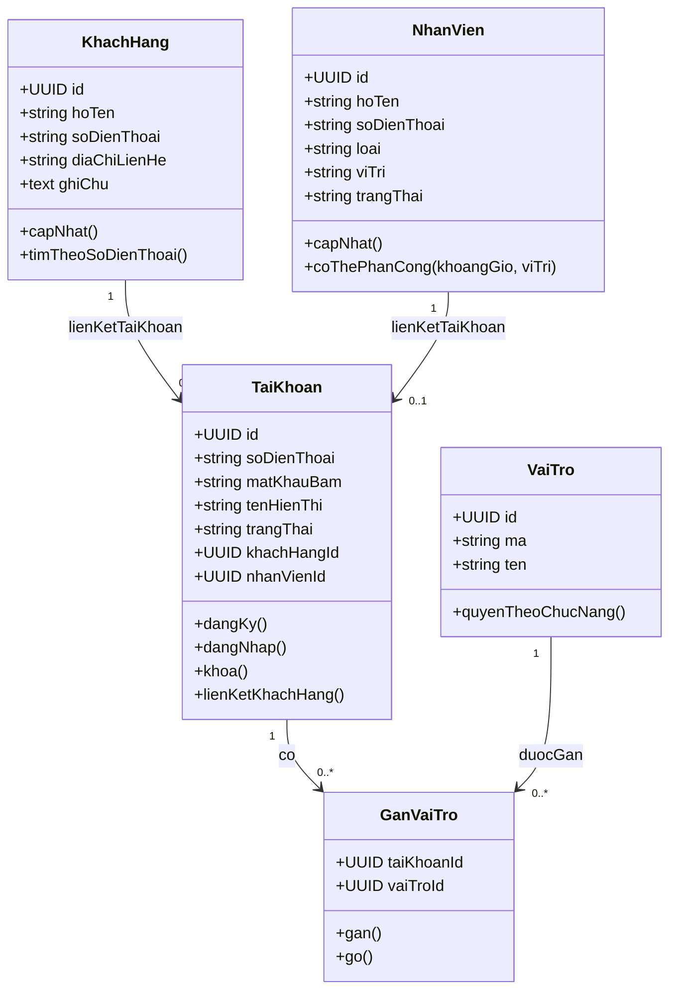
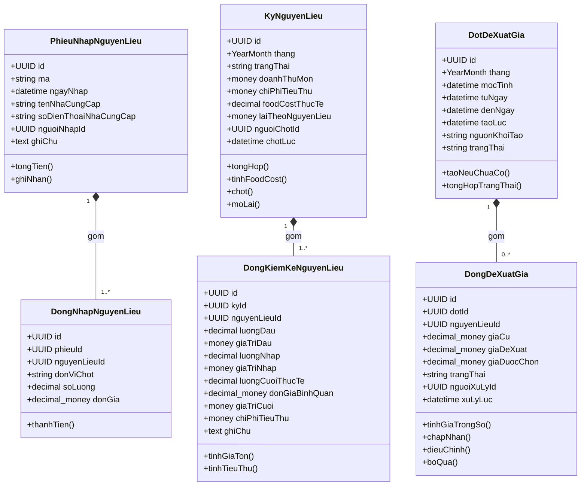
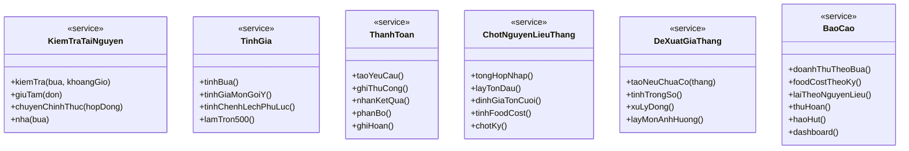

# Mô hình lớp chi tiết

Đây là mô hình lớp chi tiết và đặc tả nghiệp vụ. [Đặc tả phần mềm](../specification.md) làm gốc quy tắc BR. Không sao chép mô hình sang spec.

## Quy ước

- `UUID`: định danh; `?`: tùy chọn; `money`: tiền VNĐ nguyên; `decimal-money`: giá/đơn vị cần độ chính xác trước khi làm tròn; `decimal`: lượng/tỷ lệ chính xác; `datetime`: thời điểm có múi giờ.
- `YearMonth`: tháng theo giờ Việt Nam. Tỷ lệ trong lưu trữ thống nhất dạng thập phân, giao diện hiển thị %.
- Thuộc tính tổng hợp có thể tính khi đọc; nếu lưu bản chốt phải cập nhật nguyên tử và không coi là nguồn tiền thứ hai.
- Các model sau là mô hình miền, không yêu cầu mỗi lớp tương ứng một bảng hoặc tự tạo CRUD cho mọi lớp.
- Các giá và nội dung chốt là dữ liệu lịch sử, không liên kết động để thay đổi theo danh mục mới.

## Tài khoản và khách hàng

### TaiKhoan

| Thành phần | Nội dung |
| --- | --- |
| Thuộc tính | id: UUID; soDienThoai: string duy nhất; matKhauBam: string; tenHienThi: string; trangThai: HoatDong/Khoa; khachHangId?: UUID; nhanVienId?: UUID |
| Hành vi chính | dangKy(); dangNhap(); khoa(); lienKetKhachHang() |
| Ràng buộc | Không cần tài khoản để có hồ sơ khách/nhân sự. |

### VaiTro

| Thành phần | Nội dung |
| --- | --- |
| Thuộc tính | id: UUID; ma: enum KhachHang/QuanLyCoSo/TuVan/KeToan/ThuKho/QuanLyNhanSu; ten: string |
| Hành vi chính | quyenTheoChucNang() |
| Ràng buộc | Vai trò cố định theo bảng quyền spec, không thêm quy trình duyệt quyền. |

### GanVaiTro

| Thành phần | Nội dung |
| --- | --- |
| Thuộc tính | taiKhoanId: UUID; vaiTroId: UUID |
| Hành vi chính | gan(); go() |
| Ràng buộc | Cặp tài khoản–vai trò duy nhất; quyền là hợp các vai trò. |

### KhachHang

| Thành phần | Nội dung |
| --- | --- |
| Thuộc tính | id: UUID; hoTen: string; soDienThoai: string duy nhất; diaChiLienHe?: string; ghiChu?: text |
| Hành vi chính | capNhat(); timTheoSoDienThoai() |
| Ràng buộc | Một người/tên cho mỗi SĐT chuẩn hóa. Khách đăng ký cùng SĐT liên kết hồ sơ đặt hộ, không OTP. |

### NhanVien

| Thành phần | Nội dung |
| --- | --- |
| Thuộc tính | id: UUID; hoTen: string; soDienThoai: string; loai: CoDinh/ThoiVu; viTri: tập Bep/PhucVu/VanChuyen/KiemDem; trangThai: DangLam/NgungLam |
| Hành vi chính | capNhat(); coThePhanCong(khoangGio, viTri) |
| Ràng buộc | Vị trí nghiệp vụ không phải vai trò tài khoản. Không lương/chấm công. |

## Đơn, bữa và khảo sát

### DonDatTiec

| Thành phần | Nội dung |
| --- | --- |
| Thuộc tính | id: UUID; ma: string duy nhất; khachHangId: UUID; nguoiTaoId: UUID; kenh: Web/DienThoai/Zalo/TrucTiep; trangThai: ChoXacNhan/DaNhan/BiTuChoi/HetHan/DaHuy; ngayTao: datetime; lyDoTuChoi?: text |
| Hành vi chính | themBua(); gui(); xacNhanNhan(); tuChoi(); huy() |
| Ràng buộc | Đơn nhiều bữa; nháp chưa gửi ở trình duyệt, không trạng thái nháp lưu server. |

### BuaTiec

| Thành phần | Nội dung |
| --- | --- |
| Thuộc tính | id: UUID; donId: UUID; loaiTiecId: UUID; batDau: datetime; ketThuc: datetime; dungCuTu: datetime; dungCuDen: datetime; soBanAnBanDau: int; soBanAn: int; soNguoiMoiBan: int; soBanBoTri: int; soGheBoTri: int; nhanSuDuKienTheoViTri: map vị trí–số người; nguoiLienHe?: string; soDienThoaiLienHe?: string; trangThai: enum; ghiChu?: text |
| Hành vi chính | tinhTienMon(); nhuCauDungCu(); goiYNhanSu(); kiemTraSua(); huy(); hoanTat() |
| Ràng buộc | Tách bàn ăn khỏi bàn ghế; thực đơn, khảo sát và phân công riêng. Khung tài nguyên nhập thủ công. |

### LoaiTiec

| Thành phần | Nội dung |
| --- | --- |
| Thuộc tính | id: UUID; ten: string; moTa?: text; dangSuDung: bool |
| Hành vi chính | capNhat(); ngung() |
| Ràng buộc | Chỉ phân loại, không tự gợi ý văn hóa/món cúng, không đám tang. |

### KhaoSatDiaDiem

| Thành phần | Nội dung |
| --- | --- |
| Thuộc tính | id: UUID; buaId: UUID duy nhất; diaChi: text; khoangCachKm: decimal; ghiChu?: text; nguoiGhiId: UUID; ngayGhi: datetime |
| Hành vi chính | capNhat(); kiemTraPhamVi() |
| Ràng buộc | Không tái sử dụng địa điểm giữa các bữa; không tọa độ/API bản đồ. Mỗi bữa có địa chỉ từ lúc tạo, câu trả lời có thể bổ sung khi tư vấn. |

### TraLoiKhaoSat

| Thành phần | Nội dung |
| --- | --- |
| Thuộc tính | id: UUID; khaoSatId: UUID; thuTu: int; cauHoi: string; traLoi: text |
| Hành vi chính | capNhat() |
| Ràng buộc | Câu hỏi/đáp án lưu tại khảo sát, không cần hệ quản lý bộ câu hỏi riêng. Gợi ý điện, nước, chỗ nấu, tầng/thang máy, xe tiếp cận, diện tích. |

### MonTrongBua

| Thành phần | Nội dung |
| --- | --- |
| Thuộc tính | id: UUID; buaId: UUID; monId: UUID; tenMonChot: string; donGiaChuanChot: money; heSoQuyMo: decimal; ghiChu?: text |
| Hành vi chính | thanhTien(soBanAn) |
| Ràng buộc | Một dòng cho mỗi món; đổi món là thay dòng qua phụ lục, không thêm món sau ký. |

### DichVuTrongBua

| Thành phần | Nội dung |
| --- | --- |
| Thuộc tính | id: UUID; buaId: UUID; dichVuId: UUID; tenChot: string; donViChot: string; soLuong: decimal; donGiaChot: money |
| Hành vi chính | thanhTien() |
| Ràng buộc | Dịch vụ do cơ sở cung cấp; không đối tác thuê ngoài hoặc phát sinh trong tiệc. |

### KhoanGiaBua

| Thành phần | Nội dung |
| --- | --- |
| Thuộc tính | id: UUID; buaId: UUID; tienMon: money; tienDichVu: money; phuThu: money; lyDoPhuThu?: text; thueSuat: decimal; tienThue: money; chenhLechLamTron: money; tong: money |
| Hành vi chính | tinhTong() |
| Ràng buộc | Đúng một bảng giá hiện hành/bữa; bản hợp đồng/phụ lục giữ bản nội dung bất biến. Giá gợi ý chưa phải giá chốt. |

## Hợp đồng, điều chỉnh và tiền

### HopDong

| Thành phần | Nội dung |
| --- | --- |
| Thuộc tính | id: UUID; so: string duy nhất; donId: UUID duy nhất; noiDungChot: text/document; tongGiaTri: money; phatHanhLuc: datetime; hanCoc: datetime; trangThai: ChoXacNhanCoc/CoHieuLuc/HetHan/DaHuy/HoanTat |
| Hành vi chính | phatHanh(); kiemTraHieuLuc(); soDu(); kiemTraDong() |
| Ràng buộc | Một hợp đồng bao phủ các bữa của đơn. Nội dung lưu đủ danh sách bữa/giá/điều khoản chốt, không phụ thuộc danh mục hiện hành. |

### XacNhanVanBan

| Thành phần | Nội dung |
| --- | --- |
| Thuộc tính | id: UUID; hopDongId?: UUID; phuLucId?: UUID; phuongThuc: Online/KyGiay; nguoiXacNhanId?: UUID; tenNguoiKy: string; thoiDiemKy: datetime; nguoiGhiId: UUID; tepKyId?: UUID |
| Hành vi chính | ghiOnline(); ghiKyGiay() |
| Ràng buộc | Thuộc đúng một hợp đồng hoặc phụ lục; ký giấy bắt buộc file. Online lưu tài khoản khách; không OTP/chữ ký số. |

### PhuLucHopDong

| Thành phần | Nội dung |
| --- | --- |
| Thuộc tính | id: UUID; hopDongId: UUID; buaId: UUID; so: string; loai: DoiMon/SoBanAn; noiDungTruoc: document; noiDungSau: document; chenhLech: money; cocBoSung: money; trangThai: ChoXacNhan/ChoCocBoSung/DaApDung/DaHuy; nguoiLapId: UUID; ngayLap: datetime |
| Hành vi chính | tinhChenhLech(); xacNhan(); apDung(); huy() |
| Ràng buộc | Một phụ lục cho một bữa; không dời ngày. Chỉ một phụ lục chưa xử lý cho cùng bữa để tránh áp thay đổi xung đột. |

### HuyBuaTiec

| Thành phần | Nội dung |
| --- | --- |
| Thuộc tính | id: UUID; buaId: UUID duy nhất; nguoiGhiId: UUID; yeuCauLuc: datetime; lyDo: text; soGioConLai: decimal; cocLamCanCuHoan: money; traTruocVuot: money; tyLeHoan: decimal; phiXuLy: money; tienHoan: money; tienGiuLai: money; thuThemThoaThuan: money; ghiChuThoaThuan?: text |
| Hành vi chính | tinhHoan(); xacNhanHuy() |
| Ràng buộc | Một lần hủy/bữa; lưu kết quả và căn cứ để sửa chính sách sau không đổi lịch sử. Hủy toàn hợp đồng tạo kết quả từng bữa, không cần thêm đối tượng hủy bao ngoài. |

### GiaoDichThanhToan

| Thành phần | Nội dung |
| --- | --- |
| Thuộc tính | id: UUID; hopDongId: UUID; loai: Coc/CocBoSung/ThanhToanCuoi/Hoan; phuongThuc: TienMat/Online/ChuyenKhoanThuCong; soTien: money; trangThai: Cho/ThanhCong/ThatBai; maThamChieu?: string duy nhất theo nhà cung cấp; thoiDiem: datetime; nguoiGhiId?: UUID; tepBangChungId?: UUID |
| Hành vi chính | xacNhanOnline(); ghiThuCong(); phanBo() |
| Ràng buộc | Mọi số tiền giao dịch dương; loại Hoan quyết định chiều chi. Không sửa cọc thành hoàn, không thêm bảng công nợ. |

### PhanBoThanhToan

| Thành phần | Nội dung |
| --- | --- |
| Thuộc tính | id: UUID; giaoDichId: UUID; buaId: UUID; soTien: money; phanCocBatBuoc: money; phanTraTruoc: money |
| Hành vi chính | kiemTraTongPhanBo() |
| Ràng buộc | Tổng dòng bằng giao dịch. Phần bắt buộc + trả trước bằng số phân bổ đối với thu cọc; hoàn liên kết đúng bữa có nghĩa vụ hoàn. |

### QuyetToanBua

| Thành phần | Nội dung |
| --- | --- |
| Thuộc tính | id: UUID; buaId: UUID duy nhất; giaTriHienHanh: money; denBu: money; nghiaVuSauHuy?: money; tongPhaiTra: money; trangThai: ChoXuLy/HoanTat; ngayChot?: datetime; nguoiChotId?: UUID |
| Hành vi chính | tongThu(); tongHoan(); soDu(); chot() |
| Ràng buộc | Số đã thu/hoàn và số dư tính từ giao dịch thành công, không nhập thêm cột khách nợ độc lập. Bữa hủy thay tiền phục vụ bằng nghĩa vụ sau hủy. |

### TepDinhKem

| Thành phần | Nội dung |
| --- | --- |
| Thuộc tính | id: UUID; khoaLuuTru: string; tenGoc: string; loaiNoiDung: string; kichThuoc: int; nguoiTaiId: UUID; taiLuc: datetime |
| Hành vi chính | layTheoQuyen() |
| Ràng buộc | Lưu bản ký, bằng chứng hoàn; kho file có thể dùng S3, chưa chốt API. Không dùng URL công khai thay quyền hồ sơ. |

## Danh mục món và nguyên liệu

### LoaiMon

| Thành phần | Nội dung |
| --- | --- |
| Thuộc tính | id: UUID; ten: string; thuTu: int; dangSuDung: bool |
| Hành vi chính | capNhat(); ngung() |
| Ràng buộc | Phân nhóm để lọc danh mục, không thêm cơ cấu món bắt buộc ngoài tối thiểu 6 món tự chọn. |

### MonAn

| Thành phần | Nội dung |
| --- | --- |
| Thuộc tính | id: UUID; loaiMonId: UUID; ten: string; moTa?: text; anh?: string; giaBanChuan: money; dangPhucVu: bool |
| Hành vi chính | chiPhiUocTinh(); giaGoiY(foodCostMucTieu); capNhatGia(); ngung() |
| Ràng buộc | Giá cho bàn ăn chuẩn 10 người, không giá theo đĩa hoặc món lẻ tại tiệc. |

### SetThucDon

| Thành phần | Nội dung |
| --- | --- |
| Thuộc tính | id: UUID; ten: string; moTa?: text; dangPhucVu: bool |
| Hành vi chính | tinhGia(); capNhatMon(); ngung() |
| Ràng buộc | Giá tính tổng món, không cộng lợi nhuận lần thứ hai; bữa giữ danh sách món đã chốt, không trỏ động vào set. |

### MonTrongSet

| Thành phần | Nội dung |
| --- | --- |
| Thuộc tính | setId: UUID; monId: UUID; thuTu: int |
| Hành vi chính | sapXep() |
| Ràng buộc | Cặp set–món duy nhất. |

### NguyenLieu

| Thành phần | Nội dung |
| --- | --- |
| Thuộc tính | id: UUID; ten: string; donViChuan: string; giaHienHanh: decimal-money; dangSuDung: bool |
| Hành vi chính | capNhatGia(); monBiAnhHuong() |
| Ràng buộc | Giá hiện hành để định lượng, khác giá trị tồn kiểm kê; không có soLuongTon trừ theo từng tiệc. |

### DinhLuongMon

| Thành phần | Nội dung |
| --- | --- |
| Thuộc tính | monId: UUID; nguyenLieuId: UUID; soLuongChuan: decimal |
| Hành vi chính | tinhChiPhi() |
| Ràng buộc | Lượng cho 1 bàn ăn chuẩn; cặp món–nguyên liệu duy nhất, không hao hụt sơ chế. |

### DichVu

| Thành phần | Nội dung |
| --- | --- |
| Thuộc tính | id: UUID; ten: string; moTa?: text; donVi: string; donGia: money; dangSuDung: bool |
| Hành vi chính | capNhat(); ngung() |
| Ràng buộc | Trang trí, dọn dẹp, âm thanh… do cơ sở tự cung cấp. |

### CauHinhNghiepVu

| Thành phần | Nội dung |
| --- | --- |
| Thuộc tính | id: UUID; foodCostMucTieu: decimal; thueSuat: decimal; mocHieuLuc: datetime; nguoiCapNhatId: UUID |
| Hành vi chính | apDungChoDuLieuMoi() |
| Ràng buộc | Tham số khác theo spec. Các ngưỡng chốt trong code/config cần ghi rõ tại spec; không thêm hàng chục tham số từ bản AI cũ. |

## Nhập, kiểm kê và food cost

### PhieuNhapNguyenLieu

| Thành phần | Nội dung |
| --- | --- |
| Thuộc tính | id: UUID; ma: string duy nhất; ngayNhap: datetime; tenNhaCungCap: string; soDienThoaiNhaCungCap?: string; nguoiNhapId: UUID; ghiChu?: text |
| Hành vi chính | tongTien(); ghiNhan() |
| Ràng buộc | Không bắt buộc gắn bữa, không quản lý PO/công nợ NCC. |

### DongNhapNguyenLieu

| Thành phần | Nội dung |
| --- | --- |
| Thuộc tính | id: UUID; phieuId: UUID; nguyenLieuId: UUID; donViChot: string; soLuong: decimal; donGia: decimal-money |
| Hành vi chính | thanhTien() |
| Ràng buộc | Lượng và giá theo đơn vị chuẩn; lượng > 0, giá >= 0. |

### KyNguyenLieu

| Thành phần | Nội dung |
| --- | --- |
| Thuộc tính | id: UUID; thang: YearMonth duy nhất; trangThai: DangNhap/DaChot; doanhThuMon: money; chiPhiTieuThu: money; foodCostThucTe?: decimal; laiTheoNguyenLieu: money; nguoiChotId?: UUID; chotLuc?: datetime |
| Hành vi chính | tongHop(); tinhFoodCost(); chot(); moLai() |
| Ràng buộc | Chốt tuần tự tháng; nếu sửa tháng cũ đánh dấu các tháng sau cần chốt lại. Không xuất kho sau mỗi tiệc. |

### DongKiemKeNguyenLieu

| Thành phần | Nội dung |
| --- | --- |
| Thuộc tính | id: UUID; kyId: UUID; nguyenLieuId: UUID; luongDau: decimal; giaTriDau: money; luongNhap: decimal; giaTriNhap: money; luongCuoiThucTe: decimal; donGiaBinhQuan: decimal-money; giaTriCuoi: money; chiPhiTieuThu: money; ghiChu?: text |
| Hành vi chính | tinhGiaTon(); tinhTieuThu() |
| Ràng buộc | Cặp kỳ–nguyên liệu duy nhất. Đầu kỳ kế thừa kỳ trước; tháng đầu khai lượng/giá ban đầu. Nhập do tổng hợp phiếu, cuối do kiểm kê. |

### DotDeXuatGia

| Thành phần | Nội dung |
| --- | --- |
| Thuộc tính | id: UUID; thang: YearMonth duy nhất; mocTinh: datetime; tuNgay: datetime; denNgay: datetime; taoLuc: datetime; nguonKhoiTao: Cron/KiemTraBu; trangThai: ChoXuLy/DaXuLy |
| Hành vi chính | taoNeuChuaCo(); tongHopTrangThai() |
| Ràng buộc | Mốc tính luôn đầu tháng kể cả chạy bù; một giao dịch tạo đủ đợt/dòng, không cần model lịch nhắc. |

### DongDeXuatGia

| Thành phần | Nội dung |
| --- | --- |
| Thuộc tính | id: UUID; dotId: UUID; nguyenLieuId: UUID; giaCu: decimal-money; giaDeXuat: decimal-money; giaDuocChon?: decimal-money; trangThai: ChoXuLy/ChapNhan/DieuChinh/BoQua; nguoiXuLyId?: UUID; xuLyLuc?: datetime |
| Hành vi chính | tinhGiaTrongSo(); chapNhan(); dieuChinh(); boQua() |
| Ràng buộc | Cặp đợt–nguyên liệu duy nhất; lưu tổng lượng/giá trị có trọng số hoặc căn cứ phiếu nguồn để giải thích đề xuất. |

## Dụng cụ và tài nguyên

### DungCu

| Thành phần | Nội dung |
| --- | --- |
| Thuộc tính | id: UUID; ten: string; donVi: string; coSoDinhMuc: Nguoi/BanBoTri/Bua; dinhMuc: decimal; duTru?: decimal-percent; soLuongToiThieu: int; giaBoiThuong: money; soLuongSoHuu: int; soLuongSanSang: int; soLuongDangSuDung: int; soLuongHu: int |
| Hành vi chính | tinhNhuCau(); canhBaoThieu(); phucHoi(); loaiBo() |
| Ràng buộc | Sở hữu = sẵn sàng + đang sử dụng + hư; mất/loại bỏ đã trừ sở hữu. Không serial, không ngăn chờ vệ sinh riêng. |

### GiuDungCu

| Thành phần | Nội dung |
| --- | --- |
| Thuộc tính | id: UUID; buaId: UUID; dungCuId: UUID; soLuong: int; tuLuc: datetime; denLuc: datetime; trangThai: Tam/ChinhThuc/DaNha; hetHanTam?: datetime; daXuat: bool |
| Hành vi chính | kiemTraKhaDung(); chuyenChinhThuc(); nha() |
| Ràng buộc | Giữ và xuất là hai khái niệm; không trừ kho hai lần. Không chồng tổng giữ vượt sở hữu dùng được. |

### GiaBoiThuongBua

| Thành phần | Nội dung |
| --- | --- |
| Thuộc tính | buaId: UUID; dungCuId: UUID; tenChot: string; donGiaChot: money |
| Hành vi chính | layGiaChot() |
| Ràng buộc | Giá được chốt khi phát hành hợp đồng, trước khi kiểm đếm; không dùng giá hiện hành thay thế. |

### PhieuNhapDungCu

| Thành phần | Nội dung |
| --- | --- |
| Thuộc tính | id: UUID; ma: string duy nhất; ngayNhap: datetime; tenNhaCungCap: string; soDienThoaiNhaCungCap?: string; nguoiNhapId: UUID |
| Hành vi chính | tongTien(); ghiNhan() |
| Ràng buộc | Mua bổ sung kho, không luồng phê duyệt mua hàng. |

### DongNhapDungCu

| Thành phần | Nội dung |
| --- | --- |
| Thuộc tính | id: UUID; phieuId: UUID; dungCuId: UUID; soLuong: int; donGia: money |
| Hành vi chính | thanhTien() |
| Ràng buộc | Ghi nhận một lần làm tăng sẵn sàng và sở hữu. |

### PhieuXuatDungCu

| Thành phần | Nội dung |
| --- | --- |
| Thuộc tính | id: UUID; ma: string duy nhất; buaId: UUID duy nhất; nguoiXuatId: UUID; xuatLuc?: datetime; trangThai: Nhap/DaXuat/DaKiemDem/DaHuy |
| Hành vi chính | kiemTraTon(); xuat(); hoanTatKiemDem() |
| Ràng buộc | Phạm vi đơn giản: một phiếu xuất/bữa, một lần thu hồi đầy đủ; không thu hồi một phần. |

### DongXuatDungCu

| Thành phần | Nội dung |
| --- | --- |
| Thuộc tính | id: UUID; phieuId: UUID; dungCuId: UUID; soLuong: int |
| Hành vi chính | kiemTraSoLuong() |
| Ràng buộc | Cặp phiếu–dụng cụ duy nhất; lượng thực xuất làm căn cứ kiểm đếm. |

### BienBanKiemDem

| Thành phần | Nội dung |
| --- | --- |
| Thuộc tính | id: UUID; phieuXuatId: UUID duy nhất; nguoiKiemId: UUID; kiemLuc: datetime; trangThai: Nhap/DaXacNhan; ghiChu?: text |
| Hành vi chính | kiemTraCanBang(); tinhDenBu(); xacNhan() |
| Ràng buộc | Không biểu mẫu trình bày, không bắt ảnh/chữ ký/GPS. Xác nhận cập nhật tồn và quyết toán nguyên tử. |

### DongKiemDem

| Thành phần | Nội dung |
| --- | --- |
| Thuộc tính | id: UUID; bienBanId: UUID; dongXuatId: UUID duy nhất; thuHoiTot: int; hu: int; mat: int; soKhachChiu: int; donGiaBoiThuongChot: money; lyDo?: text |
| Hành vi chính | tinhDenBu() |
| Ràng buộc | Tốt + hư + mất = xuất; 0 <= khách chịu <= hư + mất. |

### XuLyDungCuHu

| Thành phần | Nội dung |
| --- | --- |
| Thuộc tính | id: UUID; dungCuId: UUID; soLuong: int; loai: PhucHoi/LoaiBo; lyDo: text; nguoiGhiId: UUID; thoiDiem: datetime |
| Hành vi chính | apDung() |
| Ràng buộc | Không tạo hệ quản lý bảo trì phức tạp, chỉ ghi lượng phục hồi/loại bỏ. |

## Phân công và đánh giá

### PhanCongNhanSu

| Thành phần | Nội dung |
| --- | --- |
| Thuộc tính | id: UUID; buaId: UUID; nhanVienId: UUID; viTri: enum; nhiemVu?: text; batDau: datetime; ketThuc: datetime; trangThai: HieuLuc/DaHuy; nguoiPhanCongId: UUID |
| Hành vi chính | kiemTraTrungLich(); doiNguoi(); huy() |
| Ràng buộc | Giờ làm nhập riêng; có thể khác giờ phục vụ. Năng lực chưa phân công vẫn tính theo nhu cầu dự kiến của bữa đang giữ, không đợi có tên nhân viên. Không trạng thái nhận/từ chối ca, không check-in. |

### DanhGia

| Thành phần | Nội dung |
| --- | --- |
| Thuộc tính | id: UUID; buaId: UUID duy nhất; khachHangId: UUID; diem: int; nhanXet?: text; nguoiNhapId: UUID; ngayNhap: datetime |
| Hành vi chính | ghiNhan() |
| Ràng buộc | Điểm 1–5, đúng người đặt, bữa hoàn tất; nhân viên có thể nhập hộ. Không feedback của khách mời. |

## Quan hệ và số lượng liên kết

| Từ | Đến | Số lượng | Ý nghĩa |
| --- | --- | --- | --- |
| TaiKhoan | VaiTro | N — N qua GanVaiTro | Một tài khoản có nhiều vai trò. |
| KhachHang | TaiKhoan | 1 — 0..1 | Tài khoản khách liên kết một hồ sơ; hồ sơ đặt hộ có thể chưa có tài khoản. |
| NhanVien | TaiKhoan | 1 — 0..1 | Nhân sự không cần tài khoản; tài khoản nội bộ có thể gắn một nhân viên. |
| KhachHang | DonDatTiec | 1 — 0..N | Mỗi đơn thuộc đúng một người đặt. |
| DonDatTiec | BuaTiec | 1 — 1..N, hợp thành | Không gom các bữa vào một thực đơn/địa điểm chung. |
| DonDatTiec | HopDong | 1 — 0..1 | Một hợp đồng không trỏ nhiều đơn. |
| LoaiTiec | BuaTiec | 1 — 0..N | Phân loại riêng từng bữa. |
| BuaTiec | KhaoSatDiaDiem | 1 — 1, hợp thành | Địa chỉ lưu từ lúc tạo; Q&A bổ sung trước khi nhận. |
| KhaoSatDiaDiem | TraLoiKhaoSat | 1 — 0..N, hợp thành | Không dùng chung câu trả lời giữa các bữa. |
| BuaTiec | MonTrongBua | 1 — 1..N, hợp thành | Mỗi dòng tham chiếu một MonAn. |
| BuaTiec | DichVuTrongBua | 1 — 0..N, hợp thành | Mỗi dòng tham chiếu một DichVu. |
| BuaTiec | KhoanGiaBua | 1 — 1, hợp thành | Một tổng hiện hành; giá cũ giữ trong văn bản chốt. |
| HopDong | PhuLucHopDong | 1 — 0..N | Mỗi phụ lục còn tham chiếu đúng một bữa thuộc đơn của hợp đồng. |
| HopDong/PhuLucHopDong | XacNhanVanBan | 1 — 0..1 mỗi văn bản | Một xác nhận thuộc đúng một loại văn bản, không đồng thời cả hai. |
| BuaTiec | HuyBuaTiec | 1 — 0..1 | Hủy nhiều bữa lưu một kết quả cho mỗi bữa. |
| HopDong | GiaoDichThanhToan | 1 — 0..N | Thu và hoàn chung lịch sử giao dịch. |
| GiaoDichThanhToan | PhanBoThanhToan | 1 — 1..N khi thành công | Mỗi phân bổ tham chiếu một bữa cùng hợp đồng. |
| BuaTiec | QuyetToanBua | 1 — 0..1 | Bao gồm bữa phục vụ và bữa hủy có nghĩa vụ tiền. |
| XacNhanVanBan/GiaoDichThanhToan | TepDinhKem | 0..N — 0..1 mỗi tham chiếu | File ký giấy/bằng chứng được kiểm tra quyền theo hồ sơ. |
| LoaiMon | MonAn | 1 — 0..N | Mỗi món một loại. |
| SetThucDon | MonAn | N — N qua MonTrongSet | Bữa không phụ thuộc thay đổi set sau khi ký. |
| MonAn | NguyenLieu | N — N qua DinhLuongMon | Định lượng không phải giao dịch xuất kho. |
| PhieuNhapNguyenLieu | DongNhapNguyenLieu | 1 — 1..N, hợp thành | Mỗi dòng một nguyên liệu; không bắt buộc liên kết bữa. |
| KyNguyenLieu | DongKiemKeNguyenLieu | 1 — 1..N khi chốt | Mỗi dòng một nguyên liệu, có liên hệ kỳ trước theo tháng/nguyên liệu. |
| DotDeXuatGia | DongDeXuatGia | 1 — 0..N, hợp thành | Không có nhập trong 30 ngày có thể tạo đợt rỗng đã xử lý. |
| NguyenLieu | DongNhapNguyenLieu/DongKiemKeNguyenLieu/DongDeXuatGia | 1 — 0..N từng loại | Giá gợi ý và giá tồn là hai phép tính riêng. |
| BuaTiec | GiuDungCu | 1 — 0..N | Mỗi giữ tham chiếu một DungCu và khung thời gian. |
| BuaTiec | GiaBoiThuongBua | 1 — 0..N | Mỗi dòng chốt một dụng cụ; chốt đủ loại cần dùng trước ký. |
| BuaTiec | PhieuXuatDungCu | 1 — 0..1 | Bữa không dùng dụng cụ có thể không có phiếu. |
| PhieuXuatDungCu | DongXuatDungCu | 1 — 1..N, hợp thành | Mỗi dòng một DungCu. |
| PhieuXuatDungCu | BienBanKiemDem | 1 — 0..1 | Mỗi biên bản gồm một dòng mỗi dòng xuất. |
| BienBanKiemDem | DongKiemDem | 1 — 1..N, hợp thành | Liên kết dòng xuất gốc và giá chốt của bữa. |
| PhieuNhapDungCu | DongNhapDungCu | 1 — 1..N, hợp thành | Mỗi dòng một DungCu. |
| DungCu | XuLyDungCuHu | 1 — 0..N | Phục hồi/loại bỏ không áp dụng vượt lượng hư. |
| BuaTiec | NhanVien | N — N qua PhanCongNhanSu | Không phân nhân sự theo hợp đồng chung. |
| BuaTiec | DanhGia | 1 — 0..1 | KhachHang đánh giá phải là người đặt của đơn chứa bữa. |

## Dịch vụ miền để thể hiện trên sơ đồ thiết kế

| Dịch vụ | Trách nhiệm và phương thức |
| --- | --- |
| KiemTraTaiNguyen | kiemTra(bua, khoangGio); giuTam(don); chuyenChinhThuc(hopDong); nha(bua). Kiểm tra và giữ trong cùng giao dịch, tính cả các bữa cùng đơn. |
| TinhGia | tinhBua(); tinhGiaMonGoiY(); tinhChenhLechPhuLuc(); lamTron500(). Dùng bản chốt khi đã ký. |
| ThanhToan | taoYeuCau(); ghiThuCong(); nhanKetQua(); phanBo(); ghiHoan(). Chống ghi trùng mã bên cung cấp. |
| ChotNguyenLieuThang | tongHopNhap(); layTonDau(); dinhGiaTonCuoi(); tinhFoodCost(); chotKy(). Không trừ nguyên liệu theo bữa. |
| DeXuatGiaThang | taoNeuChuaCo(thang); tinhTrongSo(); xuLyDong(); layMonAnhHuong(). Cron và kiểm tra bù dùng chung thao tác. |
| BaoCao | doanhThuTheoBua(); foodCostTheoKy(); laiTheoNguyenLieu(); thuHoan(); haoHut(); dashboard(). Không cần lớp/bảng BaoCao riêng. |

## Các bất biến cần thể hiện

1. Bữa, phụ lục, giao dịch phân bổ, quyết toán và giữ tài nguyên không được trỏ chéo hai hợp đồng.
2. Khách online chỉ xem hồ sơ liên kết SĐT; vai trò nội bộ theo bảng quyền. Quyền không suy ra từ vị trí nhân sự.
3. Tổng thu/hoàn từ giao dịch thành công; tổng phân bổ đúng số giao dịch; số dư chỉ tính một lần tiền cọc.
4. Hủy bữa nhả giữ và hủy phân công của bữa đó, không làm mất dữ liệu các bữa khác.
5. Tính khả dụng tương lai theo tổng sở hữu dùng được trừ giữ chồng lấn; lúc xuất kiểm tra thêm sẵn sàng thực tế. Giữ đã xuất không bị trừ thêm một lần chỉ vì hàng đang sử dụng.
6. Kho nguyên liệu chỉ có các mốc kiểm kê theo tháng và phiếu nhập; không có PhieuXuatNguyenLieu hay tiêu thụ thực tế theo tiệc.
7. Giá trị tồn dùng bình quân tháng; giá nguyên liệu hiện hành dùng đề xuất có trọng số 30 ngày; không dùng hai giá thay thế nhau.
8. Đợt giá duy nhất/tháng; kỳ nguyên liệu duy nhất/tháng; đánh giá duy nhất/bữa; mã thanh toán bên cung cấp duy nhất.
9. Danh mục đã có lịch sử chỉ được ngưng. Nội dung hợp đồng/phụ lục đã xác nhận và giao dịch đã thành công không sửa đè.

## Phạm vi vẽ

Vẽ một sơ đồ lớp tổng quan với các nhóm trên; có thể chia các hình chi tiết ngay trong file này nếu quá rộng. Giữ nguyên tên lớp/quan hệ giữa hình tổng quan và hình chi tiết. Không tự bổ sung lương, PO, nhà cung cấp độc lập, lô nguyên liệu, lịch xe, lead, OTP, thông báo hay công nợ.
