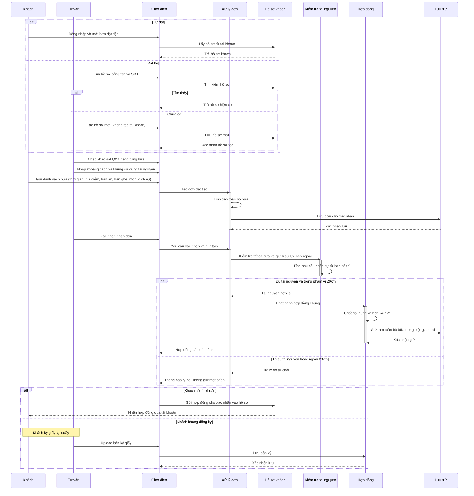

# Đặt tiệc và đặt hộ

## Phạm vi

UC liên quan: UC-DT-01, UC-DT-02, UC-DT-03, UC-DT-04, UC-DT-05, UC-HD-01, UC-HD-02. Tra tại [danh mục chung](../index.md). Quy tắc tại [đặc tả](../../specification.md); lớp tại [mô hình](../class.md).

## Lưu ý và giới hạn

- Hai nhánh tự đặt/đặt hộ hợp nhất trước khi lưu đơn; hai nhánh ký online/ký giấy hợp nhất tại ghi xác nhận.
- Thiếu tài nguyên hoặc ngoài 20 km trả lý do từ chối, không giữ một phần đơn.
- Giao tiếp qua điện thoại/Zalo được thực hiện thủ công ngoài hệ thống, không qua API tự động.
