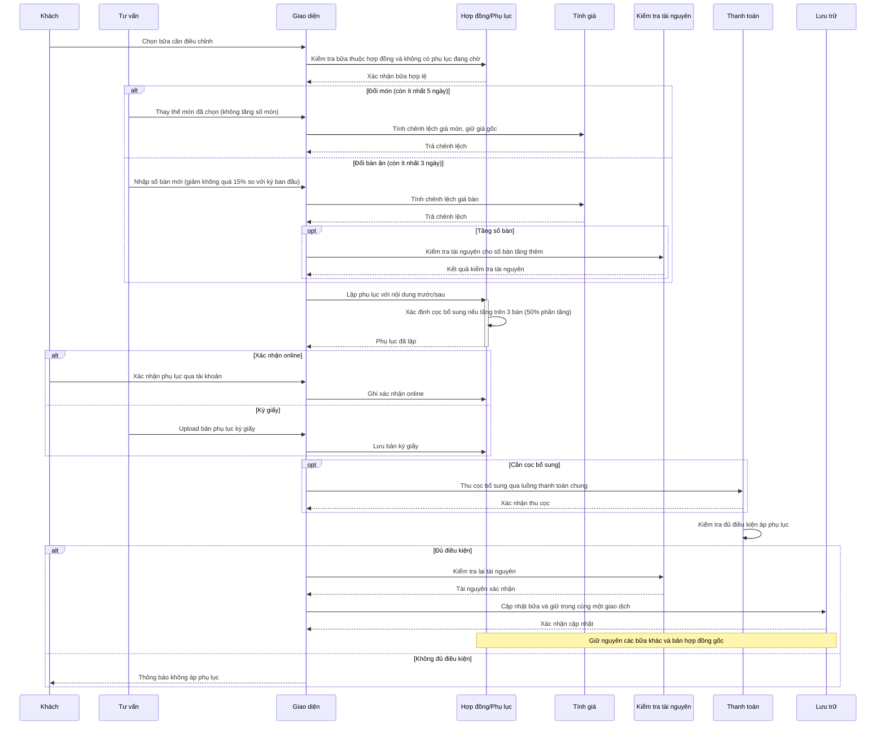

# Điều chỉnh từng bữa

## Phạm vi

UC liên quan: UC-HD-05, UC-HD-03, UC-HD-04. Tra tại [danh mục chung](../index.md). Quy tắc tại [đặc tả](../../specification.md); lớp tại [mô hình](../class.md).

## Lưu ý và giới hạn

- Không hỗ trợ dời ngày tiệc qua phụ lục điều chỉnh.
- Đổi món yêu cầu trước tiệc $\ge 5$ ngày (chỉ thay món, không tăng số món); đổi bàn yêu cầu trước tiệc $\ge 3$ ngày (giảm tối đa 15%).
- Giảm bàn làm dư tiền cọc sẽ được lưu lại để đối trừ khi quyết toán (không hoàn ngay, không hủy hợp đồng).
