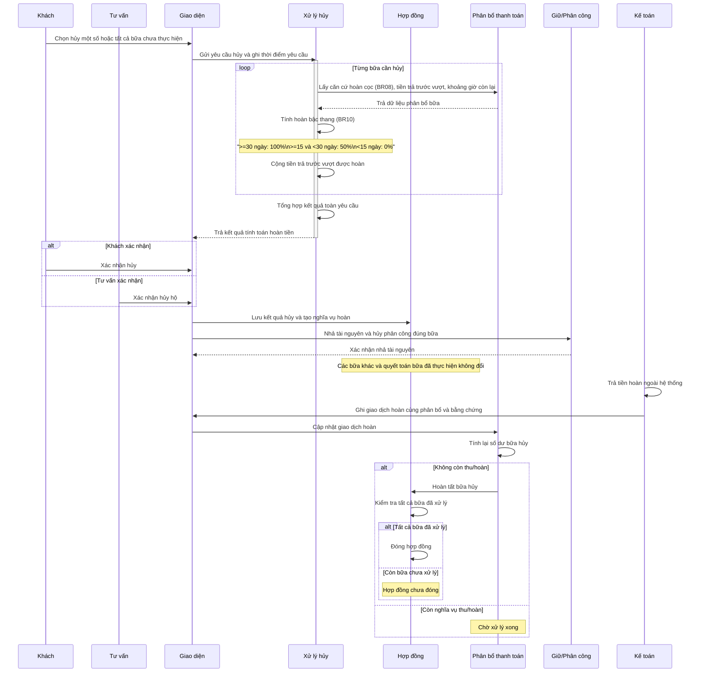

# Hủy và hoàn theo từng bữa

## Phạm vi

UC liên quan: UC-HD-06, UC-HD-07. Tra tại [danh mục chung](../index.md). Quy tắc tại [đặc tả](../../specification.md); lớp tại [mô hình](../class.md).

## Thành phần

Khách/Tư vấn → xử lý hủy → hợp đồng → phân bổ thanh toán → giữ/phân công → Kế toán.

## Nội dung cần thể hiện

1. Nhận lựa chọn hủy một số bữa hoặc tất cả bữa chưa thực hiện; ghi thời điểm yêu cầu.
2. Từng bữa lấy căn cứ hoàn cọc theo BR08, tiền trả trước vượt và khoảng giờ còn lại.
3. Tính hoàn bậc thang theo BR10, cộng tiền vượt được hoàn đủ; tổng hợp kết quả cả yêu cầu.
4. Khách hoặc tư vấn xác nhận; lưu kết quả hủy, nhả tài nguyên và hủy phân công đúng bữa, tạo nghĩa vụ hoàn.
5. Các bữa khác và quyết toán bữa đã thực hiện không đổi.
6. Kế toán trả tiền ngoài hệ thống; ghi giao dịch hoàn cùng phân bổ và bằng chứng.
7. Tính lại số dư, hoàn tất bữa hủy khi không còn thu/hoàn; hợp đồng đóng chỉ khi tất cả bữa đã xử lý.

## Nhánh và giới hạn

Bậc hoàn: >=30 ngày 100%; >=15 và <30 ngày 50%; <15 ngày 0%. Chưa cọc hủy miễn phí. Không có mặt là ghi nhận riêng, không đồng nghĩa khách hủy giữa lúc phục vụ. Không phê duyệt hoàn nhiều cấp.
