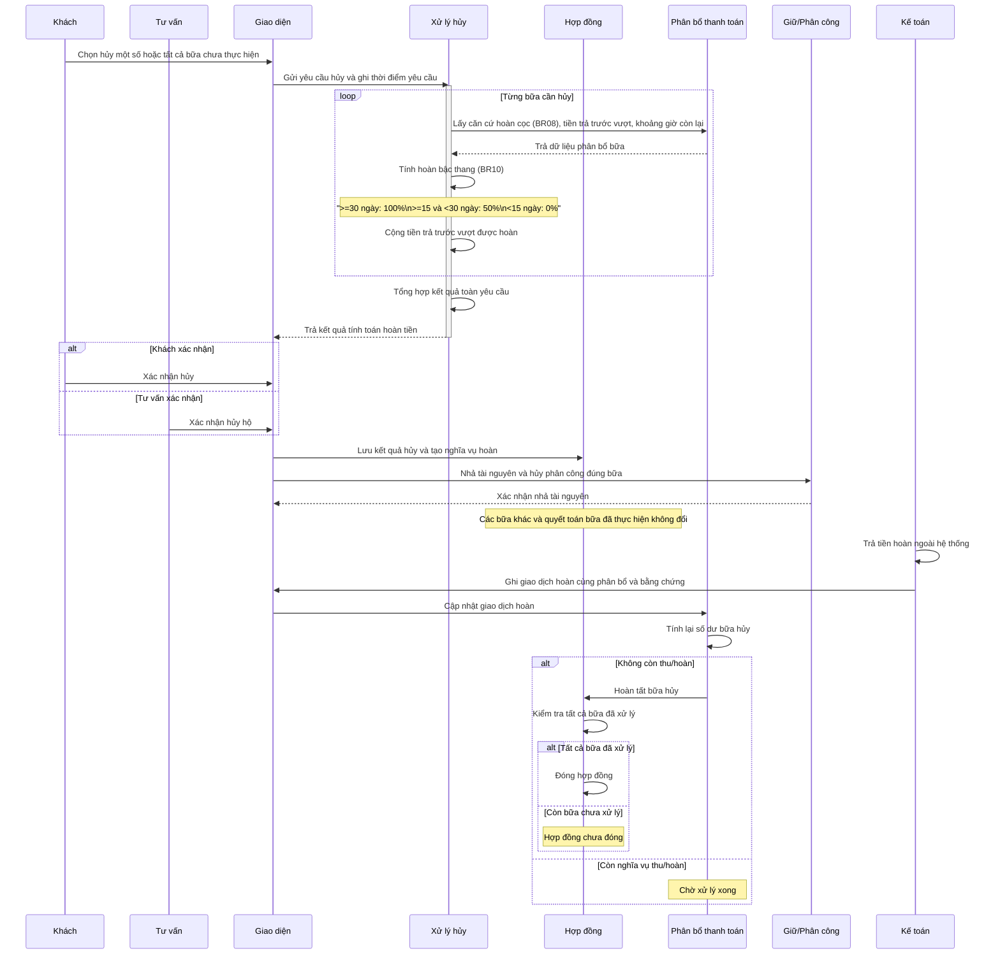

# Hủy và hoàn theo từng bữa

## Phạm vi

UC liên quan: UC-HD-06, UC-HD-07. Tra tại [danh mục chung](../index.md). Quy tắc tại [đặc tả](../../specification.md); lớp tại [mô hình](../class.md).

## Lưu ý và giới hạn

- Bậc hoàn tiền cọc căn cứ số ngày còn lại đến tiệc: $\ge 30$ ngày hoàn 100%; từ $15$ đến dưới $30$ ngày hoàn 50%; dưới $15$ ngày hoàn 0%. Phần tiền trả trước vượt cọc được hoàn đủ 100%.
- Hủy trước khi cọc không phát sinh chi phí.
- Khách không có mặt tại tiệc là trường hợp ghi nhận riêng, không tính là khách chủ động yêu cầu hủy.
- Quy trình hoàn tiền do Kế toán chi trả và ghi nhận trực tiếp, không qua phê duyệt nhiều cấp phức tạp.
