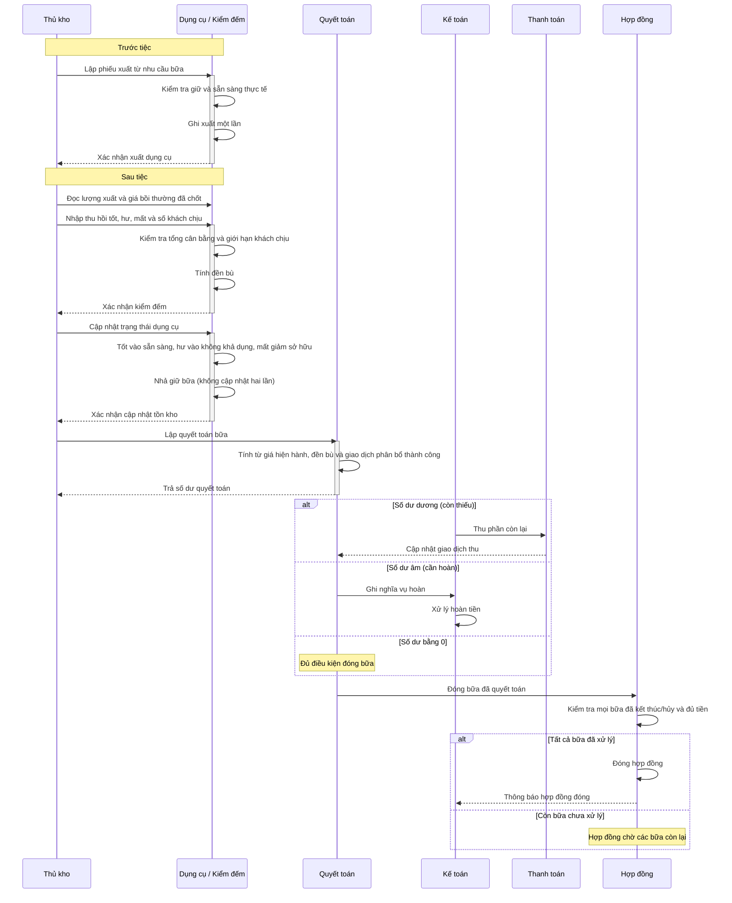

# Thu hồi dụng cụ và quyết toán

## Phạm vi

UC liên quan: UC-KHO-06, UC-KHO-07, UC-HD-08, UC-HD-03, UC-HD-04, UC-HD-07. Tra tại [danh mục chung](../index.md). Quy tắc tại [đặc tả](../../specification.md); lớp tại [mô hình](../class.md).

## Lưu ý và giới hạn

- Bữa tiệc không sử dụng dụng cụ thì bỏ qua bước lập biên bản kiểm đếm.
- Không trừ nguyên liệu theo từng bữa tiệc (nguyên liệu tính theo kỳ kiểm kê tháng).
- Không hỗ trợ công nợ trả chậm; đóng hợp đồng chỉ khi mọi bữa đã kết thúc/hủy và số dư công nợ về 0.
