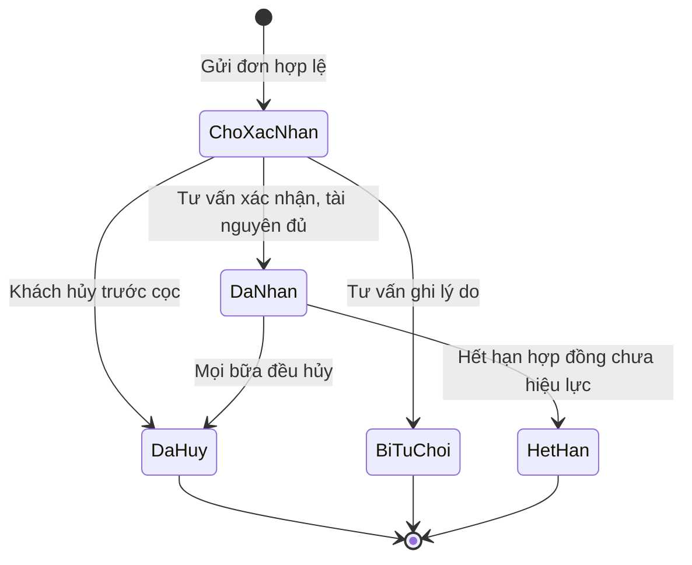
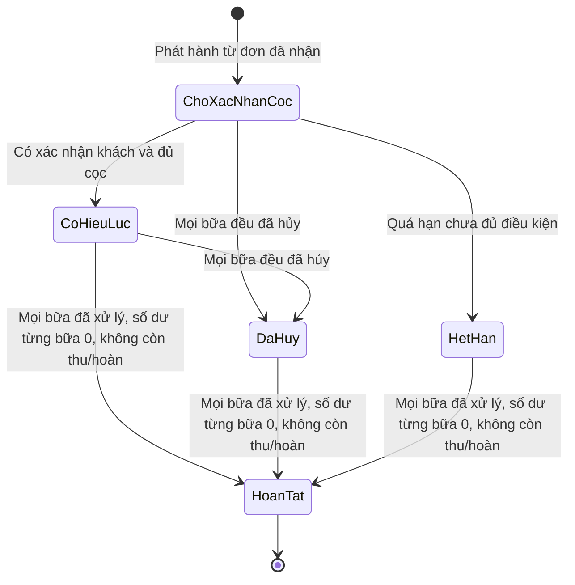
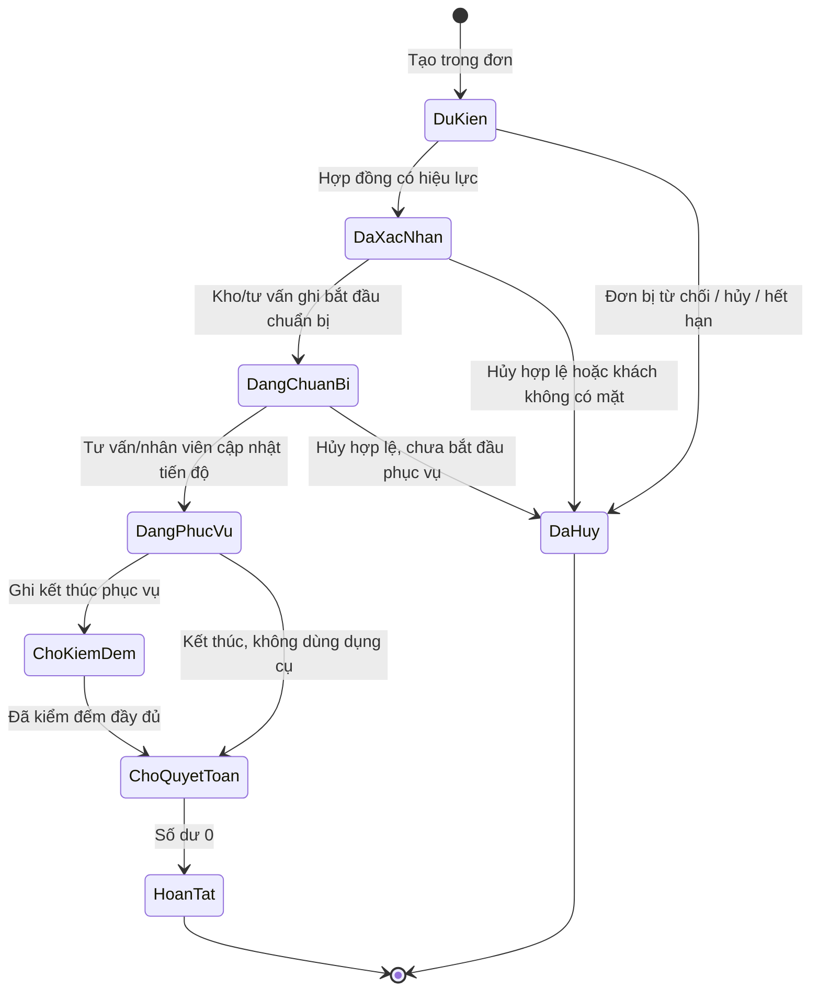

# Trạng thái đơn, hợp đồng và bữa tiệc

## Phạm vi

UC-DT-02, UC-DT-03, UC-DT-04, UC-DT-05, UC-HD-01, UC-HD-02 đến UC-HD-08, UC-VH-01, UC-KHO-07. Quy tắc theo [spec](../../specification.md), dữ liệu theo [class](../class.md).

## Lưu ý và quy tắc chuyển trạng thái

- **Độc lập tiến độ**: Không gom tiến độ của từng bữa vào trạng thái hợp đồng chung. Bữa thứ nhất có thể hoàn tất trong khi bữa thứ hai chưa diễn ra.
- **Hủy bữa**: Một bữa bị hủy không đổi trạng thái hợp đồng sang `DaHuy` nếu vẫn còn các bữa khác tiếp tục. Hợp đồng chỉ chuyển `DaHuy` khi tất cả các bữa đều bị hủy.
- **Đóng hợp đồng**: Hợp đồng chuyển `HoanTat` khi mọi bữa đã được xử lý (phục vụ xong hoặc đã hủy) và số dư công nợ của từng bữa bằng 0 (không còn nghĩa vụ thu thêm hay hoàn tiền).
- **Giao dịch thanh toán**: Trạng thái `Cho` → `ThanhCong` hoặc `ThatBai`. Giao dịch hoàn tiền là bản ghi mới, không chuyển đổi trên bản ghi thu.
- **Phụ lục**: `ChoXacNhan` → `ChoCocBoSung` (nếu tăng trên 3 bàn) → `DaApDung` (hoặc `DaHuy` nếu khách từ chối/không đủ tài nguyên). Phụ lục đã ký không sửa đè.
