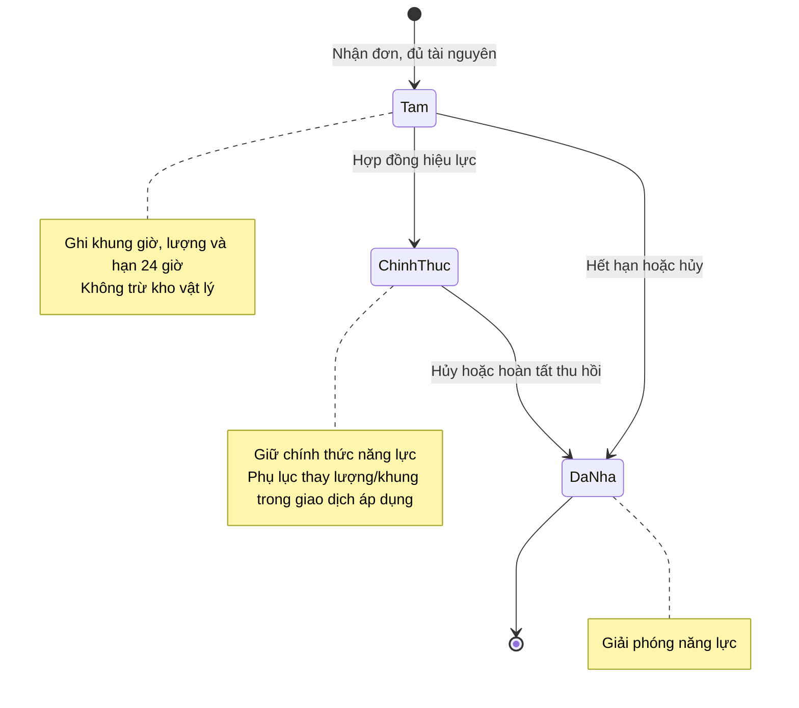
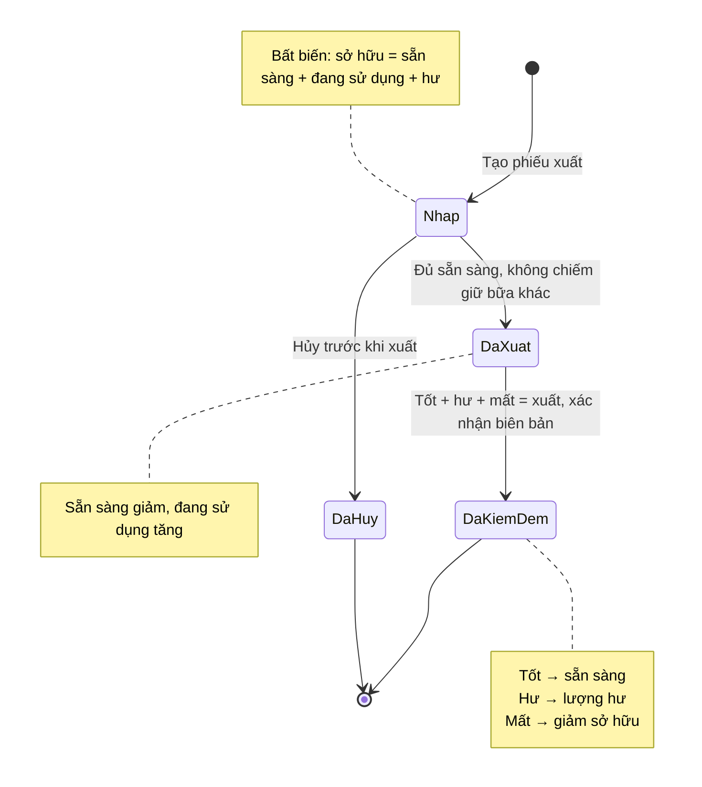

# Trạng thái giữ, xuất và thu hồi dụng cụ

## Phạm vi

UC-DT-04, UC-DT-05, UC-HD-05, UC-HD-06, UC-KHO-05 đến UC-KHO-08. Theo [BR07, BR13](../../specification.md) và [mô hình lớp](../class.md).

## Giữ dụng cụ

| Từ | Đến | Điều kiện | Tác động |
| --- | --- | --- | --- |
| Chưa giữ | Tam | Nhận đơn, đủ tài nguyên | Ghi khung giờ/lượng và hạn 24 giờ, không trừ kho |
| Tam | ChinhThuc | Hợp đồng hiệu lực | Giữ chính thức |
| Tam | DaNha | Hết hạn hoặc hủy | Không chiếm năng lực |
| ChinhThuc | DaNha | Hủy hoặc hoàn tất thu hồi | Giải phóng năng lực |

Phụ lục thay lượng/khung giữ trong giao dịch áp dụng, không nhả trước rồi mới kiểm tra. Đánh dấu đã xuất để không tính lượng giữ và hàng đang sử dụng như hai nhu cầu riêng.

## Phiếu xuất và kiểm đếm

| Từ | Đến | Điều kiện | Tác động |
| --- | --- | --- | --- |
| Nhap | DaXuat | Đủ sẵn sàng và không chiếm giữ bữa khác | Sẵn sàng giảm, đang sử dụng tăng |
| Nhap | DaHuy | Hủy trước khi xuất | Không thay kho vật lý |
| DaXuat | DaKiemDem | Tốt + hư + mất = xuất, xác nhận biên bản | Tốt về sẵn sàng, hư về lượng hư, mất giảm sở hữu |

Nếu hủy sau xuất, vẫn phải thu hồi/kiểm đếm dụng cụ đã đi; nhả giữ không tự cộng lại kho. Không trạng thái thu hồi một phần, chờ ký khách hoặc tranh chấp.

## Các lượng dụng cụ

- Mua mới → sẵn sàng và tăng sở hữu.
- Xuất: sẵn sàng → đang sử dụng.
- Thu hồi tốt: đang sử dụng → sẵn sàng.
- Thu hồi hư: đang sử dụng → hư, chưa khả dụng.
- Mất: giảm đang sử dụng và sở hữu.
- Phục hồi hư: hư → sẵn sàng.
- Loại bỏ hư: giảm hư và sở hữu.

Bất biến: sở hữu = sẵn sàng + đang sử dụng + hư. Tồn tối thiểu chỉ cảnh báo; không bắt buộc mọi dụng cụ có dự trù. Không vẽ mỗi chiếc thành một đối tượng có serial.
