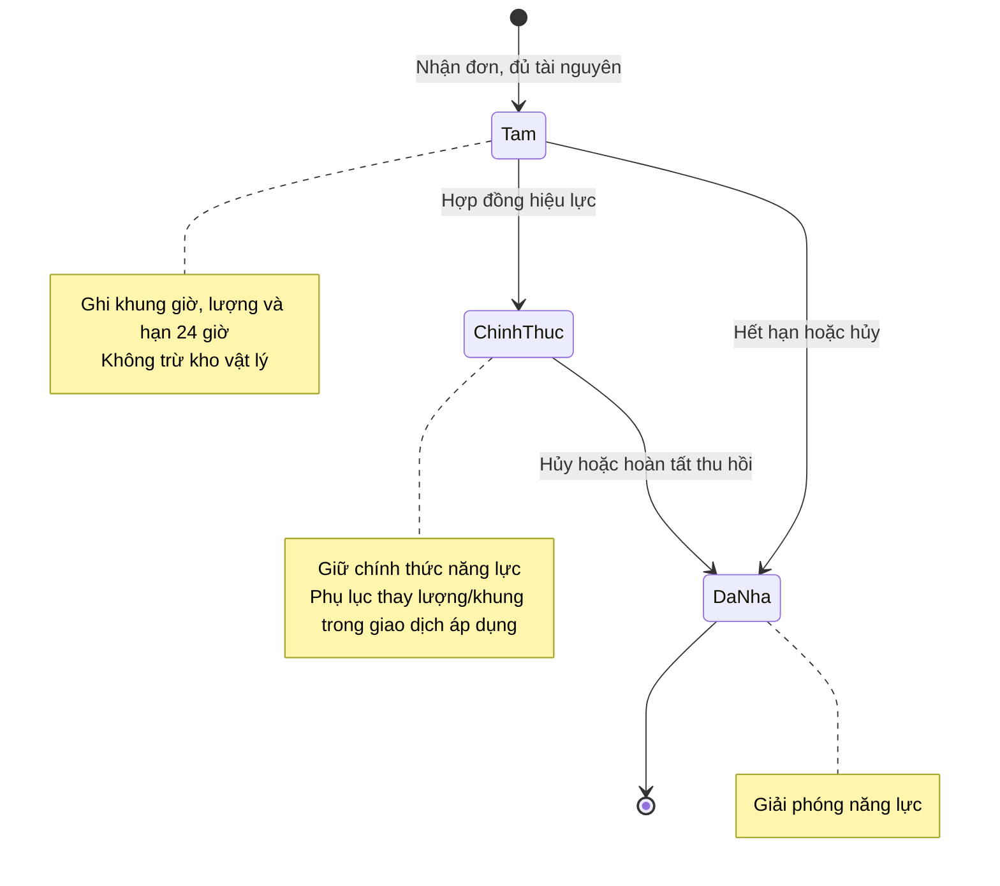
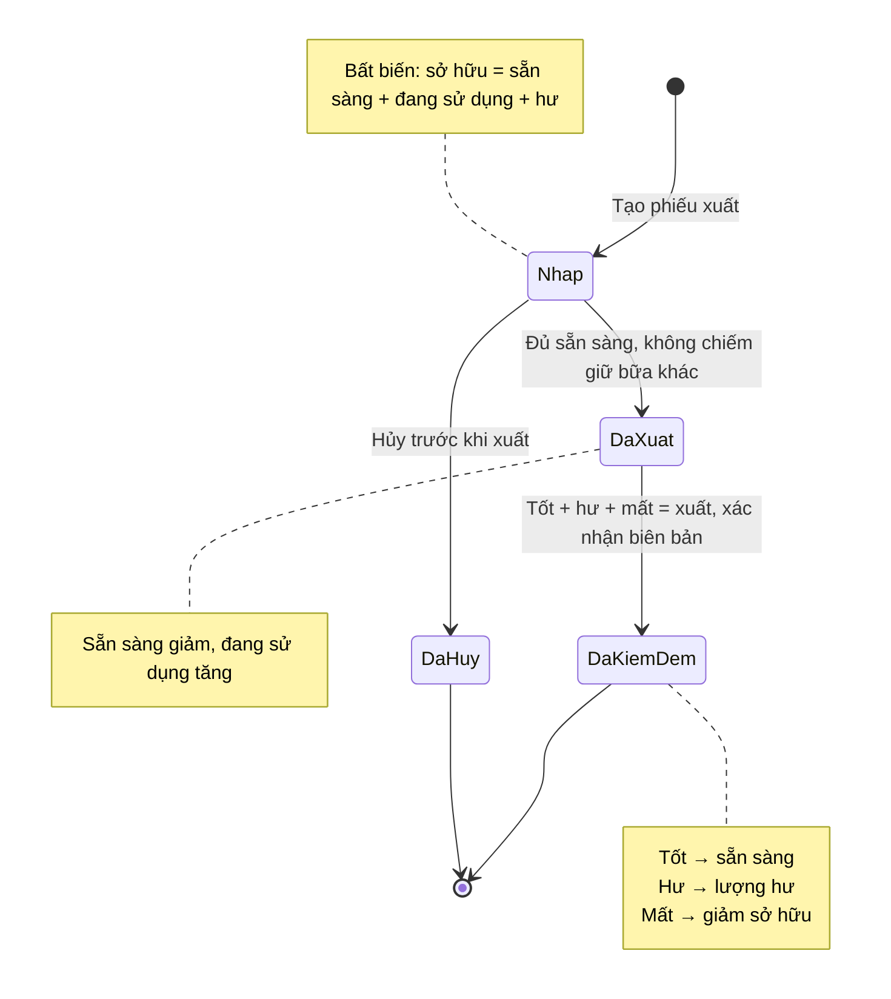

# Trạng thái giữ, xuất và thu hồi dụng cụ

## Phạm vi

UC-DT-04, UC-DT-05, UC-HD-05, UC-HD-06, UC-KHO-05 đến UC-KHO-08. Theo [BR07, BR13](../../specification.md) và [mô hình lớp](../class.md).

## Lưu ý và bất biến kho dụng cụ

- **Bất biến số lượng**: $\text{Sở hữu} = \text{Sẵn sàng} + \text{Đang sử dụng} + \text{Hư}$.
- **Chuyển dịch trạng thái dụng cụ**:
  - Mua mới: Tăng sẵn sàng và tăng sở hữu.
  - Xuất kho: Sẵn sàng $\rightarrow$ Đang sử dụng (chỉ xuất một lần cho toàn bữa).
  - Thu hồi tốt: Đang sử dụng $\rightarrow$ Sẵn sàng.
  - Thu hồi hư hỏng: Đang sử dụng $\rightarrow$ Hư (tạm không khả dụng).
  - Thu hồi mất mát: Giảm đang sử dụng và giảm sở hữu.
  - Phục hồi hư: Hư $\rightarrow$ Sẵn sàng.
  - Loại bỏ hư: Giảm hư và giảm sở hữu.
- **Giữ và Xuất**: Giữ tạm/chính thức và xuất kho là hai khái niệm độc lập; giữ đã xuất kho không bị trừ hai lần vào năng lực khả dụng. Nếu hủy sau khi đã xuất kho thực tế, vẫn bắt buộc lập biên bản thu hồi/kiểm đếm dụng cụ.
