# Sơ đồ Use Case tổng quát

Sơ đồ thể hiện ranh giới hệ thống MasterCookVN, các tác nhân và quan hệ giữa các gói Use Case. Mã và tên chi tiết tra cứu tại [Danh mục Use Case](./index.md) và [Đặc tả Use Case](./use-cases/index.md).

```mermaid
flowchart LR
    KH["👤 Khách hàng"]
    NVNb["👤 Nhân viên nội bộ\n(trừu tượng)"]
    NVTV["👤 Nhân viên tư vấn"]
    KeToan["👤 Kế toán"]
    ThuKho["👤 Thủ kho"]
    QLNS["👤 Quản lý nhân sự"]
    QLCS["👤 Quản lý cơ sở"]
    DVTT["⚙️ Dịch vụ thanh toán"]

    NVTV -->|kế thừa| NVNb
    KeToan -->|kế thừa| NVNb
    ThuKho -->|kế thừa| NVNb
    QLNS -->|kế thừa| NVNb
    QLCS -->|kế thừa| NVTV
    QLCS -->|kế thừa| KeToan
    QLCS -->|kế thừa| ThuKho
    QLCS -->|kế thừa| QLNS

    subgraph TK["📦 Gói Tài khoản"]
        TK01(["UC-TK-01: Đăng ký tài khoản khách"])
        TK02(["UC-TK-02: Đăng nhập, đăng xuất, đổi mật khẩu"])
        TK03(["UC-TK-03: Quản lý tài khoản nội bộ & phân quyền"])
    end

    subgraph DM["📦 Gói Danh mục"]
        DM01(["UC-DM-01: Quản lý loại món & món ăn"])
        DM02(["UC-DM-02: Quản lý set thực đơn"])
        DM03(["UC-DM-03: Quản lý nguyên liệu & định lượng món"])
        DM04(["UC-DM-04: Quản lý dịch vụ"])
        DM05(["UC-DM-05: Quản lý danh mục dụng cụ"])
        DM06(["UC-DM-06: Quản lý loại tiệc"])
        DM07(["UC-DM-07: Quản lý tham số nghiệp vụ"])
    end

    subgraph DT["📦 Gói Đặt tiệc"]
        DT01(["UC-DT-01: Xem danh mục & tạm tính"])
        DT02(["UC-DT-02: Tạo đơn đặt tiệc"])
        DT03(["UC-DT-03: Khảo sát địa điểm"])
        DT04(["UC-DT-04: Kiểm tra khả năng phục vụ"])
        DT05(["UC-DT-05: Xác nhận nhận hoặc từ chối đơn"])
        DT06(["UC-DT-06: Tra cứu đơn, hợp đồng & lịch sử thanh toán"])
    end

    subgraph HD["📦 Gói Hợp đồng và thanh toán"]
        HD01(["UC-HD-01: Lập & phát hành hợp đồng"])
        HD02(["UC-HD-02: Xác nhận hợp đồng"])
        HD03(["UC-HD-03: Thanh toán online"])
        HD04(["UC-HD-04: Ghi nhận thanh toán thủ công"])
        HD05(["UC-HD-05: Điều chỉnh bữa bằng phụ lục"])
        HD06(["UC-HD-06: Hủy bữa hoặc hợp đồng"])
        HD07(["UC-HD-07: Ghi nhận hoàn tiền"])
        HD08(["UC-HD-08: Quyết toán bữa & hoàn tất hợp đồng"])
    end

    subgraph NS["📦 Gói Nhân sự và vận hành"]
        NS01(["UC-NS-01: Quản lý hồ sơ nhân sự"])
        NS02(["UC-NS-02: Phân công nhân sự theo bữa"])
        VH01(["UC-VH-01: Cập nhật tiến độ bữa"])
    end

    subgraph KHO["📦 Gói Nguyên liệu và dụng cụ"]
        KHO01(["UC-KHO-01: Ghi nhận nhập nguyên liệu"])
        KHO02(["UC-KHO-02: Kiểm kê nguyên liệu cuối tháng"])
        KHO03(["UC-KHO-03: Chốt kỳ & tính food cost tháng"])
        KHO04(["UC-KHO-04: Xử lý đề xuất giá nguyên liệu tháng"])
        KHO05(["UC-KHO-05: Nhập mua dụng cụ"])
        KHO06(["UC-KHO-06: Xuất dụng cụ cho bữa"])
        KHO07(["UC-KHO-07: Thu hồi, kiểm đếm & bồi thường"])
        KHO08(["UC-KHO-08: Phục hồi hoặc loại bỏ dụng cụ hư"])
    end

    subgraph BC["📦 Gói Đánh giá và báo cáo"]
        CS01(["UC-CS-01: Ghi nhận đánh giá sau bữa"])
        BC01(["UC-BC-01: Xem dashboard & cảnh báo"])
        BC02(["UC-BC-02: Xem báo cáo doanh thu & food cost"])
        BC03(["UC-BC-03: Xem báo cáo dụng cụ"])
    end

    %% Tác nhân kết nối Use Cases
    KH --- TK01
    KH --- TK02
    KH --- DT01
    KH --- DT02
    KH --- DT06
    KH --- HD02
    KH --- HD03
    KH --- HD05
    KH --- HD06
    KH --- CS01

    NVNb --- TK02
    NVNb --- BC01

    NVTV --- DT02
    NVTV --- DT03
    NVTV --- DT04
    NVTV --- DT05
    NVTV --- DT06
    NVTV --- HD01
    NVTV --- HD02
    NVTV --- HD05
    NVTV --- HD06
    NVTV --- VH01
    NVTV --- CS01

    KeToan --- DT06
    KeToan --- HD04
    KeToan --- HD07
    KeToan --- HD08
    KeToan --- KHO03
    KeToan --- BC02

    ThuKho --- DM05
    ThuKho --- VH01
    ThuKho --- KHO01
    ThuKho --- KHO02
    ThuKho --- KHO05
    ThuKho --- KHO06
    ThuKho --- KHO07
    ThuKho --- KHO08
    ThuKho --- BC03

    QLNS --- NS01
    QLNS --- NS02

    QLCS --- TK03
    QLCS --- DM01
    QLCS --- DM02
    QLCS --- DM03
    QLCS --- DM04
    QLCS --- DM05
    QLCS --- DM06
    QLCS --- DM07
    QLCS --- KHO04
    QLCS --- BC02
    QLCS --- BC03

    DVTT --- HD03

    %% Quan hệ include và extend
    DT05 -.->|&laquo;include&raquo;| DT04
    HD05 -.->|&laquo;include&raquo;| DT04
    HD04 -.->|&laquo;extend&raquo;| HD03
    HD07 -.->|&laquo;extend&raquo;| HD06
    HD07 -.->|&laquo;extend&raquo;| HD08
```

## Tác nhân

| Tác nhân | Loại | Ghi chú |
| --- | --- | --- |
| Khách hàng | Người | Không cần đăng nhập vẫn xem danh mục và tạm tính (UC-DT-01). |
| Nhân viên nội bộ | Trừu tượng | Vai trò cha chung cho nhân sự nội bộ (UC-TK-02, UC-BC-01). |
| Nhân viên tư vấn | Người, kế thừa Nhân viên nội bộ | Tiếp nhận đơn, khảo sát địa điểm, lập hợp đồng và phụ lục. |
| Kế toán | Người, kế thừa Nhân viên nội bộ | Xác nhận thu tiền, ghi nhận hoàn tiền, chốt kỳ kiểm kê, quyết toán. |
| Thủ kho | Người, kế thừa Nhân viên nội bộ | Nhập/xuất/thu hồi dụng cụ, nhập nguyên liệu, kiểm kê cuối tháng. |
| Quản lý nhân sự | Người, kế thừa Nhân viên nội bộ | Quản lý hồ sơ nhân viên, phân công ca làm việc theo từng bữa tiệc. |
| Quản lý cơ sở | Người, kế thừa toàn bộ vai trò nội bộ | Quản trị hệ thống, xử lý đề xuất giá nguyên liệu tháng, điều chỉnh tham số. |
| Dịch vụ thanh toán | Hệ thống ngoài | Cổng thanh toán trực tuyến xử lý webhook giao dịch (UC-HD-03). |

## Quan hệ include và extend

| Quan hệ | Từ | Đến | Ghi chú |
| --- | --- | --- | --- |
| `«include»` | UC-DT-05 Xác nhận nhận đơn | UC-DT-04 Kiểm tra khả năng phục vụ | Luôn kiểm tra tài nguyên trước khi nhận đơn và giữ chỗ |
| `«include»` | UC-HD-05 Điều chỉnh bằng phụ lục | UC-DT-04 Kiểm tra khả năng phục vụ | Bắt buộc kiểm tra lại tài nguyên khi điều chỉnh tăng số bàn ăn |
| `«extend»` | UC-HD-04 Thanh toán thủ công | UC-HD-03 Thanh toán online | Mở rộng khi khách thanh toán trực tiếp bằng tiền mặt / chuyển khoản ngoài luồng |
| `«extend»` | UC-HD-07 Ghi nhận hoàn tiền | UC-HD-06 Hủy bữa hoặc hợp đồng | Mở rộng kích hoạt khi phát sinh nghĩa vụ hoàn tiền cọc |
| `«extend»` | UC-HD-07 Ghi nhận hoàn tiền | UC-HD-08 Quyết toán | Mở rộng kích hoạt khi số dư quyết toán của bữa là âm |
