# Mô hình lớp chi tiết

Đây là mô hình lớp chi tiết và đặc tả nghiệp vụ. [Đặc tả phần mềm](../specification.md) làm gốc quy tắc BR. Không sao chép mô hình sang spec.

## Quy ước

- `UUID`: định danh; `?`: tùy chọn; `money`: tiền VNĐ nguyên; `decimal-money`: giá/đơn vị cần độ chính xác trước khi làm tròn; `decimal`: lượng/tỷ lệ chính xác; `datetime`: thời điểm có múi giờ.
- `YearMonth`: tháng theo giờ Việt Nam. Tỷ lệ trong lưu trữ thống nhất dạng thập phân, giao diện hiển thị %.
- Thuộc tính tổng hợp có thể tính khi đọc; nếu lưu bản chốt phải cập nhật nguyên tử và không coi là nguồn tiền thứ hai.
- Các model sau là mô hình miền, không yêu cầu mỗi lớp tương ứng một bảng hoặc tự tạo CRUD cho mọi lớp.
- Các giá và nội dung chốt là dữ liệu lịch sử, không liên kết động để thay đổi theo Catalog mới.
- Các sơ đồ đối tượng PlantUML bên dưới là ví dụ dữ liệu, không bổ sung quy tắc nghiệp vụ. Nhãn `tênĐốiTượng : TênLớp` biểu diễn một instance; định danh như `KH01`, `B01` là ký hiệu rút gọn thay cho UUID. Chỉ các thuộc tính và liên kết cần minh họa được hiển thị, không phải toàn bộ bản ghi hay dữ liệu hệ thống. Tiền ghi bằng VNĐ nguyên, thời gian dùng múi giờ `+07:00`; thuế suất trong ví dụ là tham số giả định, không phải mức thuế pháp định.

## Sơ đồ lớp tổng quan

Sơ đồ tổng quan thể hiện kiến trúc miền (domain model) và mối liên kết cốt lõi giữa các phân hệ:

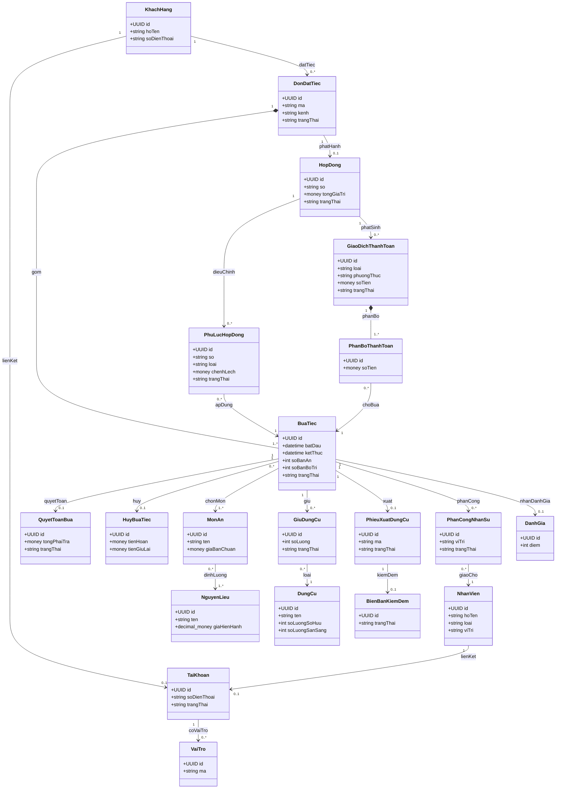

<!-- diagram id="vitepress-plugin-digrams-class-tong-quan" -->

### Ví dụ sơ đồ đối tượng

Các mã như `DT01`, `B01` là ký hiệu viết tắt cho UUID trong ví dụ. Order `DT01` có hai Meal: `B01` đã hoàn tất, `B02` bị hủy riêng. Contract ban đầu 33.000.000 đồng; Addendum tăng Meal `B01` thêm 1.980.000 đồng. Giao dịch Deposit 16.500.000 đồng được phân bổ cho cả hai Meal. Sơ đồ chỉ hiện một Dish và một loại Equipment đại diện; Menu đầy đủ được minh họa ở mục Order, Meal và khảo sát.

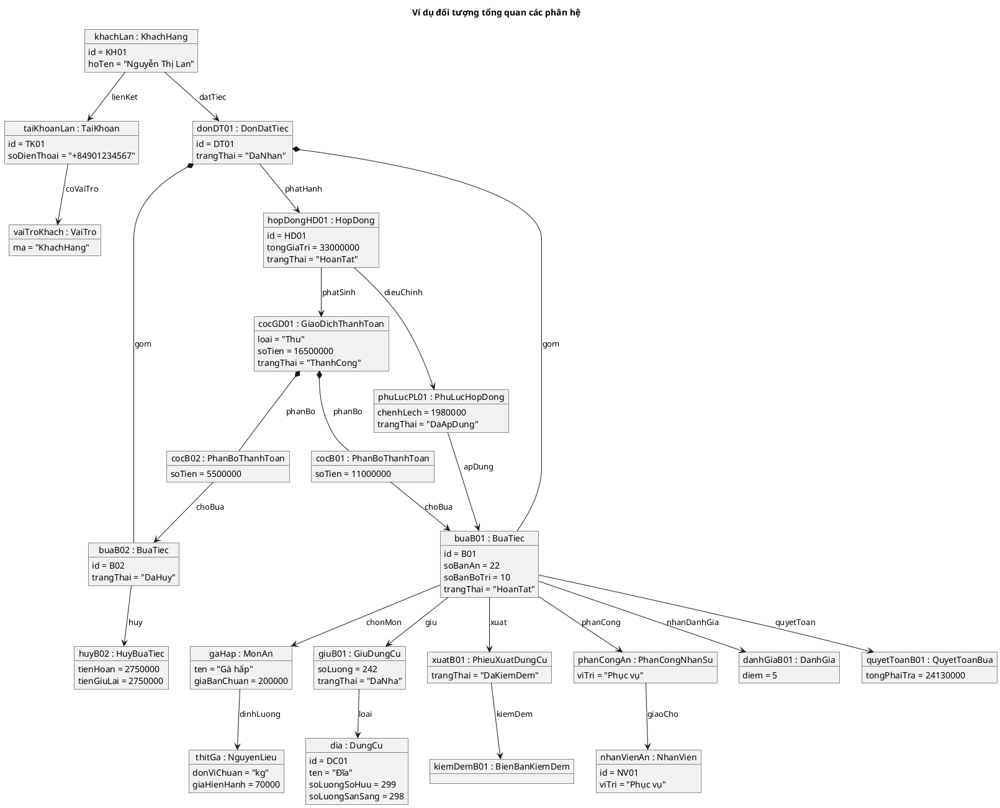

<!-- diagram id="vitepress-plugin-digrams-object-tong-quan" -->

## Account và Customer

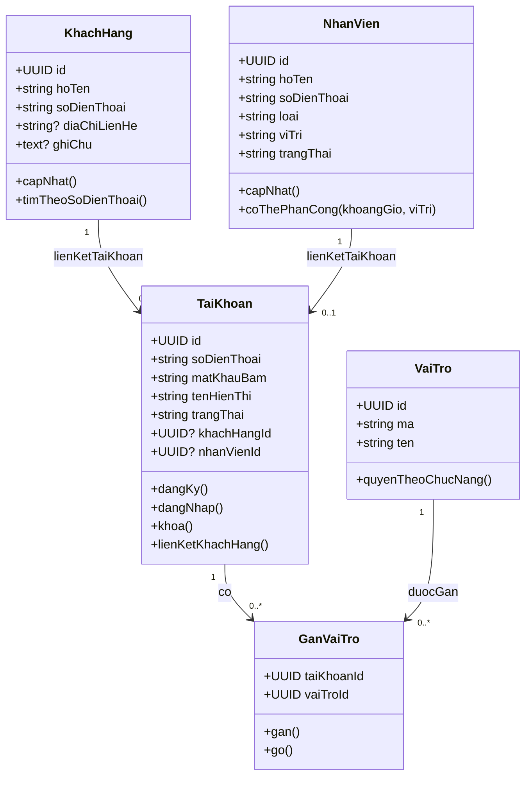

<!-- diagram id="vitepress-plugin-digrams-class-tai-khoan-khach-hang" -->

### Ràng buộc nghiệp vụ

- **TaiKhoan**: Không bắt buộc phải có Account để lưu Customer Profile hoặc Staff Profile.
- **VaiTro**: Role hệ thống cố định theo bảng quyền đặc tả, không có quy trình phê duyệt cấp quyền động.
- **GanVaiTro**: Cặp Account–Role là duy nhất; quyền của người dùng là hợp các Role được gán.
- **KhachHang**: Khóa định danh hồ sơ là số điện thoại chuẩn hóa. Customer đăng ký Account mới cùng số điện thoại sẽ tự động liên kết với Customer Profile đã tạo qua đặt hộ trước đó.
- **NhanVien**: Vị trí chuyên môn (Bếp, Phục vụ, Vận chuyển, Kiểm đếm) là thông tin nghiệp vụ dùng khi tạo Staff Assignment theo ca, không phải Role của Account hệ thống. Không quản lý chấm công/lương.

### Ví dụ sơ đồ đối tượng

Customer Profile Lan được tạo khi đặt hộ, sau đó liên kết Account đăng ký cùng SĐT chuẩn hóa. Customer Minh và Staff Member An chưa có Account. Staff Member Bình có hai Role hệ thống; vị trí chuyên môn của An không phải Role của Account.

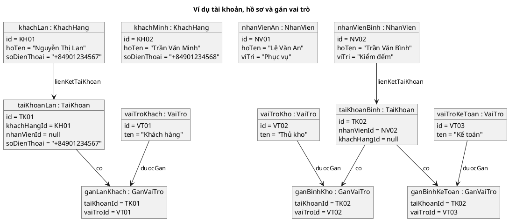

<!-- diagram id="vitepress-plugin-digrams-object-tai-khoan-khach-hang" -->

## Order, Meal và khảo sát

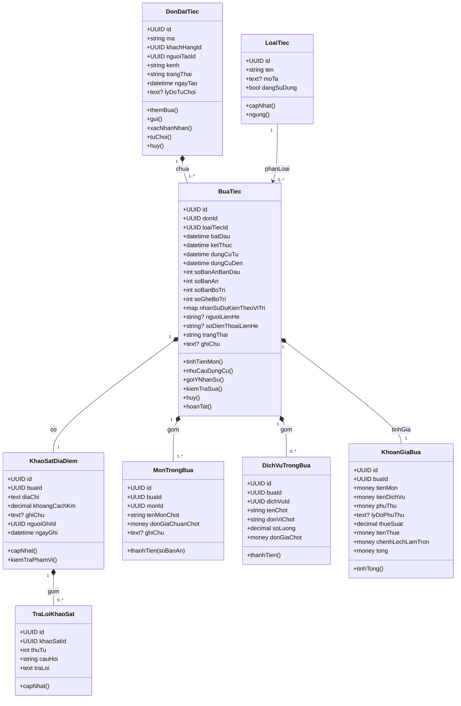

<!-- diagram id="vitepress-plugin-digrams-class-don-bua-khao-sat" -->

### Ràng buộc nghiệp vụ

- **DonDatTiec**: Order hỗ trợ một hoặc nhiều Meal; bản nháp chưa gửi chỉ lưu ở trình duyệt, hệ thống chỉ lưu khi người dùng gửi Order (`ChoXacNhan`).
- **BuaTiec**: Phân biệt rõ số Serving Table và số Tables and Chairs bố trí thực tế. Khung thời gian sử dụng tài nguyên được nhập thủ công. Menu, khảo sát và Staff Assignment độc lập theo từng Meal.
- **LoaiTiec**: Phân loại phục vụ quản lý và thống kê, không tự động gợi ý Dish tâm linh/văn hóa.
- **KhaoSatDiaDiem & TraLoiKhaoSat**: Mỗi Meal có một bản Site Survey riêng; câu hỏi và câu trả lời lưu trực tiếp tại khảo sát, không dùng chung câu trả lời giữa các Meal.
- **MonTrongBua & DichVuTrongBua**: Lưu danh sách Dish và dịch vụ chốt cố định của Meal, không liên kết động theo Catalog hiện hành sau khi Contract phát hành.
- **KhoanGiaBua**: Đúng một bảng tính giá hiện hành cho mỗi Meal. Giá trong Contract chốt là dữ liệu lịch sử bất biến.

### Ví dụ sơ đồ đối tượng

Góc nhìn sau khi Consultant khảo sát Order `DT01` ngày 01/10/2026, trước khi nhận Order và lập Contract: Meal `B01` có 20 Serving Table, bố trí 10 bàn; Meal `B02` có 10 Serving Table, bố trí 5 bàn. Mỗi Meal có khảo sát và bảng giá riêng. Sơ đồ hiển thị đủ 6 Dish của `B01`; các Dish và dịch vụ của `B02` được lược bớt. Thuế suất minh họa 10%, không phụ thu, tổng giá hai Meal là 33.000.000 đồng; giá chỉ được chốt khi phát hành Contract.

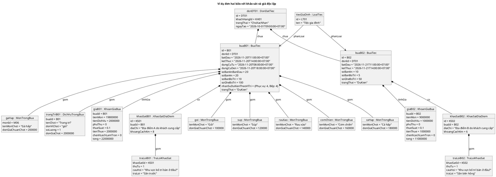

<!-- diagram id="vitepress-plugin-digrams-object-don-bua-khao-sat" -->

## Contract, điều chỉnh và tiền

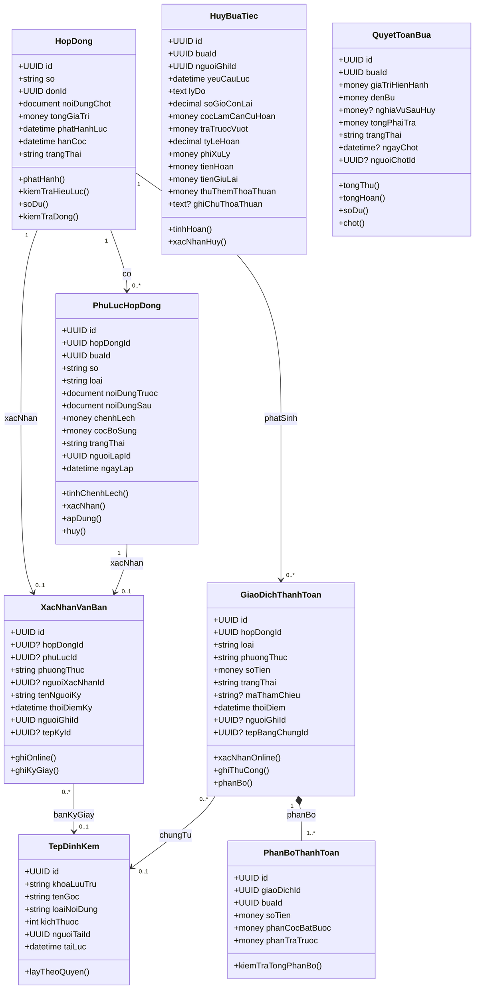

<!-- diagram id="vitepress-plugin-digrams-class-hop-dong-dieu-chinh-tien" -->

### Ràng buộc nghiệp vụ

- **HopDong**: Một Contract bao phủ tất cả các Meal của Order. Nội dung lưu đủ danh sách Meal, đơn giá và điều khoản chốt; không phụ thuộc thay đổi Catalog sau này.
- **XacNhanVanBan**: Gắn với đúng một Contract hoặc Addendum; phương thức ký giấy bắt buộc đính kèm tệp văn bản ký scan. Ký online lưu Account Customer, không dùng OTP.
- **PhuLucHopDong**: Một Addendum cho đúng một Meal; không cho phép dời ngày tiệc. Mỗi Meal chỉ có tối đa một Addendum chưa xử lý để tránh xung đột dữ liệu.
- **HuyBuaTiec**: Lưu kết quả và căn cứ Refund độc lập cho từng Meal; hủy toàn Contract tạo kết quả cho từng Meal tương ứng.
- **GiaoDichThanhToan & PhanBoThanhToan**: Mọi số tiền giao dịch là số dương (loại `Hoan` quyết định chiều chi). Tổng tiền phân bổ cho các Meal phải bằng chính xác số tiền giao dịch.
- **TepDinhKem**: Nội dung tệp lưu trong bucket public trên S3 hoặc dịch vụ lưu trữ object tương thích; `khoaLuuTru` là object key, không phải URL. Cơ sở dữ liệu lưu key và metadata; tên bucket cấu hình riêng cho từng môi trường triển khai. Ảnh Dish, bản ký giấy và chứng từ dùng chung mô hình này. URL truy cập được tạo từ cấu hình lưu trữ và key, không lưu thay key. Vì bucket public, bất kỳ ai biết URL đều có thể truy cập trực tiếp, kể cả bản ký và chứng từ.
- **QuyetToanBua**: Số tiền đã thu/hoàn và số dư tính từ các giao dịch thành công. Meal bị hủy thay thế tiền phục vụ bằng nghĩa vụ Payment sau hủy.

### Ví dụ sơ đồ đối tượng

Contract `HD01` chốt 33.000.000 đồng, ký giấy và thu Deposit 16.500.000 đồng đúng hạn. Addendum ngày 16/11 tăng `B01` từ 20 lên 22 bàn, tăng 1.980.000 đồng; tăng 2 bàn nên không yêu cầu Deposit bổ sung. `B02` bị hủy trước 20 ngày: hoàn 50% Deposit, giữ 2.750.000 đồng. `B01` Settlement 23.980.000 + 150.000 bồi thường = 24.130.000 đồng; sau thu thêm 13.130.000 đồng, số dư bằng 0. `B02` có số dư 2.750.000 − 5.500.000 + 2.750.000 = 0. Contract được đóng sau khi cả hai Meal đã xử lý xong.

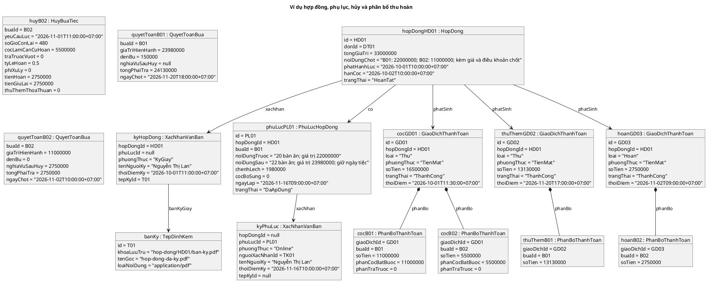

<!-- diagram id="vitepress-plugin-digrams-object-hop-dong-dieu-chinh-tien" -->

## Catalog Dish và Ingredient

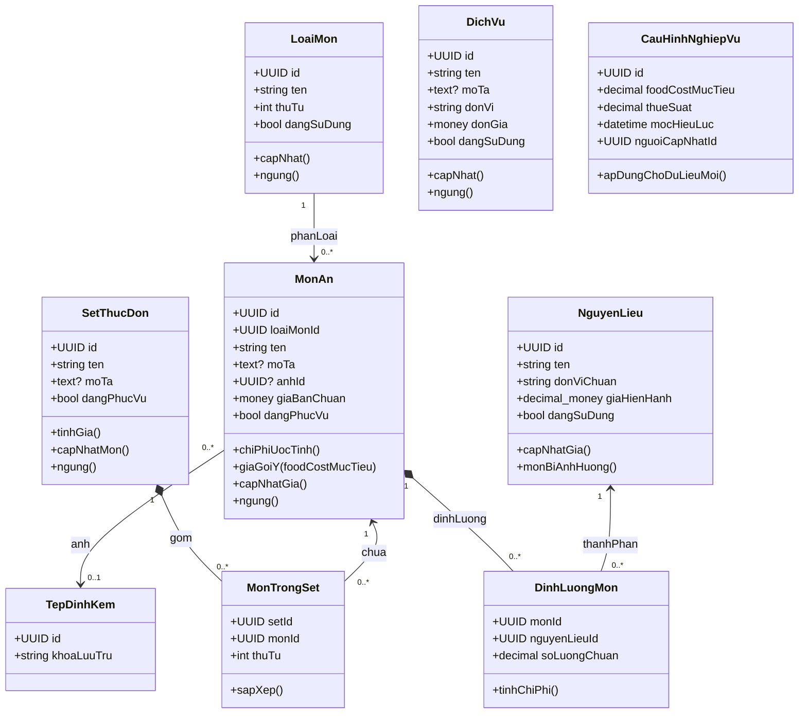

<!-- diagram id="vitepress-plugin-digrams-class-danh-muc-mon-nguyen-lieu" -->

### Ràng buộc nghiệp vụ

- **LoaiMon & MonAn**: Phân nhóm để lọc Catalog; Menu tự chọn không được rỗng, dưới ngưỡng khuyến nghị thì cảnh báo nhưng không chặn. Đơn giá chuẩn áp dụng cho Serving Table chuẩn 10 suất. Ảnh Dish tùy chọn, tham chiếu `TepDinhKem` qua `anhId`; không lưu URL ảnh trực tiếp.
- **SetThucDon**: Đơn giá set tính bằng tổng đơn giá các Dish thành phần, không cộng thêm biên lợi nhuận kép. Meal lưu danh sách Dish chốt, không trỏ động vào set.
- **MonTrongSet**: Cặp set–Dish là duy nhất.
- **NguyenLieu & DinhLuongMon**: Định lượng xác định lượng Ingredient cho 1 Serving Table chuẩn 10 người (cặp Dish–Ingredient là duy nhất). Đơn giá hiện hành dùng để tính chi phí ước tính và đề xuất giá bán Dish.
- **DichVu**: Do cơ sở tự cung cấp (trang trí, âm thanh,...); không quản lý đối tác thuê ngoài.
- **CauHinhNghiepVu**: Tham số nghiệp vụ toàn hệ thống (Target Food Cost, thuế suất,...), áp dụng cho các tính toán và Order tạo mới.

### Ví dụ sơ đồ đối tượng

Set gợi ý gồm 6 Dish, tổng giá chuẩn 900.000 đồng/Serving Table 10 người. Chỉ Dish gà được mở rộng phân loại, ảnh và định lượng trong sơ đồ: 1 kg × 70.000 = 70.000 đồng chi phí ước tính, chia Target Food Cost 0,35 được giá gợi ý 200.000 đồng. Đây là ví dụ giá đã được quản lý chọn, không tự động cập nhật giá bán hay giá Contract.

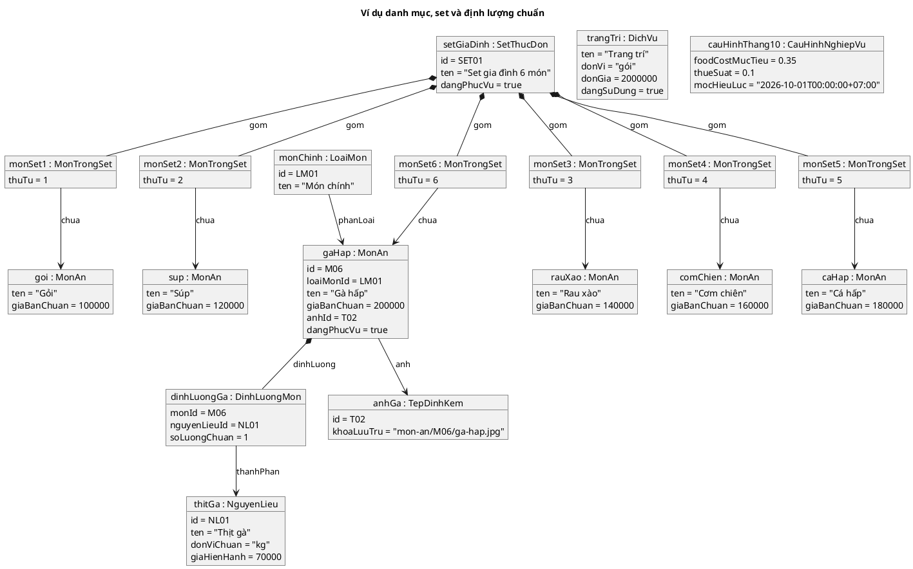

<!-- diagram id="vitepress-plugin-digrams-object-danh-muc-mon-nguyen-lieu" -->

## Nhập, Inventory Count và food cost

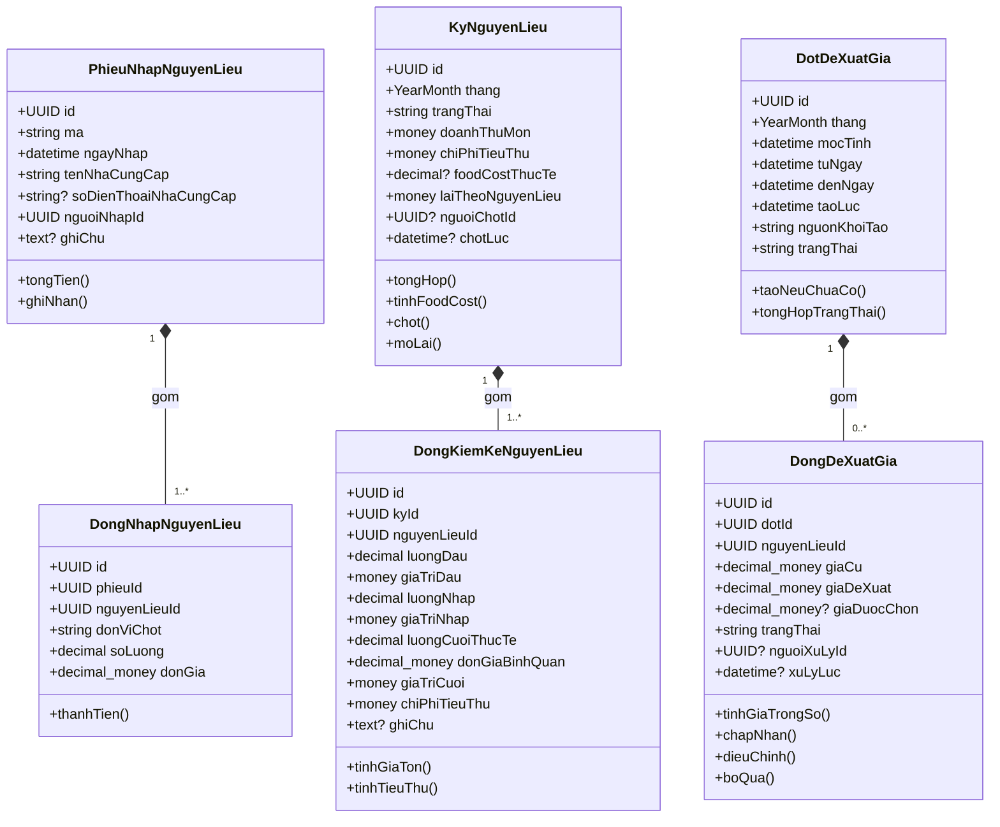

<!-- diagram id="vitepress-plugin-digrams-class-nhap-kiem-ke-food-cost" -->

### Ràng buộc nghiệp vụ

- **PhieuNhapNguyenLieu & DongNhapNguyenLieu**: Ghi nhận lượng và đơn giá thực mua; không bắt buộc gắn trực tiếp với Meal. Lượng $>0$, đơn giá $\ge 0$.
- **KyNguyenLieu & DongKiemKeNguyenLieu**: Inventory Count và chốt kỳ theo tháng. Tiêu thụ = Giá trị đầu + Nhập − Cuối kỳ. Không xuất kho trừ Ingredient sau từng Meal.
- **DotDeXuatGia & DongDeXuatGia**: Khởi tạo mốc tính ngày đầu tháng; tính bình quân trọng số 30 ngày gần nhất (khoảng cách 10 ngày tương ứng 1.5; 1.5; 2). Giá đề xuất độc lập với giá trị tồn kho.

### Ví dụ sơ đồ đối tượng

Ingredient `NL01` có 3 lần nhập trong tháng 11, tổng 30 kg trị giá 2.100.000 đồng. Tồn đầu 10 kg trị giá 600.000 đồng; bình quân tháng là 67.500 đồng/kg. Lượng cuối theo Inventory Count là 8 kg, có giá trị 540.000 đồng và chi phí tiêu thụ 2.160.000 đồng. Kỳ minh họa tổng hợp toàn cơ sở, không chỉ Order `DT01`; doanh thu Dish 24.000.000 đồng cho food cost 0,09 (9%) và Ingredient Margin 21.840.000 đồng. Chỉ dòng Inventory Count `NL01` có chi phí tiêu thụ trong ví dụ; các dòng còn lại, nếu có, được lược bớt và có chi phí tiêu thụ bằng 0.

Đợt tháng 12 dùng khoảng `[01/11, 01/12)` và ba trọng số 1,5; 1,5; 2. Giá đề xuất = (10 × 60.000 × 1,5 + 10 × 70.000 × 1,5 + 10 × 80.000 × 2) / (10 × 1,5 + 10 × 1,5 + 10 × 2) = 71.000 đồng/kg, khác giá tồn 67.500 đồng/kg. Dòng đề xuất chưa xử lý nên chưa có giá được chọn; không tự cập nhật giá hiện hành.

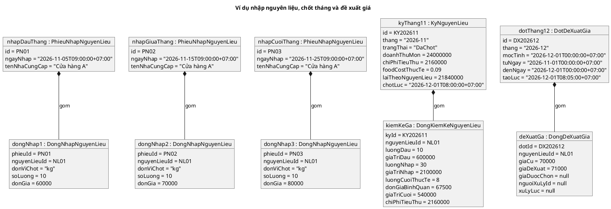

<!-- diagram id="vitepress-plugin-digrams-object-nhap-kiem-ke-food-cost" -->

## Equipment và tài nguyên

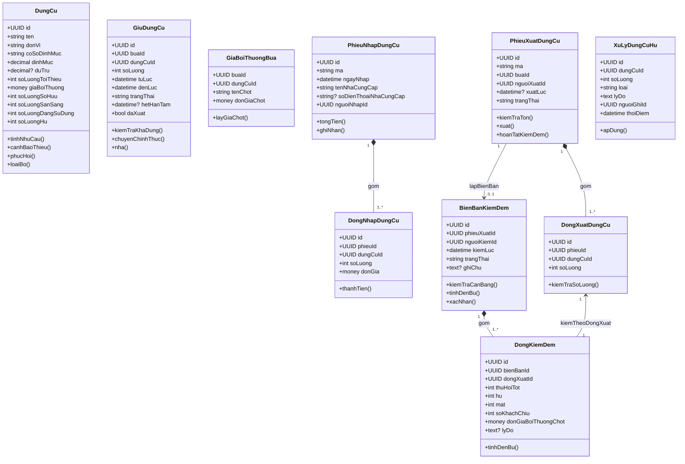

<!-- diagram id="vitepress-plugin-digrams-class-dung-cu-tai-nguyen" -->

### Ràng buộc nghiệp vụ

- **DungCu**: Bất biến sở hữu: $\text{Sở hữu} = \text{Sẵn sàng} + \text{Đang sử dụng} + \text{Hư}$. Tồn tối thiểu là ngưỡng cảnh báo bổ sung, không chặn cứng quy trình nếu đủ lượng dùng được.
- **GiuDungCu**: Giữ tạm (24 giờ) hoặc giữ chính thức; phân biệt rõ với xuất kho để tránh trừ kho hai lần vào năng lực khả dụng tương lai.
- **GiaBoiThuongBua**: Đơn giá bồi thường được chốt trong Contract trước khi diễn ra tiệc, không áp dụng đơn giá thị trường tại thời điểm kiểm đếm.
- **PhieuNhapDungCu & DongNhapDungCu**: Nhập mua bổ sung trực tiếp làm tăng sẵn sàng và tăng sở hữu.
- **PhieuXuatDungCu, BienBanKiemDem & DongKiemDem**: Một Meal tối đa một phiếu xuất và một Count Report đầy đủ. Điều kiện cân bằng bắt buộc: $\text{Tốt} + \text{Hư} + \text{Mất} = \text{Xuất}$; $0 \le \text{Khách chịu} \le \text{Hư} + \text{Mất}$.
- **XuLyDungCuHu**: Ghi nhận lượng phục hồi (chuyển sang sẵn sàng) hoặc loại bỏ (giảm lượng hư và giảm sở hữu).

### Ví dụ sơ đồ đối tượng

Sau khi tăng `B01` lên 22 bàn × 10 người, nhu cầu đĩa là làm tròn lên (220 × 1 × 1,1) = 242 chiếc. Phiếu mua trước đó nhập 300 chiếc; Meal xuất 242 chiếc, thu tốt 239, hư 2, mất 1. Customer chịu trách nhiệm cho cả 3 chiếc hư/mất theo giá chốt 50.000 đồng, thành 150.000 đồng bồi thường. Ngày 21/11 phục hồi 1 chiếc hư; trạng thái tồn sau xử lý là sở hữu 299 = sẵn sàng 298 + đang sử dụng 0 + hư 1. Giữ đã xuất được nhả sau thu hồi, không trừ thêm vào kho vật lý. Đây là góc nhìn sau xử lý, không phải tồn ngay lúc xuất.

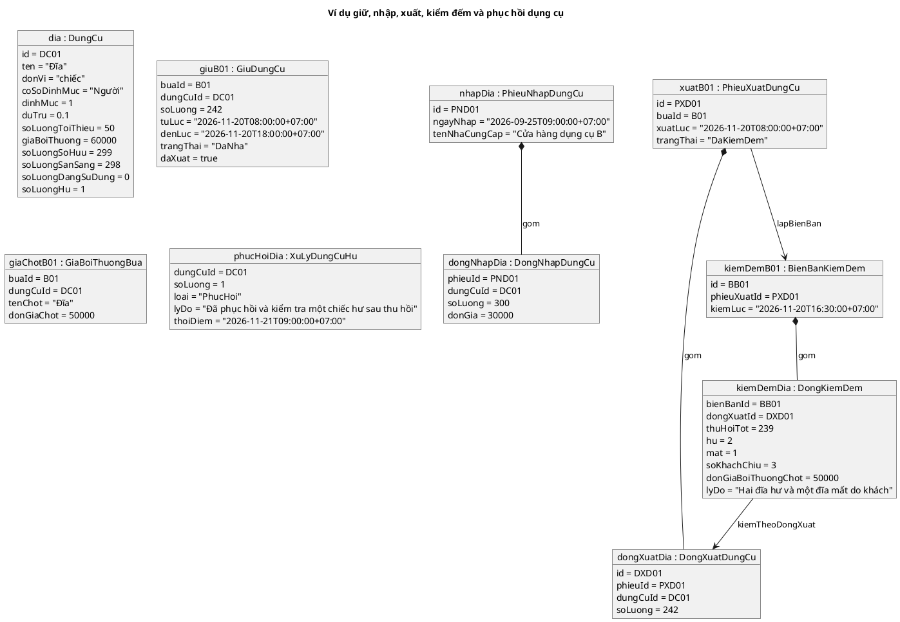

<!-- diagram id="vitepress-plugin-digrams-object-dung-cu-tai-nguyen" -->

## Staff Assignment và đánh giá

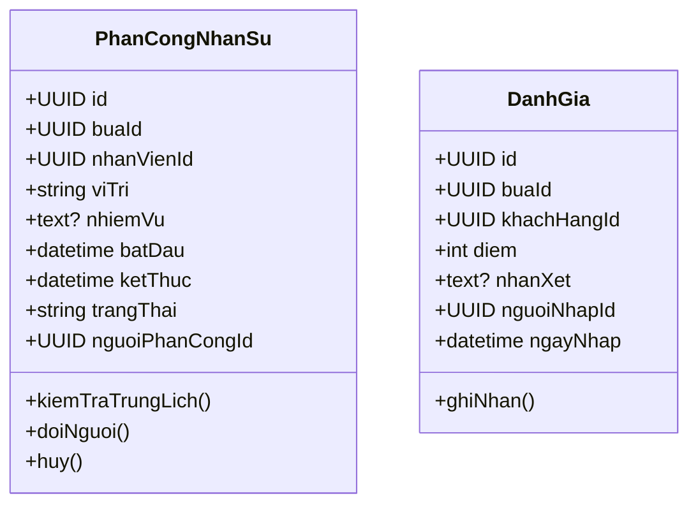

<!-- diagram id="vitepress-plugin-digrams-class-phan-cong-danh-gia" -->

### Ràng buộc nghiệp vụ

- **PhanCongNhanSu**: Khung giờ làm việc có thể bao phủ hoặc lệch so với giờ phục vụ của Meal. Kiểm tra chặn trùng lịch khi tạo Staff Assignment cho Staff Member cụ thể. Năng lực nhân sự chung được dự trù theo vị trí của các Meal đang giữ trước khi gán người đích danh.
- **DanhGia**: Mỗi Meal tối đa một đánh giá (điểm 1–5), chỉ mở khi Meal đã chuyển trạng thái `HoanTat`. Người đánh giá phải là người đặt của Order chứa Meal đó.

### Ví dụ sơ đồ đối tượng

Staff Assignment của Staff Member An phục vụ `B01` từ 08:00 đến 15:00 ngày 20/11, rộng hơn giờ phục vụ 11:00–14:00. Đây là một Staff Assignment trong nhu cầu dự kiến 4 người phục vụ, không phải toàn bộ nhân sự của Meal. Sau khi `B01` hoàn tất và Settlement xong, Customer Lan (người đặt Order `DT01`) tự nhập đánh giá 5 điểm bằng Account `TK01`. Không tạo đánh giá cho Meal `B02` đã hủy.

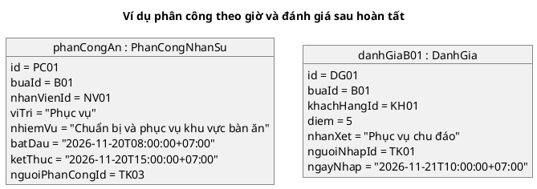

<!-- diagram id="vitepress-plugin-digrams-object-phan-cong-danh-gia" -->

## Dịch vụ miền (Domain Services)

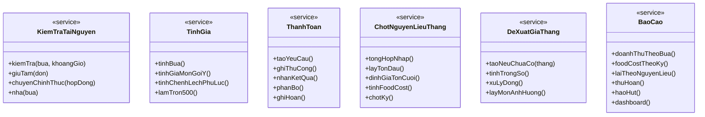

<!-- diagram id="vitepress-plugin-digrams-class-dich-vu-mien" -->

### Ví dụ sơ đồ đối tượng

Các đối tượng dưới đây là instance của đủ 6 dịch vụ miền, không phải bản ghi nghiệp vụ. Ghi chú chỉ nêu ngữ cảnh sử dụng đã có trong đặc tả; không thêm thuộc tính lưu trữ, quan hệ phụ thuộc hay thứ tự gọi giữa các dịch vụ.

```plantuml
@startuml
title Ví dụ các đối tượng dịch vụ miền
object "kiemTraTaiNguyen : KiemTraTaiNguyen" as taiNguyen
object "tinhGia : TinhGia" as gia
object "thanhToan : ThanhToan" as tien
object "chotNguyenLieuThang : ChotNguyenLieuThang" as chot
object "deXuatGiaThang : DeXuatGiaThang" as deXuat
object "baoCao : BaoCao" as baoCao
note right of taiNguyen
  Kiểm tra và giữ dụng cụ, nhân sự
  cho từng bữa của DT01 theo khung giờ nhập.
end note
note right of gia
  Tính B01 ban đầu 22000000;
  chênh lệch PL01 là 1980000.
end note
note right of tien
  Ghi thu GD01, GD02 và hoàn GD03;
  phân bổ đúng số tiền cho từng bữa.
end note
note right of chot
  Chốt kỳ 2026-11:
  tiêu thụ 2160000, food cost 0.09.
end note
note right of deXuat
  Tạo đợt 2026-12 theo mốc đầu tháng;
  đề xuất giá NL01 là 71000 đồng/kg.
end note
note right of baoCao
  Tổng hợp doanh thu bữa thực hiện,
  food cost theo kỳ, thu/hoàn và hao hụt.
end note
@enduml
```

<!-- diagram id="vitepress-plugin-digrams-object-dich-vu-mien" -->

## Các bất biến miền (Domain Invariants)

1. Meal, Addendum, giao dịch phân bổ, Settlement và giữ tài nguyên không được trỏ chéo giữa hai Contract.
2. Customer online chỉ xem hồ sơ liên kết số điện thoại của mình; quyền nội bộ xác định theo bảng phân quyền của Role.
3. Tổng thu/Refund tính từ các giao dịch thành công; tổng phân bổ theo Meal phải bằng đúng số tiền giao dịch; số dư chỉ tính một lần Deposit.
4. Hủy một Meal chỉ nhả giữ tài nguyên và hủy Staff Assignment của Meal đó, không làm ảnh hưởng đến dữ liệu các Meal khác trong cùng Order.
5. Tính khả dụng tương lai theo tổng sở hữu dùng được trừ đi các khoảng giữ chồng lấn; tại thời điểm xuất kho kiểm tra thêm lượng sẵn sàng thực tế. Giữ đã xuất kho không bị trừ hai lần.
6. Kho Ingredient chỉ thực hiện Inventory Count theo chu kỳ tháng và lưu phiếu nhập; không phát sinh phiếu xuất kho hay tính tiêu hao Ingredient chi tiết theo từng tiệc.
7. Giá trị tồn kho sử dụng đơn giá bình quân tháng; Current Ingredient Price dùng đơn giá đề xuất bình quân gia quyền 30 ngày; hai giá trị không dùng thay thế lẫn nhau.
8. Đợt đề xuất giá là duy nhất theo tháng; kỳ Ingredient duy nhất theo tháng; đánh giá duy nhất theo Meal; mã giao dịch Payment phía đối tác cung cấp là duy nhất.
9. Catalog đã có lịch sử phát sinh dữ liệu chỉ được phép ngưng sử dụng, không xóa. Nội dung Contract/Addendum đã xác nhận và giao dịch đã thành công không sửa đè.
