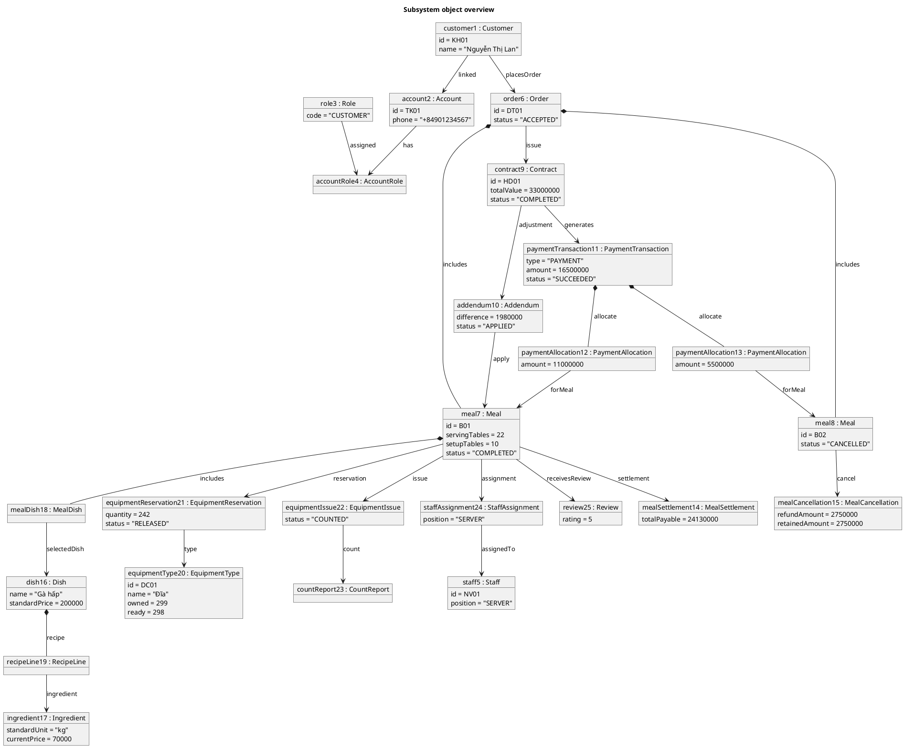
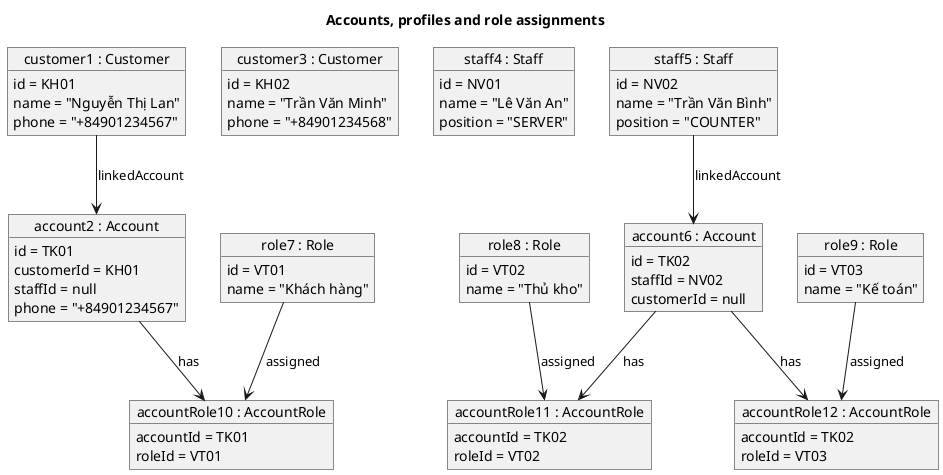
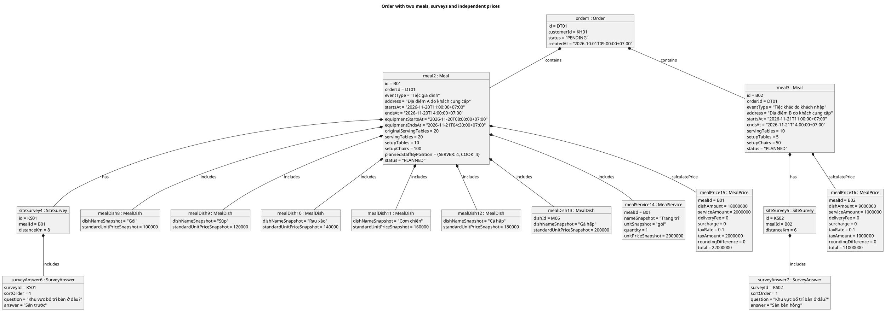
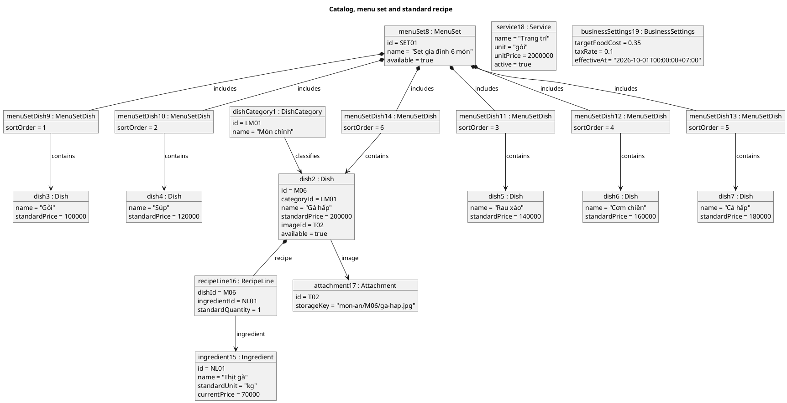
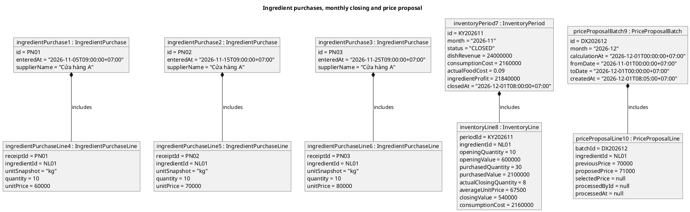
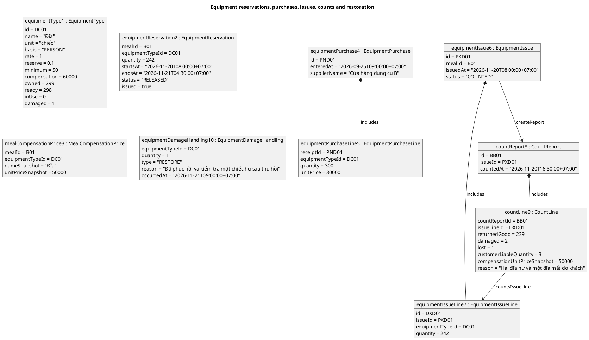
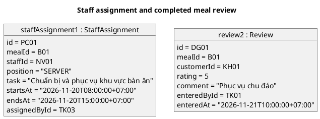

# Detailed Domain Model

Đây là mô hình lớp chi tiết và đặc tả nghiệp vụ. [Đặc tả phần mềm](../specification.md) làm gốc quy tắc BR; [tham số](../business/system-parameters.md) làm chuẩn giá trị và giới hạn. Không sao chép mô hình sang spec.

## Conventions

- `UUID`: định danh; `?`: tùy chọn; `money`: tiền VNĐ nguyên; `decimal-money`: giá/đơn vị cần độ chính xác trước khi làm tròn; `decimal`: lượng/tỷ lệ chính xác; `datetime`: thời điểm có múi giờ.
- `YearMonth`: tháng theo giờ Việt Nam. Tỷ lệ trong lưu trữ thống nhất dạng thập phân, giao diện hiển thị %.
- Thuộc tính tổng hợp có thể tính khi đọc; nếu lưu bản chốt phải cập nhật nguyên tử và không coi là nguồn tiền thứ hai.
- Các model sau là mô hình miền, không yêu cầu mỗi lớp tương ứng một bảng hoặc tự tạo CRUD cho mọi lớp.
- Các giá và nội dung chốt là dữ liệu lịch sử, không liên kết động để thay đổi theo danh mục mới.
- Các sơ đồ đối tượng PlantUML bên dưới là ví dụ dữ liệu, không bổ sung quy tắc nghiệp vụ. Nhãn `objectName : ClassName` biểu diễn một instance; định danh như `KH01`, `B01` là ký hiệu rút gọn thay cho UUID. Chỉ các thuộc tính và liên kết cần minh họa được hiển thị, không phải toàn bộ bản ghi hay dữ liệu hệ thống. Tiền ghi bằng VNĐ nguyên, thời gian dùng múi giờ `+07:00`; thuế suất trong ví dụ là tham số giả định, không phải mức thuế pháp định.
- Các giá trị hữu hạn dùng trong mô hình:
  - `OrderStatus`: `PENDING`, `ACCEPTED`, `REJECTED`, `EXPIRED`, `CANCELLED`; `OrderChannel`: `ONLINE`, `ON_BEHALF`.
  - `ContractStatus`: `AWAITING_CONFIRMATION_AND_DEPOSIT`, `ACTIVE`, `EXPIRED`, `CANCELLED`, `COMPLETED`.
  - `MealStatus`: `PLANNED`, `CONFIRMED`, `PREPARING`, `SERVING`, `AWAITING_COUNT`, `AWAITING_SETTLEMENT`, `COMPLETED`, `CANCELLED`.
  - `AddendumStatus`: `PENDING`, `AWAITING_EXTRA_DEPOSIT`, `APPLIED`, `CANCELLED`; `PaymentStatus`: `PENDING`, `SUCCEEDED`, `FAILED`.
  - `EquipmentIssueStatus`: `DRAFT`, `ISSUED`, `COUNTED`, `CANCELLED`; `InventoryPeriodStatus`: `AWAITING_CLOSE`, `CLOSED`; `EquipmentReservationStatus`: `TEMPORARY`, `CONFIRMED`, `RELEASED`; `MealSettlementStatus`: `CLOSED`.
  - `StaffPosition`: `SERVER`, `COOK`, `DRIVER`, `COUNTER`; `StaffType`: `PERMANENT`, `TEMPORARY`; `EquipmentBasis`: `PERSON`, `SETUP_TABLE`, `MEAL`, `MANUAL`.
  - `PaymentMethod`: `CASH`, `BANK_TRANSFER`, `ONLINE`; `PaymentTransactionKind`: `PAYMENT`, `REFUND`; `ConfirmationMethod`: `PAPER`, `ONLINE`; `EquipmentDamageAction`: `RESTORE`, `DISPOSE`.
  - Quyết định đã xử lý của dòng đề xuất giá: `ACCEPTED`, `ADJUSTED`, `SKIPPED`; dòng chưa xử lý vẫn chưa có quyết định.

## Class Diagram Overview

Sơ đồ thể hiện toàn bộ kiến trúc miền (domain model), đầy đủ các thực thể, thuộc tính, phương thức và mối liên kết giữa các phân hệ:

```mermaid
---
config:
  layout: elk
---
classDiagram
    direction TB

    %% ==========================================
    %% 1. DOMAIN MODEL
    %% ==========================================
    class Customer {
        +UUID id
        +string name
        +string phone
        +string? contactAddress
        +text? notes
        +update()
        +findByPhone()
    }

    class Account {
        +UUID id
        +string phone
        +string passwordHash
        +string displayName
        +string status
        +UUID? customerId
        +UUID? staffId
        +register()
        +login()
        +lock()
        +linkCustomer()
    }

    class Role {
        +UUID id
        +string code
        +string name
        +permissionsByFunction()
    }

    class AccountRole {
        +UUID accountId
        +UUID roleId
        +assign()
        +remove()
    }

    class Staff {
        +UUID id
        +string name
        +string phone
        +StaffType type
        +StaffPosition position
        +string status
        +update()
        +canAssign(timeRange, position)
    }

    %% ==========================================
    %% 2. DOMAIN MODEL
    %% ==========================================
    class Order {
        +UUID id
        +string code
        +UUID customerId
        +UUID createdById
        +OrderChannel channel
        +OrderStatus status
        +datetime createdAt
        +text? rejectionReason
        +addMeal()
        +submit()
        +accept()
        +reject()
        +cancel()
    }

    class Meal {
        +UUID id
        +UUID orderId
        +string eventType
        +text address
        +datetime startsAt
        +datetime endsAt
        +datetime? equipmentStartsAt
        +datetime? equipmentEndsAt
        +int originalServingTables
        +int servingTables
        +int setupTables
        +int setupChairs
        +map plannedStaffByPosition
        +string? contactName
        +string? contactPhone
        +MealStatus status
        +UUID? statusUpdatedById
        +datetime? statusUpdatedAt
        +text? notes
        +calculateDishAmount()
        +equipmentDemand()
        +suggestStaff()
        +canEdit()
        +cancel()
        +complete()
    }

    class SiteSurvey {
        +UUID id
        +UUID mealId
        +decimal distanceKm
        +text? notes
        +UUID recordedById
        +datetime recordedAt
        +update()
    }

    class SurveyAnswer {
        +UUID id
        +UUID surveyId
        +int sortOrder
        +string question
        +text answer
        +update()
    }

    class MealDish {
        +UUID id
        +UUID mealId
        +UUID dishId
        +string dishNameSnapshot
        +money standardUnitPriceSnapshot
        +text? notes
        +calculateAmount(servingTables)
    }

    class MealService {
        +UUID id
        +UUID mealId
        +UUID serviceId
        +string nameSnapshot
        +string unitSnapshot
        +decimal quantity
        +money unitPriceSnapshot
        +calculateAmount()
    }

    class MealPrice {
        +UUID id
        +UUID mealId
        +money dishAmount
        +money serviceAmount
        +money deliveryFee
        +money surcharge
        +text? surchargeReason
        +decimal taxRate
        +money taxAmount
        +money roundingDifference
        +money total
        +calculateTotal()
    }

    %% ==========================================
    %% 3. DOMAIN MODEL
    %% ==========================================
    class Contract {
        +UUID id
        +string number
        +UUID orderId
        +document contentSnapshot
        +money totalValue
        +datetime issuedAt
        +datetime depositDeadline
        +ContractStatus status
        +issue()
        +checkValidity()
        +balance()
        +checkClosure()
    }

    class DocumentConfirmation {
        +UUID id
        +UUID? contractId
        +UUID? addendumId
        +ConfirmationMethod method
        +UUID? confirmedById
        +string signerName
        +datetime signedAt
        +UUID recordedById
        +UUID? signedAttachmentId
        +recordOnline()
        +recordPaperSignature()
    }

    class Addendum {
        +UUID id
        +UUID contractId
        +UUID mealId
        +string number
        +string type
        +document contentBefore
        +document contentAfter
        +money difference
        +money extraDeposit
        +AddendumStatus status
        +UUID createdById
        +datetime createdAt
        +calculateDifference()
        +confirm()
        +apply()
        +cancel()
    }

    class MealCancellation {
        +UUID id
        +UUID mealId
        +UUID recordedById
        +datetime requestedAt
        +text reason
        +decimal hoursRemaining
        +money refundBasisDeposit
        +money excessPrepayment
        +decimal refundRate
        +money processingFee
        +money refundAmount
        +money retainedAmount
        +money agreedAdditionalCharge
        +text? agreementNotes
        +calculateRefund()
        +confirmCancellation()
    }

    class PaymentTransaction {
        +UUID id
        +UUID contractId
        +PaymentTransactionKind type
        +PaymentMethod method
        +money amount
        +PaymentStatus status
        +string? referenceCode
        +datetime occurredAt
        +UUID? recordedById
        +UUID? evidenceAttachmentId
        +confirmOnline()
        +recordManually()
        +allocate()
    }

    class PaymentAllocation {
        +UUID id
        +UUID transactionId
        +UUID mealId
        +money amount
        +money requiredDepositPortion
        +money prepaymentPortion
        +checkAllocationTotal()
    }

    class MealSettlement {
        +UUID id
        +UUID mealId
        +money currentValue
        +money compensation
        +money? postCancellationObligation
        +money totalPayable
        +MealSettlementStatus status
        +datetime? closedAt
        +UUID? closedById
        +totalPayments()
        +totalRefunds()
        +balance()
        +close()
    }

    class Attachment {
        +UUID id
        +string storageKey
        +string originalName
        +string contentType
        +int size
        +UUID uploadedById
        +datetime uploadedAt
        +getWithPermission()
    }

    %% ==========================================
    %% 4. DOMAIN MODEL
    %% ==========================================
    class DishCategory {
        +UUID id
        +string name
        +int sortOrder
        +bool active
        +update()
        +deactivate()
    }

    class Dish {
        +UUID id
        +UUID categoryId
        +string name
        +text? description
        +UUID? imageId
        +money standardPrice
        +bool available
        +estimatedCost()
        +suggestedPrice(targetFoodCost)
        +updatePrice()
        +deactivate()
    }

    class MenuSet {
        +UUID id
        +string name
        +text? description
        +bool available
        +calculatePrice()
        +updateDishes()
        +deactivate()
    }

    class MenuSetDish {
        +UUID menuSetId
        +UUID dishId
        +int sortOrder
        +sort()
    }

    class Ingredient {
        +UUID id
        +string name
        +string standardUnit
        +decimal_money currentPrice
        +bool active
        +updatePrice()
        +affectedDishes()
    }

    class RecipeLine {
        +UUID dishId
        +UUID ingredientId
        +decimal standardQuantity
        +calculateCost()
    }

    class Service {
        +UUID id
        +string name
        +text? description
        +string unit
        +money unitPrice
        +bool active
        +update()
        +deactivate()
    }

    class BusinessSettings {
        +UUID id
        +decimal targetFoodCost
        +decimal taxRate
        +int recommendedDishCount
        +decimal minimumDepositRate
        +decimal maximumDepositRate
        +decimal defaultEquipmentReserveRate
        +int quotationValidityDays
        +int temporaryHoldHours
        +int qrValidityMinutes
        +int minimumAdvanceBookingDays
        +int maximumAdvanceBookingDays
        +int minimumServingTables
        +int dishChangeDeadlineDays
        +int tableChangeDeadlineDays
        +decimal maximumTableReductionRate
        +map depositRefundTiers
        +decimal freeDeliveryRadiusKm
        +money deliveryFeePerKm
        +decimal referenceRadiusKm
        +int staffArrivalBeforeHours
        +int equipmentCleaningBufferHours
        +int maximumWorkingHoursPerDay
        +int minimumRestHoursBetweenShifts
        +int setupTablesPerServer
        +int servingTablesPerCook
        +int minimumCooks
        +int driversPerTenTables
        +decimal compensationExemptLossRate
        +money moneyRoundingUnit
        +int maximumFailedLoginAttempts
        +datetime effectiveAt
        +UUID updatedById
        +applyToNewData()
    }

    %% ==========================================
    %% 5. DOMAIN MODEL
    %% ==========================================
    class IngredientPurchase {
        +UUID id
        +string code
        +datetime enteredAt
        +string supplierName
        +string? supplierPhone
        +UUID enteredById
        +text? notes
        +totalAmount()
        +record()
    }

    class IngredientPurchaseLine {
        +UUID id
        +UUID receiptId
        +UUID ingredientId
        +string unitSnapshot
        +decimal quantity
        +decimal_money unitPrice
        +calculateAmount()
    }

    class InventoryPeriod {
        +UUID id
        +YearMonth month
        +InventoryPeriodStatus status
        +money dishRevenue
        +money consumptionCost
        +decimal? actualFoodCost
        +money ingredientProfit
        +UUID? countedById
        +datetime? countedAt
        +UUID? closedById
        +datetime? closedAt
        +summarize()
        +calculateFoodCost()
        +close()
        +reopen()
    }

    class InventoryLine {
        +UUID id
        +UUID periodId
        +UUID ingredientId
        +decimal openingQuantity
        +money openingValue
        +decimal purchasedQuantity
        +money purchasedValue
        +decimal actualClosingQuantity
        +decimal_money averageUnitPrice
        +money closingValue
        +money consumptionCost
        +text? notes
        +calculateInventoryValue()
        +calculateConsumption()
    }

    class PriceProposalBatch {
        +UUID id
        +YearMonth month
        +datetime calculationAt
        +datetime fromDate
        +datetime toDate
        +datetime createdAt
        +string source
        +string status
        +createIfAbsent()
        +summarizeStatus()
    }

    class PriceProposalLine {
        +UUID id
        +UUID batchId
        +UUID ingredientId
        +decimal_money previousPrice
        +decimal_money proposedPrice
        +decimal_money? selectedPrice
        +string status
        +UUID? processedById
        +datetime? processedAt
        +calculateWeightedPrice()
        +accept()
        +adjustment()
        +skip()
    }

    %% ==========================================
    %% 6. DOMAIN MODEL
    %% ==========================================
    class EquipmentType {
        +UUID id
        +string name
        +string unit
        +EquipmentBasis basis
        +decimal? rate
        +decimal? reserve
        +int minimum
        +money compensation
        +int owned
        +int ready
        +int inUse
        +int damaged
        +bool active
        +calculateDemand()
        +warnShortage()
        +restore()
        +dispose()
        +deactivate()
    }

    class EquipmentReservation {
        +UUID id
        +UUID mealId
        +UUID equipmentTypeId
        +int quantity
        +datetime startsAt
        +datetime endsAt
        +EquipmentReservationStatus status
        +datetime? temporaryExpiresAt
        +bool issued
        +checkAvailability()
        +confirmReservation()
        +release()
    }

    class MealCompensationPrice {
        +UUID mealId
        +UUID equipmentTypeId
        +string nameSnapshot
        +money unitPriceSnapshot
        +getSnapshotPrice()
    }

    class EquipmentPurchase {
        +UUID id
        +string code
        +datetime enteredAt
        +string supplierName
        +string? supplierPhone
        +UUID enteredById
        +totalAmount()
        +record()
    }

    class EquipmentPurchaseLine {
        +UUID id
        +UUID receiptId
        +UUID equipmentTypeId
        +int quantity
        +money unitPrice
        +calculateAmount()
    }

    class EquipmentIssue {
        +UUID id
        +string code
        +UUID mealId
        +UUID issuedById
        +datetime? issuedAt
        +EquipmentIssueStatus status
        +checkStock()
        +issue()
        +completeCount()
    }

    class EquipmentIssueLine {
        +UUID id
        +UUID issueId
        +UUID equipmentTypeId
        +int quantity
        +checkQuantity()
    }

    class CountReport {
        +UUID id
        +UUID issueId
        +UUID countedById
        +datetime countedAt
        +string status
        +text? notes
        +checkBalance()
        +calculateCompensation()
        +confirm()
    }

    class CountLine {
        +UUID id
        +UUID countReportId
        +UUID issueLineId
        +int returnedGood
        +int damaged
        +int lost
        +int customerLiableQuantity
        +money compensationUnitPriceSnapshot
        +text? reason
        +calculateCompensation()
    }

    class EquipmentDamageHandling {
        +UUID id
        +UUID equipmentTypeId
        +int quantity
        +EquipmentDamageAction type
        +text reason
        +UUID recordedById
        +datetime occurredAt
        +apply()
    }

    %% ==========================================
    %% 7. DOMAIN MODEL
    %% ==========================================
    class StaffAssignment {
        +UUID id
        +UUID mealId
        +UUID staffId
        +StaffPosition position
        +text? task
        +datetime startsAt
        +datetime endsAt
        +string status
        +UUID assignedById
        +checkScheduleConflict()
        +replaceStaff()
        +cancel()
    }

    class Review {
        +UUID id
        +UUID mealId
        +UUID customerId
        +int rating
        +text? comment
        +UUID enteredById
        +datetime enteredAt
        +record()
    }

    %% ==========================================
    %% 8. DOMAIN MODEL
    %% ==========================================
    class ResourceAvailabilityService {
        <<service>>
        +check(meal, timeRange)
        +holdTemporarily(order)
        +confirmReservation(contract)
        +release(meal)
    }

    class PricingService {
        <<service>>
        +calculateMeal()
        +calculateSuggestedDishPrice()
        +calculateAddendumDifference()
        +roundMoney()
    }

    class PaymentService {
        <<service>>
        +createRequest()
        +recordManually()
        +receiveResult()
        +allocate()
        +recordRefund()
    }

    class MonthlyInventoryClosingService {
        <<service>>
        +summarizePurchases()
        +getOpeningStock()
        +valueClosingStock()
        +calculateFoodCost()
        +closePeriod()
    }

    class MonthlyPriceProposalService {
        <<service>>
        +createIfAbsent(month)
        +calculateWeights()
        +processLine()
        +getAffectedDishes()
    }

    class ReportingService {
        <<service>>
        +revenueByMeal()
        +foodCostByPeriod()
        +ingredientProfit()
        +paymentsAndRefunds()
        +loss()
        +dashboard()
    }

    %% ==========================================
    %% CLASS RELATIONSHIPS
    %% ==========================================
    Customer "0..1" --> "0..1" Account : linkedAccount
    Staff "0..1" --> "0..1" Account : linkedAccount
    Account "1" --> "0..*" AccountRole : has
    Role "1" --> "0..*" AccountRole : assigned
    Customer "1" --> "0..*" Order : placesOrder
    Order "1" *-- "1..*" Meal : contains
    Meal "1" *-- "0..1" SiteSurvey : has
    SiteSurvey "1" *-- "0..*" SurveyAnswer : includes
    Meal "1" *-- "1..*" MealDish : includes
    Meal "1" *-- "0..*" MealService : includes
    Meal "1" *-- "1" MealPrice : calculatePrice
    Order "1" --> "0..1" Contract : issue
    Contract "1" --> "0..*" Addendum : has
    Addendum "0..*" --> "1" Meal : apply
    Contract "0..1" --> "0..1" DocumentConfirmation : confirm
    Addendum "0..1" --> "0..1" DocumentConfirmation : confirm
    Contract "1" --> "0..*" PaymentTransaction : generates
    PaymentTransaction "1" *-- "1..*" PaymentAllocation : allocate
    PaymentAllocation "0..*" --> "1" Meal : forMeal
    DocumentConfirmation "0..*" --> "0..1" Attachment : signedPaper
    PaymentTransaction "0..*" --> "0..1" Attachment : evidence
    Meal "1" --> "0..1" MealSettlement : settlement
    Meal "1" --> "0..1" MealCancellation : cancel
    DishCategory "1" --> "0..*" Dish : classifies
    Dish "0..*" --> "0..1" Attachment : image
    MenuSet "1" *-- "0..*" MenuSetDish : includes
    Dish "1" <-- "0..*" MenuSetDish : contains
    Dish "1" *-- "0..*" RecipeLine : recipe
    Ingredient "1" <-- "0..*" RecipeLine : ingredient
    MealDish "0..*" --> "1" Dish : selectedDish
    MealService "0..*" --> "1" Service : selectedService
    IngredientPurchase "1" *-- "1..*" IngredientPurchaseLine : includes
    IngredientPurchaseLine "0..*" --> "1" Ingredient : purchase
    InventoryPeriod "1" *-- "1..*" InventoryLine : includes
    InventoryLine "0..*" --> "1" Ingredient : inventory
    PriceProposalBatch "1" *-- "0..*" PriceProposalLine : includes
    PriceProposalLine "0..*" --> "1" Ingredient : proposal
    Meal "1" --> "0..*" EquipmentReservation : reservation
    EquipmentReservation "0..*" --> "1" EquipmentType : type
    Meal "1" --> "0..*" MealCompensationPrice : snapshotCompensationPrice
    MealCompensationPrice "0..*" --> "1" EquipmentType : apply
    EquipmentPurchase "1" *-- "1..*" EquipmentPurchaseLine : includes
    EquipmentPurchaseLine "0..*" --> "1" EquipmentType : purchase
    Meal "1" --> "0..1" EquipmentIssue : issue
    EquipmentIssue "1" *-- "1..*" EquipmentIssueLine : includes
    EquipmentIssueLine "0..*" --> "1" EquipmentType : issue
    EquipmentIssue "1" --> "0..1" CountReport : createReport
    CountReport "1" *-- "1..*" CountLine : includes
    EquipmentIssueLine "1" <-- "0..1" CountLine : countsIssueLine
    EquipmentDamageHandling "0..*" --> "1" EquipmentType : handling
    Meal "1" --> "0..*" StaffAssignment : assignment
    StaffAssignment "0..*" --> "1" Staff : assignedTo
    Meal "1" --> "0..1" Review : receivesReview
```

<!-- diagram id="vitepress-plugin-digrams-class-overview" -->

### Ví dụ sơ đồ đối tượng

Các mã như `DT01`, `B01` là ký hiệu viết tắt cho UUID trong ví dụ. Đơn `DT01` có hai bữa: `B01` đã hoàn tất, `B02` bị hủy riêng. Hợp đồng ban đầu 33.000.000 đồng; phụ lục tăng bữa `B01` thêm 1.980.000 đồng. Giao dịch cọc 16.500.000 đồng được phân bổ cho cả hai bữa. Sơ đồ chỉ hiện một món và một loại dụng cụ đại diện; thực đơn đầy đủ được minh họa ở mục đơn, bữa và khảo sát.



<!-- diagram id="vitepress-plugin-digrams-object-overview" -->

## Accounts and Customers

### Ràng buộc nghiệp vụ

- **Account**: Không bắt buộc phải có tài khoản để lưu hồ sơ khách hàng hoặc hồ sơ nhân sự. Tài khoản có vai trò khách hàng phải liên kết đúng một hồ sơ khách; liên kết nhân sự là tùy chọn.
- **Role**: Vai trò hệ thống cố định theo bảng quyền đặc tả, không có quy trình phê duyệt cấp quyền động.
- **AccountRole**: Cặp tài khoản–vai trò là duy nhất; quyền của người dùng là hợp các vai trò được gán.
- **Customer**: Khóa định danh hồ sơ là số điện thoại chuẩn hóa. Khách hàng đăng ký tài khoản mới cùng số điện thoại sẽ tự động liên kết với hồ sơ khách đã tạo qua đặt hộ trước đó.
- **Staff**: Vị trí chuyên môn (Bếp, Phục vụ, Vận chuyển, Kiểm đếm) là thông tin nghiệp vụ phân công ca, không phải vai trò tài khoản hệ thống. Không quản lý chấm công/lương.

### Ví dụ sơ đồ đối tượng

Hồ sơ khách Lan được tạo khi đặt hộ, sau đó liên kết tài khoản đăng ký cùng SĐT chuẩn hóa. Khách Minh và nhân viên An chưa có tài khoản. Nhân viên Bình có hai vai trò hệ thống; vị trí chuyên môn của An không phải vai trò tài khoản.



<!-- diagram id="vitepress-plugin-digrams-object-accounts-customers" -->

## Orders, Meals and Surveys

### Ràng buộc nghiệp vụ

- **Order**: Đơn tiệc hỗ trợ một hoặc nhiều bữa tiệc; bản nháp chưa gửi chỉ lưu ở trình duyệt, hệ thống chỉ lưu khi người dùng gửi đơn (`PENDING`).
- **Meal**: Phân biệt rõ số bàn ăn và số bàn ghế bố trí thực tế. `eventType` là chuỗi nhập tự do theo từng bữa, không phải enum hoặc khóa ngoại danh mục; có thể nhập loại khác. Địa chỉ lưu ngay khi gửi đơn. Khung dụng cụ được nhập sau, tính cả thời gian vệ sinh TS19 và bắt buộc đầy đủ trước khi nhận đơn. Khung nhân sự dự kiến dùng `startsAt` trừ TS18 đến `endsAt`, không lưu thêm khung giờ riêng; giờ phân công thực tế nằm ở `StaffAssignment`. Thực đơn, khảo sát và phân công độc lập theo từng bữa.
- **SiteSurvey & SurveyAnswer**: Bữa mới gửi có thể chưa khảo sát; trước khi nhận đơn, mỗi bữa bắt buộc có một khảo sát riêng tại địa chỉ của bữa. Câu hỏi và câu trả lời lưu trực tiếp tại khảo sát, không dùng chung câu trả lời giữa các bữa. Khoảng cách chỉ dùng tính phí vận chuyển, không tự kiểm tra theo bán kính tham khảo.
- **MealDish & MealService**: Lưu danh sách món và dịch vụ chốt cố định của bữa tiệc, không liên kết động theo danh mục hiện hành sau khi hợp đồng phát hành.
- **MealPrice**: Đúng một bảng tính giá hiện hành cho mỗi bữa tiệc. Tiền trước thuế = tiền món + dịch vụ + phí vận chuyển + phụ thu; phí vận chuyển không cộng lại vào phụ thu. Tổng sau thuế làm tròn theo TS26, lưu chênh lệch riêng. Giá trong hợp đồng chốt là dữ liệu lịch sử bất biến.

### Ví dụ sơ đồ đối tượng

Góc nhìn sau khi tư vấn khảo sát đơn `DT01` ngày 01/10/2026, trước khi nhận đơn và lập hợp đồng: bữa `B01` có 20 bàn ăn, bố trí 10 bàn; bữa `B02` có 10 bàn ăn, bố trí 5 bàn. Mỗi bữa có khảo sát và bảng giá riêng. Sơ đồ hiển thị đủ 6 món của `B01`; các món và dịch vụ của `B02` được lược bớt. Thuế suất minh họa 10%, không phụ thu, tổng giá hai bữa là 33.000.000 đồng; giá chỉ được chốt khi phát hành hợp đồng.



<!-- diagram id="vitepress-plugin-digrams-object-orders-meals-surveys" -->

## Contracts, Adjustments and Payments

### Ràng buộc nghiệp vụ

- **Contract**: Một hợp đồng bao phủ tất cả các bữa tiệc của đơn. Nội dung lưu đủ danh sách bữa, đơn giá và điều khoản chốt; không phụ thuộc thay đổi danh mục sau này.
- **DocumentConfirmation**: Gắn với đúng một Hợp đồng hoặc Phụ lục; phương thức ký giấy bắt buộc đính kèm tệp văn bản ký scan. Ký online lưu tài khoản khách hàng, không dùng OTP.
- **Addendum**: Một phụ lục cho đúng một bữa tiệc; không cho phép dời ngày tiệc. Mỗi bữa chỉ có tối đa một phụ lục chưa xử lý để tránh xung đột dữ liệu.
- **MealCancellation**: Lưu kết quả và căn cứ hoàn tiền độc lập cho từng bữa tiệc; hủy toàn hợp đồng tạo kết quả cho từng bữa tương ứng.
- **PaymentTransaction & PaymentAllocation**: Mọi số tiền giao dịch là số dương (loại `REFUND` quyết định chiều chi). Tổng tiền phân bổ cho các bữa phải bằng chính xác số tiền giao dịch.
- **Attachment**: Nội dung tệp lưu trong bucket public trên S3 hoặc dịch vụ lưu trữ object tương thích; `storageKey` là object key, không phải URL. Cơ sở dữ liệu lưu key và metadata; tên bucket cấu hình riêng cho từng môi trường triển khai. Ảnh món, bản ký giấy và chứng từ dùng chung mô hình này. URL truy cập được tạo từ cấu hình lưu trữ và key, không lưu thay key. Vì bucket public, bất kỳ ai biết URL đều có thể truy cập trực tiếp, kể cả bản ký và chứng từ.
- **MealSettlement**: Số tiền đã thu/hoàn và số dư tính từ các giao dịch thành công. Bữa tiệc bị hủy thay thế tiền phục vụ bằng nghĩa vụ thanh toán sau hủy.

### Ví dụ sơ đồ đối tượng

Hợp đồng `HD01` chốt 33.000.000 đồng, ký giấy và thu cọc 16.500.000 đồng đúng hạn. Phụ lục ngày 16/11 tăng `B01` từ 20 lên 22 bàn, tăng 1.980.000 đồng; tăng 2 bàn nên không yêu cầu cọc bổ sung. `B02` bị hủy trước 20 ngày: hoàn 50% cọc, giữ 2.750.000 đồng. `B01` quyết toán 23.980.000 + 150.000 bồi thường = 24.130.000 đồng; sau thu thêm 13.130.000 đồng, số dư bằng 0. `B02` có số dư 2.750.000 − 5.500.000 + 2.750.000 = 0. Hợp đồng được đóng sau khi cả hai bữa đã xử lý xong.

```plantuml
@startuml
title Contract, addendum, cancellation and payment allocation
object "contract1 : Contract" as contract1 {
  id = HD01
  orderId = DT01
  totalValue = 33000000
  contentSnapshot = "B01: 22000000; B02: 11000000; kèm giá và điều khoản chốt"
  issuedAt = "2026-10-01T10:00:00+07:00"
  depositDeadline = "2026-10-02T10:00:00+07:00"
  status = "COMPLETED"
}
object "documentConfirmation2 : DocumentConfirmation" as documentConfirmation2 {
  contractId = HD01
  addendumId = null
  method = "PAPER"
  signerName = "Nguyễn Thị Lan"
  signedAt = "2026-10-01T11:00:00+07:00"
  signedAttachmentId = T01
}
object "attachment3 : Attachment" as attachment3 {
  id = T01
  storageKey = "hop-dong/HD01/ban-ky.pdf"
  originalName = "hop-dong-da-ky.pdf"
  contentType = "application/pdf"
}
object "addendum4 : Addendum" as addendum4 {
  id = PL01
  contractId = HD01
  mealId = B01
  contentBefore = "20 bàn ăn; giá trị 22000000"
  contentAfter = "22 bàn ăn; giá trị 23980000; giữ ngày tiệc"
  difference = 1980000
  extraDeposit = 0
  createdAt = "2026-11-16T09:00:00+07:00"
  status = "APPLIED"
}
object "documentConfirmation5 : DocumentConfirmation" as documentConfirmation5 {
  contractId = null
  addendumId = PL01
  method = "ONLINE"
  confirmedById = TK01
  signerName = "Nguyễn Thị Lan"
  signedAt = "2026-11-16T10:00:00+07:00"
  signedAttachmentId = null
}
object "mealCancellation6 : MealCancellation" as mealCancellation6 {
  mealId = B02
  requestedAt = "2026-11-01T11:00:00+07:00"
  hoursRemaining = 480
  refundBasisDeposit = 5500000
  excessPrepayment = 0
  refundRate = 0.5
  processingFee = 0
  refundAmount = 2750000
  retainedAmount = 2750000
  agreedAdditionalCharge = 0
}
object "paymentTransaction7 : PaymentTransaction" as paymentTransaction7 {
  id = GD01
  contractId = HD01
  type = "PAYMENT"
  method = "CASH"
  amount = 16500000
  status = "SUCCEEDED"
  occurredAt = "2026-10-01T11:30:00+07:00"
}
object "paymentTransaction8 : PaymentTransaction" as paymentTransaction8 {
  id = GD02
  contractId = HD01
  type = "PAYMENT"
  method = "CASH"
  amount = 13130000
  status = "SUCCEEDED"
  occurredAt = "2026-11-20T17:00:00+07:00"
}
object "paymentTransaction9 : PaymentTransaction" as paymentTransaction9 {
  id = GD03
  contractId = HD01
  type = "REFUND"
  method = "CASH"
  amount = 2750000
  status = "SUCCEEDED"
  occurredAt = "2026-11-02T09:00:00+07:00"
}
object "paymentAllocation10 : PaymentAllocation" as paymentAllocation10 {
  transactionId = GD01
  mealId = B01
  amount = 11000000
  requiredDepositPortion = 11000000
  prepaymentPortion = 0
}
object "paymentAllocation11 : PaymentAllocation" as paymentAllocation11 {
  transactionId = GD01
  mealId = B02
  amount = 5500000
  requiredDepositPortion = 5500000
  prepaymentPortion = 0
}
object "paymentAllocation12 : PaymentAllocation" as paymentAllocation12 {
  transactionId = GD02
  mealId = B01
  amount = 13130000
}
object "paymentAllocation13 : PaymentAllocation" as paymentAllocation13 {
  transactionId = GD03
  mealId = B02
  amount = 2750000
}
object "mealSettlement14 : MealSettlement" as mealSettlement14 {
  mealId = B01
  currentValue = 23980000
  compensation = 150000
  postCancellationObligation = null
  totalPayable = 24130000
  closedAt = "2026-11-20T18:00:00+07:00"
}
object "mealSettlement15 : MealSettlement" as mealSettlement15 {
  mealId = B02
  currentValue = 11000000
  compensation = 0
  postCancellationObligation = 2750000
  totalPayable = 2750000
  closedAt = "2026-11-02T10:00:00+07:00"
}
contract1 --> documentConfirmation2 : confirm
documentConfirmation2 --> attachment3 : signedPaper
contract1 --> addendum4 : has
addendum4 --> documentConfirmation5 : confirm
contract1 --> paymentTransaction7 : generates
contract1 --> paymentTransaction8 : generates
contract1 --> paymentTransaction9 : generates
paymentTransaction7 *-- paymentAllocation10 : allocate
paymentTransaction7 *-- paymentAllocation11 : allocate
paymentTransaction8 *-- paymentAllocation12 : allocate
paymentTransaction9 *-- paymentAllocation13 : allocate
@enduml
```



<!-- diagram id="vitepress-plugin-digrams-object-contracts-adjustments-payments" -->

## Dishes and Ingredients

### Ràng buộc nghiệp vụ

- **DishCategory & Dish**: Phân nhóm để lọc danh mục; thực đơn tự chọn không được rỗng, dưới ngưỡng khuyến nghị thì cảnh báo nhưng không chặn. Đơn giá chuẩn áp dụng cho bàn ăn chuẩn 10 suất. Ảnh món tùy chọn, tham chiếu `Attachment` qua `imageId`; không lưu URL ảnh trực tiếp.
- **MenuSet**: Đơn giá set tính bằng tổng đơn giá các món thành phần, không cộng thêm biên lợi nhuận kép. Bữa tiệc lưu danh sách món chốt, không trỏ động vào set.
- **MenuSetDish**: Cặp set–món là duy nhất.
- **Ingredient & RecipeLine**: Định lượng xác định lượng nguyên liệu cho 1 bàn ăn chuẩn 10 người (cặp món–nguyên liệu là duy nhất). Đơn giá hiện hành dùng để tính chi phí ước tính và đề xuất giá bán món.
- **Service**: Do cơ sở tự cung cấp (trang trí, âm thanh,...); không quản lý đối tác thuê ngoài.
- **BusinessSettings**: Tham số nghiệp vụ toàn hệ thống theo TS01–TS27, food cost mục tiêu và thuế suất. Bảng tham số là chuẩn giá trị/giới hạn; thay đổi không sửa cam kết đã chốt. `depositRefundTiers` lưu mốc số ngày và tỷ lệ hoàn của TS14.

### Ví dụ sơ đồ đối tượng

Set gợi ý gồm 6 món, tổng giá chuẩn 900.000 đồng/bàn ăn 10 người. Chỉ món gà được mở rộng phân loại, ảnh và định lượng trong sơ đồ: 1 kg × 70.000 = 70.000 đồng chi phí ước tính, chia food cost mục tiêu 0,35 được giá gợi ý 200.000 đồng. Đây là ví dụ giá đã được quản lý chọn, không tự động cập nhật giá bán hay giá hợp đồng.



<!-- diagram id="vitepress-plugin-digrams-object-dishes-ingredients" -->

## Purchases, Inventory and Food Cost

### Ràng buộc nghiệp vụ

- **IngredientPurchase & IngredientPurchaseLine**: Ghi nhận lượng và đơn giá thực mua; không bắt buộc gắn trực tiếp với bữa tiệc. Lượng $>0$, đơn giá $\ge 0$.
- **InventoryPeriod & InventoryLine**: Kiểm kê và chốt kỳ theo tháng. Tiêu thụ = Giá trị đầu + Nhập − Cuối kỳ. Không xuất kho trừ nguyên liệu sau từng bữa tiệc.
- **PriceProposalBatch & PriceProposalLine**: Khởi tạo mốc tính ngày đầu tháng; tính bình quân trọng số 30 ngày gần nhất (khoảng cách 10 ngày tương ứng 1.5; 1.5; 2). Giá đề xuất độc lập với giá trị tồn kho.

### Ví dụ sơ đồ đối tượng

Nguyên liệu `NL01` có 3 lần nhập trong tháng 11, tổng 30 kg trị giá 2.100.000 đồng. Tồn đầu 10 kg trị giá 600.000 đồng; bình quân tháng là 67.500 đồng/kg. Kiểm kê cuối 8 kg có giá trị 540.000 đồng, tiêu thụ 2.160.000 đồng. Kỳ minh họa tổng hợp toàn cơ sở, không chỉ đơn `DT01`; doanh thu món 24.000.000 đồng cho food cost 0,09 (9%) và lãi theo nguyên liệu 21.840.000 đồng. Chỉ dòng kiểm kê `NL01` có chi phí tiêu thụ trong ví dụ; các dòng còn lại, nếu có, được lược bớt và có chi phí tiêu thụ bằng 0.

Đợt tháng 12 dùng khoảng `[01/11, 01/12)` và ba trọng số 1,5; 1,5; 2. Giá đề xuất = (10 × 60.000 × 1,5 + 10 × 70.000 × 1,5 + 10 × 80.000 × 2) / (10 × 1,5 + 10 × 1,5 + 10 × 2) = 71.000 đồng/kg, khác giá tồn 67.500 đồng/kg. Dòng đề xuất chưa xử lý nên chưa có giá được chọn; không tự cập nhật giá hiện hành.



<!-- diagram id="vitepress-plugin-digrams-object-purchases-inventory-food-cost" -->

## Equipment and Resources

### Ràng buộc nghiệp vụ

- **EquipmentType**: Bất biến sở hữu: $\text{Sở hữu} = \text{Sẵn sàng} + \text{Đang sử dụng} + \text{Hư}$. Tồn tối thiểu chỉ cảnh báo. Dự trù trống dùng TS04 (mặc định 10%); nhập 0 nếu không dự trù. Đồ nhập lượng theo bữa có thể để trống định mức. Loại ngưng sử dụng không được chọn cho bữa mới, vẫn giữ lịch sử.
- **EquipmentReservation**: Giữ tạm theo TS06 (mặc định 24 giờ) hoặc giữ chính thức; phân biệt với xuất kho để tránh trừ hai lần. Khung giữ bao gồm vệ sinh TS19; đã kiểm đếm nhưng chưa hết khung thì vẫn giữ, khoảng đã kết thúc không chiếm năng lực khi tra cứu/kiểm tra. Hủy trước xuất thì nhả ngay; đã xuất phải thu hồi/kiểm đếm và bảo đảm khung vệ sinh trước lượt dùng tiếp theo.
- **MealCompensationPrice**: Đơn giá bồi thường được chốt trong hợp đồng trước khi diễn ra tiệc, không áp dụng đơn giá thị trường tại thời điểm kiểm đếm.
- **EquipmentPurchase & EquipmentPurchaseLine**: Nhập mua bổ sung trực tiếp làm tăng sẵn sàng và tăng sở hữu.
- **EquipmentIssue, CountReport & CountLine**: Một bữa tối đa một phiếu xuất và một biên bản kiểm đếm đầy đủ. Trước thu hồi, dòng xuất chưa có dòng kiểm đếm; khi xác nhận biên bản phải đủ mọi dòng xuất. Điều kiện cân bằng: $\text{Tốt} + \text{Hư} + \text{Mất} = \text{Xuất}$; $0 \le \text{Khách chịu} \le \text{Hư} + \text{Mất}$. Theo từng loại, nếu hư + mất không vượt TS25 (mặc định 1%) số xuất thì miễn bồi thường, khách chịu = 0; vượt ngưỡng thì tính số khách chịu × giá chốt, không khấu trừ thêm 1%. Bữa đã hủy vẫn giữ `CANCELLED` sau kiểm đếm và quyết toán.
- **EquipmentDamageHandling**: Ghi nhận lượng phục hồi (chuyển sang sẵn sàng) hoặc loại bỏ (giảm lượng hư và giảm sở hữu).

### Ví dụ sơ đồ đối tượng

Sau khi tăng `B01` lên 22 bàn × 10 người, nhu cầu đĩa là làm tròn lên (220 × 1 × 1,1) = 242 chiếc. Phiếu mua trước đó nhập 300 chiếc; bữa xuất 242 chiếc, thu tốt 239, hư 2, mất 1. Hao hụt 3/242 ≈ 1,24% vượt TS25 = 1%, nên khách chịu cả 3 chiếc theo giá chốt 50.000 đồng, thành 150.000 đồng bồi thường. Khung dụng cụ đến 04:30 ngày 21/11 đã gồm 12 giờ vệ sinh sau khi thu hồi lúc 16:30 ngày 20/11; nhả giữ khi thu hồi và vệ sinh xong. Ngày 21/11 phục hồi 1 chiếc hư; trạng thái tồn sau xử lý là sở hữu 299 = sẵn sàng 298 + đang sử dụng 0 + hư 1. Đây là góc nhìn sau xử lý, không phải tồn ngay lúc xuất.



<!-- diagram id="vitepress-plugin-digrams-object-equipment-resources" -->

## Assignments and Reviews

### Ràng buộc nghiệp vụ

- **StaffAssignment**: Giờ phân công nhập thủ công, có mặt trước giờ tiệc ít nhất TS18, không trùng lịch, không vượt TS20 giờ/ngày và nghỉ ít nhất TS21 giờ giữa ca. Năng lực chung trước phân công lấy số lượng theo vị trí tại bữa và khung từ `startsAt` trừ TS18 đến `endsAt` của các bữa đang giữ, không cần lớp giữ nhân sự riêng.
- **Review**: Mỗi bữa tiệc tối đa một đánh giá (điểm 1–5), chỉ mở khi bữa tiệc đã chuyển trạng thái `COMPLETED`. Người đánh giá phải là người đặt của đơn chứa bữa đó.

### Ví dụ sơ đồ đối tượng

Nhân viên An được phân công phục vụ `B01` từ 08:00 đến 15:00 ngày 20/11, rộng hơn giờ phục vụ 11:00–14:00. Đây là một phân công trong nhu cầu dự kiến 4 người phục vụ, không phải toàn bộ nhân sự của bữa. Sau khi `B01` hoàn tất và quyết toán xong, khách Lan (người đặt đơn `DT01`) tự nhập đánh giá 5 điểm bằng tài khoản `TK01`. Không tạo đánh giá cho bữa `B02` đã hủy.



<!-- diagram id="vitepress-plugin-digrams-object-assignments-reviews" -->

## Domain Services

### Ví dụ sơ đồ đối tượng

Các đối tượng dưới đây là instance của đủ 6 dịch vụ miền, không phải bản ghi nghiệp vụ. Ghi chú chỉ nêu ngữ cảnh sử dụng đã có trong đặc tả; không thêm thuộc tính lưu trữ, quan hệ phụ thuộc hay thứ tự gọi giữa các dịch vụ.

```plantuml
@startuml
title Domain service objects
object "resourceAvailabilityService1 : ResourceAvailabilityService" as resourceAvailabilityService1
object "pricingService2 : PricingService" as pricingService2
object "paymentService3 : PaymentService" as paymentService3
object "monthlyInventoryClosingService4 : MonthlyInventoryClosingService" as monthlyInventoryClosingService4
object "monthlyPriceProposalService5 : MonthlyPriceProposalService" as monthlyPriceProposalService5
object "reportingService6 : ReportingService" as reportingService6
note right of resourceAvailabilityService1
  Check and reserve equipment and staff
  for each DT01 meal within its time range.
end note
note right of pricingService2
  Calculate initial B01 price 22000000;
  PL01 difference is 1980000.
end note
note right of paymentService3
  Record payments GD01, GD02 and refund GD03;
  allocate the exact amount to each meal.
end note
note right of monthlyInventoryClosingService4
  Close period 2026-11:
  consumption 2160000, food cost 0.09.
end note
note right of monthlyPriceProposalService5
  Create the 2026-12 batch at the month boundary;
  proposed NL01 price is 71000 VND/kg.
end note
note right of reportingService6
  Summarize completed meal revenue,
  period food cost, payments, refunds and loss.
end note
@enduml
```



<!-- diagram id="vitepress-plugin-digrams-object-domain-services" -->

## Domain Invariants

1. Bữa tiệc, phụ lục, giao dịch phân bổ, quyết toán và giữ tài nguyên không được trỏ chéo giữa hai hợp đồng.
2. Khách hàng online chỉ xem hồ sơ liên kết số điện thoại của mình; quyền nội bộ xác định theo bảng phân quyền của vai trò.
3. Tổng thu/hoàn tiền tính từ các giao dịch thành công; tổng phân bổ theo bữa phải bằng đúng số tiền giao dịch; số dư chỉ tính một lần tiền cọc.
4. Hủy một bữa chỉ nhả giữ chưa xuất và hủy phân công của bữa đó, không ảnh hưởng các bữa khác; dụng cụ đã xuất vẫn thu hồi/kiểm đếm và bảo đảm khung vệ sinh TS19.
5. Tính khả dụng tương lai theo tổng sở hữu dùng được trừ đi các khoảng giữ chồng lấn; tại thời điểm xuất kho kiểm tra thêm lượng sẵn sàng thực tế. Giữ đã xuất kho không bị trừ hai lần.
6. Kho nguyên liệu chỉ kiểm kê theo chu kỳ tháng và lưu phiếu nhập; không phát sinh phiếu xuất kho hay tính tiêu hao nguyên liệu chi tiết theo từng tiệc.
7. Giá trị tồn kho sử dụng đơn giá bình quân tháng; giá nguyên liệu hiện hành dùng đơn giá đề xuất bình quân gia quyền 30 ngày; hai giá trị không dùng thay thế lẫn nhau.
8. Đợt đề xuất giá là duy nhất theo tháng; kỳ nguyên liệu duy nhất theo tháng; đánh giá duy nhất theo bữa; mã giao dịch thanh toán phía đối tác cung cấp là duy nhất.
9. Danh mục đã có lịch sử phát sinh dữ liệu chỉ được phép ngưng sử dụng, không xóa. Nội dung hợp đồng/phụ lục đã xác nhận và giao dịch đã thành công không sửa đè.
