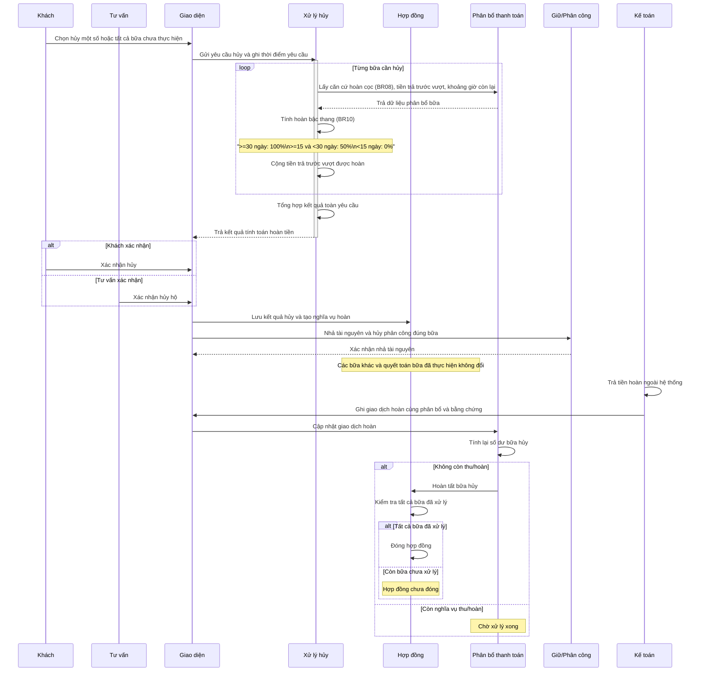

# Hủy và hoàn theo từng Meal

## Phạm vi

UC liên quan: UC-HD-06, UC-HD-07. Tra tại [danh mục chung](../danh-muc-use-case.md).

## Lưu ý và giới hạn

- Mức Refund đối với Deposit căn cứ số ngày còn lại đến tiệc: $\ge 30$ ngày hoàn 100%; từ $15$ đến dưới $30$ ngày hoàn 50%; dưới $15$ ngày hoàn 0%. Phần tiền trả trước vượt Deposit được hoàn đủ 100%.
- Hủy trước khi Deposit không phát sinh chi phí.
- Customer không có mặt tại tiệc là trường hợp ghi nhận riêng, không tính là Customer chủ động yêu cầu hủy.
- Quy trình Refund do Accountant chi trả và ghi nhận trực tiếp, không qua phê duyệt nhiều cấp phức tạp.
