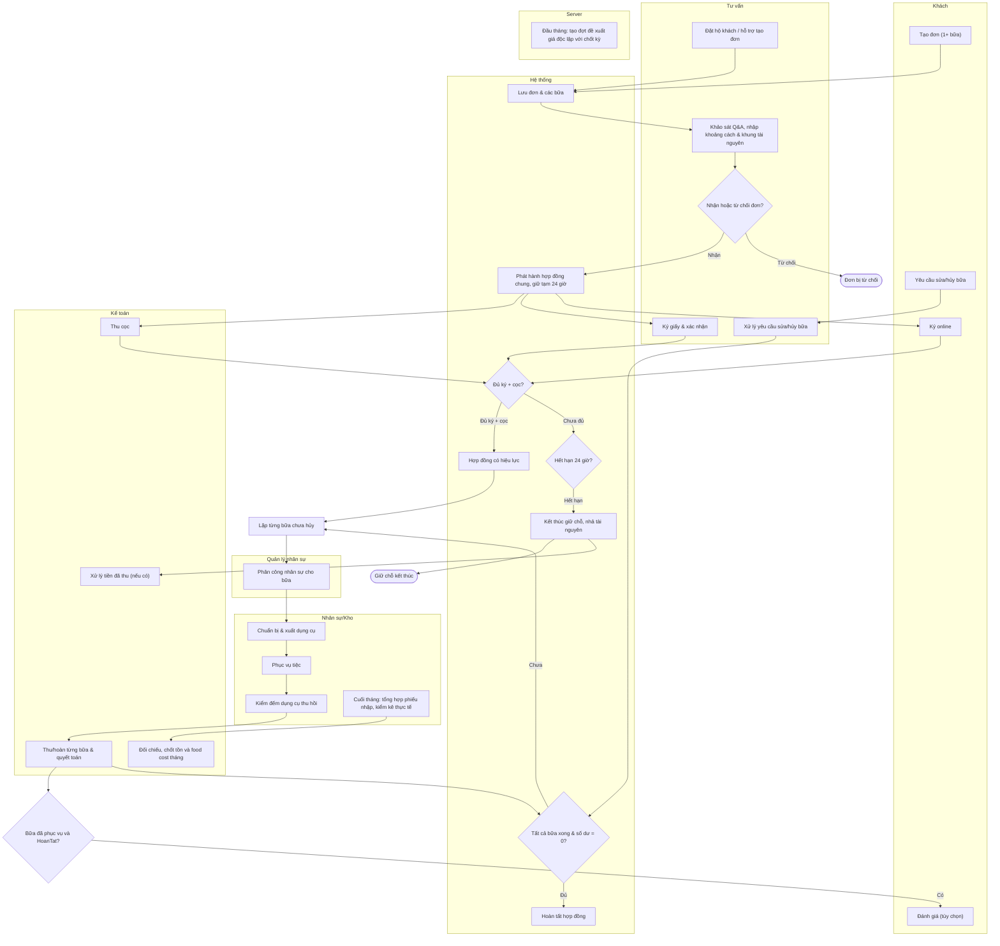

# Quy trình tổng thể

## Phạm vi

UC liên quan: UC-DT-02, UC-DT-03, UC-DT-04, UC-DT-05, UC-HD-01 đến UC-HD-08, UC-NS-02, UC-KHO-02 đến UC-KHO-04, UC-KHO-06, UC-KHO-07, UC-CS-01. Tra tại [danh mục chung](./danh-muc-use-case.md).

## Lưu ý và giới hạn

- Không vẽ các bước nghiệp vụ hiện trường (check-in, ký bàn giao giấy tờ, chụp ảnh hiện trạng hay thu hồi dụng cụ nhiều đợt).
- Các nhánh hủy tiệc hoặc điều chỉnh hợp đồng được chi tiết hóa tại các sơ đồ sequence riêng biệt tương ứng.
