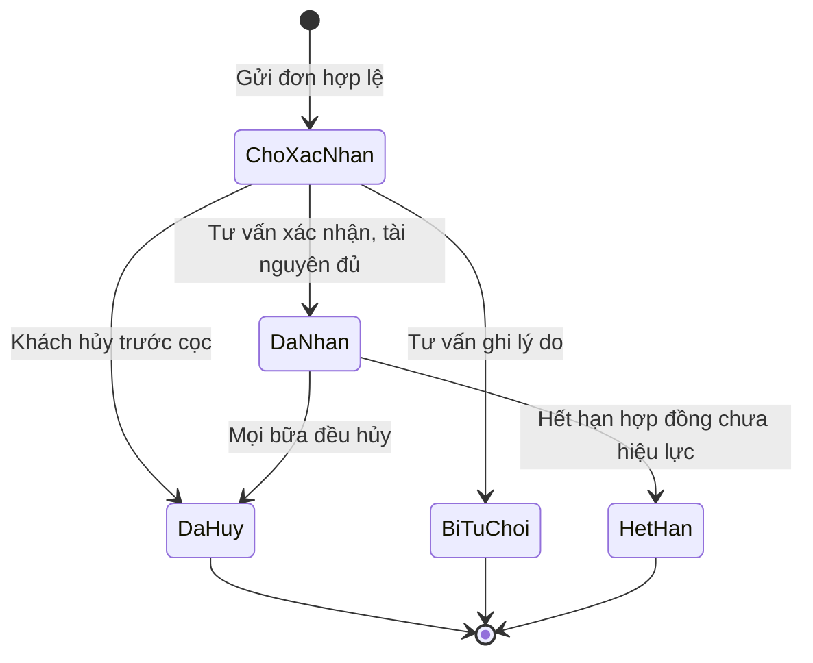
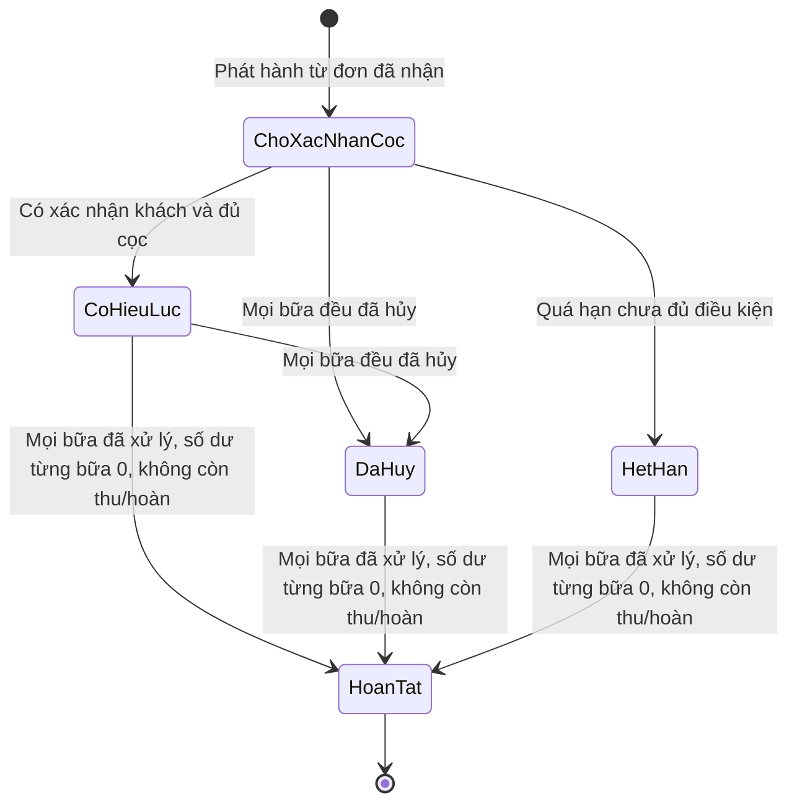
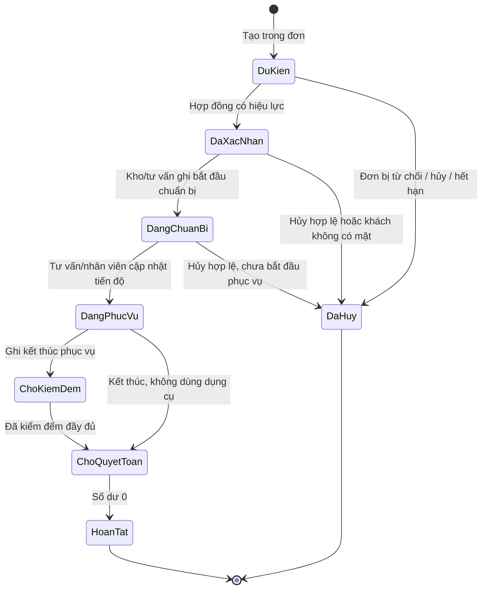

# Trạng thái Order, Contract và Meal

## Phạm vi

UC-DT-02, UC-DT-03, UC-DT-04, UC-DT-05, UC-HD-01, UC-HD-02 đến UC-HD-08, UC-VH-01, UC-KHO-07. Quy tắc theo [spec](../specification.md), dữ liệu theo [class](../mo-hinh/mo-hinh-lop-class.md).

## Lưu ý và quy tắc chuyển trạng thái

- **Độc lập tiến độ**: Không gom tiến độ của từng Meal vào trạng thái Contract chung. Meal thứ nhất có thể hoàn tất trong khi Meal thứ hai chưa diễn ra.
- **Hủy Meal**: Một Meal bị hủy không đổi trạng thái Contract sang `DaHuy` nếu vẫn còn các Meal khác tiếp tục. Contract chỉ chuyển `DaHuy` khi tất cả các Meal đều bị hủy.
- **Đóng Contract**: Contract chuyển `HoanTat` khi mọi Meal đã được xử lý (phục vụ xong hoặc đã hủy) và số dư công nợ của từng Meal bằng 0 (không còn nghĩa vụ thu thêm hay Refund).
- **Giao dịch Payment**: Trạng thái `Cho` → `ThanhCong` hoặc `ThatBai`. Giao dịch Refund là bản ghi mới, không chuyển đổi trên bản ghi thu.
- **Addendum**: `ChoXacNhan` → `ChoCocBoSung` (nếu tăng trên 3 bàn) → `DaApDung` (hoặc `DaHuy` nếu Customer từ chối/không đủ tài nguyên). Addendum đã ký không sửa đè.
