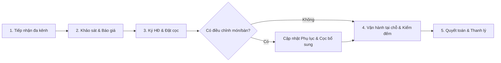
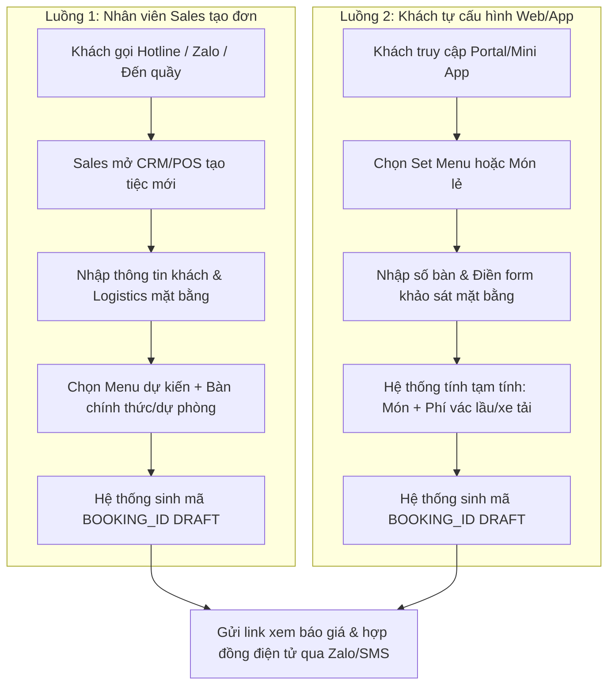
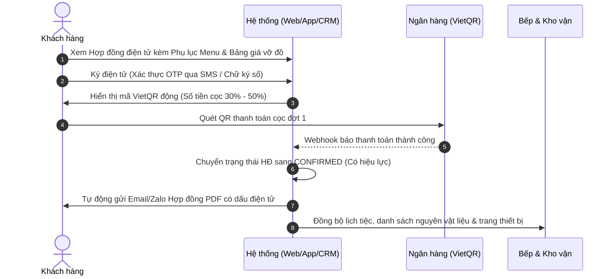
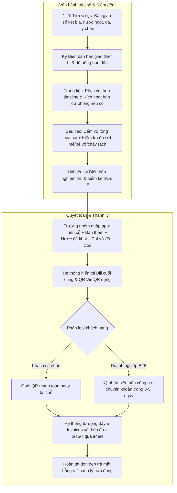

# Quy trình vận hành & khung hợp đồng

---

## Quy trình vận hành tổng thể

Quy trình quản lý tiệc lưu động bao gồm 5 giai đoạn chính được trực quan hóa qua sơ đồ sau:



---

### GIAI ĐOẠN 1: TIẾP NHẬN YÊU CẦU & TẠO HỒ SƠ TIỆC (BOOKING RECORD)

Hệ thống hỗ trợ 2 luồng tiếp nhận: qua Sales (Hotline/Tư vấn trực tiếp) và Khách tự cấu hình Online qua Web/App.



#### Chi tiết thông tin thu thập:

- **Thông tin khách hàng:** Tên cá nhân/Doanh nghiệp, SĐT, Email, MST (nếu xuất hóa đơn GTGT).
- **Khảo sát logistics mặt bằng (Cực kỳ quan trọng với tiệc lưu động):**
  - Địa hình: Nhà riêng, văn phòng, kho xưởng, sân vườn ngoài trời...
  - Lầu/tầng tổ chức? Có thang máy vận chuyển hay phải vác bộ?
  - Khoảng cách từ vị trí xe tải dừng/đỗ đến điểm dựng bếp/bàn tiệc?
  - Hiện trạng điện nước: Nguồn nước sạch dã chiến, chỗ thoát nước, nguồn điện 1 pha/3 pha cho thiết bị nấu.

---

### GIAI ĐOẠN 2: PHÁT HÀNH HỢP ĐỒNG & THANH TOÁN TIỀN CỌC



---

### GIAI ĐOẠN 3: ĐIỀU CHỈNH THỰC ĐƠN, SỐ BÀN & BIẾN ĐỘNG TÀI CHÍNH

Trong tiệc lưu động, khách thường thay đổi số lượng khách mời trước giờ G. Hệ thống xử lý theo quy tắc sau:

| Sự kiện thay đổi                          | Thời điểm cho phép                                                                                  | Ảnh hưởng Hợp đồng & Tiền cọc                                                                                                                                                  | Cách xử lý hệ thống                                                                |
| :---------------------------------------- | :-------------------------------------------------------------------------------------------------- | :----------------------------------------------------------------------------------------------------------------------------------------------------------------------------- | :--------------------------------------------------------------------------------- |
| **Đổi món trong Menu**                    | Trước tiệc $\ge 5$ ngày                                                                             | • Giá món mới $\ge$ món cũ: Tính bù chênh lệch vào Bill cuối.<br>• Giá món mới $<$ món cũ: Giảm trừ vào Bill cuối.<br>• Không cần cọc thêm trừ khi tổng giá trị tăng $> 20\%$. | Cập nhật lại Phụ lục Menu; hệ thống gửi thông báo xác nhận sửa đổi qua Zalo/Email. |
| **Tăng số lượng bàn**                     | Trước tiệc $\ge 3$ ngày                                                                             | • Tăng tổng giá trị hợp đồng.<br>• Nếu tăng trên 3 bàn: Yêu cầu nạp cọc bổ sung tương ứng (30% - 50% của phần tăng thêm).                                                      | Sinh mã QR thanh toán cọc bổ sung; cập nhật tự động giá trị hợp đồng.              |
| **Giảm số lượng bàn**                     | Trước tiệc $\ge 3$ ngày (Tối đa giảm không quá 10% - 15% tổng số bàn)                               | • Tiền cọc đợt 1 giữ nguyên (không hoàn trả lại phần chênh lệch cọc ngay).<br>• Khoản tiền thừa sẽ khấu trừ trực tiếp vào hóa đơn quyết toán cuối cùng.                        | Tạo `Phụ lục sửa đổi số lượng`; xác nhận lại số lượng bàn chính thức.              |
| **Báo giảm bàn quá sát giờ** ($< 48$ giờ) | Dưới 48 giờ trước giờ phục vụ                                                                       | **Không được giảm trừ tiền cỗ.** Bên cung cấp vẫn nấu đủ số bàn và đóng hộp giao nguyên thực phẩm cho khách mang về, do thực phẩm tươi sống đã được sơ chế.                    | Giữ nguyên 100% giá trị các bàn đã báo giảm trễ hạn.                               |
| **Hủy toàn bộ tiệc**                      | • $\ge 7$ ngày trước tiệc:<br>Phạt 50% tiền cọc.<br>• $< 3$ ngày trước tiệc:<br>Phạt 100% tiền cọc. | Hợp đồng chấm dứt hiệu lực theo điều khoản hủy phạt.                                                                                                                           | Xuất biên bản chấm dứt hợp đồng; khấu trừ cọc tương ứng.                           |

---

### GIAI ĐOẠN 4 & 5: VẬN HÀNH TẠI CHỖ, QUYẾT TOÁN & THANH LÝ

Quy trình giao nhận 3 bước và tất toán tài chính được thể hiện chi tiết bằng sơ đồ luồng:



---

## Bản dự thảo hợp đồng dịch vụ tiệc lưu động

_Căn cứ tham chiếu:_

- _Bộ luật Dân sự số 91/2015/QH13 của Quốc hội nước CHXHCN Việt Nam._
- _Luật Thương mại số 36/2005/QH11 của Quốc hội nước CHXHCN Việt Nam._
- _Luật An toàn thực phẩm số 55/2010/QH12._

````
---

**CỘNG HÒA XÃ HỘI CHỦ NGHĨA VIỆT NAM**
**Độc lập – Tự do – Hạnh phúc**

---

### HỢP ĐỒNG DỊCH VỤ ĂN UỐNG LƯU ĐỘNG (CATERING)

_Số: ...... /HĐDV-CATERING/202..._

Hôm nay, ngày ...... tháng ...... năm 202..., tại ..........................................................., chúng tôi gồm có:

**BÊN CUNG CẤP DỊCH VỤ (BÊN A):**

- Tên đơn vị / Nhà hàng: ............................................................................................
- Đại diện theo pháp luật: ................................................... Chức vụ: ........................
- Địa chỉ: .................................................................................................................
- Mã số thuế: ............................................................................................................
- Điện thoại / Hotline: ................................................................................................
- Số tài khoản: ..........................................................................................................
- Mở tại ngân hàng: ....................................................................................................

**BÊN SỬ DỤNG DỊCH VỤ (BÊN B):**

- Tên khách hàng / Công ty: ......................................................................................
- Đại diện: ................................................................... Chức vụ: ............................
- CCCD/CMND số: ...................................... Cấp ngày: ................... Nơi cấp: .............
- Mã số thuế (nếu có): ...............................................................................................
- Địa chỉ: .................................................................................................................
- Điện thoại liên hệ: .................................................................................................

Hai bên cùng thống nhất ký kết Hợp đồng dịch vụ tổ chức tiệc lưu động với các điều khoản chi tiết như sau:

---

#### ĐIỀU 1: NỘI DUNG DỊCH VỤ, THỜI GIAN & ĐỊA ĐIỂM

1.1. **Tính chất dịch vụ:** Bên A nhận cung cấp dịch vụ ẩm thực, bàn ghế, dụng cụ ăn uống và nhân viên phục vụ trọn gói tại địa điểm chỉ định của Bên B.
1.2. **Quy mô tiệc:**

- Số lượng bàn chính thức: ...... bàn (06 hoặc 10 người/bàn).
- Số lượng bàn dự phòng: ...... bàn (Bên A chuẩn bị sẵn thực phẩm tươi sống, chỉ nấu khi Bên B yêu cầu kích hoạt).
  1.3. **Thời gian triển khai:**
- Thời gian bắt đầu set-up mặt bằng: ...... giờ ...... phút, ngày ....../....../202...
- Thời gian đón khách & dùng tiệc: ...... giờ ...... phút, ngày ....../....../202...
- Thời gian kết thúc & dọn dẹp: ...... giờ ...... phút, ngày ....../....../202...
  1.4. **Địa điểm thực hiện:** .........................................................................................
- Điều kiện mặt bằng: (Ghi rõ tầng lầu, vị trí bếp dã chiến, nơi cấp nước sinh hoạt, chỗ cắm điện).

---

#### ĐIỀU 2: GIÁ TRỊ HỢP ĐỒNG & PHƯƠNG THỨC THANH TOÁN

2.1. **Tổng giá trị dự kiến (Tạm tính):**

- Đơn giá tiệc: .......................... VNĐ/bàn $\times$ ...... bàn = .......................... VNĐ.
- Chi phí đồ uống (tạm tính theo số két/thùng mang đến): .......................... VNĐ.
- Chi phí vận chuyển, vác lầu & dọn dẹp dã chiến: .......................... VNĐ.
- Thuế GTGT (VAT ...%): .......................... VNĐ.
- **TỔNG CỘNG TẠM TÍNH:** .......................... VNĐ _(Bằng chữ: ...................................)_

2.2. **Tiến độ thanh toán:**

- **Đợt 1 (Đặt cọc):** Bên B đặt cọc cho Bên A số tiền tương đương **50%** (hoặc 30%) tổng giá trị tạm tính ngay sau khi ký hợp đồng, tương đương: .......................... VNĐ. Hợp đồng chỉ chính thức phát sinh hiệu lực sau khi Bên A nhận đủ khoản cọc này.
- **Đợt 2 (Quyết toán):** Sau khi kết thúc buổi tiệc, hai bên ký "Biên bản nghiệm thu & kiểm kê thực tế", Bên B có trách nhiệm thanh toán toàn bộ số tiền còn lại sau khi đã cấn trừ tiền cọc đợt 1.

---

#### ĐIỀU 3: QUY ĐỊNH VỀ THAY ĐỔI SỐ BÀN, MÓN ĂN & HỦY DỊCH VỤ

3.1. **Điều chỉnh số lượng bàn & thực đơn:**

- Mọi yêu cầu thay đổi món ăn hoặc tăng/giảm số lượng bàn phải được thông báo bằng văn bản hoặc tin nhắn xác nhận trước ngày tổ chức tiệc tối thiểu **03 (ba) ngày**.
- Bên B được quyền giảm không quá **10%** tổng số bàn đã đặt trước mốc 03 ngày. Nếu Bên B báo giảm bàn sau mốc 48 giờ trước tiệc, Bên B vẫn phải thanh toán 100% tiền thực phẩm của số bàn đã giảm (Bên A sẽ đóng hộp thức ăn hoàn trả cho Bên B).
- Trường hợp Bên B sử dụng thêm các bàn dự phòng trong bữa tiệc, đơn giá các bàn dự phòng phát sinh sẽ tính bằng đúng đơn giá bàn chính thức đã thỏa thuận.
  3.2. **Chính sách phạt hủy hợp đồng:**
- Nếu Bên B hủy hợp đồng trước tiệc từ 07 ngày trở lên: Chịu phạt 30% tổng tiền cọc.
- Nếu Bên B hủy hợp đồng từ 03 đến dưới 07 ngày trước tiệc: Chịu phạt 50% tổng tiền cọc.
- Nếu Bên B hủy hợp đồng dưới 03 ngày trước tiệc: Bên B bị phạt 100% toàn bộ số tiền đã đặt cọc nhằm bồi hoàn chi phí chuẩn bị nguyên vật liệu và giữ lịch nhân sự của Bên A.

---

#### ĐIỀU 4: KIỂM KÊ ĐỒ UỐNG, THIẾT BỊ & ĐỀN BÙ HƯ HỎNG

4.1. **Kiểm kê đồ uống (Bia, nước ngọt, rượu):**

- Trước giờ tiệc 60 phút, đại diện hai bên cùng tiến hành đếm số két/thùng đồ uống do Bên A nhập đến và ký nhận biên bản giao nhận ban đầu.
- Khi tiệc kết thúc, hai bên kiểm đếm số vỏ lon/chai rỗng đã khui và số lượng hàng nguyên vẹn còn lại để trả về. Bên B chỉ thanh toán đúng số lượng lon/chai thực tế đã khui mở.
  4.2. **Đền bù tài sản bể vỡ:**
- Bên B có trách nhiệm hướng dẫn khách sử dụng tài sản cẩn thận.
- Trường hợp khách của Bên B làm cháy rách khăn bàn rèm che, nứt vỡ bát đĩa, ly tách hoặc làm hỏng thiết bị âm thanh ánh sáng do Bên A cung cấp, Bên B có trách nhiệm bồi hoàn chi phí theo "Biểu phí hao hụt vật tư" đính kèm Hợp đồng này.

---

#### ĐIỀU 5: TRÁCH NHIỆM AN TOÀN VỆ SINH THỰC PHẨM & MẶT BẰNG

5.1. **An toàn vệ sinh thực phẩm (ATVSTP):**

- Bên A cam kết toàn bộ thực phẩm có nguồn gốc xuất xứ rõ ràng, lưu mẫu thức ăn trong vòng 24 giờ theo đúng quy định của Bộ Y tế.
- Bên A không chịu trách nhiệm đối với các loại đồ ăn, đồ uống, bánh kem... do Bên B tự mang từ ngoài vào tiệc.
- Khuyến nghị thức ăn thừa sau tiệc: Thức ăn lưu động nên được bảo quản lạnh và sử dụng tốt nhất trong vòng 02 giờ sau tiệc; Bên A miễn trừ trách nhiệm về chất lượng vi sinh nếu Bên B tự ý giữ lại thức ăn thừa qua đêm mà không có thiết bị bảo quản tiêu chuẩn.
  5.2. **Bàn giao mặt bằng:**
- Bên A có trách nhiệm thu gom toàn bộ rác thải phát sinh từ quá trình chế biến và phục vụ, quét dọn sạch sẽ khu vực tổ chức và khu bếp dã chiến trước khi rời đi.

---

#### ĐIỀU 6: ĐIỀU KHOẢN CHUNG & HIỆU LỰC HỢP ĐỒNG

6.1. Hợp đồng này có hiệu lực kể từ ngày đại diện hai bên ký kết (hoặc xác nhận điện tử hợp lệ) và Bên A nhận được đầy đủ tiền đặt cọc Đợt 1.
6.2. Hợp đồng được coi là tự động thanh lý toàn bộ nghĩa vụ khi Bên B đã thanh toán hết số tiền theo Bảng kê quyết toán cuối cùng, nhận hóa đơn GTGT hợp lệ (nếu có) và Bên A đã hoàn tất việc dọn dẹp bàn giao mặt bằng.
6.3. Hợp đồng được lập thành 02 (hai) bản có giá trị pháp lý như nhau, mỗi bên giữ 01 bản để thực hiện.

```
       ĐẠI DIỆN BÊN A                               ĐẠI DIỆN BÊN B
  (Ký, ghi rõ họ tên và đóng dấu)              (Ký, ghi rõ họ tên và đóng dấu)
```
````

---

## Tài liệu tham khảo & căn cứ thực tế tại Việt Nam

Để thiết kế hệ thống và hoàn thiện quy chế pháp lý, các tiêu chuẩn và mẫu thực tế sau đây được áp dụng:

1. **Về khuôn khổ pháp luật hợp đồng:**
   - Hợp đồng dịch vụ tiệc bản chất là **Hợp đồng dịch vụ** theo quy định tại _Điều 513 đến Điều 521 Bộ luật Dân sự 2015_.
   - Khái niệm đặt cọc tuân thủ _Điều 328 Bộ luật Dân sự 2015_ (Xử lý tiền cọc khi một bên từ chối thực hiện nghĩa vụ hợp đồng).
   - Nghĩa vụ phạt vi phạm và bồi thường thiệt hại thực hiện theo _Điều 300, 301 Luật Thương mại 2005_ (mức phạt hợp đồng thương mại tối đa 8% giá trị phần nghĩa vụ bị vi phạm nếu cả 2 bên là thương nhân).

2. **Về an toàn vệ sinh thực phẩm (Catering):**
   - Áp dụng các quy định về _Bếp ăn tập thể và cơ sở kinh doanh dịch vụ ăn uống lưu động_ theo _Luật An toàn thực phẩm 2010_ và _Nghị định 15/2018/NĐ-CP_.
   - Quy trình lưu mẫu thực phẩm 24 giờ áp dụng theo _Quyết định 1246/QĐ-BYT_ của Bộ Y tế.

3. **Mẫu thực tế từ các đơn vị catering lớn tại Việt Nam:**
   - Tham khảo cấu trúc hợp đồng tiệc ngoài trời của các chuỗi: _TiecSaigon (tiecsaigon.com)_, _Đại Lâm Event_, _Minh Long Food_. Các bên đều áp dụng cơ chế: Chốt mâm cứng + mâm dự phòng 5-10%, khóa thực đơn trước 3 ngày, đếm vỏ chai đồ uống cuối tiệc và tích hợp bảng giá đền bù vỡ đồ ngay trong phụ lục.
