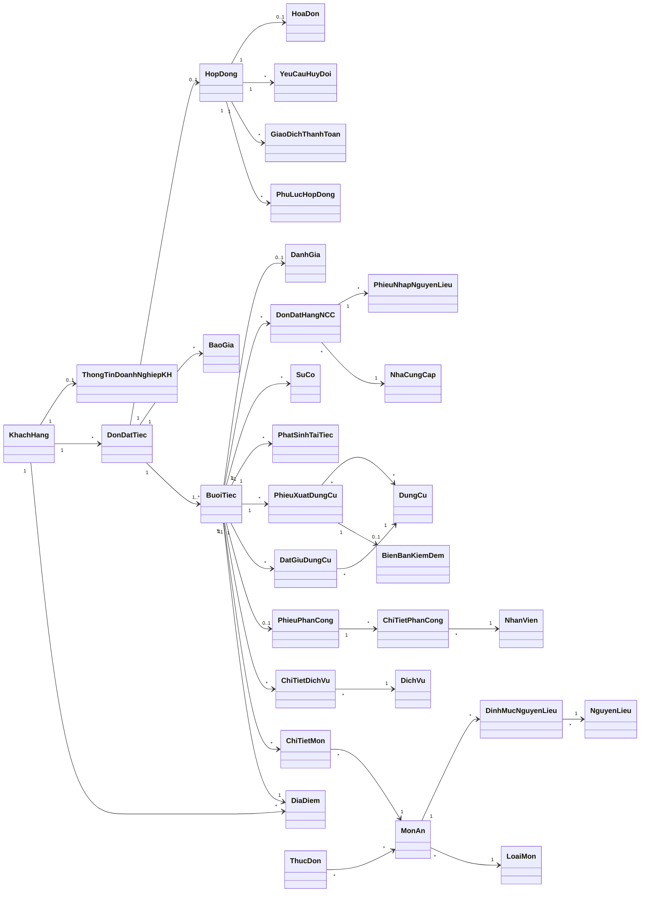
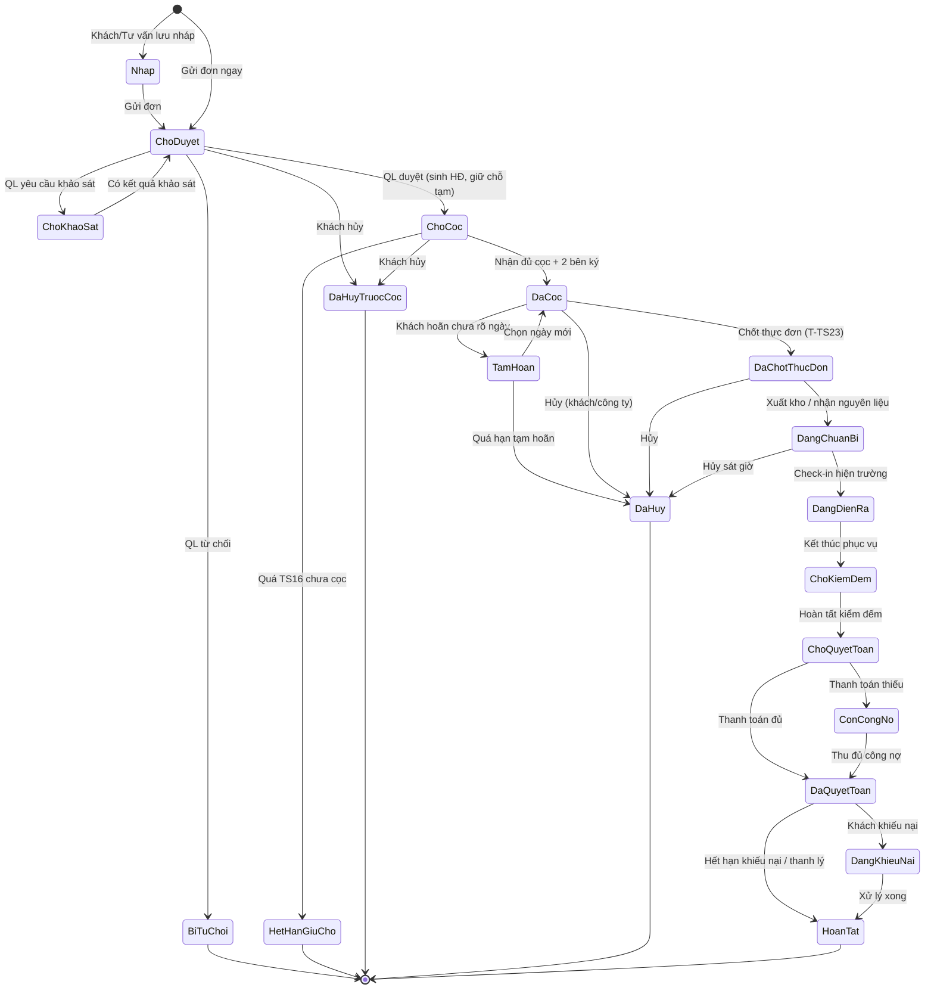
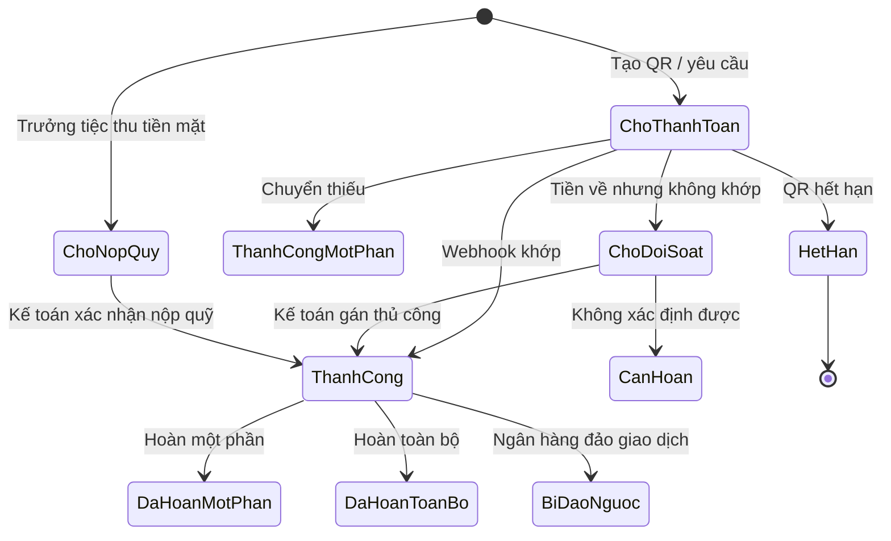
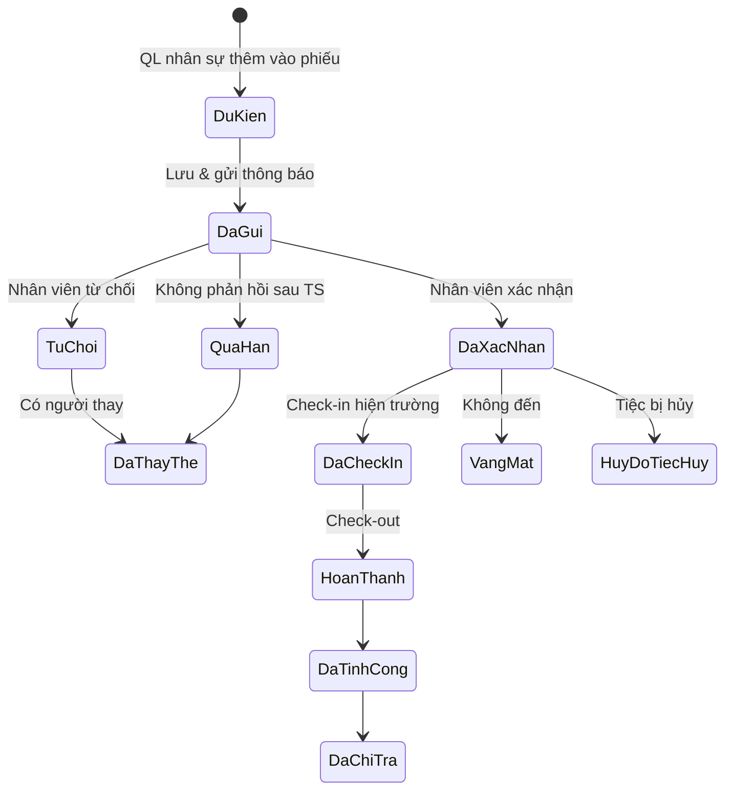
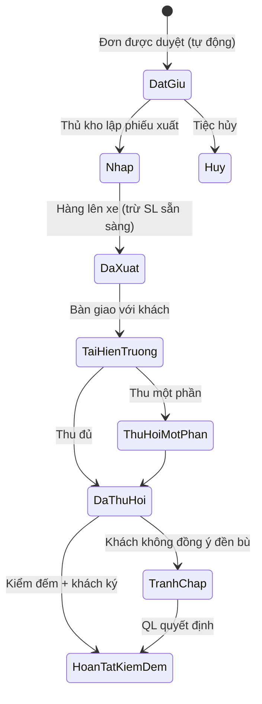
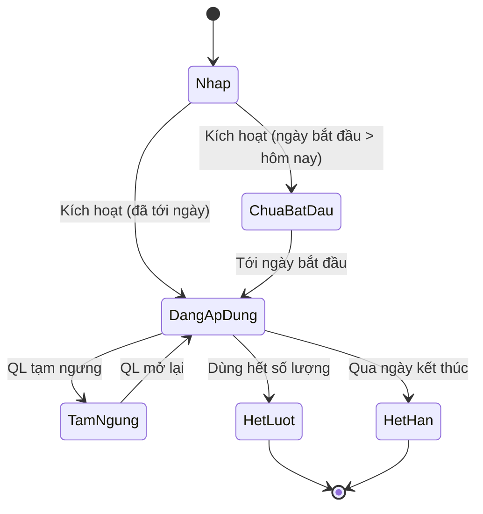
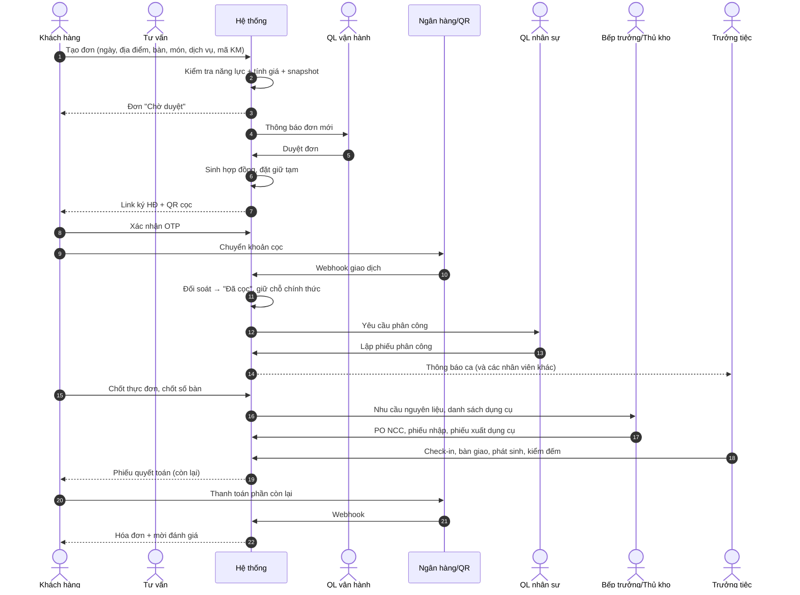

# BỔ SUNG PHÂN TÍCH NGHIỆP VỤ — ĐỀ TÀI QUẢN LÝ TIỆC NẤU ĂN LƯU ĐỘNG

## Phần 1. Rà soát báo cáo hiện tại — lỗi, mâu thuẫn, chỗ cần sửa

### 1.2. Mã biểu mẫu và mã quy định không khớp 🔴

Đây là lỗi **nghiêm trọng nhất** vì nó làm phần luồng nghiệp vụ tham chiếu sai biểu mẫu.

**Bảng "Danh sách yêu cầu phần mềm" ghi:**

| STT | Yêu cầu                                    | Mã trong bảng |
| --- | ------------------------------------------ | ------------- |
| 7   | Lập phiếu nhập nguyên liệu                 | BM7           |
| 8   | Lập chương trình khuyến mãi                | BM8           |
| 9   | Lập danh mục dịch vụ & bảng giá bồi thường | BM9           |

**Nhưng phần nội dung biểu mẫu lại ghi:**

| Biểu mẫu thực tế                       | Mã ghi trên biểu mẫu |
| -------------------------------------- | -------------------- |
| Danh mục dịch vụ & bảng giá bồi thường | **BM7**              |
| Phiếu nhập nguyên liệu                 | **BM8**              |
| Chương trình khuyến mãi                | **BM9**              |

-> Thống nhất tên thôi nha

**Phần luồng nghiệp vụ thì dùng lẫn cả hai cách:**

- 1.4.1 ghi "BM8 (khuyến mãi), BM9 (dịch vụ)" → theo bảng yêu cầu.
- 1.4.7, 1.4.8 ghi "BM7 (Phiếu nhập nguyên liệu)" → theo bảng yêu cầu.
- 1.4.10 ghi "BM9 (bảng giá bồi thường)" → theo bảng yêu cầu.

**Đề xuất:** chọn **một** bảng ánh xạ duy nhất, rồi sửa cả nội dung biểu mẫu. Ví dụ bảng chuẩn (giữ nguyên thứ tự của bảng yêu cầu):

| Mã   | Biểu mẫu                               | Quy định |
| ---- | -------------------------------------- | -------- |
| BM1  | Danh mục món ăn                        | QĐ1      |
| BM2  | Thực đơn (combo)                       | QĐ2      |
| BM3  | Danh mục loại tiệc                     | QĐ3      |
| BM4  | Phiếu đặt tiệc                         | QĐ4      |
| BM5  | Hợp đồng dịch vụ đặt tiệc              | QĐ5      |
| BM6  | Lịch tiệc & phân công nhân sự          | QĐ6      |
| BM7  | Phiếu nhập nguyên liệu                 | QĐ7      |
| BM8  | Chương trình khuyến mãi                | QĐ8      |
| BM9  | Danh mục dịch vụ & bảng giá bồi thường | QĐ9      |
| BM10 | Phiếu xuất dụng cụ                     | QĐ10     |
| BM11 | Biên bản kiểm đếm & đền bù             | QĐ11     |
| BM12 | Hóa đơn thanh toán                     | QĐ12     |
| BM13 | Tra cứu hợp đồng & lịch sử thanh toán  | —        |
| BM14 | Báo cáo thống kê                       | —        |
| BM15 | Tham số hệ thống                       | —        |

**Lỗi mã quy định:**

AI tự fix mã quy định cho thống nhất thứ tự

### 1.3. Lỗi nội dung từng biểu mẫu 🔴

| Biểu mẫu               | Vấn đề                                                                                                                                                                                                                                                                                                                                                                                                                                                    | Đề xuất                                                                                                                                                                                                                                                                                                 |
| ---------------------- | --------------------------------------------------------------------------------------------------------------------------------------------------------------------------------------------------------------------------------------------------------------------------------------------------------------------------------------------------------------------------------------------------------------------------------------------------------- | ------------------------------------------------------------------------------------------------------------------------------------------------------------------------------------------------------------------------------------------------------------------------------------------------------- |
| **BM4** Đặt tiệc       | Không có **giờ bắt đầu – kết thúc**, chỉ "ngày giờ diễn ra". Không có thông tin địa điểm chi tiết (loại địa điểm, hẻm, tầng, điện nước). Không có số khách dự kiến tách biệt số bàn, không có bàn chay/trẻ em, không có ghi chú dị ứng. "Địa chỉ khách hàng" và "Địa điểm diễn ra" chưa phân biệt rõ người liên hệ tại chỗ.                                                                                                                               | Xem BM4 mở rộng ở Phần 10.                                                                                                                                                                                                                                                                              |
| **QĐ4**                | "Khách hàng phải cọc trước **hoặc** trả 100% … tiền cọc phải **đúng** 50%" mâu thuẫn với TS06 = 50% (**tối thiểu**) và TS07 = 100% (**tối đa**). BM5-B6 lại ghi "Tiền cọc phải bằng 50%" → khách trả 100% sẽ bị hệ thống chặn.                                                                                                                                                                                                                            | Chọn một trong hai: (a) cọc ∈ [TS06, TS07] — khách tự chọn số tiền; (b) cọc chỉ có hai mức {TS06, 100%}. Khuyến nghị **(a)** và đổi tên TS06 thành "Tỷ lệ cọc tối thiểu". Sửa BM5-B6 thành "Tiền cọc ≥ TS06 × Tổng giá trị".                                                                            |
| **BM5** Hợp đồng       | Thông tin bên A cứng "CÔNG TY DỊCH VỤ MASTERCOOK VIỆT NAM" trong khi phạm vi là **"Công ty hộ gia đình"** (xem 1.6). Thiếu: điều khoản thanh toán, hủy, đền bù, bất khả kháng, an toàn thực phẩm, chữ ký hai bên, MST bên B (nếu là công ty). Có "ngày lập" và "ngày ký" nhưng không có trạng thái ký.                                                                                                                                                    | Xem BM5 mở rộng ở Phần 10 và các điều khoản mẫu.                                                                                                                                                                                                                                                        |
| **BM7/BM8** Phiếu nhập | B4 "Kiểm tra tính hợp lệ về quy định và đơn giá" mơ hồ. Thuật toán nhảy từ B6 sang B8 (thiếu B7). B5 "số tiền thanh toán (**>0**)" nhưng 1.4.8 ghi "**không âm**" → mua chịu (thanh toán 0đ) bị chặn hay không? "Tên nguyên liệu" nhập tự do, không có danh mục → không thống kê được "thịt heo" vs "Thịt heo" vs "thịt lợn".                                                                                                                             | Thống nhất: "Số tiền thanh toán ≥ 0 và ≤ Tổng tiền hàng". Thêm **danh mục nguyên liệu** (mã, tên, đơn vị chuẩn).                                                                                                                                                                                        |
| **1.4.7 vs BM8**       | 1.4.7 ghi "đối chiếu với kho thực phẩm (**không quản lý**)" nhưng D4 của phiếu nhập lại "cập nhật **Số lượng tồn kho mới**" → hệ thống có quản lý tồn kho thực phẩm hay không?                                                                                                                                                                                                                                                                            | Chọn một: (a) **không quản lý tồn kho thực phẩm** — phiếu nhập chỉ để ghi nhận chi phí theo tiệc (đơn giản, hợp lý vì thực phẩm tươi mua theo tiệc, dùng hết trong ngày); hoặc (b) quản lý tồn kho khô (gia vị, dầu, gạo, đồ khô) + mua tươi theo tiệc. Khuyến nghị **(b)** ở mức đơn giản, xem Phần 6. |
| **BM10** Xuất dụng cụ  | QĐ "Số lượng **từng loại** dụng cụ xuất ra phải nhiều hơn 10% so với lượng khách" → áp cho **rạp, loa, máy phát, bàn** là vô lý (400 khách → 440 cái rạp?). Thuật toán lưu D4 (B7) **trước** khi tính tồn kho mới (B8). B6 không có nhánh lỗi.                                                                                                                                                                                                            | Định mức theo **đơn vị tính của dụng cụ**: _theo khách_ (chén, đũa, muỗng, ly, khăn giấy) × (1 + TS08); _theo bàn_ (bàn, khăn trải, nồi lẩu, bếp cồn, mâm) × (1 + dự phòng bàn); _theo tiệc_ (rạp, loa, máy phát, quạt) theo dịch vụ đã chọn. Đảo B7/B8.                                                |
| **BM11** Kiểm đếm      | Tiêu đề ghi "**Mã phiếu xuất**" (copy BM10) → phải là "Mã biên bản kiểm đếm". Chỉ có "số lượng xuất" và "thu hồi" → không có **thu hồi nhưng hư hỏng** (chén mẻ, khăn rách, ghế gãy). Không phân biệt **lỗi do khách** hay **do nhân viên/vận chuyển**. "Tồn kho mới = hiện tại + **thu hồi**" → đồ hư cũng được cộng vào tồn khả dụng. B6 "nếu không thỏa → kết thúc" nhưng QĐ lại cho phép thiếu (tính đền bù) → không rõ điều kiện "không thỏa" là gì. | Xem BM11 mở rộng (Phần 10): cột _Thu hồi tốt / Hư hỏng / Mất / Nguyên nhân / Bên chịu trách nhiệm_. Chỉ cộng **thu hồi tốt** vào tồn khả dụng; hư hỏng → kho "chờ sửa/thanh lý".                                                                                                                        |
| **BM12** Hóa đơn       | B5 lặp "Kiểm tra quy định thu hồi dụng cụ". B6 "Số tiền khách thanh toán phải **đúng bằng số tiền còn lại trừ chi phí cọc**" → **trừ cọc hai lần** (số tiền còn lại đã trừ cọc). Đồng thời mâu thuẫn với ngoại lệ 1.4.12 "khách thanh toán thiếu thì để công nợ". Trạng thái hóa đơn luôn "Đã thanh toán".                                                                                                                                                | Sửa: "Số tiền thanh toán ≤ Số tiền còn lại; nếu nhỏ hơn → trạng thái **Còn công nợ**; nếu bằng → **Đã thanh toán**". Tách **Hóa đơn** và **Giao dịch thanh toán** (một hóa đơn có nhiều giao dịch).                                                                                                     |
| **BM13, BM14**         | Còn nguyên mẫu **"Tên Sách – Tồn Đầu – Phát Sinh – Tồn Cuối"** (copy từ đồ án quản lý thư viện).                                                                                                                                                                                                                                                                                                                                                          | Viết lại hoàn toàn — xem Phần 10.                                                                                                                                                                                                                                                                       |
| **BM15** Tham số       | Cột "Áp dụng" gần như trống (chỉ TS01 ghi "BM"). TS13 mô tả "tính từ **ngày** xác nhận hủy đến **ngày** diễn ra" — tính theo ngày lịch hay theo giờ? Tiệc 18h ngày 20, hủy lúc 20h ngày 17 → còn 2 ngày 22 giờ hay "3 ngày"?                                                                                                                                                                                                                              | Điền cột áp dụng (BM nào, QĐ nào). Quy ước: thời hạn tính theo **giờ** (VD 72h) hoặc "trước 0h của ngày T−3". Thêm cột **"Ngày hiệu lực"** — thay đổi tham số không ảnh hưởng hợp đồng đã ký.                                                                                                           |

### 1.4. Lỗi trong luồng nghiệp vụ 🔴

| Mục            | Vấn đề                                                                                                                                                                                                                                                                                                                                                                                                                                                                                                                                                      | Đề xuất                                                                                                                                                                                                                 |
| -------------- | ----------------------------------------------------------------------------------------------------------------------------------------------------------------------------------------------------------------------------------------------------------------------------------------------------------------------------------------------------------------------------------------------------------------------------------------------------------------------------------------------------------------------------------------------------------- | ----------------------------------------------------------------------------------------------------------------------------------------------------------------------------------------------------------------------- |
| 1.4.1          | "Khi muốn đặt tiệc, khách hàng **đăng nhập và đăng ký**" → thứ tự ngược.                                                                                                                                                                                                                                                                                                                                                                                                                                                                                    | "đăng ký (nếu chưa có tài khoản) hoặc đăng nhập". Cân nhắc cho phép **đặt bằng số điện thoại + OTP** không cần mật khẩu (người lớn tuổi đặt đám giỗ rất ngại tạo tài khoản).                                            |
| 1.4.2          | Tác nhân ghi "**Logic và ràng buộc hệ thống**" — không phải tác nhân.                                                                                                                                                                                                                                                                                                                                                                                                                                                                                       | Tác nhân: Khách hàng (chính), Nhân viên tư vấn (đặt hộ), Quản lý vận hành (duyệt).                                                                                                                                      |
| 1.4.2 bước 5   | "không vượt **TS01** (10%)" → TS01 là số người/bàn tối thiểu.                                                                                                                                                                                                                                                                                                                                                                                                                                                                                               | Sửa thành **TS12**.                                                                                                                                                                                                     |
| 1.4.2 bước 7   | "**Hệ thống** xem xét đơn (khả năng phục vụ, **địa điểm**, lịch và phân công nhân sự) rồi duyệt hoặc từ chối" → hệ thống không thể tự đánh giá địa điểm (hẻm có vào được xe tải không, có chỗ dựng rạp không).                                                                                                                                                                                                                                                                                                                                              | Tách: (a) hệ thống **tự kiểm tra** năng lực (số tiệc/ngày, dụng cụ, nhân sự khả dụng, khoảng cách); (b) **Quản lý vận hành duyệt thủ công** phần địa điểm và yêu cầu đặc biệt, có thể kích hoạt UC "Khảo sát địa điểm". |
| 1.4.2          | Tiền cọc được tính ở bước 5 (trước khi duyệt) nhưng chỉ hiển thị sau khi duyệt (bước 7). Trong lúc chờ duyệt, giá món/khuyến mãi có thể thay đổi.                                                                                                                                                                                                                                                                                                                                                                                                           | Quy định: giá & khuyến mãi được **chốt (snapshot) tại thời điểm khách gửi đơn**, giữ trong TS "thời hạn hiệu lực báo giá".                                                                                              |
| 1.4.2 ngoại lệ | "thông báo cho khách hàng **thông qua số điện thoại**"                                                                                                                                                                                                                                                                                                                                                                                                                                                                                                      | Ghi rõ kênh: SMS/Zalo/email/thông báo trên web.                                                                                                                                                                         |
| 1.4.3 bước 6   | "xác nhận trạng thái hợp đồng **'Đã thanh toán'** … chuyển sang bước **1.4.1**"                                                                                                                                                                                                                                                                                                                                                                                                                                                                             | Trạng thái phải là "**Đã cọc**" (1.4.4 dùng "Đã cọc"); chuyển sang **1.4.4**. "Đã thanh toán" chỉ dùng khi khách trả 100%.                                                                                              |
| 1.4.3          | Tác nhân chỉ có Khách hàng. Hợp đồng là văn bản **hai bên** → phải có đại diện bên A (chủ cơ sở) duyệt/ký.                                                                                                                                                                                                                                                                                                                                                                                                                                                  | Thêm tác nhân "Quản lý vận hành / Chủ cơ sở". Hợp đồng chỉ có hiệu lực khi **cả hai** đã xác nhận **và** đã nhận cọc.                                                                                                   |
| 1.4.3 ngoại lệ | "Quá hạn QR" — chưa nói điều gì xảy ra sau đó (đơn bị hủy? giữ lịch bao lâu?).                                                                                                                                                                                                                                                                                                                                                                                                                                                                              | Quá hạn QR → tạo lại QR (không hủy đơn). Quá **TS "thời hạn cọc"** (VD 48h) → đơn tự động "Hết hạn giữ chỗ", nhả lịch.                                                                                                  |
| 1.4.5          | Hai điều kiện ghép **AND** tạo **khoảng trống logic**: (a) còn > 3 ngày nhưng **đã** nhập nguyên liệu → ?; (b) còn < 3 ngày nhưng **chưa** nhập nguyên liệu → ? Ngoài ra: hủy trước 2 tháng vẫn mất 50% cọc là **không hợp lý**, dễ bị phản biện. "**Không thể hủy đơn**" — thực tế không thể ép khách tổ chức tiệc; hệ thống phải cho hủy, chỉ là **không hoàn cọc** (và có thể phạt). Không có trường hợp hủy khi đơn **chưa cọc**. Không có **dời ngày** (rất phổ biến: đám giỗ đổi ngày, tiệc công ty lùi lịch, đám cưới đổi ngày vì xem lại ngày tốt). | Viết lại theo **bậc thang** (xem UC-HĐ-07 ở Phần 6): bảng tỉ lệ hoàn theo số ngày còn lại + khấu trừ **chi phí thực tế đã phát sinh** (nguyên liệu đã mua, đặt cọc thuê ngoài) có chứng từ. Thêm UC "Dời ngày tiệc".    |
| 1.4.5 bước 2   | "hệ thống **liên hệ** để hoàn trả" → hệ thống không liên hệ; kế toán mới hoàn.                                                                                                                                                                                                                                                                                                                                                                                                                                                                              | "Hệ thống tạo **yêu cầu hoàn tiền** cho Kế toán".                                                                                                                                                                       |
| 1.4.5 ngoại lệ | "Công ty hủy vì bất khả kháng thì hoàn 100%" — vậy nếu công ty hủy **không vì bất khả kháng** (nhận trùng lịch, thiếu người)? Theo thông lệ (và tinh thần Bộ luật Dân sự về đặt cọc), bên nhận cọc từ chối thực hiện thường phải **hoàn cọc và chịu phạt một khoản tương đương** (trừ khi có thỏa thuận khác).                                                                                                                                                                                                                                              | Thêm nhánh "Công ty đơn phương hủy": hoàn 100% + phạt theo điều khoản hợp đồng. Bất khả kháng phải định nghĩa (thiên tai, bão, dịch bệnh, lệnh cấm tụ tập của chính quyền…).                                            |
| 1.4.7          | "Trước ngày tiệc **một khoảng hợp lý**" — không đo được.                                                                                                                                                                                                                                                                                                                                                                                                                                                                                                    | Tham số: **mốc chốt thực đơn** (VD T−5) và **mốc chốt số bàn** (VD T−1, 12h trưa).                                                                                                                                      |
| 1.4.7 ngoại lệ | "Khách hàng có thể đổi món sau khi chốt" → mâu thuẫn với ý nghĩa của "chốt".                                                                                                                                                                                                                                                                                                                                                                                                                                                                                | Sau mốc chốt: chỉ cho đổi nếu NCC chưa giao hoặc bếp chấp nhận; phát sinh chi phí thì tính vào phụ lục.                                                                                                                 |
| 1.4.9          | Trạng thái HĐ "Đang chuẩn bị"; 1.4.10 "Đang thực hiện" → "Chờ kiểm đếm"; 1.4.11 "Chờ thanh toán"; 1.4.12 "Đã quyết toán"; 1.4.3 "Đã thanh toán"; 1.4.4 "Đã cọc", "Đã phân công"; 1.4.2 "Chờ xác nhận", "Đã hủy". **Không có sơ đồ trạng thái thống nhất**, "Đã phân công" là trạng thái của phiếu phân công hay của hợp đồng?                                                                                                                                                                                                                               | Xem **Phần 7** — vòng đời trạng thái đầy đủ.                                                                                                                                                                            |
| 1.4.10         | "Khách hàng xem và xác nhận" danh sách dụng cụ bàn giao — **xác nhận lúc nào**? Nếu xác nhận online trước khi xe tới thì vô nghĩa.                                                                                                                                                                                                                                                                                                                                                                                                                          | Xác nhận **tại hiện trường** khi bàn giao (ký trên điện thoại của trưởng tiệc hoặc ký giấy rồi chụp ảnh). Xem UC "Bàn giao hiện trường".                                                                                |
| 1.4.11         | Nhân viên lập biên bản **trên giấy** → Quản trị viên **nhập lại** → nhập liệu hai lần, dễ sai, khách không ký xác nhận số liệu đền bù → dễ tranh chấp.                                                                                                                                                                                                                                                                                                                                                                                                      | Trưởng tiệc kiểm đếm trực tiếp trên điện thoại/tablet, **khách ký xác nhận** tại chỗ, chụp ảnh đồ hư.                                                                                                                   |
| 1.4.12         | Tác nhân "Kế toán" lập hóa đơn **ngay sau tiệc** — thực tế tiệc kết thúc 21–22h, khách thanh toán tại chỗ cho trưởng tiệc (thường bằng tiền mặt hoặc chuyển khoản), kế toán không có mặt.                                                                                                                                                                                                                                                                                                                                                                   | Cho phép **trưởng tiệc thu tiền tại chỗ** (tạo giao dịch "chờ đối soát"), kế toán **đối soát** hôm sau.                                                                                                                 |
| 1.4.13         | "Phân quyền tài khoản" nằm trong Quản lý nhân sự — phân quyền là việc của **Quản trị viên hệ thống**, không phải nghiệp vụ nhân sự. Không có chấm công, tính thù lao (dù bảng đối tượng nói Kế toán theo dõi lợi nhuận).                                                                                                                                                                                                                                                                                                                                    | Tách UC phân quyền sang nhóm Hệ thống. Thêm chấm công/thù lao theo tiệc.                                                                                                                                                |
| 1.4.14         | Báo cáo "lợi nhuận" nhưng hệ thống **không có chi phí nhân công, chi phí thuê ngoài, chi phí vận chuyển** → chỉ tính được doanh thu và chi phí nguyên liệu.                                                                                                                                                                                                                                                                                                                                                                                                 | Thêm dữ liệu chi phí theo tiệc (Phần 4) hoặc đổi tên báo cáo thành "Lãi gộp theo nguyên liệu".                                                                                                                          |

### 1.5. Lỗi ở phần Đối tượng 🟠

| Vấn đề                                                                                                                                                                                                                                                                                                                   | Đề xuất                                                                                                                                                                                                                                |
| ------------------------------------------------------------------------------------------------------------------------------------------------------------------------------------------------------------------------------------------------------------------------------------------------------------------------ | -------------------------------------------------------------------------------------------------------------------------------------------------------------------------------------------------------------------------------------- |
| **Quản trị viên** đang làm quá nhiều việc nghiệp vụ: chốt thực đơn (1.4.7), lập phiếu nhập (1.4.8), xuất kho (1.4.9), gửi phiếu cho khách (1.4.10), nhập biên bản kiểm đếm (1.4.11). Trong khi bảng đối tượng mô tả Quản trị viên là người "nắm cấu trúc dữ liệu, quản lý tài khoản, bảo trì hệ thống" → vai trò **IT**. | Tách **Quản trị hệ thống** (IT) và **Quản lý vận hành / Chủ cơ sở** (nghiệp vụ). Thêm **Thủ kho**, **Bếp trưởng**, **Trưởng tiệc**. Ở cơ sở nhỏ, một người có thể giữ nhiều vai trò → hệ thống hỗ trợ **một tài khoản nhiều vai trò**. |
| Nhân viên bếp/phục vụ/vận chuyển "không dùng hệ thống", nhưng họ cần: xem lịch được phân công, xác nhận nhận ca, check-in. Nếu không, Quản lý nhân sự phải gọi điện từng người (bước 5 của 1.4.4 "liên lạc với nhân viên để thông báo").                                                                                 | Cho nhân viên một **cổng tối giản** (xem lịch, xác nhận/từ chối ca, check-in) — hoặc ít nhất nhận thông báo Zalo/SMS có link xác nhận.                                                                                                 |
| Bảng đối tượng người thiếu: **Nhân viên tư vấn/bán hàng**, **Người liên hệ tại địa điểm**, **Đối tác thuê ngoài** (rạp, âm thanh, MC…), **Khách hàng doanh nghiệp** (khác khách cá nhân: cần hóa đơn VAT, thanh toán công nợ).                                                                                           | Xem Phần 3.                                                                                                                                                                                                                            |
| Bảng đối tượng vật thiếu: **Loại tiệc, Dịch vụ, Khuyến mãi, Nhà cung cấp, Nhân viên, Địa điểm, Phiếu xuất, Biên bản kiểm đếm, Thanh toán/Hoàn tiền, Tham số, Danh mục nguyên liệu**. "Lịch phân công: giao việc **theo tuần**" mâu thuẫn với BM6 phân công **theo tiệc**.                                                | Xem Phần 4.                                                                                                                                                                                                                            |
| "Quản lý nhân sự… **đánh giá** hoạt động làm việc của nhân viên" nhưng không có UC/biểu mẫu đánh giá.                                                                                                                                                                                                                    | Thêm UC "Đánh giá nhân viên sau tiệc".                                                                                                                                                                                                 |
| "Kế toán… quản lý **lợi nhuận**" — xem 1.4.14.                                                                                                                                                                                                                                                                           |                                                                                                                                                                                                                                        |

### 1.6. Vấn đề về phạm vi và khảo sát 🟠

| Vấn đề                                                                                                                                                                                                                                                    | Đề xuất                                                                                                                                                                                                                                                                                                                                         |
| --------------------------------------------------------------------------------------------------------------------------------------------------------------------------------------------------------------------------------------------------------- | ----------------------------------------------------------------------------------------------------------------------------------------------------------------------------------------------------------------------------------------------------------------------------------------------------------------------------------------------- |
| "**Công ty hộ gia đình**" không phải loại hình pháp lý ở Việt Nam. Có **hộ kinh doanh** (đăng ký tại cấp xã/phường, không có tư cách pháp nhân) và **doanh nghiệp** (công ty TNHH, cổ phần…). Hợp đồng lại ghi "CÔNG TY DỊCH VỤ MASTERCOOK" → không khớp. | Đổi thành "**Hộ kinh doanh / doanh nghiệp nhỏ (quy mô 30–50 nhân sự)**". Trong hợp đồng, bên A ghi tên cơ sở và **cấu hình được** (lấy từ bảng thông tin doanh nghiệp, không cứng). Lưu ý hộ kinh doanh quy mô 30–50 lao động là khá lớn; nhóm nên kiểm tra lại quy định hiện hành về ngưỡng lao động của hộ kinh doanh.                        |
| Phạm vi ghi 10–20 đơn/tháng nhưng TS11 cho phép 3 tiệc/ngày (~90 tiệc/tháng) và kho đáp ứng 20–40 bàn/tiệc — nếu 3 tiệc cùng ngày đều 40 bàn → cần 120 bàn. Kho có đủ không?                                                                              | TS11 nên được thay/hỗ trợ bằng **năng lực theo tài nguyên** (tổng bàn, tổng nhân sự, số xe trong ngày). Xem Phần 9.                                                                                                                                                                                                                             |
| Bảng so sánh chỉ có **PITO** (nền tảng đặt suất ăn/catering cho văn phòng — mô hình khác hẳn nấu tiệc tại gia). Mục "Đánh giá phản hồi" đề tài **không có** → điểm trừ vì đây là tính năng dễ làm.                                                        | Bổ sung so sánh thêm 2–3 đối tượng: (a) cách làm thủ công hiện tại (sổ tay + Zalo + Excel); (b) phần mềm quản lý nhà hàng/F&B phổ biến (VD: KiotViet, Sapo FnB, iPOS — nhóm tự kiểm chứng tính năng); (c) website các cơ sở nấu tiệc tại gia (thường chỉ có trang giới thiệu + số điện thoại). Thêm tính năng **Đánh giá phản hồi** vào đề tài. |
| Mục 1.3.3 cột "Hóa đơn/Phiếu quyết toán" ghi "Quy định nội bộ" — không rõ nghĩa.                                                                                                                                                                          | Ghi rõ: "Phiếu quyết toán nội bộ; hóa đơn điện tử theo quy định thuế là phạm vi mở rộng".                                                                                                                                                                                                                                                       |
| Khảo sát hiện trạng chung chung, không có **số liệu/nguồn** hay **phỏng vấn thực tế**.                                                                                                                                                                    | Phỏng vấn ít nhất 1–2 cơ sở nấu tiệc (bộ câu hỏi ở Phần 17), ghi lại quy trình hiện tại → làm phụ lục. Giảng viên đánh giá rất cao phần này.                                                                                                                                                                                                    |

### 1.7. Vấn đề logic tính tiền 🔴

1. **Thứ tự áp giảm giá**: giảm giá áp lên (a) chỉ tiền món, (b) tiền món + dịch vụ, hay (c) toàn bộ? Báo cáo trừ giảm giá sau khi cộng dịch vụ → giảm cả trên dịch vụ thuê ngoài (rạp, ban nhạc) — cơ sở có thể **lỗ** vì giá thuê ngoài là giá vốn.
2. **"Tối đa 10%" là 10% của cái gì?** Phải định nghĩa "giá trị đơn làm căn cứ giảm giá".
3. **Phụ thu** (ngày lễ, ngoài giờ, phí vận chuyển xa, phí phục vụ tầng cao không thang máy) chưa có chỗ trong công thức.
4. **Thuế VAT** chưa xuất hiện. Giá niêm yết đã gồm VAT hay chưa?
5. **Tiền đền bù** không nên chịu giảm giá, không nên tính vào "doanh thu dịch vụ".
6. **Đồ uống tính theo thực tế** (bia, nước ngọt — thông lệ phổ biến: "khui bao nhiêu tính bấy nhiêu, trả lại thùng/két chưa khui") không đưa được vào công thức "giá/bàn".
7. **Bàn phát sinh**/**bàn dự phòng** tại tiệc chưa có.

**Công thức đề xuất (thay thế QĐ4):**

```
P_ban      = làm_tròn( P0 × [1 + (n − 10)/10] )           // giá 1 bàn theo n người
T_mon      = P_ban × m_chot                                // m_chot: số bàn đã chốt
T_dv       = Σ (đơn giá dịch vụ × số lượng)                // dịch vụ nội bộ + thuê ngoài
T_phuthu   = phụ thu lễ/Tết + ngoài giờ + vận chuyển + ...
T_giam     = min( Σ giảm từ mã KM , TS12 × T_mon )         // chỉ giảm trên tiền món
Tam_tinh   = T_mon + T_dv + T_phuthu − T_giam
VAT        = Tam_tinh × thuế suất (nếu giá chưa gồm VAT)
Tong_HD    = Tam_tinh + VAT
Coc        ∈ [TS06 × Tong_HD , Tong_HD]

// Sau tiệc:
T_phatsinh = bàn phát sinh × P_ban + đồ uống thực tế + dịch vụ phát sinh
T_denbu    = Σ (hư hỏng + mất do khách) × đơn giá bồi thường   // không VAT dịch vụ, không giảm giá
Tong_QT    = Tong_HD ± điều chỉnh phụ lục + T_phatsinh(+VAT) + T_denbu
Con_lai    = Tong_QT − Σ các khoản đã thanh toán
```

---

## Phần 2. Bối cảnh nghiệp vụ thực tế của tiệc lưu động ở Việt Nam

Phần này giúp nhóm **giải thích được vì sao** hệ thống cần các chức năng ở các phần sau. Nên đưa một phần vào mục 1.1 Khảo sát hiện trạng.

### 2.1. Các loại tiệc thường gặp và đặc thù

| Loại tiệc                                                                        | Đặc thù nghiệp vụ                                                                                                                                                                                                                                                                            | Hệ quả cho hệ thống                                                                                                                                                                        |
| -------------------------------------------------------------------------------- | -------------------------------------------------------------------------------------------------------------------------------------------------------------------------------------------------------------------------------------------------------------------------------------------- | ------------------------------------------------------------------------------------------------------------------------------------------------------------------------------------------ |
| **Tiệc cưới tại gia** (nhà gái / nhà trai, tiệc "nhóm họ" hôm trước, tiệc chính) | Thường **2 buổi liên tiếp** (tiệc nhóm họ tối hôm trước + tiệc chính trưa hôm sau), cùng địa điểm. Cần rạp, cổng hoa, sân khấu, âm thanh, MC. Rơi nhiều vào mùa cưới (khoảng tháng 9–12 âm lịch), cuối tuần, "ngày đẹp". Số khách khó đoán (khách mời mang theo người).                      | Một hợp đồng có **nhiều buổi tiệc** (sự kiện con). Dụng cụ/rạp **để lại qua đêm** tại địa điểm. Cần **bàn dự phòng**. Ngày đẹp → quá tải → cần **kiểm tra năng lực** sớm.                  |
| **Đám giỗ**                                                                      | Ngày theo **âm lịch**, lặp lại **hằng năm**. Khách thường là người lớn tuổi, đặt qua điện thoại. Thường có **mâm cúng** riêng trước khi ăn. Thường trưa.                                                                                                                                     | Hỗ trợ **ngày âm lịch** khi nhập; **nhắc khách đặt lại năm sau** (CRM). Mâm cúng là một "món/dịch vụ" riêng.                                                                               |
| **Đám tang**                                                                     | **Không đặt trước được**, cần phục vụ **gấp** (trong 12–24h), kéo dài **nhiều ngày**, nhiều bữa (bữa cơm, bữa khuya cho người thức canh, nước uống phục vụ khách viếng liên tục). Kiêng: không trang trí rực rỡ, không nhạc vui.                                                             | Cần luồng **đặt gấp** (bỏ qua mốc đặt trước tối thiểu, phụ phí gấp). Một hợp đồng nhiều ngày, số lượng thay đổi **theo ngày**. Tế nhị trong giao tiếp (không gửi khuyến mãi "chúc mừng"!). |
| **Thôi nôi, đầy tháng**                                                          | Có **mâm cúng** (xôi, chè, gà…), quy mô nhỏ–vừa.                                                                                                                                                                                                                                             | Mâm cúng đi kèm loại tiệc.                                                                                                                                                                 |
| **Tân gia, khai trương**                                                         | Có cúng, thường nhỏ. Khai trương có thể cần múa lân.                                                                                                                                                                                                                                         | Dịch vụ thuê ngoài.                                                                                                                                                                        |
| **Mừng thọ, sinh nhật, họp mặt**                                                 | Quy mô nhỏ, linh hoạt.                                                                                                                                                                                                                                                                       | Số bàn nhỏ — cần phí phục vụ tối thiểu.                                                                                                                                                    |
| **Tất niên / Year-end party công ty, Tân niên**                                  | Khách là **doanh nghiệp**: cần **hóa đơn VAT**, hợp đồng ký bởi người đại diện pháp luật hoặc người được ủy quyền, **thanh toán chuyển khoản sau** (công nợ 15–30 ngày), cần đề nghị thanh toán, báo giá có đóng dấu. Tổ chức tại văn phòng, nhà xưởng, sân công ty. Rơi dồn vào tháng Chạp. | Hồ sơ khách doanh nghiệp (MST, địa chỉ xuất hóa đơn), luồng **công nợ**, xuất **hóa đơn điện tử**.                                                                                         |
| **Tiệc buffet / BBQ / teabreak hội thảo**                                        | Không theo bàn mà theo **suất/khách**.                                                                                                                                                                                                                                                       | Hình thức tính giá **theo khách** (mở rộng).                                                                                                                                               |
| **Cơm hộp, suất ăn sự kiện**                                                     | Theo suất, giao tận nơi, không phục vụ tại chỗ.                                                                                                                                                                                                                                              | Ngoài phạm vi hoặc mở rộng.                                                                                                                                                                |
| **Đám hỏi / dạm ngõ**                                                            | Quy mô nhỏ, đi kèm mâm quả (thường thuê riêng).                                                                                                                                                                                                                                              | Dịch vụ thuê ngoài.                                                                                                                                                                        |
| **Tiệc ở chùa / nhà thờ / nhà văn hóa**                                          | Có thể yêu cầu **món chay** toàn bộ; cần xin phép đơn vị quản lý địa điểm.                                                                                                                                                                                                                   | Thực đơn chay; ghi chú giấy phép.                                                                                                                                                          |

### 2.2. Các loại địa điểm và điều kiện hiện trường

| Loại địa điểm                                    | Rủi ro / thông tin cần thu thập                                                                                                   |
| ------------------------------------------------ | --------------------------------------------------------------------------------------------------------------------------------- |
| Nhà riêng **mặt tiền**                           | Dựng rạp lấn **vỉa hè/lòng đường** → thường phải **xin phép** chính quyền địa phương (phường/xã). Giờ cấm xe tải nội đô.          |
| Nhà trong **hẻm**                                | Hẻm nhỏ xe tải **không vào được** → phải trung chuyển bằng xe ba gác/xe máy, tốn người và thời gian. Hàng xóm phàn nàn chiếm hẻm. |
| **Chung cư** (sảnh, sân thượng, khu BBQ, căn hộ) | Ban quản lý **cấm nấu bằng bếp gas**, giới hạn giờ, thang máy chở hàng, phí đăng ký sử dụng khu vực, đặt cọc với ban quản lý.     |
| **Văn phòng công ty**                            | Tòa nhà quy định giờ ra vào hàng hóa, thẻ ra vào cho nhân viên, cấm lửa/khói → phải **nấu sẵn tại bếp trung tâm**.                |
| **Nhà xưởng / KCN**                              | Xa trung tâm (phí vận chuyển), cần đăng ký người ra vào cổng bảo vệ.                                                              |
| **Sân vườn, bãi biển, resort, khu du lịch**      | Phụ thuộc **thời tiết**; resort có thể thu phí "phí mang dịch vụ ngoài vào".                                                      |
| **Nhà văn hóa, hội trường, chùa**                | Xin phép đơn vị quản lý, giờ trả mặt bằng.                                                                                        |
| Tầng cao **không thang máy**                     | Phụ phí bốc vác.                                                                                                                  |
| Vùng **ngập nước** khi mưa / triều cường         | Phương án dự phòng.                                                                                                               |

**Thông tin cần thu thập cho mỗi địa điểm** (để đưa vào thực thể Địa điểm – Phần 4): địa chỉ đầy đủ + tọa độ, loại địa điểm, xe tải vào được không (tải trọng tối đa), khoảng cách từ chỗ đậu xe đến nơi tổ chức, diện tích dựng rạp, mặt bằng (đất/xi măng/gạch – ảnh hưởng chân rạp), nguồn **điện** (công suất, có cần máy phát), nguồn **nước**, chỗ **nấu** (được dùng gas không), chỗ rửa, nhà vệ sinh cho khách, **giấy phép** cần xin, quy định giờ giấc/tiếng ồn, người liên hệ tại chỗ, ảnh hiện trường.

### 2.3. Các hình thức phục vụ

1. **Nấu tại chỗ hoàn toàn**: đầu bếp mang bếp gas công nghiệp, nồi chảo, nguyên liệu sơ chế sẵn đến địa điểm. Phổ biến nhất ở tiệc tại gia.
2. **Nấu sẵn tại bếp trung tâm rồi vận chuyển** (giữ nóng bằng thùng giữ nhiệt, hâm lại tại chỗ): bắt buộc khi địa điểm cấm lửa (văn phòng, chung cư).
3. **Kết hợp**: món hầm/luộc nấu trước, món xào/chiên làm tại chỗ.
4. **Kiểu phục vụ**: bàn tròn 10 người (phổ biến nhất), mâm (ngồi chiếu — miền Bắc, nông thôn), buffet, suất phần.

→ Hình thức nấu ảnh hưởng tới: **giờ có mặt** của đội bếp, dụng cụ cần mang, số xe, và **rủi ro an toàn thực phẩm** (thời gian từ khi nấu đến khi ăn).

### 2.4. Thói quen giao dịch phổ biến

- **Đặt qua điện thoại / Zalo / Facebook Messenger** là chủ yếu; rất ít khách tự thao tác trên web → hệ thống **bắt buộc** có chức năng **nhân viên tạo đơn hộ khách**.
- Khách thường **tăng/giảm số bàn** nhiều lần; số bàn chính thức thường chốt **1 ngày trước tiệc**.
- **Bàn dự phòng** (còn gọi là "bàn chờ"): chuẩn bị thêm 1–2 bàn (hoặc ~10%); nếu khách dùng thì tính tiền, nếu không dùng thì không tính (hoặc tính một phần — tùy thỏa thuận vì nguyên liệu đã nấu).
- **Bia, nước ngọt, đá**: phổ biến là "tính theo thực tế sử dụng", két/thùng chưa khui được trả lại. Có khi khách **tự mua bia** và chỉ thuê phục vụ.
- **Thanh toán phần còn lại ngay sau tiệc**, thường bằng tiền mặt (đám cưới: dùng tiền mừng để trả) hoặc chuyển khoản. Khách doanh nghiệp thì chuyển khoản sau khi nhận hóa đơn.
- **Tiền "bồi dưỡng"/tip** cho nhân viên phục vụ — có thể phát sinh, cần quy định ghi nhận (không tính doanh thu cơ sở).
- **Đồ ăn thừa**: khách thường xin **hộp mang về** → dịch vụ "hộp đựng" có tính phí hoặc miễn phí.
- **Nếm thử món (food tasting)** trước tiệc cưới — có thể tính phí, trừ vào hợp đồng nếu ký.
- **Khách quen**, **giới thiệu** (người quen giới thiệu được ưu đãi).

### 2.5. Đặc thù nhân sự

- Lõi **cố định**: bếp trưởng, phụ bếp, tài xế, thủ kho, trưởng tiệc.
- Phần lớn **thời vụ**: sinh viên chạy bàn, bốc vác, trả **theo ca/theo tiệc**, thường trả tiền mặt cuối ngày hoặc cuối tuần.
- Rủi ro: thời vụ **báo nghỉ sát giờ**, **bỏ ca**; mùa cao điểm thiếu người phải gọi "đội ngoài".
- Yêu cầu an toàn thực phẩm: người trực tiếp chế biến cần **khám sức khỏe** định kỳ và có **xác nhận kiến thức an toàn thực phẩm** (nhóm kiểm tra văn bản hiện hành).

### 2.6. Mùa vụ và yếu tố thời gian

- **Cao điểm**: mùa cưới cuối năm âm lịch, tháng Chạp (tất niên), cuối tuần, ngày đẹp theo lịch âm.
- **Thấp điểm**: tháng 7 âm lịch (ít cưới hỏi), sau Tết.
- **Tết Nguyên đán**: giá nguyên liệu tăng mạnh, nhân sự nghỉ → phụ thu Tết hoặc không nhận.
- **Mùa mưa** (miền Nam ~ tháng 5–11, miền Trung mùa bão ~ tháng 9–12): rạp, phương án dự phòng, hủy vì bão.

---

## Phần 3. Tác nhân (Actor) — bổ sung và phân quyền

### 3.1. Danh sách tác nhân đề xuất

| Mã  | Tác nhân                                                             | Loại            | Mô tả vai trò                                                                                                                                                                                          | Dùng hệ thống?                                               | So với báo cáo                                                 |
| --- | -------------------------------------------------------------------- | --------------- | ------------------------------------------------------------------------------------------------------------------------------------------------------------------------------------------------------ | ------------------------------------------------------------ | -------------------------------------------------------------- |
| A01 | **Khách vãng lai**                                                   | Chính           | Chưa đăng nhập; xem dịch vụ, thực đơn, tạm tính giá, xem lịch trống, gửi yêu cầu tư vấn.                                                                                                               | ✔                                                            | Có (gộp trong "Khách hàng") → tách riêng                       |
| A02 | **Khách hàng cá nhân**                                               | Chính           | Đặt tiệc, ký hợp đồng, cọc, theo dõi đơn, yêu cầu thay đổi/hủy/dời, thanh toán, đánh giá.                                                                                                              | ✔                                                            | Có                                                             |
| A03 | **Khách hàng doanh nghiệp**                                          | Chính           | Kế thừa A02; thêm: thông tin pháp nhân (tên công ty, MST, địa chỉ xuất hóa đơn), người đại diện ký, người liên hệ, nhận hóa đơn VAT, thanh toán công nợ.                                               | ✔                                                            | **Mới**                                                        |
| A04 | **Người liên hệ tại địa điểm**                                       | Phụ             | Người có mặt tại hiện trường (có thể khác người đặt — VD: con đặt tiệc mừng thọ cho bố mẹ ở quê; thư ký công ty đặt, quản lý văn phòng nhận). Nhận bàn giao, ký biên bản kiểm đếm, xác nhận phát sinh. | Gián tiếp (ký trên thiết bị của trưởng tiệc / nhận link OTP) | **Mới**                                                        |
| A05 | **Nhân viên tư vấn / bán hàng**                                      | Chính           | Tiếp nhận yêu cầu qua điện thoại/Zalo, **tạo đơn hộ khách**, tư vấn thực đơn, lập báo giá, đi khảo sát địa điểm, theo dõi khách.                                                                       | ✔                                                            | **Mới**                                                        |
| A06 | **Quản lý vận hành / Chủ cơ sở**                                     | Chính           | Duyệt đơn, phê duyệt giá đặc biệt/giảm giá ngoài chính sách, ký hợp đồng (bên A), quyết định hủy từ phía công ty, xem báo cáo tổng.                                                                    | ✔                                                            | Thay cho phần nghiệp vụ của "Quản trị viên"                    |
| A07 | **Quản trị hệ thống**                                                | Chính           | Quản lý tài khoản, phân quyền, tham số, sao lưu, xem nhật ký hệ thống.                                                                                                                                 | ✔                                                            | Có ("Quản trị viên") — thu hẹp lại                             |
| A08 | **Quản lý nhân sự**                                                  | Chính           | Hồ sơ nhân viên, phân công, chấm công, thù lao, đánh giá.                                                                                                                                              | ✔                                                            | Có                                                             |
| A09 | **Kế toán / Thủ quỹ**                                                | Chính           | Đối soát thanh toán, hoàn tiền, hóa đơn, công nợ khách & NCC, chi trả thù lao, báo cáo tài chính.                                                                                                      | ✔                                                            | Có                                                             |
| A10 | **Thủ kho**                                                          | Chính           | Quản lý danh mục dụng cụ, xuất/thu hồi, kiểm kê, vệ sinh/sửa chữa/thanh lý, nhận hàng NCC.                                                                                                             | ✔                                                            | **Mới**                                                        |
| A11 | **Bếp trưởng**                                                       | Chính           | Quản lý món ăn & **định mức nguyên liệu**, chốt danh sách nguyên liệu cần mua, kiểm tra chất lượng hàng nhận, phân công trong bếp, **lưu mẫu thực phẩm**.                                              | ✔                                                            | **Mới** (báo cáo có "Nhân viên bếp" nhưng không dùng hệ thống) |
| A12 | **Trưởng tiệc (Điều phối hiện trường)**                              | Chính           | Người chịu trách nhiệm tại địa điểm: check-in đội, bàn giao với khách, ghi phát sinh, ghi sự cố, kiểm đếm, thu tiền tại chỗ.                                                                           | ✔ (giao diện di động)                                        | **Mới**                                                        |
| A13 | **Nhân viên** (bếp, phục vụ, vận chuyển, tài xế) — cố định & thời vụ | Phụ             | Xem lịch, xác nhận/từ chối ca, check-in/out, đăng ký lịch rảnh (thời vụ).                                                                                                                              | ✔ (tối giản) hoặc chỉ nhận thông báo                         | Có (đánh dấu không dùng) → đề xuất dùng tối giản               |
| A14 | **Nhà cung cấp nguyên liệu**                                         | Phụ, ngoài      | Nhận đơn đặt hàng (qua Zalo/điện thoại/email từ hệ thống), giao hàng, nhận thanh toán.                                                                                                                 | ✗                                                            | Có                                                             |
| A15 | **Đối tác thuê ngoài**                                               | Phụ, ngoài      | Cho thuê rạp, âm thanh ánh sáng, MC, ban nhạc, múa lân, hoa, thuê thêm bàn ghế khi kho thiếu.                                                                                                          | ✗                                                            | **Mới**                                                        |
| A16 | **Đơn vị quản lý địa điểm**                                          | Phụ, ngoài      | Ban quản lý chung cư/tòa nhà, chính quyền địa phương (xin phép dựng rạp), resort.                                                                                                                      | ✗                                                            | **Mới** (chỉ lưu thông tin, giấy phép)                         |
| S01 | **Cổng thanh toán / ngân hàng**                                      | Hệ thống ngoài  | Tạo mã VietQR/thanh toán online; gửi **webhook/biến động số dư** để đối soát tự động.                                                                                                                  | —                                                            | Có (QR) — thêm đối soát                                        |
| S02 | **Dịch vụ thông báo** (SMS, Zalo OA/ZNS, Email)                      | Hệ thống ngoài  | Gửi OTP, xác nhận đơn, nhắc lịch, nhắc thanh toán.                                                                                                                                                     | —                                                            | **Mới**                                                        |
| S03 | **Dịch vụ bản đồ**                                                   | Hệ thống ngoài  | Chuyển địa chỉ ↔ tọa độ, tính khoảng cách/thời gian di chuyển.                                                                                                                                         | —                                                            | **Mới**                                                        |
| S04 | **Hệ thống hóa đơn điện tử**                                         | Hệ thống ngoài  | Phát hành hóa đơn điện tử theo quy định thuế.                                                                                                                                                          | —                                                            | 🟢 Mở rộng                                                     |
| S05 | **Bộ định thời (Scheduler)**                                         | Hệ thống nội bộ | Kích hoạt tác vụ tự động: hủy đơn quá hạn cọc, nhắc lịch, hết hạn khuyến mãi, cảnh báo tồn kho, nhắc khám sức khỏe hết hạn…                                                                            | —                                                            | **Mới** (nên vẽ thành tác nhân "Thời gian" trong sơ đồ UC)     |
| S06 | Dịch vụ thời tiết                                                    | Hệ thống ngoài  | Cảnh báo mưa/bão cho tiệc ngoài trời.                                                                                                                                                                  | —                                                            | 🟢 Mở rộng                                                     |

> **Gợi ý vẽ sơ đồ Use Case:** dùng **quan hệ tổng quát hóa** (generalization):
>
> - `Khách vãng lai` ← `Khách hàng cá nhân` ← `Khách hàng doanh nghiệp`
> - `Nhân viên nội bộ` ← {`Nhân viên tư vấn`, `Quản lý vận hành`, `Quản lý nhân sự`, `Kế toán`, `Thủ kho`, `Bếp trưởng`, `Trưởng tiệc`, `Nhân viên`}
> - `Quản trị hệ thống` tách riêng.

### 3.2. Ma trận phân quyền (đề xuất)

Ký hiệu: **C** tạo · **R** xem · **U** sửa · **D** xóa/hủy · **A** duyệt · **—** không có quyền · **(own)** chỉ của mình

| Chức năng                       | Khách           | Tư vấn       | QL vận hành | QT hệ thống | QL nhân sự  | Kế toán         | Thủ kho         | Bếp trưởng      | Trưởng tiệc      | Nhân viên          |
| ------------------------------- | --------------- | ------------ | ----------- | ----------- | ----------- | --------------- | --------------- | --------------- | ---------------- | ------------------ |
| Món ăn, thực đơn                | R               | R            | CRUD A      | R           | —           | R               | —               | CRU             | R                | —                  |
| Định mức nguyên liệu            | —               | —            | R           | —           | —           | R               | R               | CRUD            | —                | —                  |
| Loại tiệc, dịch vụ              | R               | R            | CRUD        | R           | —           | R               | R               | R               | R                | —                  |
| Khuyến mãi                      | R (công khai)   | R            | CRUD A      | —           | —           | R               | —               | —               | —                | —                  |
| Bảng giá bồi thường             | R               | R            | CRUD        | —           | —           | R               | R               | —               | R                | —                  |
| Đơn đặt tiệc                    | CRU (own)       | CRU          | RUA D       | R           | R           | R               | R               | R               | R (được giao)    | —                  |
| Báo giá / Hợp đồng              | R + ký (own)    | CRU          | RUA + ký    | R           | —           | R               | —               | —               | R                | —                  |
| Phụ lục hợp đồng                | R + ký (own)    | C            | A           | —           | —           | R               | —               | —               | —                | —                  |
| Hủy / dời đơn                   | C yêu cầu (own) | C yêu cầu    | A           | —           | —           | R               | —               | —               | —                | —                  |
| Thanh toán                      | C (own)         | R            | R           | —           | —           | CRUA            | —               | —               | C (thu tại chỗ)  | —                  |
| Hoàn tiền                       | R (own)         | —            | A           | —           | —           | CRU             | —               | —               | —                | —                  |
| Lịch tiệc tổng                  | —               | R            | R           | R           | R           | R               | R               | R               | R (được giao)    | —                  |
| Phân công                       | —               | —            | R A         | —           | CRUD        | R               | —               | U (bếp)         | R                | R (own) + xác nhận |
| Hồ sơ nhân viên                 | —               | —            | R           | —           | CRUD        | R (lương)       | —               | —               | —                | R (own)            |
| Chấm công / thù lao             | —               | —            | R           | —           | CRU         | RUA             | —               | —               | C (check-in đội) | R (own)            |
| Nguyên liệu / PO / phiếu nhập   | —               | —            | R A         | —           | —           | RU (thanh toán) | CRU (nhận hàng) | CRU             | —                | —                  |
| Dụng cụ / phiếu xuất            | —               | —            | R           | —           | —           | R               | CRUD            | —               | R                | —                  |
| Bàn giao / kiểm đếm hiện trường | Ký (own)        | —            | R           | —           | —           | R               | R U             | —               | CRU              | —                  |
| Sự cố / phát sinh               | R (own)         | R            | RA          | —           | —           | R               | R               | R               | C                | C (báo cáo)        |
| Đánh giá / khiếu nại            | C (own)         | R            | RU          | —           | R           | R               | —               | R               | R                | —                  |
| Báo cáo                         | —               | R (của mình) | R           | —           | R (nhân sự) | R               | R (kho)         | R (nguyên liệu) | —                | —                  |
| Tài khoản, phân quyền, tham số  | —               | —            | R (tham số) | CRUD        | —           | —               | —               | —               | —                | —                  |
| Nhật ký hệ thống                | —               | —            | R           | R           | —           | —               | —               | —               | —                | —                  |

> **Lưu ý cơ sở nhỏ:** một người thường kiêm nhiều vai trò (chủ cơ sở kiêm tư vấn kiêm kế toán). Hệ thống cho **một tài khoản gán nhiều vai trò**; quyền là **hợp** các quyền của từng vai trò. Tuy nhiên nên cảnh báo **xung đột kiểm soát**: người tạo phiếu hoàn tiền không nên đồng thời là người duyệt (nguyên tắc "bốn mắt") — với cơ sở nhỏ có thể cho phép nhưng **ghi nhật ký**.

---

## Phần 4. Đối tượng / thực thể nghiệp vụ — bổ sung

### 4.1. Danh sách thực thể đề xuất

Đánh dấu: ✔ có trong báo cáo · ✚ mới · ✎ có nhưng cần mở rộng

#### Nhóm Danh mục (Master data)

| Thực thể                             |     | Thuộc tính chính                                                                                                                                                                                                                                                                                                                                                                                                          | Ghi chú                                                           |
| ------------------------------------ | --- | ------------------------------------------------------------------------------------------------------------------------------------------------------------------------------------------------------------------------------------------------------------------------------------------------------------------------------------------------------------------------------------------------------------------------- | ----------------------------------------------------------------- |
| **LoaiMon** (Loại món)               | ✚   | mã, tên (khai vị, súp, món chính, lẩu, cơm/mì, tráng miệng, đồ uống, mâm cúng), thứ tự hiển thị, bắt buộc trong combo?                                                                                                                                                                                                                                                                                                    | Báo cáo nhắc "danh mục loại món hợp lệ" nhưng không có thực thể.  |
| **MonAn**                            | ✎   | mã, tên, loại món, **đơn vị tính giá** (bàn/phần/thực tế), giá bán/bàn 10 người, **giá vốn ước tính**, mô tả, ảnh, **là món chay**, **thành phần gây dị ứng** (hải sản, đậu phộng, gluten, sữa…), **theo mùa** (từ tháng–đến tháng), **thời gian chế biến**, **cách chế biến** (tại chỗ / bếp trung tâm), trạng thái (đang phục vụ / tạm ngưng / ngưng), **cần đặt trước tối thiểu N ngày** (VD: dê, heo quay nguyên con) |                                                                   |
| **DinhMucNguyenLieu** (công thức)    | ✚   | món, nguyên liệu, **số lượng cho 1 bàn 10 người**, đơn vị, tỉ lệ hao hụt sơ chế                                                                                                                                                                                                                                                                                                                                           | Để **tự tính** nguyên liệu cần mua.                               |
| **ThucDon** (combo)                  | ✎   | mã, tên, loại tiệc phù hợp, danh sách món, giá/bàn, **phân khúc** (phổ thông / trung cấp / cao cấp), trạng thái, **phiên bản**                                                                                                                                                                                                                                                                                            | Đổi món trong combo → tạo phiên bản mới; đơn cũ giữ phiên bản cũ. |
| **LoaiTiec**                         | ✎   | mã, tên, mô tả, thực đơn gợi ý, dịch vụ gợi ý, **có mâm cúng**, **lưu ý văn hóa**, **cho phép đặt gấp**, trạng thái                                                                                                                                                                                                                                                                                                       |                                                                   |
| **DichVu**                           | ✎   | mã, tên, nhóm (trang trí, âm thanh, nhân sự thêm, đồ uống, vận chuyển…), đơn vị tính (gói/bàn/giờ/km/cái), đơn giá, **nguồn** (nội bộ / thuê ngoài – đối tác nào), **giá vốn**, có áp giảm giá không, trạng thái                                                                                                                                                                                                          | Phân biệt nội bộ / thuê ngoài là rất quan trọng cho lợi nhuận.    |
| **DungCu**                           | ✎   | mã, tên, phân loại (bàn ghế, rạp, đồ ăn uống, bếp, âm thanh, trang trí…), **cách theo dõi** (theo số lượng / theo cá thể có số serial), **định mức** (theo khách / theo bàn / theo tiệc), đơn giá bồi thường, giá mua, **thời gian vệ sinh/bảo trì sau dùng**, tổng số lượng sở hữu                                                                                                                                       |                                                                   |
| **CaThe DungCu** (tài sản có serial) | ✚   | mã tài sản, loại dụng cụ, serial, ngày mua, tình trạng, vị trí hiện tại                                                                                                                                                                                                                                                                                                                                                   | Cho loa, máy phát, quạt hơi nước, rạp — đồ giá trị cao.           |
| **NguyenLieu**                       | ✚   | mã, tên chuẩn, nhóm (thịt, hải sản, rau, khô, gia vị, đồ uống…), đơn vị chuẩn, **tươi sống/khô**, hạn dùng mặc định, NCC ưu tiên                                                                                                                                                                                                                                                                                          | Thay cho "Tên nguyên liệu" nhập tự do.                            |
| **NhaCungCap**                       | ✚   | mã, tên, SĐT, Zalo, địa chỉ, MST, nhóm hàng cung cấp, điều khoản thanh toán, **đánh giá** (đúng giờ, chất lượng), trạng thái                                                                                                                                                                                                                                                                                              |                                                                   |
| **DoiTac** (thuê ngoài)              | ✚   | mã, tên, loại dịch vụ, SĐT, bảng giá, đánh giá                                                                                                                                                                                                                                                                                                                                                                            |                                                                   |
| **KhuVucPhucVu**                     | ✚   | quận/huyện/phường, khoảng cách, phí vận chuyển, có phục vụ không                                                                                                                                                                                                                                                                                                                                                          |                                                                   |
| **NgayDacBiet**                      | ✚   | ngày (dương + âm), loại (lễ, Tết, ngày đẹp, ngày nghỉ của cơ sở), phụ thu %, cho phép nhận đơn?                                                                                                                                                                                                                                                                                                                           |                                                                   |
| **ThamSo**                           | ✎   | mã, tên, giá trị, kiểu, áp dụng cho BM/QĐ nào, **ngày hiệu lực**, người cập nhật                                                                                                                                                                                                                                                                                                                                          |                                                                   |
| **MauDieuKhoan** (mẫu hợp đồng)      | ✚   | phiên bản, nội dung điều khoản (thanh toán, hủy, đền bù, bất khả kháng, ATTP), ngày hiệu lực                                                                                                                                                                                                                                                                                                                              | Hợp đồng lưu **phiên bản điều khoản** tại thời điểm ký.           |
| **ThongTinDoanhNghiep**              | ✚   | tên cơ sở, người đại diện, MST, địa chỉ, tài khoản ngân hàng, logo, giấy chứng nhận ATTP                                                                                                                                                                                                                                                                                                                                  | Thay cho tên công ty cứng trong BM5.                              |

#### Nhóm Khách hàng

| Thực thể                  |     | Thuộc tính chính                                                                                                                                                                                                                                | Ghi chú                                                   |
| ------------------------- | --- | ----------------------------------------------------------------------------------------------------------------------------------------------------------------------------------------------------------------------------------------------- | --------------------------------------------------------- |
| **KhachHang**             | ✎   | mã, loại (cá nhân/doanh nghiệp), họ tên, SĐT (duy nhất), email, Zalo, ngày sinh, **nguồn biết đến** (giới thiệu, Facebook, khách cũ…), **người giới thiệu**, hạng khách, ghi chú, **cờ cảnh báo** (từng bùng cọc, nợ xấu), đồng ý nhận tiếp thị |                                                           |
| **ThongTinDoanhNghiepKH** | ✚   | tên công ty, MST, địa chỉ xuất hóa đơn, email nhận hóa đơn, người đại diện, chức vụ, hạn mức công nợ                                                                                                                                            |                                                           |
| **NguoiLienHe**           | ✚   | họ tên, SĐT, quan hệ với khách, vai trò (người ký / người tại hiện trường / người thanh toán)                                                                                                                                                   |                                                           |
| **DiaDiem**               | ✚   | khách hàng, tên gợi nhớ ("Nhà bà nội – Long An"), địa chỉ, tọa độ, loại địa điểm, các thuộc tính hiện trường (Phần 2.2), ảnh, ghi chú, **đã khảo sát chưa**                                                                                     | Một khách có nhiều địa điểm; tái sử dụng cho lần đặt sau. |

#### Nhóm Bán hàng – Hợp đồng

| Thực thể                       |     | Thuộc tính chính                                                                                                                                                                                                                                       | Ghi chú                                                       |
| ------------------------------ | --- | ------------------------------------------------------------------------------------------------------------------------------------------------------------------------------------------------------------------------------------------------------ | ------------------------------------------------------------- |
| **YeuCauTuVan** (lead)         | ✚   | nguồn, thông tin liên hệ, nhu cầu sơ bộ (loại tiệc, ngày, số bàn, ngân sách), nhân viên phụ trách, trạng thái (mới/đang tư vấn/đã chuyển đơn/thất bại + lý do)                                                                                         | Đo **tỉ lệ chuyển đổi**.                                      |
| **DonDatTiec**                 | ✎   | mã, khách, người tạo (khách/nhân viên), **kênh** (web/điện thoại/Zalo/trực tiếp), loại tiệc, trạng thái, ngày tạo, ghi chú, **mức ưu tiên**                                                                                                            | Là "vỏ" chứa một hoặc nhiều buổi tiệc.                        |
| **BuoiTiec** (sự kiện)         | ✚   | đơn, địa điểm, **ngày (dương + âm)**, giờ bắt đầu, giờ kết thúc, **giờ có mặt**, số khách dự kiến, n người/bàn, **số bàn đặt**, **số bàn dự phòng**, **số bàn chốt**, **số bàn thực tế**, số bàn chay, số trẻ em, hình thức nấu, người liên hệ tại chỗ | **Tách khỏi đơn** để hỗ trợ cưới 2 buổi, đám tang nhiều ngày. |
| **ChiTietMon** (của buổi tiệc) | ✎   | buổi tiệc, món, **đơn giá snapshot**, số lượng/ghi chú (ít cay, không hành…), là món thay thế?                                                                                                                                                         | Snapshot giá — đổi giá món sau này không ảnh hưởng đơn cũ.    |
| **ChiTietDichVu**              | ✎   | buổi tiệc, dịch vụ, số lượng, **đơn giá snapshot**, đối tác thực hiện, giá vốn                                                                                                                                                                         |                                                               |
| **ApDungKhuyenMai**            | ✎   | đơn, mã KM, số tiền giảm thực tế, thời điểm áp                                                                                                                                                                                                         |                                                               |
| **PhuThu**                     | ✚   | buổi tiệc, loại (lễ Tết, ngoài giờ, xa, tầng cao, gấp), cách tính, số tiền                                                                                                                                                                             |                                                               |
| **BaoGia**                     | ✚   | đơn, **phiên bản**, tổng tiền, ngày lập, **hạn hiệu lực**, trạng thái (nháp/đã gửi/khách chấp nhận/hết hạn/bị thay thế)                                                                                                                                | Thương lượng nhiều vòng = nhiều phiên bản.                    |
| **HopDong**                    | ✎   | số HĐ, đơn, báo giá được chấp nhận, **phiên bản điều khoản**, giá trị, tỉ lệ cọc, ngày lập, **ngày khách ký**, **ngày bên A ký**, phương thức ký (OTP/ký tay scan), trạng thái, file PDF                                                               |                                                               |
| **PhuLucHopDong**              | ✚   | hợp đồng, số phụ lục, loại thay đổi (số bàn/món/ngày/dịch vụ/địa điểm), nội dung trước – sau, chênh lệch tiền, lý do, người yêu cầu, trạng thái xác nhận hai bên                                                                                       | Mọi thay đổi sau ký phải qua phụ lục.                         |
| **YeuCauHuyDoi**               | ✚   | hợp đồng, loại (hủy/dời ngày), bên yêu cầu (khách/công ty), lý do, ngày yêu cầu, **số giờ còn lại tới tiệc**, chính sách áp dụng, chi phí đã phát sinh, số tiền hoàn/phạt, trạng thái duyệt                                                            |                                                               |
| **LichSuTrangThai**            | ✚   | đối tượng, trạng thái cũ, trạng thái mới, thời điểm, người thực hiện, lý do                                                                                                                                                                            | Dùng chung cho đơn, hợp đồng, phiếu… — **truy vết**.          |

#### Nhóm Tài chính

| Thực thể                      |      | Thuộc tính chính                                                                                                                                                                                                                                                                                           | Ghi chú                              |
| ----------------------------- | ---- | ---------------------------------------------------------------------------------------------------------------------------------------------------------------------------------------------------------------------------------------------------------------------------------------------------------- | ------------------------------------ |
| **GiaoDichThanhToan**         | ✎    | mã, hợp đồng/hóa đơn, **loại** (cọc / cọc bổ sung / thanh toán cuối / đền bù / hoàn tiền / phạt), số tiền, phương thức (tiền mặt / chuyển khoản / QR / thẻ), **mã tham chiếu ngân hàng**, **nội dung CK**, người thu, thời điểm, trạng thái (chờ / thành công / thất bại / **chờ đối soát** / đã đối soát) | Một hợp đồng có **nhiều** giao dịch. |
| **HoaDon** (phiếu quyết toán) | ✎    | số, hợp đồng, các dòng (món, dịch vụ, phụ thu, phát sinh, đền bù, giảm giá), VAT, tổng, đã trả, còn lại, trạng thái (nháp/đã phát hành/đã thanh toán/còn công nợ/đã hủy-điều chỉnh)                                                                                                                        |                                      |
| **HoaDonDienTu**              | ✚ 🟢 | số hóa đơn, ký hiệu, mã tra cứu, file, trạng thái                                                                                                                                                                                                                                                          |                                      |
| **CongNo**                    | ✚    | đối tượng (khách/NCC), chứng từ gốc, số tiền, hạn thanh toán, đã trả, quá hạn bao ngày                                                                                                                                                                                                                     |                                      |
| **ChiPhiTiec**                | ✚    | buổi tiệc, loại chi phí (nguyên liệu, nhân công, thuê ngoài, xăng xe, hao hụt dụng cụ, chi phí khác), số tiền, chứng từ                                                                                                                                                                                    | Để tính **lãi gộp theo tiệc**.       |

#### Nhóm Vận hành – Nhân sự

| Thực thể                    |     | Thuộc tính chính                                                                                                                                                                                                                                                                                                                   | Ghi chú                              |
| --------------------------- | --- | ---------------------------------------------------------------------------------------------------------------------------------------------------------------------------------------------------------------------------------------------------------------------------------------------------------------------------------- | ------------------------------------ |
| **NhanVien**                | ✎   | mã, họ tên, SĐT, CCCD, loại (cố định/thời vụ), **vị trí/kỹ năng** (nhiều — một người vừa phục vụ vừa bốc vác), **bằng lái** (hạng), **giấy khám sức khỏe – ngày hết hạn**, **xác nhận kiến thức ATTP – hạn**, đơn giá thù lao (theo ca/giờ/tiệc), tài khoản ngân hàng, trạng thái (đang làm/tạm nghỉ/nghỉ việc), **điểm đánh giá** |                                      |
| **LichRanh**                | ✚   | nhân viên (thời vụ), ngày, khung giờ có thể làm                                                                                                                                                                                                                                                                                    |                                      |
| **NghiPhep**                | ✚   | nhân viên, từ – đến, lý do, trạng thái duyệt                                                                                                                                                                                                                                                                                       | Chặn phân công.                      |
| **PhieuPhanCong**           | ✎   | buổi tiệc, người lập, trạng thái                                                                                                                                                                                                                                                                                                   |                                      |
| **ChiTietPhanCong**         | ✎   | phiếu, nhân viên, vị trí, nhiệm vụ, giờ bắt đầu–kết thúc, **trạng thái xác nhận** (đã gửi/đã nhận/từ chối/thay thế), **check-in/check-out** (giờ, tọa độ), **vắng mặt**                                                                                                                                                            |                                      |
| **ChamCong / ThuLao**       | ✚   | nhân viên, buổi tiệc, số giờ, đơn giá, phụ cấp (đêm, xa, lễ), thưởng/tip, khấu trừ (đền bù do lỗi), thực nhận, trạng thái chi trả                                                                                                                                                                                                  |                                      |
| **DanhGiaNhanVien**         | ✚   | nhân viên, buổi tiệc, người đánh giá, điểm, nhận xét                                                                                                                                                                                                                                                                               |                                      |
| **PhuongTien**              | ✚   | biển số, loại, tải trọng, tình trạng, hạn đăng kiểm/bảo hiểm                                                                                                                                                                                                                                                                       |                                      |
| **ChuyenXe**                | ✚   | buổi tiệc, xe, tài xế, giờ đi–về, lượt (chở đi / thu hồi), hàng hóa                                                                                                                                                                                                                                                                |                                      |
| **KeHoachTiec** (run-sheet) | ✚   | buổi tiệc, danh sách mốc giờ: xe xuất phát, dựng rạp, bếp bắt đầu, khai tiệc, lên món theo đợt, dọn dẹp…                                                                                                                                                                                                                           |                                      |
| **BienBanBanGiao**          | ✚   | buổi tiệc, thời điểm, danh sách dụng cụ bàn giao, tình trạng, ảnh, chữ ký người liên hệ                                                                                                                                                                                                                                            |                                      |
| **PhatSinhTaiTiec**         | ✚   | buổi tiệc, loại (thêm bàn, đồ uống thực tế, thêm dịch vụ, kéo dài giờ), số lượng, đơn giá, người xác nhận (khách)                                                                                                                                                                                                                  |                                      |
| **SuCo**                    | ✚   | buổi tiệc, loại (trễ giờ, mất điện, mưa, thiếu món, khách phàn nàn, tai nạn lao động, nghi ngộ độc), mô tả, ảnh, mức độ, xử lý, chi phí                                                                                                                                                                                            |                                      |
| **MauLuuThucPham**          | ✚   | buổi tiệc, món, thời điểm lấy mẫu, người lấy, thời điểm hủy mẫu                                                                                                                                                                                                                                                                    | Phục vụ truy xuất khi có sự cố ATTP. |

#### Nhóm Kho

| Thực thể                                         |     | Thuộc tính chính                                                                                                                                           | Ghi chú                                                                                    |
| ------------------------------------------------ | --- | ---------------------------------------------------------------------------------------------------------------------------------------------------------- | ------------------------------------------------------------------------------------------ |
| **Kho**                                          | ✎   | mã, tên (kho dụng cụ, kho khô, tủ đông/mát), loại                                                                                                          |                                                                                            |
| **TonKhoDungCu**                                 | ✎   | dụng cụ, **SL tổng sở hữu**, **SL sẵn sàng**, SL đang ở tiệc, SL chờ vệ sinh, SL hư chờ sửa, SL đã thanh lý                                                | Tồn theo **trạng thái**, không chỉ một con số.                                             |
| **DatGiuDungCu** (reservation)                   | ✚   | buổi tiệc, dụng cụ, số lượng, từ thời điểm (giờ xuất) đến thời điểm (giờ thu hồi + thời gian vệ sinh)                                                      | **Then chốt** để kiểm tra khả dụng theo ngày.                                              |
| **PhieuXuatDungCu**                              | ✎   | buổi tiệc, chuyến xe, danh sách, người xuất, người nhận (trưởng tiệc)                                                                                      |                                                                                            |
| **BienBanKiemDem**                               | ✎   | phiếu xuất, từng dòng: SL xuất, SL thu hồi tốt, SL hư, SL mất, nguyên nhân, **bên chịu trách nhiệm** (khách/nhân viên/hao mòn tự nhiên), ảnh, chữ ký khách |                                                                                            |
| **PhieuSuaChuaThanhLy**                          | ✚   | dụng cụ, số lượng, loại (vệ sinh/sửa/thanh lý), chi phí                                                                                                    |                                                                                            |
| **PhieuThueNgoai**                               | ✚   | đối tác, dụng cụ/dịch vụ, số lượng, thời gian, giá, buổi tiệc                                                                                              | Khi kho không đủ.                                                                          |
| **DonDatHangNCC** (PO)                           | ✚   | NCC, buổi tiệc (hoặc dự trữ), danh sách, ngày giao yêu cầu, trạng thái                                                                                     | Báo cáo gọi là "phiếu nhập" cho cả hai giai đoạn — nên tách **đặt hàng** và **nhận hàng**. |
| **PhieuNhapNguyenLieu**                          | ✎   | PO tham chiếu, ngày giờ nhận, người nhận, từng dòng: SL đặt, **SL nhận thực tế**, SL loại bỏ (không đạt chất lượng), đơn giá, hạn dùng/lô                  |                                                                                            |
| **PhieuXuatNguyenLieu** / **PhieuHuyNguyenLieu** | ✚   | xuất cho tiệc / hủy vì hư, hết hạn                                                                                                                         |                                                                                            |
| **PhieuKiemKe**                                  | ✚   | kho, ngày, từng dòng: SL sổ sách, SL thực tế, chênh lệch, lý do                                                                                            |                                                                                            |

#### Nhóm CSKH & Hệ thống

| Thực thể                      |     | Thuộc tính chính                                                                                                                             |
| ----------------------------- | --- | -------------------------------------------------------------------------------------------------------------------------------------------- |
| **DanhGia**                   | ✚   | buổi tiệc, khách, điểm tổng, điểm từng tiêu chí (món ăn, phục vụ, đúng giờ, vệ sinh), nhận xét, ảnh, phản hồi của cơ sở, hiển thị công khai? |
| **KhieuNai**                  | ✚   | buổi tiệc, khách, loại, nội dung, bằng chứng, hạn xử lý, người xử lý, kết quả (xin lỗi / giảm giá / hoàn một phần / bồi thường), trạng thái  |
| **ThongBao**                  | ✚   | người nhận, kênh, mẫu, nội dung, thời điểm gửi, trạng thái gửi                                                                               |
| **MauThongBao**               | ✚   | mã sự kiện (đơn đã duyệt, nhắc cọc, nhắc lịch…), kênh, nội dung có biến                                                                      |
| **NhatKyHeThong** (audit log) | ✚   | người dùng, hành động, đối tượng, dữ liệu trước–sau, IP, thời điểm                                                                           |
| **TaiKhoan / VaiTro / Quyen** | ✎   |                                                                                                                                              |

### 4.2. Sơ đồ lớp tổng quan (gợi ý — rút gọn thuộc tính)



### 4.3. Các nguyên tắc thiết kế dữ liệu quan trọng

1. **Snapshot giá**: mọi dòng chi tiết (món, dịch vụ, phụ thu, bồi thường) lưu **đơn giá tại thời điểm** báo giá/ký. Sửa giá trong danh mục **không được** làm thay đổi đơn đã có. Đây là câu hỏi phản biện kinh điển.
2. **Phiên bản hóa** thực đơn combo, điều khoản hợp đồng, bảng giá bồi thường: tạo bản mới, không sửa đè bản đang được tham chiếu.
3. **Xóa mềm**: món/dịch vụ/nhân viên đã từng dùng trong đơn **không được xóa cứng**, chỉ chuyển "ngưng".
4. **Tách Đơn – Buổi tiệc**: một đơn nhiều buổi (cưới 2 buổi, đám tang 3 ngày, tiệc công ty ở 2 chi nhánh của khách).
5. **Tách Hóa đơn – Giao dịch**: thanh toán nhiều lần, nhiều phương thức.
6. **Tồn kho theo trạng thái + Đặt giữ theo thời gian**: "còn bao nhiêu" luôn là câu hỏi **"còn bao nhiêu trong khoảng thời gian X–Y"**.
7. **Lịch sử trạng thái + nhật ký** cho mọi đối tượng có tiền.
8. **Ngày giờ**: lưu kiểu `datetime` có múi giờ; buổi tiệc có thể **qua nửa đêm** (đám tang thức khuya, tiệc tất niên 18h–0h30).
9. **Tiền**: dùng kiểu số nguyên (đồng) hoặc `decimal`, **không dùng float**.

---

## Phần 5. Danh sách Use Case đầy đủ

Cột "BC": ✔ đã có trong báo cáo · ✎ có nhưng cần sửa/mở rộng · ✚ mới. Cột "Ưu tiên": M = Must, S = Should, C = Could (xem Phần 16).

### 5.1. Gói Tài khoản & Truy cập

| Mã       | Use Case                                               | Tác nhân      | BC  | Ưu tiên |
| -------- | ------------------------------------------------------ | ------------- | --- | ------- |
| UC-TK-01 | Đăng ký tài khoản (SĐT + OTP / email)                  | A01           | ✎   | M       |
| UC-TK-02 | Đăng nhập / đăng xuất                                  | Tất cả        | ✎   | M       |
| UC-TK-03 | Quên / đặt lại mật khẩu                                | Tất cả        | ✚   | M       |
| UC-TK-04 | Cập nhật hồ sơ cá nhân                                 | A02, A03, A13 | ✚   | S       |
| UC-TK-05 | Quản lý sổ địa điểm đã lưu                             | A02, A03      | ✚   | S       |
| UC-TK-06 | Cập nhật thông tin doanh nghiệp (MST, địa chỉ hóa đơn) | A03           | ✚   | S       |
| UC-TK-07 | Yêu cầu xóa tài khoản / xóa dữ liệu cá nhân            | A02           | ✚   | C       |
| UC-TK-08 | Quản lý tài khoản nội bộ (tạo, khóa, đặt lại mật khẩu) | A07           | ✎   | M       |
| UC-TK-09 | Quản lý vai trò & phân quyền                           | A07           | ✎   | M       |
| UC-TK-10 | Xem nhật ký hệ thống                                   | A07, A06      | ✚   | S       |

### 5.2. Gói Danh mục

| Mã       | Use Case                                                | Tác nhân | BC       | Ưu tiên |
| -------- | ------------------------------------------------------- | -------- | -------- | ------- |
| UC-DM-01 | Quản lý loại món                                        | A06, A11 | ✚        | M       |
| UC-DM-02 | Quản lý món ăn (thêm/sửa/ngưng, ảnh, dị ứng, chay, mùa) | A06, A11 | ✎ (BM1)  | M       |
| UC-DM-03 | Quản lý định mức nguyên liệu của món                    | A11      | ✚        | S       |
| UC-DM-04 | Quản lý thực đơn combo (có phiên bản)                   | A06, A11 | ✎ (BM2)  | M       |
| UC-DM-05 | Quản lý loại tiệc                                       | A06      | ✎ (BM3)  | M       |
| UC-DM-06 | Quản lý dịch vụ (nội bộ / thuê ngoài)                   | A06      | ✎ (BM9)  | M       |
| UC-DM-07 | Quản lý danh mục dụng cụ & bảng giá bồi thường          | A06, A10 | ✎ (BM9)  | M       |
| UC-DM-08 | Quản lý danh mục nguyên liệu                            | A11, A10 | ✚        | S       |
| UC-DM-09 | Quản lý nhà cung cấp                                    | A06, A09 | ✚        | M       |
| UC-DM-10 | Quản lý đối tác thuê ngoài                              | A06      | ✚        | C       |
| UC-DM-11 | Quản lý khu vực phục vụ & phí vận chuyển                | A06      | ✚        | S       |
| UC-DM-12 | Quản lý ngày đặc biệt (lễ, Tết, ngày nghỉ, phụ thu)     | A06      | ✚        | S       |
| UC-DM-13 | Quản lý chương trình khuyến mãi                         | A06      | ✎ (BM8)  | M       |
| UC-DM-14 | Quản lý mẫu điều khoản hợp đồng (phiên bản)             | A06      | ✚        | S       |
| UC-DM-15 | Quản lý mẫu thông báo                                   | A07      | ✚        | C       |
| UC-DM-16 | Quản lý tham số hệ thống                                | A07, A06 | ✎ (BM15) | M       |
| UC-DM-17 | Quản lý phương tiện vận chuyển                          | A06, A10 | ✚        | C       |
| UC-DM-18 | Cập nhật thông tin cơ sở kinh doanh (bên A)             | A07      | ✚        | M       |

### 5.3. Gói Tư vấn & Đặt tiệc

| Mã       | Use Case                                                      | Tác nhân | BC        | Ưu tiên |
| -------- | ------------------------------------------------------------- | -------- | --------- | ------- |
| UC-DT-01 | Xem giới thiệu, thực đơn, dịch vụ, chính sách                 | A01      | ✔ (1.4.1) | M       |
| UC-DT-02 | Tạm tính giá                                                  | A01      | ✔         | M       |
| UC-DT-03 | **Xem lịch trống / kiểm tra ngày còn nhận tiệc**              | A01, A05 | ✚         | M       |
| UC-DT-04 | Gửi yêu cầu tư vấn (để lại SĐT)                               | A01      | ✚         | S       |
| UC-DT-05 | Quản lý yêu cầu tư vấn (lead)                                 | A05      | ✚         | S       |
| UC-DT-06 | Khách tự tạo đơn đặt tiệc                                     | A02      | ✎ (1.4.2) | M       |
| UC-DT-07 | **Nhân viên tạo đơn hộ khách**                                | A05      | ✚         | M       |
| UC-DT-08 | Lưu nháp đơn, tiếp tục sau                                    | A02, A05 | ✚         | C       |
| UC-DT-09 | Áp dụng mã khuyến mãi                                         | A02, A05 | ✔         | M       |
| UC-DT-10 | Khai báo yêu cầu đặc biệt (dị ứng, chay, trẻ em, mâm cúng)    | A02, A05 | ✚         | S       |
| UC-DT-11 | **Kiểm tra năng lực phục vụ** (include khi tạo/duyệt đơn)     | Hệ thống | ✚         | M       |
| UC-DT-12 | **Khảo sát địa điểm**                                         | A05      | ✚         | S       |
| UC-DT-13 | Lập / gửi báo giá (nhiều phiên bản)                           | A05      | ✚         | S       |
| UC-DT-14 | Khách chấp nhận / từ chối / đề nghị sửa báo giá               | A02      | ✚         | S       |
| UC-DT-15 | **Duyệt / từ chối đơn đặt tiệc**                              | A06      | ✎         | M       |
| UC-DT-16 | Phê duyệt giá đặc biệt / giảm giá ngoài chính sách            | A06      | ✚         | C       |
| UC-DT-17 | Đặt lịch nếm thử món (food tasting)                           | A02, A05 | ✚         | C       |
| UC-DT-18 | Đặt tiệc gấp (đám tang, sự kiện khẩn)                         | A05      | ✚         | S       |
| UC-DT-19 | Theo dõi trạng thái đơn của tôi                               | A02      | ✚         | M       |
| UC-DT-20 | Quản lý hồ sơ khách hàng (CRM: lịch sử, ghi chú, cờ cảnh báo) | A05, A06 | ✚         | S       |

### 5.4. Gói Hợp đồng & Thanh toán

| Mã       | Use Case                                              | Tác nhân           | BC        | Ưu tiên |
| -------- | ----------------------------------------------------- | ------------------ | --------- | ------- |
| UC-HĐ-01 | Sinh hợp đồng từ báo giá/đơn đã duyệt                 | Hệ thống, A06      | ✎ (BM5)   | M       |
| UC-HĐ-02 | Khách xem & xác nhận ký hợp đồng (OTP)                | A02, A03           | ✎         | M       |
| UC-HĐ-03 | Bên A ký/duyệt hợp đồng                               | A06                | ✚         | M       |
| UC-HĐ-04 | Thanh toán cọc qua QR                                 | A02                | ✔         | M       |
| UC-HĐ-05 | **Đối soát thanh toán tự động** (webhook ngân hàng)   | S01, Hệ thống      | ✚         | S       |
| UC-HĐ-06 | Ghi nhận thanh toán thủ công (tiền mặt / CK ngoài QR) | A09, A12           | ✚         | M       |
| UC-HĐ-07 | **Yêu cầu hủy hợp đồng (khách)**                      | A02                | ✎ (1.4.5) | M       |
| UC-HĐ-08 | **Công ty hủy / không thể phục vụ**                   | A06                | ✎         | M       |
| UC-HĐ-09 | **Dời ngày tiệc**                                     | A02, A05, A06      | ✚         | M       |
| UC-HĐ-10 | **Thay đổi đơn sau ký → phụ lục hợp đồng**            | A02, A05, A06      | ✎         | M       |
| UC-HĐ-11 | Xử lý hoàn tiền                                       | A09, A06           | ✎         | M       |
| UC-HĐ-12 | Cọc bổ sung khi giá trị hợp đồng tăng                 | A02                | ✚         | S       |
| UC-HĐ-13 | Lập phiếu quyết toán / hóa đơn cuối                   | A09                | ✎ (BM12)  | M       |
| UC-HĐ-14 | Thanh toán phần còn lại                               | A02, A12, A09      | ✎         | M       |
| UC-HĐ-15 | Quản lý công nợ khách hàng & nhắc nợ                  | A09, S05           | ✚         | S       |
| UC-HĐ-16 | Xuất hóa đơn điện tử (VAT)                            | A09, S04           | ✚         | C       |
| UC-HĐ-17 | Thanh lý hợp đồng                                     | A06, A09           | ✚         | S       |
| UC-HĐ-18 | Tra cứu hợp đồng & lịch sử thanh toán                 | A09, A06, A02(own) | ✎ (BM13)  | M       |
| UC-HĐ-19 | Tự động hủy đơn quá hạn cọc                           | S05                | ✚         | M       |

### 5.5. Gói Lập kế hoạch & Vận hành tiệc

| Mã       | Use Case                                                                 | Tác nhân      | BC        | Ưu tiên |
| -------- | ------------------------------------------------------------------------ | ------------- | --------- | ------- |
| UC-VH-01 | Xem lịch tiệc tổng (ngày/tuần/tháng)                                     | Nội bộ        | ✎         | M       |
| UC-VH-02 | **Chốt thực đơn**                                                        | A06, A11, A02 | ✎ (1.4.7) | M       |
| UC-VH-03 | **Chốt số bàn cuối cùng & bàn dự phòng**                                 | A02, A05      | ✚         | M       |
| UC-VH-04 | Lập kế hoạch tiệc (run-sheet)                                            | A06, A12      | ✚         | C       |
| UC-VH-05 | Lập phiếu phân công nhân sự                                              | A08           | ✎ (BM6)   | M       |
| UC-VH-06 | Gợi ý phân công tự động theo định mức & lịch rảnh                        | Hệ thống      | ✚         | C       |
| UC-VH-07 | **Nhân viên xác nhận / từ chối ca**                                      | A13           | ✚         | S       |
| UC-VH-08 | **Thay thế nhân sự vắng**                                                | A08, A12      | ✚         | S       |
| UC-VH-09 | Điều phối xe & chuyến xe                                                 | A06, A10      | ✚         | C       |
| UC-VH-10 | Check-in / check-out tại hiện trường                                     | A12, A13      | ✚         | S       |
| UC-VH-11 | **Bàn giao hiện trường với khách**                                       | A12, A04      | ✚         | S       |
| UC-VH-12 | **Ghi nhận phát sinh tại tiệc** (thêm bàn, đồ uống thực tế, kéo dài giờ) | A12, A04      | ✚         | M       |
| UC-VH-13 | **Báo cáo sự cố**                                                        | A12, A13      | ✚         | S       |
| UC-VH-14 | Lưu mẫu thực phẩm                                                        | A11           | ✚         | C       |
| UC-VH-15 | Nhắc lịch tự động (khách, nhân viên)                                     | S05           | ✚         | S       |
| UC-VH-16 | Hoàn tất buổi tiệc (đóng hiện trường)                                    | A12           | ✚         | M       |

### 5.6. Gói Kho & Mua hàng

| Mã        | Use Case                                                          | Tác nhân      | BC       | Ưu tiên |
| --------- | ----------------------------------------------------------------- | ------------- | -------- | ------- |
| UC-KHO-01 | **Đặt giữ dụng cụ cho buổi tiệc** (tự động khi duyệt đơn)         | Hệ thống      | ✚        | M       |
| UC-KHO-02 | Lập phiếu xuất dụng cụ                                            | A10           | ✎ (BM10) | M       |
| UC-KHO-03 | **Thu hồi & kiểm đếm, phân loại hư hỏng**                         | A12, A10      | ✎ (BM11) | M       |
| UC-KHO-04 | Vệ sinh / sửa chữa / thanh lý dụng cụ                             | A10           | ✚        | S       |
| UC-KHO-05 | Nhập mua dụng cụ mới                                              | A10, A09      | ✚        | S       |
| UC-KHO-06 | Thuê ngoài dụng cụ khi thiếu                                      | A10, A06      | ✚        | S       |
| UC-KHO-07 | Kiểm kê định kỳ                                                   | A10           | ✚        | S       |
| UC-KHO-08 | **Tính nhu cầu nguyên liệu** từ thực đơn chốt × số bàn × định mức | Hệ thống, A11 | ✚        | S       |
| UC-KHO-09 | Lập đơn đặt hàng NCC                                              | A11, A10      | ✎        | M       |
| UC-KHO-10 | Nhận hàng & lập phiếu nhập nguyên liệu (kiểm tra chất lượng)      | A10, A11      | ✎ (BM7)  | M       |
| UC-KHO-11 | Trả hàng / khiếu nại NCC                                          | A10           | ✚        | C       |
| UC-KHO-12 | Xuất nguyên liệu cho buổi tiệc                                    | A10, A11      | ✚        | C       |
| UC-KHO-13 | Nhập lại nguyên liệu thừa / hủy nguyên liệu hỏng                  | A11, A10      | ✚        | C       |
| UC-KHO-14 | Thanh toán & theo dõi công nợ NCC                                 | A09           | ✎        | S       |
| UC-KHO-15 | Cảnh báo tồn kho tối thiểu                                        | S05           | ✚        | C       |

### 5.7. Gói Nhân sự

| Mã       | Use Case                                                    | Tác nhân | BC         | Ưu tiên |
| -------- | ----------------------------------------------------------- | -------- | ---------- | ------- |
| UC-NS-01 | Quản lý hồ sơ nhân viên (cố định/thời vụ, kỹ năng, giấy tờ) | A08      | ✔ (1.4.13) | M       |
| UC-NS-02 | Đăng ký lịch rảnh (thời vụ)                                 | A13      | ✚          | C       |
| UC-NS-03 | Đăng ký / duyệt nghỉ phép                                   | A13, A08 | ✚          | C       |
| UC-NS-04 | Xem lịch làm việc của tôi                                   | A13      | ✚          | S       |
| UC-NS-05 | Chấm công theo buổi tiệc                                    | A12, A08 | ✚          | S       |
| UC-NS-06 | Tính thù lao theo tiệc / theo kỳ                            | A08, A09 | ✚          | S       |
| UC-NS-07 | Chi trả thù lao                                             | A09      | ✚          | C       |
| UC-NS-08 | Đánh giá nhân viên sau tiệc                                 | A12, A08 | ✚          | S       |
| UC-NS-09 | Cảnh báo giấy khám sức khỏe / chứng nhận ATTP sắp hết hạn   | S05      | ✚          | C       |
| UC-NS-10 | Tra cứu lịch sử tham gia tiệc                               | A08      | ✔          | M       |

### 5.8. Gói Chăm sóc khách hàng

| Mã       | Use Case                                                              | Tác nhân | BC  | Ưu tiên |
| -------- | --------------------------------------------------------------------- | -------- | --- | ------- |
| UC-CS-01 | Đánh giá sau tiệc                                                     | A02      | ✚   | S       |
| UC-CS-02 | Phản hồi đánh giá                                                     | A06      | ✚   | C       |
| UC-CS-03 | **Gửi & xử lý khiếu nại**                                             | A02, A06 | ✚   | S       |
| UC-CS-04 | **Nhắc khách đặt lại** (đám giỗ năm sau, sinh nhật, tất niên năm sau) | S05, A05 | ✚   | C       |
| UC-CS-05 | Gửi thông báo khuyến mãi (khách đồng ý nhận)                          | A06      | ✚   | C       |
| UC-CS-06 | Chương trình khách thân thiết / giới thiệu                            | A06      | ✚   | C       |

### 5.9. Gói Báo cáo

| Mã       | Use Case                                                            | Tác nhân | BC       | Ưu tiên |
| -------- | ------------------------------------------------------------------- | -------- | -------- | ------- |
| UC-BC-01 | Báo cáo doanh thu theo kỳ / loại tiệc / thực đơn / dịch vụ          | A06, A09 | ✎ (BM14) | M       |
| UC-BC-02 | **Báo cáo lãi gộp theo buổi tiệc**                                  | A06, A09 | ✚        | S       |
| UC-BC-03 | Báo cáo công nợ phải thu / phải trả                                 | A09      | ✚        | S       |
| UC-BC-04 | Báo cáo tình hình đơn (mới, đã cọc, hủy, tỉ lệ hủy, lý do hủy)      | A06      | ✎        | M       |
| UC-BC-05 | Báo cáo hao hụt dụng cụ, đền bù thu được                            | A06, A10 | ✎        | S       |
| UC-BC-06 | Báo cáo chi phí nguyên liệu theo tiệc / theo NCC                    | A06, A11 | ✎        | S       |
| UC-BC-07 | Báo cáo nhân sự (số ca, giờ công, thù lao, điểm đánh giá, vắng mặt) | A08      | ✚        | S       |
| UC-BC-08 | Báo cáo món bán chạy / ít được chọn                                 | A06      | ✚        | C       |
| UC-BC-09 | Báo cáo khách hàng (mới/cũ, nguồn, tỉ lệ quay lại)                  | A06      | ✚        | C       |
| UC-BC-10 | Báo cáo hiệu quả khuyến mãi                                         | A06      | ✚        | C       |
| UC-BC-11 | Báo cáo mức độ hài lòng                                             | A06      | ✚        | C       |
| UC-BC-12 | Dashboard tổng quan (tiệc sắp tới, tiền chờ thu, cảnh báo)          | A06      | ✚        | S       |
| UC-BC-13 | Xuất báo cáo (PDF/Excel)                                            | Nội bộ   | ✔        | M       |

### 5.10. Gói Tác vụ tự động (tác nhân Thời gian — S05)

| Mã     | Tác vụ                                                                               | Thời điểm     |
| ------ | ------------------------------------------------------------------------------------ | ------------- |
| JOB-01 | Hủy đơn "Chờ cọc" quá hạn, nhả đặt giữ                                               | Mỗi 15 phút   |
| JOB-02 | Hết hạn báo giá                                                                      | Hằng ngày     |
| JOB-03 | Chuyển trạng thái khuyến mãi (Chưa bắt đầu → Đang áp dụng → Hết hạn)                 | 0h hằng ngày  |
| JOB-04 | Nhắc khách chốt thực đơn (trước mốc chốt 1 ngày)                                     | Hằng ngày     |
| JOB-05 | Nhắc khách chốt số bàn                                                               | Theo mốc      |
| JOB-06 | Nhắc nhân viên ca ngày mai, yêu cầu xác nhận                                         | 18h hằng ngày |
| JOB-07 | Cảnh báo tiệc trong 48h chưa đủ nhân sự / chưa nhập đủ nguyên liệu / chưa đủ dụng cụ | Mỗi giờ       |
| JOB-08 | Cảnh báo tiệc đã qua giờ kết thúc mà chưa kiểm đếm / chưa quyết toán                 | Hằng ngày     |

### 5.11. Quan hệ include / extend gợi ý cho sơ đồ Use Case

- `UC-DT-06 Tạo đơn` **«include»** `UC-DT-11 Kiểm tra năng lực`, `Tính giá`.
- `UC-DT-06 Tạo đơn` **«extend»** `UC-DT-09 Áp mã KM` (điều kiện: khách có mã).
- `UC-DT-15 Duyệt đơn` **«include»** `UC-DT-11 Kiểm tra năng lực`; **«extend»** `UC-DT-12 Khảo sát địa điểm` (điều kiện: địa điểm mới/chưa khảo sát hoặc quy mô ≥ N bàn).
- `UC-HĐ-02 Ký HĐ` **«include»** `Xác thực OTP`.
- `UC-HĐ-04 Thanh toán cọc` **«extend»** `UC-HĐ-12 Cọc bổ sung`.
- `UC-HĐ-07 Hủy (khách)` **«include»** `Tính tiền hoàn`; **«extend»** `UC-HĐ-11 Hoàn tiền` (điều kiện: số tiền hoàn > 0).
- `UC-HĐ-10 Thay đổi đơn` **«include»** `UC-DT-11 Kiểm tra năng lực` (khi tăng bàn).
- `UC-HĐ-09 Dời ngày` **«include»** `UC-DT-11 Kiểm tra năng lực` ở ngày mới.
- `UC-KHO-03 Kiểm đếm` **«extend»** `UC-VH-13 Báo cáo sự cố`.
- `UC-HĐ-13 Quyết toán` **«include»** kết quả `UC-KHO-03` và `UC-VH-12`.

---

## Phần 6. Đặc tả chi tiết các Use Case mới / cần viết lại

> Mẫu đặc tả dùng: **Mã – Tên – Tác nhân – Mục tiêu – Tiền điều kiện – Kích hoạt – Luồng chính – Luồng thay thế (A) – Ngoại lệ (E) – Hậu điều kiện – Quy định/Tham số – Biểu mẫu**.

### 6.1. UC-DT-11 — Kiểm tra năng lực phục vụ 🔴

- **Tác nhân:** Hệ thống (được gọi bởi UC-DT-03, UC-DT-06, UC-DT-07, UC-DT-15, UC-HĐ-09, UC-HĐ-10).
- **Mục tiêu:** Trả lời câu hỏi "**Có nhận được tiệc X bàn, ở địa điểm Y, vào khung giờ Z không?**" và nếu không, **thiếu gì**.
- **Đầu vào:** ngày, giờ bắt đầu – kết thúc, số bàn (gồm dự phòng), số khách, địa điểm (tọa độ), danh sách dịch vụ, thực đơn.
- **Luồng chính:**
  1. Tính **khung thời gian chiếm dụng** = [giờ bắt đầu − thời gian chuẩn bị (TS) − thời gian di chuyển, giờ kết thúc + thời gian dọn dẹp + di chuyển về + thời gian vệ sinh dụng cụ].
  2. Kiểm tra **ngày đặc biệt**: ngày nghỉ của cơ sở → từ chối; ngày lễ → đánh dấu phụ thu.
  3. Kiểm tra **số tiệc trong ngày** ≤ TS11.
  4. Kiểm tra **tổng số bàn trong ngày** (gồm các tiệc đã cọc + đang giữ chỗ) + số bàn mới ≤ năng lực bàn ghế tối đa/ngày.
  5. Với từng **dụng cụ** cần (theo định mức): tổng đã đặt giữ trong khung chiếm dụng + nhu cầu mới ≤ SL sở hữu − SL hư/đang sửa. Ghi nhận danh sách **thiếu** (loại, số lượng).
  6. Ước tính **nhân sự cần** theo định mức (TS-BS: phục vụ/bàn, bếp/bàn, vận chuyển/tiệc) và so với số nhân sự **có thể** làm (cố định không nghỉ phép + thời vụ đã đăng ký rảnh) trừ số đã phân công trong khung.
  7. Kiểm tra **xe**: số chuyến cần ≤ số xe khả dụng.
  8. Kiểm tra **khoảng cách** ≤ TS bán kính tối đa; tính phí vận chuyển.
  9. Kiểm tra **món cần đặt trước** (heo quay, dê…): số ngày còn lại ≥ yêu cầu.
  10. Trả kết quả: **ĐỦ** / **THIẾU CÓ THỂ BÙ** (thiếu dụng cụ → có thể thuê ngoài; thiếu thời vụ) / **KHÔNG ĐỦ** (vượt trần cứng).
- **Luồng thay thế:**
  - A1: Thiếu dụng cụ nhưng có đối tác cho thuê → trả về "có thể bù", gợi ý chi phí thuê.
  - A2: Thiếu nhân sự nhưng còn > 7 ngày → "có thể bù", cảnh báo cho Quản lý nhân sự.
- **Hậu điều kiện:** không ghi gì (chỉ đọc), trừ khi được gọi từ UC duyệt → tạo **đặt giữ**.
- **Lưu ý:** Kết quả kiểm tra ở bước khách tự đặt (UC-DT-06) chỉ là **sơ bộ**; kết quả **chính thức** là khi Quản lý vận hành duyệt. Phải xử lý **tranh chấp đồng thời** (2 khách đặt cùng lúc ngày cuối cùng còn trống — xem EC ở Phần 12).

### 6.2. UC-DT-07 — Nhân viên tạo đơn hộ khách 🔴

- **Tác nhân:** Nhân viên tư vấn (A05).
- **Bối cảnh:** Phần lớn khách đặt qua điện thoại/Zalo hoặc đến tận nơi.
- **Tiền điều kiện:** nhân viên đã đăng nhập.
- **Luồng chính:**
  1. Nhân viên nhập SĐT khách → hệ thống tìm khách cũ.
  2. Nếu có: hiển thị lịch sử đơn, địa điểm đã lưu, **cờ cảnh báo** (từng hủy bùng cọc, còn nợ). Nếu không: tạo hồ sơ khách mới (họ tên, SĐT, loại khách).
  3. Nhập thông tin buổi tiệc: loại tiệc, ngày (cho phép **nhập theo âm lịch** → hệ thống quy đổi và hiển thị cả hai), giờ, địa điểm (chọn từ sổ hoặc nhập mới), số bàn, n người/bàn.
  4. Hệ thống chạy UC-DT-11 và hiển thị kết quả ngay (để tư vấn trên điện thoại).
  5. Chọn thực đơn/món, dịch vụ, áp mã KM.
  6. Hệ thống tính giá (công thức Phần 1.7).
  7. Nhân viên lưu đơn ở trạng thái "**Chờ duyệt**" (hoặc "Nháp" nếu khách còn cân nhắc).
  8. Hệ thống gửi cho khách **tin nhắn kèm link** xem tóm tắt đơn/báo giá; khách có thể xác nhận qua OTP mà **không cần tạo tài khoản**.
- **Luồng thay thế:**
  - A1: Khách chỉ hỏi giá → lưu là "**Yêu cầu tư vấn**" thay vì đơn.
  - A2: Khách không có SĐT riêng (người già dùng SĐT con) → cho phép một SĐT nhiều hồ sơ? → **Không**; dùng **Người liên hệ** để phân biệt người đặt và người thụ hưởng.
- **Ngoại lệ:**
  - E1: SĐT đã tồn tại nhưng tên khác → hỏi nhân viên xác nhận cập nhật hay là người khác trong gia đình (thêm người liên hệ).
  - E2: Khách có cờ "bùng cọc" → yêu cầu cọc 100% hoặc cần Quản lý duyệt.
- **Hậu điều kiện:** đơn có trường **kênh = điện thoại/Zalo**, **người tạo = nhân viên** (để tính hoa hồng/hiệu suất tư vấn).

### 6.3. UC-DT-12 — Khảo sát địa điểm 🟠

- **Tác nhân:** Nhân viên tư vấn hoặc Trưởng tiệc.
- **Kích hoạt:** Quản lý vận hành yêu cầu khi duyệt đơn (địa điểm mới, quy mô lớn, có dựng rạp, chung cư/tòa nhà).
- **Luồng chính:**
  1. Hệ thống tạo **lịch khảo sát** (ngày giờ hẹn với người liên hệ).
  2. Nhân viên đến hiện trường, điền **Phiếu khảo sát** (BM-BS02, Phần 10) trên điện thoại: xe tải vào được không, khoảng cách khuân vác, diện tích, mặt bằng, điện, nước, chỗ nấu, quy định ban quản lý, giấy phép cần xin, ảnh/video.
  3. Nhân viên đề xuất: **phù hợp** / **phù hợp có điều kiện** (VD: phải nấu ở bếp trung tâm; phải thuê máy phát; phụ phí trung chuyển) / **không phù hợp**.
  4. Hệ thống cập nhật thông tin vào **Địa điểm** (tái sử dụng lần sau) và tạo **phụ thu** đề xuất.
  5. Quản lý vận hành tiếp tục UC-DT-15.
- **Ngoại lệ:** khách không có mặt hẹn → đặt lại lịch; quá 2 lần → khảo sát qua video call + ảnh khách gửi.
- **Quy định:** có thể thu **phí khảo sát** đối với địa điểm xa (trừ vào hợp đồng nếu ký).

### 6.4. UC-DT-15 — Duyệt / từ chối đơn đặt tiệc (viết lại 1.4.2 bước 7) 🔴

- **Tác nhân:** Quản lý vận hành (A06).
- **Tiền điều kiện:** đơn "Chờ duyệt".
- **Luồng chính:**
  1. Quản lý mở danh sách đơn chờ duyệt (sắp xếp theo **ngày tiệc gần nhất** và **thời điểm gửi**).
  2. Hệ thống hiển thị kết quả UC-DT-11 **tại thời điểm hiện tại** (có thể khác lúc khách gửi).
  3. Quản lý xem thông tin địa điểm, yêu cầu đặc biệt, lịch sử khách.
  4. Quản lý chọn:
     - **Duyệt** → hệ thống: tạo **đặt giữ tạm** dụng cụ/năng lực trong TS-thời hạn cọc; sinh **hợp đồng** (UC-HĐ-01); gửi khách thông báo kèm link ký + QR cọc; đơn → "**Chờ cọc**".
     - **Duyệt có điều chỉnh** (đổi giờ, thêm phụ thu, yêu cầu nấu tại bếp trung tâm…) → tạo **báo giá phiên bản mới** gửi khách chấp nhận.
     - **Yêu cầu khảo sát** → UC-DT-12, đơn → "Chờ khảo sát".
     - **Từ chối** (bắt buộc chọn lý do: hết năng lực, ngoài khu vực, địa điểm không phù hợp, khách trong danh sách cảnh báo, khác…) → đơn "**Bị từ chối**" (khác với "Đã hủy"), gửi thông báo, **gợi ý ngày khác còn trống**.
- **Ngoại lệ:**
  - E1: Đơn chờ duyệt quá TS (VD 24h) → cảnh báo quản lý (khách đang chờ).
  - E2: Hai đơn tranh cùng năng lực cuối cùng → ưu tiên đơn gửi trước; đơn sau được đề xuất ngày khác.
- **Quy định:** Thời hạn phản hồi đơn (SLA) ≤ TS (VD 24h làm việc).

### 6.5. UC-HĐ-04 + UC-HĐ-05 + UC-HĐ-06 — Đặt cọc và đối soát 🔴

- **Tác nhân:** Khách hàng; Cổng thanh toán/Ngân hàng; Kế toán.
- **Luồng chính (QR):**
  1. Khách mở hợp đồng, đọc điều khoản, tích đồng ý, nhập **OTP** gửi về SĐT (chữ ký xác nhận điện tử đơn giản).
  2. Khách chọn **số tiền cọc** trong [TS06 × Tổng, Tổng].
  3. Hệ thống tạo **giao dịch "Chờ thanh toán"** với **mã nội dung chuyển khoản duy nhất** (VD `TIEC HD2026-0123 C1`) và sinh **VietQR** có sẵn số tiền + nội dung; QR hết hạn sau TS17.
  4. Khách quét QR, chuyển khoản.
  5. Ngân hàng/cổng thanh toán gửi **thông báo giao dịch** (webhook) về hệ thống.
  6. Hệ thống **khớp** theo nội dung CK + số tiền → giao dịch "Thành công"; hợp đồng → "**Đã cọc / Có hiệu lực**"; **đặt giữ tạm → đặt giữ chính thức**; gửi biên nhận điện tử cho khách; thông báo cho Quản lý & Quản lý nhân sự (để phân công).
- **Luồng thay thế:**
  - A1: Khách chuyển **thiếu** (VD gõ sai số tiền) → giao dịch "Thành công một phần", hợp đồng vẫn "Chờ cọc", hiển thị số còn thiếu để chuyển tiếp.
  - A2: Khách chuyển **thừa** → ghi nhận đủ, phần thừa tính vào "đã thanh toán trước" (trừ vào quyết toán).
  - A3: Khách chuyển **sai nội dung** / chuyển từ tài khoản người thân → webhook không khớp → giao dịch vào hàng đợi "**Chờ đối soát thủ công**"; Kế toán gán thủ công (UC-HĐ-06).
  - A4: Khách **trả tiền mặt** tại văn phòng → Kế toán ghi nhận thủ công, in phiếu thu.
  - A5: Khách doanh nghiệp cần **đề nghị thanh toán có dấu** trước khi chuyển → hệ thống xuất file đề nghị thanh toán; hạn cọc được kéo dài theo TS riêng cho doanh nghiệp.
- **Ngoại lệ:**
  - E1: QR hết hạn → tạo QR mới (giữ nguyên mã nội dung), **không** hủy đơn.
  - E2: Quá **thời hạn cọc** (TS16) → JOB-01 chuyển đơn "**Hết hạn giữ chỗ**", nhả đặt giữ, báo khách. Nếu tiền về **sau** khi đã hết hạn → giao dịch "Chờ đối soát"; Quản lý quyết định khôi phục đơn (nếu ngày còn trống) hoặc hoàn tiền.
  - E3: Webhook gửi **trùng** (gửi lại 2 lần) → kiểm tra mã giao dịch ngân hàng, **không ghi nhận hai lần** (idempotent).
  - E4: Ngân hàng **hoàn trả**/giao dịch bị đảo → giao dịch "Thất bại", hợp đồng quay lại "Chờ cọc", cảnh báo.
- **Hậu điều kiện:** Lịch tiệc được giữ chính thức; lịch sử giao dịch đầy đủ.

### 6.6. UC-HĐ-10 — Thay đổi đơn sau khi ký hợp đồng (Phụ lục) 🔴

- **Tác nhân:** Khách hàng (yêu cầu), Nhân viên tư vấn (lập), Quản lý vận hành (duyệt).
- **Các loại thay đổi:** tăng/giảm số bàn; đổi món; thêm/bớt dịch vụ; đổi giờ; đổi địa điểm; đổi n người/bàn; đổi người liên hệ.
- **Luồng chính:**
  1. Khách gửi yêu cầu thay đổi (web hoặc qua tư vấn).
  2. Hệ thống xác định **mốc thời gian hiện tại** so với các mốc: chốt thực đơn, chốt số bàn, đã đặt hàng NCC chưa, đã thuê ngoài chưa.
  3. Hệ thống kiểm tra **ràng buộc theo loại thay đổi**:
     - **Tăng bàn**: chạy UC-DT-11 cho phần tăng; kiểm tra món có đủ nguyên liệu (nếu đã đặt NCC → cần đặt bổ sung).
     - **Giảm bàn**: trước mốc chốt số bàn → giảm tự do; sau mốc → chỉ được giảm tối đa TS25 (%) không mất phí; vượt mức → tính **phí giảm bàn** (nguyên liệu đã mua). Nếu giảm xuống dưới số bàn tối thiểu → áp phí phục vụ tối thiểu.
     - **Đổi món**: trước mốc chốt thực đơn → tự do (tính lại giá); sau mốc → chỉ khi NCC chưa giao hoặc Bếp trưởng chấp nhận; chi phí nguyên liệu đã mua không dùng được → tính cho khách.
     - **Đổi địa điểm**: tính lại phí vận chuyển; có thể phải khảo sát lại.
     - **Đổi ngày** → chuyển sang UC-HĐ-09.
  4. Hệ thống tính **chênh lệch** giá trị hợp đồng (giữ đơn giá snapshot cho các dòng cũ; dòng mới dùng giá hiện hành **hoặc** giá theo báo giá — cần quy định).
  5. Tạo **Phụ lục hợp đồng** (BM-BS05) trạng thái "Chờ xác nhận"; gửi khách xác nhận OTP; Quản lý duyệt.
  6. Khi cả hai xác nhận: cập nhật buổi tiệc; điều chỉnh đặt giữ dụng cụ, nhu cầu nguyên liệu, gợi ý điều chỉnh phân công; nếu tổng mới làm **tỉ lệ cọc** < TS06 → yêu cầu **cọc bổ sung** (UC-HĐ-12).
- **Ngoại lệ:**
  - E1: Tăng bàn vượt năng lực → đề xuất thuê ngoài bàn ghế (phụ phí) hoặc từ chối phần tăng.
  - E2: Khách không xác nhận phụ lục trong TS → phụ lục hết hạn, giữ hợp đồng cũ.
  - E3: Giảm bàn làm tổng < số tiền đã cọc → phần cọc dư **không hoàn ngay**, trừ vào quyết toán (hoặc theo chính sách).
- **Hậu điều kiện:** hợp đồng có phiên bản hiện hành = gốc + các phụ lục đã hiệu lực.

### 6.7. UC-HĐ-09 — Dời ngày tiệc 🔴

- **Tác nhân:** Khách hàng; Quản lý vận hành.
- **Bối cảnh:** Rất phổ biến — đổi ngày cưới theo thầy xem ngày, gia đình có tang (kiêng tổ chức hỷ), công ty lùi sự kiện, dịch bệnh, thời tiết.
- **Luồng chính:**
  1. Khách gửi yêu cầu dời, chọn ngày mới (hệ thống hiển thị lịch trống — UC-DT-03).
  2. Hệ thống chạy UC-DT-11 cho ngày mới.
  3. Hệ thống áp **chính sách dời** theo số ngày còn lại tới ngày cũ (TS28): dời **lần đầu**, báo trước ≥ X ngày → miễn phí; báo muộn hơn → phí dời (chi phí đã phát sinh + % hợp đồng); số lần dời tối đa.
  4. Áp lại **giá**: nếu ngày mới là ngày lễ (phụ thu) hoặc giá món đã tăng → quy định giữ giá cũ hay áp giá mới (đề xuất: giữ giá cũ nếu ngày mới trong vòng TS tháng, quá hạn thì báo giá lại).
  5. Tạo **phụ lục** dời ngày; hai bên xác nhận.
  6. Hệ thống: nhả đặt giữ ngày cũ, tạo đặt giữ ngày mới; **hủy phân công** cũ (thông báo nhân viên); **hủy/dời đơn đặt hàng NCC** (nếu đã đặt — nguyên liệu tươi đã giao thì tính vào chi phí phát sinh); hủy/dời thuê ngoài.
  7. Tiền cọc được **chuyển nguyên** sang ngày mới.
- **Ngoại lệ:**
  - E1: Ngày mới không còn năng lực → gợi ý ngày gần nhất còn trống; khách không đồng ý → chuyển sang luồng **hủy** (UC-HĐ-07).
  - E2: Khách dời **không xác định ngày** ("hoãn, sẽ báo lại") → trạng thái "**Tạm hoãn**", giữ cọc tối đa TS tháng; quá hạn → xử lý như hủy.
  - E3: Dời do **công ty** (không đủ năng lực vì sự cố) → miễn mọi phí, có thể tặng ưu đãi.

### 6.8. UC-HĐ-07 — Khách yêu cầu hủy (viết lại 1.4.5) 🔴

- **Tác nhân:** Khách hàng; Quản lý vận hành (duyệt); Kế toán (hoàn tiền).
- **Luồng chính:**
  1. Khách chọn "Hủy tiệc", chọn **lý do** (danh sách + khác).
  2. Hệ thống xác định **trạng thái hiện tại** và **số giờ còn lại** đến giờ bắt đầu tiệc (H).
  3. Hệ thống tính số tiền hoàn theo **bảng bậc thang** (TS27 — ví dụ):

     | Thời điểm hủy (so với giờ tiệc)                | Hoàn cọc                                          | Ghi chú                              |
     | ---------------------------------------------- | ------------------------------------------------- | ------------------------------------ |
     | Đơn **chưa cọc** (Chờ duyệt / Chờ cọc)         | —                                                 | Hủy miễn phí, ngay lập tức           |
     | ≥ 30 ngày                                      | 100% cọc − phí xử lý (nếu có)                     |                                      |
     | 15 – < 30 ngày                                 | 50%                                               |                                      |
     | < 15 ngày                                      | 0%                                                | Đã chốt thực đơn, đã đặt nguyên liệu |
     | Sau giờ bắt đầu / khách không có mặt (no-show) | 0% + có thể thu thêm phần nguyên liệu đã chế biến |                                      |

  4. **Khấu trừ chi phí thực tế đã phát sinh** có chứng từ (nguyên liệu đã nhận, đặt cọc thuê ngoài không hoàn được) — số tiền hoàn = max(0, min(mức bậc thang, cọc − chi phí thực tế)). _(Nhóm chọn: chỉ dùng bậc thang, hoặc bậc thang + chi phí thực tế — nên chọn một và ghi rõ trong điều khoản.)_
  5. Hệ thống hiển thị cho khách **số tiền sẽ được hoàn** và yêu cầu xác nhận lần cuối (OTP).
  6. Tạo **Yêu cầu hủy** (BM-BS06) → Quản lý vận hành duyệt.
  7. Khi duyệt: hợp đồng → "**Đã hủy (khách)**"; nhả đặt giữ dụng cụ/năng lực; hủy phân công (thông báo nhân viên — có thể trả **phí giữ ca** cho thời vụ nếu hủy sát giờ); hủy đơn hàng NCC chưa giao; tạo **yêu cầu hoàn tiền** cho Kế toán.
  8. Kế toán thực hiện chuyển khoản hoàn (UC-HĐ-11), nhập mã giao dịch; hệ thống ghi giao dịch loại "Hoàn tiền", gửi biên nhận cho khách.
- **Ngoại lệ:**
  - E1: Khách đã thanh toán 100% → bậc thang áp trên **toàn bộ số đã trả**? Hay chỉ phần cọc? → **Phải ghi rõ**. Đề xuất: phần tương ứng TS06 áp bậc thang; phần trả vượt cọc được hoàn 100%.
  - E2: Khách hủy **một phần** (cưới 2 buổi, hủy buổi nhóm họ) → xử lý như **giảm** (phụ lục), không phải hủy.
  - E3: Khách hủy vì **lý do bất khả kháng** (thiên tai, lệnh cấm tụ tập, người trong gia đình qua đời…) → Quản lý được quyền **miễn trừ** bậc thang (ghi lý do, nhật ký); đề xuất ưu tiên **dời ngày** thay vì hủy.
  - E4: Khách không cung cấp tài khoản hoàn → hoàn qua tài khoản đã chuyển cọc (lấy từ dữ liệu ngân hàng) hoặc tiền mặt có ký nhận.
  - E5: Khách yêu cầu hủy **khi đang diễn ra** (sự cố giữa tiệc) → không phải hủy, mà là **Sự cố/Khiếu nại** (UC-VH-13, UC-CS-03).

### 6.9. UC-HĐ-08 — Công ty hủy / không thể phục vụ 🔴

- **Tác nhân:** Quản lý vận hành.
- **Nguyên nhân:** bất khả kháng (bão, lũ, dịch bệnh, lệnh hạn chế của chính quyền, cúp điện diện rộng…); sự cố nội bộ (xe hỏng, cháy bếp, ngộ độc trong đội, thiếu nhân sự nghiêm trọng); nhận nhầm/trùng lịch.
- **Luồng chính:**
  1. Quản lý chọn hợp đồng, chọn **loại nguyên nhân** (bất khả kháng / do công ty).
  2. Hệ thống ưu tiên **đề xuất dời ngày** hoặc **chuyển cho đối tác** (cơ sở nấu tiệc khác — nếu có hợp tác) trước khi hủy.
  3. Nếu hủy: **bất khả kháng** → hoàn 100% cọc (trừ chi phí hai bên thỏa thuận); **do công ty** → hoàn 100% + **phạt** theo điều khoản (VD: thêm khoản bằng tiền cọc — nhóm tham khảo quy định về đặt cọc trong Bộ luật Dân sự 2015 và tự quyết mức phạt, ghi trong mẫu điều khoản).
  4. Gửi thông báo khẩn (gọi điện + SMS/Zalo) cho khách; nhả lịch; thông báo nhân viên, NCC, đối tác.
- **Ngoại lệ:** Không liên lạc được khách → nhiệm vụ gọi lại cho tư vấn, ghi nhận các lần liên hệ.

### 6.10. UC-VH-03 — Chốt số bàn cuối cùng & bàn dự phòng 🟠

- **Tác nhân:** Khách hàng; Nhân viên tư vấn; Hệ thống (nhắc).
- **Luồng chính:**
  1. Tại mốc T − TS24 (VD 24h trước), JOB-05 nhắc khách chốt số bàn.
  2. Khách xác nhận **số bàn chính thức** và **số bàn dự phòng** (gợi ý mặc định: TS26).
  3. Hệ thống kiểm tra: chênh lệch so với số bàn trên hợp đồng nằm trong phạm vi cho phép (giảm ≤ TS25 %, tăng ≤ năng lực).
  4. Lưu số bàn chốt → khóa cho bếp và kho; cập nhật phiếu xuất dụng cụ (theo số bàn chốt + dự phòng).
- **Quy định về bàn dự phòng** (đề xuất): bàn dự phòng được **chuẩn bị đầy đủ** (dụng cụ + nguyên liệu); nếu khách **sử dụng** → tính 100% giá bàn; nếu **không sử dụng** → tính X% giá bàn (nguyên liệu đã sơ chế) hoặc miễn phí (cơ sở chịu) — tham số TS.
- **Ngoại lệ:**
  - E1: Khách **không chốt** trước mốc → hệ thống dùng **số bàn trên hợp đồng** làm số chốt.
  - E2: Khách báo **giảm mạnh** sát giờ (VD từ 30 xuống 20) → vượt TS25 → tính phí phần vượt.

### 6.11. UC-KHO-08 + UC-KHO-09 — Tính nhu cầu nguyên liệu & đặt hàng NCC 🟠

- **Tác nhân:** Hệ thống, Bếp trưởng, Thủ kho.
- **Luồng chính:**
  1. Sau khi chốt thực đơn (UC-VH-02), hệ thống tính: `Nhu cầu(nguyên liệu) = Σ_món ( định mức/bàn × (số bàn chốt + dự phòng) × (1 + hao hụt sơ chế) × hệ số n/10 )`.
  2. Gộp nhu cầu các tiệc **cùng ngày giao** để mua chung (giảm giá, giảm số chuyến).
  3. Trừ tồn kho khô hiện có (nếu quản lý kho khô).
  4. Bếp trưởng **điều chỉnh** (làm tròn theo quy cách bán: con gà, ký, thùng…).
  5. Lập **đơn đặt hàng** theo từng NCC (NCC ưu tiên của từng nguyên liệu), ngày giờ giao yêu cầu (VD T−1 chiều cho đồ khô, sáng ngày T cho đồ tươi sống).
  6. Gửi đơn cho NCC (in/xuất ảnh/gửi Zalo — ngoài hệ thống), trạng thái "Đã gửi NCC".
  7. Khi nhận hàng → UC-KHO-10: nhập **số lượng thực nhận**, **loại bỏ** hàng không đạt (ảnh), đơn giá thực tế; ghi công nợ NCC.
- **Ngoại lệ:**
  - E1: NCC báo **hết hàng** / giá tăng đột biến → đổi NCC hoặc đề xuất **món thay thế** (cần khách đồng ý → phụ lục).
  - E2: NCC **giao trễ** sát giờ → cảnh báo; bếp mua lẻ tại chợ (ghi nhận chi phí bằng **phiếu chi mua lẻ** không có hóa đơn).
  - E3: Món không có định mức → bắt buộc Bếp trưởng nhập tay.
- **Hậu điều kiện:** chi phí nguyên liệu được **gắn vào buổi tiệc** → báo cáo lãi gộp.

### 6.12. UC-VH-07 + UC-VH-08 — Nhân viên xác nhận ca & thay thế người vắng 🟠

- **Luồng chính:**
  1. Sau khi Quản lý nhân sự lưu phiếu phân công, hệ thống gửi thông báo cho từng nhân viên (Zalo/SMS kèm link).
  2. Nhân viên **xác nhận** hoặc **từ chối** (kèm lý do) trong TS giờ.
  3. Hệ thống tổng hợp: tiệc nào **chưa đủ người xác nhận** → cảnh báo (JOB-07).
  4. Với vị trí bị từ chối / quá hạn chưa xác nhận: hệ thống **gợi ý người thay thế** — cùng kỹ năng, không trùng lịch (tính cả thời gian di chuyển giữa hai địa điểm), còn trong giới hạn giờ làm/ngày, ưu tiên điểm đánh giá cao, ưu tiên ở gần.
  5. Quản lý chọn người thay, gửi lại thông báo.
- **Ngoại lệ:**
  - E1: Nhân viên **bỏ ca không báo** (no-show) → Trưởng tiệc đánh dấu "Vắng" khi check-in; ghi nhận vào hồ sơ (ảnh hưởng điểm, có thể khóa nhận ca).
  - E2: Không tìm được người thay → thuê đội ngoài (ghi chi phí nhân công thuê ngoài).
  - E3: Nhân viên **thời vụ chưa có tài khoản** → chỉ gửi SMS; xác nhận bằng trả lời tin nhắn hoặc Quản lý xác nhận hộ.

### 6.13. UC-VH-10 + UC-VH-11 — Thực hiện tiệc tại hiện trường 🟠

- **Tác nhân:** Trưởng tiệc, Nhân viên, Người liên hệ tại địa điểm.
- **Luồng chính:**
  1. **Xuất phát**: Trưởng tiệc xác nhận phiếu xuất dụng cụ đã lên xe (đối chiếu số lượng).
  2. **Đến nơi**: check-in (giờ + vị trí GPS + ảnh hiện trường). Nhân viên check-in → hệ thống so với danh sách phân công → phát hiện vắng/trễ.
  3. **Bàn giao hiện trường** (BM-BS07): sau khi dựng rạp/bày bàn, Trưởng tiệc cùng Người liên hệ kiểm tra danh sách dụng cụ đã bố trí, tình trạng; người liên hệ **ký trên màn hình** (hoặc xác nhận OTP). Từ thời điểm này khách **chịu trách nhiệm bảo quản** dụng cụ trong khu vực khách (theo điều khoản).
  4. **Lên món** theo kế hoạch; Bếp trưởng **lấy mẫu lưu** từng món (UC-VH-14).
  5. **Phát sinh** (UC-VH-12): thêm bàn, đồ uống, kéo dài giờ → ghi nhận, người liên hệ xác nhận.
  6. **Sự cố** (UC-VH-13): ghi nhận ngay.
  7. **Kết thúc**: thu dọn, kiểm đếm (UC-KHO-03), thu tiền (UC-HĐ-14), check-out.
- **Ngoại lệ:**
  - E1: Mất mạng tại hiện trường → ứng dụng cho phép **lưu tạm offline** và đồng bộ sau (🟢) hoặc in biên bản giấy, chụp ảnh, nhập sau (ghi rõ "nhập bù").
  - E2: Người liên hệ không có mặt → người khác ký, ghi rõ họ tên/SĐT/quan hệ.
  - E3: Khách **chưa sẵn sàng mặt bằng** (chưa dọn sân, đồ đạc chiếm chỗ) → ghi nhận trễ do khách, không tính lỗi công ty.

### 6.14. UC-VH-12 — Ghi nhận phát sinh tại tiệc 🔴

- **Loại phát sinh:**
  - **Thêm bàn** (khách đến đông): dùng bàn dự phòng → tính giá bàn; vượt bàn dự phòng → chỉ phục vụ được nếu bếp còn khả năng (nấu thêm từ nguyên liệu dư) → Trưởng tiệc + Bếp trưởng xác nhận.
  - **Đồ uống theo thực tế**: đếm số lon/chai/két **đã khui** khi kết thúc, trả lại két/thùng nguyên.
  - **Kéo dài giờ** phục vụ: tính phụ phí theo giờ (phục vụ + thuê dụng cụ).
  - **Thêm dịch vụ** tại chỗ: thêm đá, thêm hộp mang về, thêm món lẻ.
  - **Giảm thực tế**: bàn không có người ngồi (khách vắng) → **vẫn tính** theo số bàn chốt (thông lệ), ghi chú.
- **Luồng:** Trưởng tiệc nhập → hệ thống tính tiền theo **đơn giá snapshot** → người liên hệ **xác nhận** từng dòng → tự động đưa vào quyết toán.
- **Ngoại lệ:** khách **không đồng ý** số lượng (VD tranh cãi số lon bia) → ghi nhận "có tranh chấp", chụp ảnh, chuyển Quản lý xử lý trước khi quyết toán.

### 6.15. UC-KHO-03 — Thu hồi, kiểm đếm và phân loại hao hụt (viết lại BM11) 🔴

- **Tác nhân:** Trưởng tiệc (tại hiện trường), Thủ kho (tại kho), Người liên hệ (ký).
- **Luồng chính:**
  1. Sau tiệc, Trưởng tiệc mở phiếu xuất tương ứng; với mỗi dụng cụ nhập: **SL thu hồi nguyên vẹn**, **SL hư hỏng** (mẻ, vỡ, rách, gãy), **SL mất**.
  2. Với dòng hư/mất: chọn **nguyên nhân** và **bên chịu trách nhiệm**:
     - **Khách** (khách làm vỡ, mất trong khu vực khách quản lý sau bàn giao) → tính đền bù theo bảng giá **snapshot** trong hợp đồng.
     - **Nhân viên/vận chuyển** (rơi vỡ khi bốc dỡ) → không tính khách; có thể khấu trừ thù lao theo quy định nội bộ.
     - **Hao mòn tự nhiên** (khăn bạc màu, ly mẻ do dùng lâu) → không tính ai; ghi chi phí khấu hao.
     - **Chưa rõ** → chuyển Quản lý quyết định.
  3. Áp **ngưỡng hao hụt chấp nhận** (TS): VD hao hụt chén đĩa ≤ 1% không tính đền bù cho khách (thông lệ để giữ quan hệ).
  4. Hệ thống tính tiền đền bù; Người liên hệ xem và **ký xác nhận** (có ảnh minh chứng).
  5. Tại kho: Thủ kho **kiểm lại** khi dỡ hàng. Nếu chênh lệch với số Trưởng tiệc ghi (mất trên đường về) → ghi chênh lệch thuộc trách nhiệm nội bộ.
  6. Cập nhật tồn: nguyên vẹn → "**Chờ vệ sinh**" → sau vệ sinh → "Sẵn sàng"; hư → "**Chờ sửa / thanh lý**"; mất → giảm SL sở hữu.
  7. Phiếu xuất → "Hoàn tất kiểm đếm"; buổi tiệc → "Chờ quyết toán".
- **Luồng thay thế:**
  - A1: Rạp/dụng cụ để lại qua đêm (cưới 2 buổi) → kiểm đếm **sau buổi cuối**.
  - A2: Một phần dụng cụ thu hồi **ngày hôm sau** (khách giữ lại bàn ghế đến sáng) → phiếu xuất ở trạng thái "Thu hồi một phần"; kiểm đếm khi đủ.
- **Ngoại lệ:**
  - E1: Khách **không đồng ý** đền bù → "Tranh chấp", Quản lý xem ảnh, quyết định miễn/giảm/giữ.
  - E2: Thu hồi **nhiều hơn** số xuất (nhầm dụng cụ của tiệc khác / đồ của khách) → cảnh báo đối chiếu, không cộng tồn tự động.
  - E3: Phát hiện mất **sau khi** khách đã ký và quyết toán → không truy thu khách; ghi tổn thất nội bộ.

### 6.16. UC-HĐ-13 + UC-HĐ-14 — Quyết toán & thanh toán cuối (viết lại BM12) 🔴

- **Tác nhân:** Trưởng tiệc (thu tại chỗ), Kế toán (đối soát, phát hành), Khách hàng.
- **Luồng chính:**
  1. Khi buổi tiệc "Chờ quyết toán", hệ thống **tự lập phiếu quyết toán nháp** gồm: giá trị hợp đồng hiện hành (gốc + phụ lục), phát sinh đã xác nhận, phụ thu, giảm giá, VAT, đền bù, các khoản đã thanh toán (cọc, cọc bổ sung) → **Số còn lại**.
  2. Trưởng tiệc trình phiếu cho khách ngay tại chỗ (màn hình/in nhanh). Khách thanh toán: tiền mặt (Trưởng tiệc thu — giao dịch "Chờ nộp quỹ") hoặc quét QR (tự động đối soát).
  3. Hôm sau, Kế toán **đối soát**: tiền mặt Trưởng tiệc nộp quỹ khớp với giao dịch; chuyển khoản khớp sao kê.
  4. Kế toán phát hành hóa đơn chính thức; hợp đồng → "**Đã quyết toán**" (nếu đủ) hoặc "**Còn công nợ**".
- **Luồng thay thế:**
  - A1: **Khách doanh nghiệp** → không thu tại chỗ; Kế toán phát hành hóa đơn + đề nghị thanh toán; công nợ hạn TS39.
  - A2: Số còn lại **âm** (khách đã trả 100% nhưng giảm bàn / không dùng hết dịch vụ) → tạo **khoản hoàn**.
  - A3: Khách trả **thiếu** → ghi công nợ, hẹn ngày trả, JOB-09 nhắc.
- **Ngoại lệ:**
  - E1: Còn **tranh chấp** (phát sinh/đền bù) → không cho phát hành hóa đơn chính thức cho tới khi Quản lý xử lý; phần không tranh chấp có thể thu trước.
  - E2: Phát hiện sai sót **sau khi** phát hành → **không sửa** hóa đơn cũ; lập **phiếu điều chỉnh** (hoặc hủy & lập lại — theo quy định hóa đơn).
  - E3: Khách **bỏ đi không thanh toán** → công nợ quá hạn, cờ cảnh báo khách, Quản lý xử lý (pháp lý ngoài hệ thống).
  - E4: Tiền mặt Trưởng tiệc nộp **thiếu** so với hệ thống → chênh lệch quỹ, ghi nhận trách nhiệm.

### 6.17. UC-CS-03 — Khiếu nại sau tiệc (bao gồm nghi ngộ độc thực phẩm) 🟠

- **Tác nhân:** Khách hàng, Quản lý vận hành, Bếp trưởng.
- **Luồng chính:**
  1. Khách gửi khiếu nại trong thời hạn TS37 (VD 48h sau tiệc): loại (món ăn chất lượng, thiếu món, phục vụ, trễ giờ, vệ sinh, **sức khỏe**), mô tả, ảnh.
  2. Hệ thống gán người xử lý, hạn phản hồi.
  3. Quản lý xem: nhật ký sự cố, phát sinh, check-in, đánh giá nhân viên của buổi tiệc.
  4. Kết quả: xin lỗi / giảm giá trên công nợ còn lại / hoàn một phần / voucher cho lần sau / bác bỏ (có lý do).
- **Luồng đặc biệt — nghi ngộ độc thực phẩm** 🔴 (câu hỏi phản biện rất hay gặp):
  1. Đánh dấu khiếu nại **mức nghiêm trọng**; thông báo ngay Chủ cơ sở và Bếp trưởng.
  2. Hệ thống truy xuất: **mẫu lưu** của buổi tiệc (còn trong hạn?), danh sách món, **lô nguyên liệu và NCC** của từng món, danh sách nhân viên bếp tham gia, giờ nấu – giờ phục vụ.
  3. **Khóa** không cho hủy mẫu lưu của buổi tiệc đó.
  4. Cảnh báo các tiệc **khác** dùng **cùng lô nguyên liệu** / cùng NCC trong cùng ngày.
  5. Ghi nhận phối hợp với cơ quan chức năng (ngoài hệ thống).

### 6.18. UC-NS-05 + UC-NS-06 — Chấm công & tính thù lao theo tiệc 🟠

- **Luồng chính:**
  1. Giờ công = check-out − check-in (Trưởng tiệc có thể điều chỉnh có lý do).
  2. Thù lao = giờ công × đơn giá theo vị trí **hoặc** khoán theo tiệc; + phụ cấp (ca đêm sau 22h, xa > X km, ngày lễ), + tip phân bổ (nếu cơ sở quy định chia đều), − khấu trừ (làm vỡ đồ do lỗi — nếu quy định nội bộ cho phép và nằm trong giới hạn pháp luật lao động).
  3. Tổng hợp theo kỳ (tuần/tháng) → Kế toán duyệt → chi trả → đánh dấu đã trả.
  4. Chi phí nhân công được **gắn vào buổi tiệc** → báo cáo lãi gộp.
- **Ngoại lệ:** nhân viên làm 2 tiệc liền trong ngày → không tính trùng giờ di chuyển; tiệc bị hủy sát giờ → phí giữ ca cho thời vụ (TS).

### 6.19. UC-CS-04 — Nhắc khách đặt lại 🟢 (điểm cộng "hiểu nghiệp vụ Việt Nam")

- **Ý tưởng:** đám giỗ lặp lại **hằng năm theo âm lịch**; sinh nhật, tất niên công ty, thôi nôi → đầy tháng → sinh nhật 1 tuổi của cùng một bé…
- **Luồng:** JOB-12 tính ngày âm lịch năm sau của các tiệc loại "giỗ" → trước ~30 ngày tạo **nhiệm vụ gọi điện** cho tư vấn + gửi tin nhắn (nếu khách đồng ý nhận tin), kèm thực đơn năm ngoái để "đặt lại y như năm ngoái" một chạm.
- **Lưu ý tế nhị:** **không** áp dụng cho đám tang; nội dung tin nhắn trang trọng.

### 6.20. UC-DT-18 — Đặt tiệc gấp (đám tang, sự kiện khẩn) 🟠

- **Khác biệt với luồng thường:** bỏ qua TS18 (số ngày đặt trước tối thiểu); **không** khảo sát (hoặc khảo sát qua ảnh); thực đơn chỉ chọn từ danh sách "**món làm nhanh**" (không cần đặt trước); áp **phụ phí gấp** (TS19) — riêng đám tang có thể miễn tùy chính sách; cọc có thể nhận tiền mặt tại chỗ; hợp đồng rút gọn.
- **Đám tang nhiều ngày:** một đơn — nhiều buổi (theo ngày/bữa); số lượng **cập nhật hằng ngày** theo thực tế khách viếng; quyết toán **sau ngày cuối**.

---

## Phần 7. Vòng đời trạng thái (State machine)

> Báo cáo hiện dùng ít nhất 12 tên trạng thái khác nhau cho đơn/hợp đồng mà không có sơ đồ. Đề xuất **tách 2 đối tượng** có trạng thái riêng: **Đơn đặt tiệc** (giai đoạn bán hàng) và **Hợp đồng/Buổi tiệc** (giai đoạn thực hiện) — hoặc gộp làm một như dưới đây nếu muốn đơn giản.

### 7.1. Đơn đặt tiệc / Hợp đồng (gộp)



**Bảng chuyển trạng thái (rút gọn):**

| Từ                          | Đến                         | Ai/cái gì kích hoạt              | Điều kiện                                 | Tác động phụ                                 |
| --------------------------- | --------------------------- | -------------------------------- | ----------------------------------------- | -------------------------------------------- |
| Chờ duyệt                   | Chờ cọc                     | QL vận hành                      | UC-DT-11 đạt                              | Tạo HĐ, đặt giữ **tạm**, gửi link ký + QR    |
| Chờ cọc                     | Đã cọc                      | Hệ thống (webhook) / Kế toán     | Cọc ≥ TS06 × tổng; HĐ đã ký               | Đặt giữ **chính thức**; báo QL nhân sự       |
| Chờ cọc                     | Hết hạn giữ chỗ             | JOB-01                           | Quá TS16                                  | Nhả đặt giữ, báo khách                       |
| Đã cọc                      | Đã chốt thực đơn            | Khách xác nhận / tự động tại mốc | Tới mốc TS23                              | Khóa sửa món tự do, tính nhu cầu nguyên liệu |
| Đã chốt thực đơn            | Đang chuẩn bị               | Thủ kho/Bếp                      | Có phiếu xuất hoặc PO đã nhận             | —                                            |
| Đang chuẩn bị               | Đang diễn ra                | Trưởng tiệc check-in             | —                                         | —                                            |
| Đang diễn ra                | Chờ kiểm đếm                | Trưởng tiệc                      | —                                         | Mở biên bản kiểm đếm                         |
| Chờ kiểm đếm                | Chờ quyết toán              | Trưởng tiệc/Thủ kho              | Biên bản hoàn tất (hoặc không có dụng cụ) | Lập phiếu quyết toán nháp                    |
| Chờ quyết toán              | Đã quyết toán / Còn công nợ | Kế toán                          | Theo số đã thu                            | Phát hành hóa đơn                            |
| Đã quyết toán               | Hoàn tất                    | JOB / QL                         | Hết TS37 không khiếu nại                  | Mở đánh giá, tính thù lao                    |
| Bất kỳ trước "Đang diễn ra" | Đã hủy                      | QL duyệt yêu cầu hủy             | Theo UC-HĐ-07/08                          | Nhả tài nguyên, tạo hoàn tiền                |

**Ràng buộc quan trọng:**

- Chỉ trạng thái **Đã cọc trở đi** mới **giữ lịch chính thức**; "Chờ cọc" giữ **tạm** có thời hạn.
- Không được nhảy cóc (VD từ "Đã cọc" sang "Chờ quyết toán").
- Mọi chuyển trạng thái ghi vào **LichSuTrangThai**.

### 7.2. Giao dịch thanh toán



### 7.3. Phân công nhân viên (từng dòng)



### 7.4. Phiếu xuất dụng cụ



### 7.5. Dụng cụ (theo số lượng — các "ngăn" tồn kho)

```
Sẵn sàng ──(xuất)──► Đang ở tiệc ──(thu hồi tốt)──► Chờ vệ sinh ──(vệ sinh xong)──► Sẵn sàng
                           │
                           ├──(hư)──► Chờ sửa ──(sửa xong)──► Sẵn sàng
                           │                 └──(không sửa được)──► Thanh lý
                           └──(mất)──► Mất (giảm SL sở hữu)
Mua mới ──► Sẵn sàng ;  Thuê ngoài ──► (tách riêng, phải trả lại đối tác)
```

**Bất biến (invariant):** `SL sở hữu = Sẵn sàng + Đang ở tiệc + Chờ vệ sinh + Chờ sửa` (thanh lý và mất đã trừ khỏi sở hữu). Kiểm kê định kỳ phát hiện lệch.

### 7.6. Khuyến mãi



> **Lưu ý:** "số lượt đã dùng" phải được **trả lại** khi đơn dùng mã bị hủy **trước cọc** / bị từ chối / hết hạn giữ chỗ. Còn đơn hủy **sau cọc** → tùy chính sách (đề xuất: không trả lượt).

### 7.7. Đơn đặt hàng NCC / Phiếu nhập

`Nháp → Đã gửi NCC → (NCC xác nhận) → Giao một phần → Đã nhận đủ → (Đã thanh toán | Còn nợ NCC) ; Hủy (khi tiệc hủy và NCC chưa giao)`

### 7.8. Khiếu nại

`Mới → Đang xử lý → Chờ khách phản hồi → Đã giải quyết | Bị bác bỏ → Đóng ; Nghiêm trọng (ATTP) → Leo thang lên Chủ cơ sở`

---

## Phần 8. Luồng nghiệp vụ tổng thể theo mốc thời gian

> Lấy **T** = ngày giờ bắt đầu tiệc. Các mốc là **tham số**.

| Mốc                    | Công việc                                                                               | Tác nhân                   | Hệ thống tự động                                       |
| ---------------------- | --------------------------------------------------------------------------------------- | -------------------------- | ------------------------------------------------------ |
| Bất kỳ                 | Khách xem thực đơn, tạm tính, xem lịch trống, để lại SĐT                                | Khách vãng lai             | —                                                      |
| T−(≥TS18)              | Tạo đơn (web hoặc tư vấn tạo hộ)                                                        | Khách / Tư vấn             | Kiểm tra năng lực sơ bộ, tính giá, snapshot giá        |
| +0–24h                 | Duyệt đơn, (khảo sát địa điểm), báo giá điều chỉnh                                      | QL vận hành, Tư vấn        | Cảnh báo đơn chờ duyệt quá SLA                         |
| +0–TS16                | Khách ký HĐ (OTP), đặt cọc QR                                                           | Khách                      | Đối soát webhook, chuyển "Đã cọc", giữ lịch chính thức |
| Sau cọc                | Phân công dự kiến                                                                       | QL nhân sự                 | Gợi ý theo định mức; gửi thông báo nhân viên           |
| T−30 … T−7             | Thay đổi (phụ lục), dời ngày, hủy theo bậc thang                                        | Khách, QL                  | Tính chênh lệch, phí, hoàn                             |
| T−7                    | Nhắc khách chuẩn bị mặt bằng, xin phép dựng rạp (nếu cần); đặt thuê ngoài               | Tư vấn                     | JOB nhắc                                               |
| T−TS23 (VD T−5)        | **Chốt thực đơn**                                                                       | Khách, Bếp trưởng          | Tính nhu cầu nguyên liệu, gợi ý PO                     |
| T−3                    | Đặt hàng NCC (đồ khô + đặt trước con nguyên); hết hạn hủy có hoàn                       | Bếp trưởng, Thủ kho        | —                                                      |
| T−2                    | Chốt phân công; nhân viên xác nhận ca                                                   | QL nhân sự, Nhân viên      | Cảnh báo thiếu người (JOB-07)                          |
| T−1 (VD 12h)           | **Chốt số bàn & dự phòng**; lập phiếu xuất dụng cụ; nhận đồ khô; sơ chế; nhắc nhân viên | Khách, Thủ kho, Bếp        | Nhắc khách & nhân viên (JOB-05, JOB-06)                |
| T−1 chiều / T sáng sớm | Dựng rạp, bàn ghế (nếu tiệc lớn hoặc tiệc trưa)                                         | Vận chuyển                 | —                                                      |
| T (sáng)               | Nhận đồ tươi sống, kiểm tra chất lượng, lập phiếu nhập                                  | Thủ kho, Bếp               | Ghi chi phí vào tiệc                                   |
| T − TS35               | Xe xuất phát; check-in; bàn giao hiện trường                                            | Trưởng tiệc                | Ghi giờ/GPS; phát hiện vắng                            |
| T                      | Phục vụ; lưu mẫu; ghi phát sinh, sự cố                                                  | Toàn đội                   | —                                                      |
| T + kết thúc           | Kiểm đếm, khách ký; quyết toán nháp; thu tiền; check-out                                | Trưởng tiệc, Người liên hệ | Tính đền bù, phát sinh, số còn lại                     |
| T+1                    | Dỡ hàng về kho, kiểm lại, vệ sinh; nộp quỹ; đối soát; phát hành hóa đơn                 | Thủ kho, Kế toán           | Gửi khảo sát đánh giá                                  |
| T+1 … T+TS37           | Khách đánh giá / khiếu nại; hủy mẫu lưu sau TS38                                        | Khách, QL, Bếp             | Nhắc hủy mẫu                                           |
| Cuối kỳ                | Tính & chi thù lao; thanh toán NCC; báo cáo                                             | QL nhân sự, Kế toán, QL    | —                                                      |
| +~1 năm                | Nhắc đặt lại (giỗ, sinh nhật, tất niên)                                                 | Tư vấn                     | JOB-12                                                 |

### 8.1. Sơ đồ tuần tự luồng chính (gợi ý)



### 8.2. Sơ đồ hoạt động đề xuất vẽ thêm (Chương 2)

1. Activity: **Hủy đơn** (rẽ nhánh theo trạng thái & số giờ còn lại).
2. Activity: **Kiểm tra năng lực phục vụ**.
3. Activity: **Kiểm đếm & phân loại hao hụt**.
4. Swimlane (làn bơi): **Ngày diễn ra tiệc** (Kho – Bếp – Trưởng tiệc – Khách – Kế toán).

---

## Phần 9. Quy định và tham số hệ thống bổ sung

### 9.1. Bảng tham số bổ sung (tiếp nối TS01–TS14)

> Đề nghị thêm cột **"Ngày hiệu lực"** và điền cột **"Áp dụng"** cho cả TS01–TS14.

| Mã   | Tên tham số                                            | Giá trị ví dụ                 | Kiểu            | Áp dụng                    |
| ---- | ------------------------------------------------------ | ----------------------------- | --------------- | -------------------------- |
| TS15 | Thời hạn hiệu lực báo giá                              | 7                             | Ngày            | BM-BS03                    |
| TS16 | Thời hạn thanh toán cọc sau khi duyệt                  | 48                            | Giờ             | UC-HĐ-04, JOB-01           |
| TS17 | Thời hạn hiệu lực mã QR                                | 15                            | Phút            | UC-HĐ-04                   |
| TS18 | Số ngày đặt trước tối thiểu (đơn thường)               | 3                             | Ngày            | BM4                        |
| TS19 | Phụ phí đặt gấp                                        | 10                            | %               | UC-DT-18                   |
| TS20 | Số ngày đặt trước tối đa                               | 90                            | Ngày            | BM4                        |
| TS21 | Số bàn tối thiểu / buổi tiệc                           | 1                             | Bàn             | BM4                        |
| TS22 | Số bàn tối đa / buổi tiệc                              | 40                            | Bàn             | BM4                        |
| TS23 | Mốc chốt thực đơn                                      | 5                             | Ngày trước tiệc | UC-VH-02                   |
| TS24 | Mốc chốt số bàn                                        | 24                            | Giờ trước tiệc  | UC-VH-03                   |
| TS25 | Tỉ lệ giảm bàn sau mốc chốt không tính phí             | 10                            | %               | UC-HĐ-10                   |
| TS26 | Tỉ lệ bàn dự phòng mặc định                            | 10 (tối thiểu 1 bàn)          | %               | UC-VH-03                   |
| TS27 | Bảng bậc thang hoàn cọc                                | Xem 6.8                       | Bảng            | UC-HĐ-07 (thay TS13, TS14) |
| TS28 | Số lần dời ngày miễn phí / số ngày báo trước tối thiểu | 1 lần / 14 ngày               | —               | UC-HĐ-09                   |
| TS29 | Bán kính phục vụ miễn phí vận chuyển                   | 10                            | Km              | Tính giá                   |
| TS30 | Phí vận chuyển / km vượt                               | 15.000                        | VNĐ/km          | Tính giá                   |
| TS31 | Bán kính phục vụ tối đa                                | 20                            | Km              | UC-DT-11                   |
| TS32 | Phụ thu ngày lễ / Tết                                  | 10 / 20                       | %               | Tính giá                   |
| TS33 | Giờ kết thúc phục vụ chuẩn / phụ thu mỗi giờ quá giờ   | 22h / 500.000                 | Giờ / VNĐ       | UC-VH-12                   |
| TS34 | Thuế suất VAT áp dụng                                  | Theo quy định hiện hành 8%    | %               | Hóa đơn                    |
| TS35 | Thời gian có mặt trước giờ tiệc (chuẩn bị)             | 3                             | Giờ             | Phân công, năng lực        |
| TS36 | Thời gian vệ sinh dụng cụ giữa hai tiệc                | 12                            | Giờ             | Đặt giữ dụng cụ            |
| TS37 | Thời hạn khách khiếu nại sau tiệc                      | 48                            | Giờ             | UC-CS-03                   |
| TS38 | Thời gian lưu mẫu thực phẩm                            | 24                            | Giờ             | UC-VH-14                   |
| TS39 | Hạn thanh toán công nợ khách doanh nghiệp              | 30                            | Ngày            | UC-HĐ-15                   |
| TS40 | Số giờ làm tối đa / nhân viên / ngày                   | 12                            | Giờ             | Phân công                  |
| TS41 | Thời gian nghỉ tối thiểu giữa hai ca                   | 8                             | Giờ             | Phân công                  |
| TS42 | Định mức phục vụ                                       | 1 người / 2 bàn               | Tỉ lệ           | Phân công                  |
| TS43 | Định mức bếp                                           | 1 người / 5 bàn (tối thiểu 2) | Tỉ lệ           | Phân công                  |
| TS44 | Định mức vận chuyển/bốc vác                            | 2 người / 10 bàn có rạp       | Tỉ lệ           | Phân công                  |
| TS45 | Thời hạn nhân viên xác nhận ca                         | 12                            | Giờ             | UC-VH-07                   |
| TS46 | Hạn mức giảm giá đặc biệt tư vấn được tự quyết         | 0 (luôn cần QL duyệt)         | %               | UC-DT-16                   |
| TS47 | Số lần tối đa một khách dùng một mã KM                 | 1                             | Lần             | KM                         |
| TS48 | Cho phép cộng dồn nhiều mã KM                          | Không                         | Bool            | KM                         |
| TS49 | Ngưỡng hao hụt dụng cụ không tính đền bù               | 1                             | % SL xuất       | UC-KHO-03                  |
| TS50 | Tỉ lệ tính tiền bàn dự phòng không sử dụng             | 0                             | % giá bàn       | Quyết toán                 |
| TS51 | Đơn vị làm tròn tiền                                   | 1.000                         | VNĐ             | Tất cả                     |
| TS52 | SLA phản hồi đơn chờ duyệt                             | 24                            | Giờ             | UC-DT-15                   |
| TS53 | Thời hạn tạm hoãn tối đa                               | 6                             | Tháng           | UC-HĐ-09                   |
| TS54 | Phí giữ ca cho thời vụ khi tiệc hủy sát giờ (< 24h)    | 50                            | % thù lao ca    | UC-NS-06                   |
| TS55 | Đơn giá tối thiểu một món                              | 100.000                       | VNĐ/bàn         | BM1 (QĐ1)                  |
| TS56 | Năng lực bàn ghế tối đa / ngày (tổng các tiệc)         | 100                           | Bàn             | UC-DT-11                   |
| TS57 | Số lần đăng nhập sai trước khi khóa tạm                | 5                             | Lần             | Bảo mật                    |
| TS58 | Thời hạn lưu trữ chứng từ                              | Theo quy định kế toán         | Năm             | Sao lưu                    |

> **Lưu ý:** TS09–TS10 (3–15 nhân sự) nên **đổi nghĩa** thành "giới hạn cảnh báo" hoặc thay bằng TS42–TS44. TS11 (3 tiệc/ngày) giữ làm **trần cứng** nhưng bổ sung TS56.

### 9.2. Quy định bổ sung (QĐ-BS)

**Về đặt tiệc & giá**

- **QĐ-BS01 – Snapshot giá:** Đơn giá món, dịch vụ, phụ thu, bảng giá bồi thường được ghi nhận tại thời điểm **gửi đơn** và giữ nguyên trong TS15; khi lập hợp đồng thì cố định theo hợp đồng.
- **QĐ-BS02 – Phạm vi giảm giá:** Khuyến mãi chỉ áp lên **tiền món** (và dịch vụ nội bộ nếu mã cho phép); **không** áp lên dịch vụ thuê ngoài, phụ thu, VAT, đền bù. Tổng giảm ≤ TS12 × tiền món. Mặc định không cộng dồn (TS48).
- **QĐ-BS03 – Thời gian đặt trước:** Ngày tiệc − ngày đặt ∈ [TS18, TS20], trừ loại tiệc cho phép đặt gấp.
- **QĐ-BS04 – Quy mô:** Số bàn ∈ [TS21, TS22]; tổng bàn trong ngày ≤ TS56; số tiệc trong ngày ≤ TS11.
- **QĐ-BS05 – Đồ uống theo thực tế:** Món/dịch vụ có đơn vị "theo thực tế" không tính vào tổng hợp đồng (chỉ ước tính), được quyết toán theo số lượng thực tế có xác nhận của khách.
- **QĐ-BS06 – Bàn dự phòng:** Được chuẩn bị theo TS26; bàn sử dụng tính 100% đơn giá; bàn không sử dụng tính TS50.
- **QĐ-BS07 – Món cần đặt trước:** Món có "số ngày đặt trước tối thiểu" chỉ được chọn khi ngày tiệc − hôm nay ≥ giá trị đó.
- **QĐ-BS08 – Món chay & dị ứng:** Đơn có khai báo dị ứng bắt buộc Bếp trưởng xác nhận đã đọc trước khi chốt thực đơn.

**Về hợp đồng & thanh toán**

- **QĐ-BS09 – Hiệu lực hợp đồng:** Hợp đồng có hiệu lực khi **(1)** khách xác nhận, **(2)** bên A xác nhận, **(3)** đã nhận cọc ≥ TS06.
- **QĐ-BS10 – Phụ lục:** Mọi thay đổi về số bàn, món, dịch vụ, ngày, giờ, địa điểm sau khi hợp đồng có hiệu lực phải lập phụ lục được hai bên xác nhận.
- **QĐ-BS11 – Cọc bổ sung:** Khi giá trị hợp đồng tăng làm tỉ lệ đã cọc < TS06, khách phải cọc bổ sung trước mốc chốt thực đơn.
- **QĐ-BS12 – Hủy:** Theo bảng TS27; đơn chưa cọc hủy miễn phí; công ty hủy do lỗi của mình hoàn 100% + phạt theo điều khoản; bất khả kháng hoàn theo thỏa thuận (mặc định 100%).
- **QĐ-BS13 – Thanh toán cuối:** Số tiền thanh toán ≤ số còn lại; thiếu → công nợ; thừa → tạo khoản hoàn hoặc ghi có.
- **QĐ-BS14 – Không sửa chứng từ đã phát hành:** Hóa đơn, phiếu thu, biên bản đã ký chỉ được **điều chỉnh/hủy** bằng chứng từ mới, không sửa trực tiếp.
- **QĐ-BS15 – Tiền boa:** Ghi nhận riêng, không tính doanh thu, phân bổ theo quy định nội bộ.

**Về vận hành**

- **QĐ-BS16 – Không trùng lịch nhân viên:** Hai ca của một nhân viên không được chồng lấn, tính cả thời gian di chuyển giữa hai địa điểm; tổng giờ/ngày ≤ TS40; nghỉ giữa ca ≥ TS41.
- **QĐ-BS17 – Điều kiện vị trí bếp:** Chỉ nhân viên có giấy khám sức khỏe & xác nhận kiến thức ATTP **còn hạn tại ngày tiệc** mới được phân công vị trí bếp/chế biến.
- **QĐ-BS18 – Tài xế:** Chỉ nhân viên có bằng lái phù hợp loại xe và còn hạn.
- **QĐ-BS19 – Định mức nhân sự:** Số nhân sự từng vị trí ≥ định mức TS42–TS44 (cảnh báo nếu thiếu, không chặn cứng khi QL xác nhận).
- **QĐ-BS20 – Định mức dụng cụ:** Theo đơn vị tính: theo khách × (1+TS08), theo bàn × (số bàn chốt + dự phòng), theo tiệc theo dịch vụ đã chọn.
- **QĐ-BS21 – Đặt giữ dụng cụ:** Khoảng đặt giữ = [giờ xuất kho, giờ thu hồi dự kiến + TS36]. Tổng đặt giữ tại mọi thời điểm ≤ SL sở hữu khả dụng.
- **QĐ-BS22 – Bàn giao:** Dụng cụ thuộc trách nhiệm bảo quản của khách kể từ khi người liên hệ ký biên bản bàn giao đến khi bắt đầu thu hồi.
- **QĐ-BS23 – Đền bù:** Chỉ tính cho dòng có "bên chịu trách nhiệm = khách", sau khi trừ ngưỡng TS49; đơn giá theo bảng giá bồi thường trong hợp đồng.
- **QĐ-BS24 – Lưu mẫu:** Mỗi món chế biến trong buổi tiệc phải có mẫu lưu; mẫu chỉ được hủy sau TS38 và khi không có khiếu nại ATTP đang mở.

**Về khuyến mãi** (bổ sung QĐ cho BM khuyến mãi)

- **QĐ-BS25:** Mã KM có: điều kiện giá trị đơn tối thiểu, mức giảm tối đa (VNĐ) với loại %, phạm vi loại tiệc, **khoảng ngày diễn ra tiệc** áp dụng (khác với khoảng ngày phát hành), đối tượng (mọi khách / khách mới / khách cũ / khách được chỉ định), số lượt tổng, số lượt/khách.
- **QĐ-BS26:** Kiểm tra hiệu lực mã tại thời điểm **gửi đơn**; mã được "giữ lượt" khi đơn được gửi, "trả lượt" khi đơn bị từ chối/hết hạn/hủy trước cọc.

**Về dữ liệu**

- **QĐ-BS27:** Không xóa cứng danh mục đã có giao dịch; chỉ chuyển "Ngưng".
- **QĐ-BS28:** SĐT khách là duy nhất; email (nếu có) là duy nhất.
- **QĐ-BS29:** Thay đổi tham số chỉ áp dụng cho đơn tạo **sau** ngày hiệu lực.

---

## Phần 10. Biểu mẫu viết lại và biểu mẫu mới

### 10.1. BM4 mở rộng — Phiếu đặt tiệc (các trường cần thêm)

| Nhóm                       | Trường bổ sung                                                                                                                  |
| -------------------------- | ------------------------------------------------------------------------------------------------------------------------------- |
| Người đặt                  | Loại khách (cá nhân/doanh nghiệp), Zalo, email, **kênh đặt** (web/điện thoại/Zalo/trực tiếp), người giới thiệu                  |
| Người liên hệ tại địa điểm | Họ tên, SĐT, quan hệ                                                                                                            |
| Thời gian                  | Ngày **dương** + **âm** (tự quy đổi), **giờ bắt đầu**, **giờ kết thúc dự kiến**, buổi (sáng/trưa/tối)                           |
| Địa điểm                   | Chọn từ sổ / nhập mới; loại địa điểm; xe tải vào được?; tầng/thang máy; có điện/nước; được nấu tại chỗ?; cần xin phép?; ghi chú |
| Quy mô                     | Số khách dự kiến, n người/bàn, số bàn, **số bàn dự phòng**, số bàn chay, số trẻ em                                              |
| Thực đơn                   | Món + ghi chú chế biến; dị ứng; mâm cúng (nếu có)                                                                               |
| Dịch vụ                    | Dịch vụ nội bộ / thuê ngoài, số lượng, đơn vị                                                                                   |
| Tiền                       | Tiền món, dịch vụ, **phụ thu** (lễ, xa, ngoài giờ, gấp), giảm giá, VAT, tổng, **tỉ lệ cọc khách chọn**, tiền cọc                |
| Khác                       | Yêu cầu đặc biệt, đồng ý điều khoản                                                                                             |

### 10.2. BM5 mở rộng — Hợp đồng dịch vụ đặt tiệc

| Phần                                      | Nội dung                                                                                                                        |
| ----------------------------------------- | ------------------------------------------------------------------------------------------------------------------------------- |
| Căn cứ                                    | Bộ luật Dân sự 2015; Luật Thương mại (nếu bên A là thương nhân); nhu cầu và khả năng hai bên                                    |
| Bên A                                     | Lấy từ **Thông tin cơ sở** (tên, đại diện, MST, địa chỉ, STK) — **không cài cứng**                                              |
| Bên B                                     | Cá nhân: họ tên, CCCD (tùy chọn), SĐT, địa chỉ / Doanh nghiệp: tên, MST, người đại diện, chức vụ, giấy ủy quyền                 |
| Điều 1. Nội dung dịch vụ                  | Tham chiếu đơn: buổi tiệc (ngày, giờ, địa điểm), số bàn, thực đơn, dịch vụ                                                      |
| Điều 2. Giá trị & thanh toán              | Tổng tạm tính, VAT, cọc (số tiền, hạn), phần còn lại (hạn, phương thức), quyết toán theo thực tế (bàn phát sinh, đồ uống)       |
| Điều 3. Thay đổi                          | Mốc chốt thực đơn, chốt số bàn, ngưỡng giảm bàn, phụ lục                                                                        |
| Điều 4. Hủy & dời                         | Bảng bậc thang, dời ngày, hủy do bên A, bất khả kháng (định nghĩa)                                                              |
| Điều 5. Dụng cụ & đền bù                  | Bàn giao, trách nhiệm bảo quản, bảng giá bồi thường (phụ lục kèm), ngưỡng hao hụt                                               |
| Điều 6. An toàn thực phẩm                 | Bên A đảm bảo nguồn gốc nguyên liệu, lưu mẫu; bên B không mang thực phẩm bên ngoài vào phục vụ chung (hoặc tự chịu trách nhiệm) |
| Điều 7. Trách nhiệm bên B                 | Chuẩn bị mặt bằng, điện nước, xin phép địa phương (hoặc ủy quyền bên A — có phí), người liên hệ                                 |
| Điều 8. Khiếu nại & giải quyết tranh chấp | Thời hạn khiếu nại TS37; thương lượng; tòa án có thẩm quyền                                                                     |
| Chữ ký                                    | Xác nhận điện tử (OTP + thời điểm + IP) hoặc ký tay; **phiên bản điều khoản**                                                   |

### 10.3. BM13 viết lại — Tra cứu hợp đồng và lịch sử thanh toán

**Tiêu chí tra cứu:** Số HĐ / mã đơn · Tên / SĐT khách · Khoảng ngày tiệc · Khoảng ngày ký · Loại tiệc · Trạng thái HĐ · Trạng thái thanh toán (chưa cọc / đã cọc / còn nợ / đã quyết toán / đã hoàn) · Nhân viên tư vấn.

**Kết quả danh sách:**

| STT | Số HĐ | Khách hàng | SĐT | Ngày tiệc | Loại tiệc | Số bàn | Tổng giá trị | Đã thanh toán | Còn lại | Trạng thái |
| --- | ----- | ---------- | --- | --------- | --------- | ------ | ------------ | ------------- | ------- | ---------- |
| 1   |       |            |     |           |           |        |              |               |         |            |

**Chi tiết lịch sử thanh toán của một HĐ:**

| STT | Mã giao dịch | Thời điểm | Loại (cọc/cọc bổ sung/thanh toán cuối/đền bù/hoàn) | Phương thức | Số tiền | Mã tham chiếu NH | Người ghi nhận | Trạng thái |
| --- | ------------ | --------- | -------------------------------------------------- | ----------- | ------- | ---------------- | -------------- | ---------- |
| 1   |              |           |                                                    |             |         |                  |                |            |

**Thuật toán (gợi ý):** B1 nhận tiêu chí (D1) → B2 kết nối → B3 đọc HĐ, giao dịch thỏa tiêu chí (D3) → B4 tính tổng đã thanh toán (Σ giao dịch thành công − hoàn) và còn lại → B5 xuất D5 (danh sách) → B6 đóng kết nối → B7 kết thúc.

### 10.4. BM14 viết lại — Báo cáo doanh thu theo tháng

**BM14.1 – Doanh thu theo loại tiệc**

Tháng: …… / Năm: ……

| STT | Loại tiệc | Số tiệc | Tổng số bàn | Tiền món | Dịch vụ | Phụ thu & phát sinh | Giảm giá | Doanh thu thuần | Tỉ lệ (%) |
| --- | --------- | ------- | ----------- | -------- | ------- | ------------------- | -------- | --------------- | --------- |
| 1   |           |         |             |          |         |                     |          |                 |           |
|     | **Tổng**  |         |             |          |         |                     |          |                 | 100%      |

**BM14.2 – Tình hình đơn**

| Chỉ tiêu                    | Số lượng | Giá trị |
| --------------------------- | -------- | ------- |
| Đơn mới                     |          |         |
| Đơn được duyệt              |          |         |
| Đơn bị từ chối (theo lý do) |          |         |
| Đơn hết hạn giữ chỗ         |          |         |
| Hợp đồng có hiệu lực        |          |         |
| Hủy (khách) / Hủy (công ty) |          |         |
| Tiền cọc giữ lại do hủy     |          |         |
| Tiền đã hoàn                |          |         |
| Tiệc đã thực hiện           |          |         |

**BM14.3 – Lãi gộp theo buổi tiệc** 🟠

| STT | Số HĐ | Ngày | Số bàn | Doanh thu thuần | Nguyên liệu | Nhân công | Thuê ngoài | Vận chuyển | Hao hụt dụng cụ (nội bộ) | Lãi gộp | Biên lãi (%) |
| --- | ----- | ---- | ------ | --------------- | ----------- | --------- | ---------- | ---------- | ------------------------ | ------- | ------------ |

**BM14.4 – Công nợ** (phải thu khách / phải trả NCC): Đối tượng · Chứng từ · Ngày phát sinh · Hạn · Số tiền · Đã trả · Còn lại · Số ngày quá hạn.

**BM14.5 – Hao hụt dụng cụ:** Dụng cụ · SL xuất trong kỳ · Hư (khách / nội bộ / hao mòn) · Mất · Tiền đền bù thu được · Giá trị tổn thất nội bộ.

**BM14.6 – Nhân sự:** Nhân viên · Loại · Số ca · Giờ công · Vắng/trễ · Điểm đánh giá TB · Thù lao.

**QĐ14:** Chỉ tính doanh thu cho hợp đồng **Đã quyết toán/Còn công nợ** có ngày tiệc trong kỳ (ghi nhận theo **ngày tiệc**, không theo ngày cọc); tiền cọc giữ lại do hủy tính vào "thu nhập khác"; tiền đền bù tính riêng.

### 10.5. Biểu mẫu mới

**BM-BS01 – Phiếu yêu cầu tư vấn:** Mã · Ngày · Nguồn · Họ tên · SĐT · Loại tiệc · Ngày dự kiến · Số bàn dự kiến · Ngân sách/bàn · Ghi chú · Nhân viên phụ trách · Trạng thái · Lý do thất bại.

**BM-BS02 – Phiếu khảo sát địa điểm:**

| Hạng mục                     | Kết quả                                                                | Ghi chú/Ảnh |
| ---------------------------- | ---------------------------------------------------------------------- | ----------- |
| Địa chỉ, tọa độ              |                                                                        |             |
| Loại địa điểm                | Nhà riêng / Hẻm / Chung cư / Văn phòng / Nhà xưởng / Ngoài trời / Khác |             |
| Xe tải vào được (tải trọng)  | Có / Không (… tấn)                                                     |             |
| Khoảng cách khuân vác        | … m                                                                    |             |
| Diện tích tổ chức            | … m² — đủ … bàn                                                        |             |
| Mặt bằng                     | Đất / Xi măng / Gạch / Cỏ                                              |             |
| Dựng rạp                     | Được / Không — cần xin phép?                                           |             |
| Điện                         | Công suất … / cần máy phát                                             |             |
| Nước                         | Có / Không                                                             |             |
| Nấu tại chỗ                  | Được dùng gas / Cấm lửa                                                |             |
| Khu rửa, vệ sinh             |                                                                        |             |
| Quy định giờ / tiếng ồn      |                                                                        |             |
| Rủi ro thời tiết (ngập, gió) |                                                                        |             |
| Kết luận                     | Phù hợp / Có điều kiện / Không phù hợp                                 |             |
| Phụ thu đề xuất              |                                                                        |             |

**BM-BS03 – Báo giá:** Số báo giá · Phiên bản · Ngày lập · Hiệu lực đến · Khách · Buổi tiệc · Các dòng (món/dịch vụ/phụ thu, SL, đơn giá, thành tiền) · Giảm giá · VAT · Tổng · Ghi chú điều kiện.

**BM-BS04 – Đơn đặt hàng NCC (PO):** Số PO · NCC · Buổi tiệc liên quan (có thể nhiều) · Ngày giờ giao yêu cầu · Địa điểm giao (kho/bếp/hiện trường) · Dòng: nguyên liệu, quy cách, SL, đơn giá dự kiến · Tổng · Người lập · Trạng thái.

**BM-BS05 – Phụ lục hợp đồng:** Số phụ lục · Số HĐ · Ngày · Loại thay đổi · Bảng "Trước – Sau" · Chênh lệch tiền · Cọc bổ sung (nếu có) · Lý do · Xác nhận bên B (thời điểm/OTP) · Xác nhận bên A.

**BM-BS06 – Phiếu yêu cầu hủy / dời:** Số phiếu · Số HĐ · Loại (hủy/dời/tạm hoãn) · Bên yêu cầu · Lý do · Thời điểm yêu cầu · Số giờ còn lại · Chính sách áp dụng · Đã thanh toán · Chi phí đã phát sinh (chứng từ) · Số tiền hoàn/phạt · Ngày mới (nếu dời) · Người duyệt · Trạng thái.

**BM-BS07 – Biên bản bàn giao hiện trường:** Số HĐ · Buổi tiệc · Thời điểm · Danh sách dụng cụ đã bố trí (tên, SL, tình trạng) · Ảnh tổng thể · Người bàn giao (trưởng tiệc) · Người nhận (khách) ký.

**BM-BS08 – Phiếu ghi nhận phát sinh:** Số HĐ · Dòng: loại, mô tả, SL, đơn giá, thành tiền · Khách xác nhận · Tranh chấp (có/không, ghi chú).

**BM-BS09 – Biên bản sự cố:** Thời điểm · Loại · Mức độ · Mô tả · Người phát hiện · Ảnh · Biện pháp xử lý · Chi phí · Trách nhiệm.

**BM-BS10 – Phiếu đánh giá sau tiệc:** Điểm (1–5): Món ăn · Lượng món · Phục vụ · Đúng giờ · Vệ sinh · Trang trí · Tổng thể · Nhận xét · Có giới thiệu cho người khác không.

**BM-BS11 – Bảng chấm công & thù lao theo tiệc:** Buổi tiệc · Nhân viên · Vị trí · Check-in · Check-out · Giờ công · Đơn giá · Phụ cấp · Tip · Khấu trừ · Thực nhận · Ký nhận.

**BM-BS12 – Sổ lưu mẫu thực phẩm:** Buổi tiệc · Món · Khối lượng mẫu · Thời điểm lấy · Người lấy · Nhiệt độ bảo quản · Thời điểm hủy · Người hủy.

**BM-BS13 – Kế hoạch tiệc (run-sheet):** Mốc giờ · Công việc · Người phụ trách · Trạng thái.

**BM-BS14 – Phiếu thu / Phiếu chi / Phiếu hoàn tiền:** Số · Ngày · Đối tượng · Lý do · Số tiền (số + chữ) · Phương thức · Chứng từ kèm · Người lập · Người nhận/nộp.

**BM-BS15 – Phiếu kiểm kê dụng cụ:** Ngày · Kho · Dòng: dụng cụ, SL sổ sách (theo từng ngăn), SL thực tế, chênh lệch, nguyên nhân · Người kiểm · Người duyệt.

### 10.6. BM11 viết lại — Biên bản kiểm đếm & đền bù

| BM11              | Biên bản kiểm đếm & tính đền bù        |                        |                       |               |     |     |             |                                               |            |
| ----------------- | -------------------------------------- | ---------------------- | --------------------- | ------------- | --- | --- | ----------- | --------------------------------------------- | ---------- |
| Mã biên bản: …    | Số HĐ: …                               | Mã phiếu xuất: …       | Thời điểm kiểm đếm: … | Người kiểm: … |     |     |             |                                               |            |
| STT               | Dụng cụ                                | ĐVT                    | SL xuất               | Thu hồi tốt   | Hư  | Mất | Nguyên nhân | Bên chịu TN                                   | Đơn giá BT | Thành tiền |
| 1                 |                                        |                        |                       |               |     |     |             |                                               |            |            |
|                   |                                        |                        |                       |               |     |     |             | **Tổng đền bù khách chịu (sau ngưỡng TS49):** |            |            |
| Ảnh minh chứng: … | Khách xác nhận (họ tên, chữ ký/OTP): … | Tranh chấp: Có / Không |                       |               |     |     |             |                                               |            |            |

**QĐ11 (viết lại):** (1) SL xuất = thu hồi tốt + hư + mất. (2) Đền bù khách = Σ (hư + mất do khách) × đơn giá bồi thường trong HĐ, trừ ngưỡng TS49. (3) Tồn "Chờ vệ sinh" += thu hồi tốt; "Chờ sửa" += hư; SL sở hữu −= mất.

### 10.7. BM12 viết lại — Phiếu quyết toán

| Khoản                                        | Diễn giải           | Số tiền |
| -------------------------------------------- | ------------------- | ------- |
| (1) Tiền món theo HĐ hiện hành               | P_ban × số bàn chốt |         |
| (2) Bàn phát sinh / dự phòng đã dùng         |                     |         |
| (3) Dịch vụ theo HĐ                          |                     |         |
| (4) Dịch vụ / đồ uống phát sinh theo thực tế |                     |         |
| (5) Phụ thu (lễ, xa, ngoài giờ…)             |                     |         |
| (6) Giảm giá                                 |                     | (−)     |
| (7) Cộng tiền hàng & dịch vụ = (1)+…+(5)−(6) |                     |         |
| (8) VAT                                      |                     |         |
| (9) Đền bù dụng cụ                           | Theo BM11           |         |
| (10) **Tổng quyết toán** = (7)+(8)+(9)       |                     |         |
| (11) Đã thanh toán (cọc, cọc bổ sung, khác)  | Liệt kê giao dịch   | (−)     |
| (12) **Còn phải thanh toán** = (10) − (11)   | Âm → hoàn lại khách |         |
| Thanh toán lần này                           | Phương thức         |         |
| Còn nợ sau thanh toán                        | Hạn trả             |         |

**QĐ12:** Thanh toán lần này ≤ (12); nếu < (12) → trạng thái "Còn công nợ" và phải có hạn trả; nếu (12) < 0 → tạo phiếu hoàn.

---

## Phần 11. Các bất cập thực tế và giải pháp

> Dùng bảng này cho mục **1.1 Khảo sát hiện trạng / 1.2 Lý do chọn đề tài** (cột 1–2) và để **biện minh cho chức năng** (cột 3).

### 11.1. Khâu tiếp nhận & bán hàng

| #   | Bất cập hiện tại                                                 | Hậu quả                                                                  | Giải pháp trong hệ thống                                                    |
| --- | ---------------------------------------------------------------- | ------------------------------------------------------------------------ | --------------------------------------------------------------------------- |
| 1   | Nhận đơn qua điện thoại/Zalo, ghi sổ tay                         | Thất lạc, nhầm ngày, nhầm số bàn, không ai biết "ai đã hứa gì với khách" | Tư vấn tạo đơn hộ (UC-DT-07); mọi thông tin vào một chỗ; lịch sử trạng thái |
| 2   | Không biết ngày đó còn nhận được không, phải hỏi chủ             | Khách chờ, mất khách; hoặc nhận quá năng lực                             | Lịch trống công khai + kiểm tra năng lực tức thì (UC-DT-03, UC-DT-11)       |
| 3   | Báo giá miệng, mỗi lần một giá                                   | Tranh cãi khi quyết toán                                                 | Báo giá có phiên bản, hiệu lực, snapshot giá                                |
| 4   | Khách "giữ chỗ" bằng lời, không cọc, rồi không đặt               | Mất cơ hội nhận khách khác vào ngày đẹp                                  | Giữ chỗ tạm có thời hạn (TS16), tự động nhả                                 |
| 5   | Khách hỏi giá rồi đi, không theo dõi                             | Không đo được tỉ lệ chuyển đổi                                           | Quản lý lead (UC-DT-05)                                                     |
| 6   | Khách cũ gọi lại nhưng không nhớ năm ngoái đặt gì                | Tư vấn lại từ đầu, mất thời gian                                         | Hồ sơ khách + "đặt lại như lần trước"                                       |
| 7   | Không phân biệt người đặt / người ở hiện trường / người trả tiền | Gọi nhầm người, không ai ký nhận                                         | Thực thể Người liên hệ với vai trò                                          |
| 8   | Ngày âm lịch – dương lịch nhầm lẫn (đám giỗ)                     | Đến sai ngày — sự cố nghiêm trọng                                        | Nhập & hiển thị song song âm–dương, xác nhận lại với khách                  |

### 11.2. Khâu hợp đồng & tiền

| #   | Bất cập                                                                    | Hậu quả                                         | Giải pháp                                                               |
| --- | -------------------------------------------------------------------------- | ----------------------------------------------- | ----------------------------------------------------------------------- |
| 9   | Cọc chuyển khoản nhưng nội dung CK lung tung ("chuyen tien", "me Lan gui") | Kế toán không biết tiền của đơn nào             | QR có nội dung duy nhất + đối soát tự động + hàng đợi đối soát thủ công |
| 10  | Thay đổi số bàn/món chỉ báo miệng                                          | Quyết toán cãi nhau "tôi đã báo giảm 3 bàn rồi" | Phụ lục có xác nhận OTP                                                 |
| 11  | Chính sách hủy không rõ ràng, xử lý cảm tính                               | Mất uy tín, mất tiền                            | Bậc thang hủy, hiển thị **trước khi** khách xác nhận                    |
| 12  | Tiền mặt nhân viên thu tại tiệc                                            | Thất thoát, chênh lệch quỹ                      | Giao dịch "Chờ nộp quỹ", đối soát                                       |
| 13  | Khách doanh nghiệp đòi hóa đơn VAT, thanh toán chậm                        | Quên đòi nợ                                     | Công nợ + nhắc tự động                                                  |
| 14  | Không biết tiệc nào lời, tiệc nào lỗ                                       | Định giá sai, nhận tiệc lỗ mà không biết        | Chi phí gắn theo tiệc → lãi gộp                                         |
| 15  | Khuyến mãi tràn lan, giảm chồng giảm                                       | Lỗ                                              | Quy tắc KM rõ, trần giảm, không cộng dồn                                |

### 11.3. Khâu vận hành

| #   | Bất cập                                                 | Hậu quả                                   | Giải pháp                                                              |
| --- | ------------------------------------------------------- | ----------------------------------------- | ---------------------------------------------------------------------- |
| 16  | Trùng lịch nhân viên, gọi điện từng người               | Thiếu người sát giờ                       | Phân công có kiểm tra trùng, xác nhận ca, gợi ý thay thế               |
| 17  | Thời vụ bỏ ca không báo                                 | Phục vụ chậm, khách phàn nàn              | Theo dõi no-show, điểm tin cậy, danh sách dự bị                        |
| 18  | Không biết đội đã đến nơi chưa                          | Chủ phải gọi liên tục                     | Check-in GPS                                                           |
| 19  | Kho "nghĩ là còn" nhưng đồ đang ở tiệc khác / đang hư   | Thiếu đồ tại tiệc                         | Tồn theo ngăn trạng thái + đặt giữ theo thời gian                      |
| 20  | Ba tiệc cùng ngày dùng chung dụng cụ                    | Thiếu, phải đi mượn/thuê gấp giá cao      | Kiểm tra từ lúc duyệt đơn; đặt thuê ngoài sớm                          |
| 21  | Hôm trước tiệc tối, hôm sau tiệc trưa — đồ chưa kịp rửa | Mang đồ bẩn, thiếu đồ                     | Thời gian vệ sinh TS36 trong đặt giữ                                   |
| 22  | Mua nguyên liệu theo kinh nghiệm                        | Thừa (lãng phí) hoặc thiếu (chạy chợ gấp) | Định mức nguyên liệu × số bàn chốt                                     |
| 23  | NCC giao thiếu, giao hàng kém                           | Món kém chất lượng                        | Phiếu nhận hàng ghi SL thực nhận & loại bỏ, đánh giá NCC               |
| 24  | Hẻm nhỏ, xe tải không vào, phát hiện tại ngày tiệc      | Trễ giờ, thêm người khiêng                | Khảo sát địa điểm, lưu thông tin địa điểm                              |
| 25  | Chung cư/tòa nhà cấm nấu                                | Không làm được món nóng tại chỗ           | Thuộc tính địa điểm "cấm lửa" → hình thức nấu bếp trung tâm            |
| 26  | Mưa bão, cúp điện                                       | Tiệc gián đoạn                            | Checklist dự phòng (rạp, máy phát), cảnh báo thời tiết, biên bản sự cố |
| 27  | Mất chén đĩa, khách không thừa nhận                     | Tranh cãi, mất lòng khách                 | Bàn giao có ký, kiểm đếm có ảnh + ký, ngưỡng hao hụt                   |
| 28  | Nhân viên làm vỡ nhưng đổ cho khách                     | Khách bức xúc                             | Phân loại bên chịu trách nhiệm                                         |
| 29  | Không có bằng chứng khi khách nghi ngộ độc              | Rủi ro pháp lý lớn                        | Lưu mẫu, truy xuất lô nguyên liệu – NCC – nhân viên                    |
| 30  | Biên bản giấy rồi nhập lại                              | Sai lệch, chậm                            | Nhập trực tiếp trên điện thoại tại hiện trường                         |

### 11.4. Khâu nhân sự & quản trị

| #   | Bất cập                                                | Hậu quả                                     | Giải pháp                               |
| --- | ------------------------------------------------------ | ------------------------------------------- | --------------------------------------- |
| 31  | Tính công thời vụ bằng tay                             | Sai, tranh cãi tiền công                    | Chấm công theo check-in/out             |
| 32  | Giấy khám sức khỏe nhân viên bếp hết hạn không ai biết | Vi phạm quy định ATTP khi bị kiểm tra       | Cảnh báo hạn, chặn phân công vị trí bếp |
| 33  | Không đánh giá nhân viên                               | Không biết ai làm tốt để ưu tiên gọi        | Đánh giá sau tiệc                       |
| 34  | Chủ cơ sở ôm hết việc                                  | Không mở rộng được                          | Phân quyền theo vai trò, dashboard      |
| 35  | Không có số liệu mùa vụ                                | Không chuẩn bị nhân sự/dụng cụ cho cao điểm | Báo cáo theo tháng, theo loại tiệc      |

---

## Phần 12. Edge case — tình huống biên, phát sinh

> Định dạng: **EC-xxx — Tình huống → Cách xử lý đề xuất.** Dùng làm: mục "Ngoại lệ" trong luồng, **test case** ở chương kiểm thử, và chuẩn bị trả lời phản biện.

### 12.1. Đặt đơn & tính giá

- **EC-001** — Khách nhập n = 9 người/bàn (dưới TS01) vì nhà có 9 người → Báo lỗi; gợi ý: vẫn tính giá bàn 10 người, hoặc chọn hình thức tính theo suất (nếu hỗ trợ).
- **EC-002** — n = 13 (vượt TS02) → Báo lỗi; gợi ý tăng thêm bàn.
- **EC-003** — Tổng khách 205, n = 10 → 20,5 bàn → Hệ thống làm tròn lên 21 bàn hoặc gợi ý 19 bàn × 10 + 1 bàn × 12 + … → Đề xuất: cho phép **các bàn có n khác nhau** là phức tạp; đơn giản nhất là **một n cho cả tiệc** và làm tròn lên.
- **EC-004** — Thực đơn tự chọn chỉ có 5 món (< TS03) → Báo lỗi, chỉ rõ thiếu loại món bắt buộc nào.
- **EC-005** — Thực đơn tự chọn chọn 2 lần cùng một món → Không cho trùng (hoặc cho với ghi chú "gấp đôi" — tính giá gấp đôi).
- **EC-006** — Món bị chuyển "ngưng phục vụ" **sau khi** khách đã cọc → Đơn giữ nguyên; hệ thống cảnh báo Bếp trưởng; nếu thực sự không làm được (hết mùa) → đề xuất món thay thế cùng giá, khách xác nhận qua phụ lục.
- **EC-007** — Giá món tăng sau khi khách gửi đơn nhưng trước khi duyệt → Giữ giá snapshot trong TS15.
- **EC-008** — Báo giá hết hạn khi khách mới vào ký → Yêu cầu tạo báo giá mới với giá hiện hành.
- **EC-009** — Combo bị sửa (đổi món) trong khi có đơn đang dùng combo đó → Combo có phiên bản; đơn giữ phiên bản cũ.
- **EC-010** — Món "theo mùa" (VD cua gạch, cá linh mùa nước nổi) được chọn cho ngày tiệc ngoài mùa → Chặn theo **ngày tiệc**, không phải ngày đặt.
- **EC-011** — Món cần đặt trước 3 ngày (heo quay nguyên con) cho tiệc còn 2 ngày → Chặn món đó.
- **EC-012** — Ngày tiệc trong quá khứ hoặc hôm nay → Chặn (trừ đặt gấp do nhân viên tạo).
- **EC-013** — Ngày tiệc cách 2 năm → Chặn theo TS20.
- **EC-014** — Giờ kết thúc < giờ bắt đầu (tiệc qua nửa đêm, 18h → 0h30) → Cho phép, hiểu là hôm sau; hiển thị rõ "kết thúc 00:30 ngày …".
- **EC-015** — Nhập ngày âm lịch **tháng nhuận** (VD năm có tháng nhuận, đám giỗ ngày 15/6 nhuận) → Bộ chuyển đổi âm–dương phải hỗ trợ tháng nhuận; hiển thị cảnh báo để xác nhận với khách. (Lưu ý: tập quán giỗ năm sau thường tính theo tháng thường — nhắc tư vấn hỏi lại.)
- **EC-016** — Ngày âm 30 không tồn tại ở năm sau (tháng thiếu) → Quy ước lấy ngày 29 hoặc ngày cuối tháng, cảnh báo xác nhận.
- **EC-017** — Địa chỉ nhập không tìm được tọa độ → Cho chọn điểm trên bản đồ hoặc nhập thủ công khoảng cách; đánh dấu "chưa xác thực địa chỉ".
- **EC-018** — Địa điểm ngoài bán kính TS31 → Từ chối tự động hoặc chuyển QL duyệt với phụ phí lớn.
- **EC-019** — Địa điểm ở ranh giới khu vực (cách 10,2 km khi TS29 = 10) → Làm tròn khoảng cách theo quy tắc rõ ràng (VD làm tròn xuống đến 0,5 km) để tránh tranh cãi.
- **EC-020** — Đơn 1 bàn hoặc 2 bàn (dưới TS21) → Từ chối hoặc áp phí phục vụ tối thiểu.
- **EC-021** — Khách chọn dịch vụ "rạp" cho địa điểm trong nhà/văn phòng → Cảnh báo không hợp lý (không chặn).
- **EC-022** — Số tiền làm tròn gây lệch 1 đồng giữa tổng dòng và tổng phiếu → Làm tròn **từng dòng** rồi cộng, hoặc làm tròn **tổng** — chọn một, áp nhất quán.
- **EC-023** — Tổng tiền cực lớn (40 bàn × combo cao cấp + dịch vụ) vượt giới hạn kiểu số → Dùng kiểu số nguyên 64-bit/decimal.
- **EC-024** — Khách nhập ghi chú quá dài / có ký tự đặc biệt / emoji → Giới hạn độ dài, lưu UTF-8 đầy đủ.
- **EC-025** — Khách đặt nhiều đơn trùng lặp (bấm gửi 2 lần) → Chống gửi trùng (idempotency key / vô hiệu nút sau khi bấm).
- **EC-026** — Một khách đặt **2 tiệc cùng ngày** ở 2 địa điểm (VD công ty đặt cho 2 xưởng) → Cho phép, mỗi buổi tiệc kiểm tra năng lực riêng và cộng dồn.
- **EC-027** — Khách đặt hộ người khác (con đặt cho bố mẹ ở quê) → Người đặt ≠ người liên hệ ≠ người thanh toán — dùng vai trò Người liên hệ.

### 12.2. Lịch & năng lực

- **EC-028** — Hai khách cùng đặt ngày cuối cùng còn trống **cùng lúc** → Kiểm tra năng lực và tạo đặt giữ trong **cùng một giao dịch CSDL** có khóa; người thứ hai nhận thông báo "vừa hết chỗ", gợi ý ngày khác.
- **EC-029** — Đơn "Chờ duyệt" không giữ chỗ → ngày đó nhận thêm nhiều đơn chờ duyệt vượt năng lực → Khi duyệt kiểm tra lại; đơn duyệt sau bị từ chối/đề xuất đổi ngày. Hiển thị cho khách "ngày này đang có nhiều yêu cầu".
- **EC-030** — QL duyệt đơn nhưng trong lúc đó có đơn khác vừa cọc chiếm hết năng lực → Duyệt thất bại với thông báo rõ.
- **EC-031** — Tiệc tối hôm trước kết thúc 22h, tiệc trưa hôm sau 11h cần cùng loại dụng cụ → Kiểm tra TS36; nếu không đủ thời gian vệ sinh → coi như không khả dụng.
- **EC-032** — Cưới 2 buổi: rạp dựng từ chiều T−1, để qua đêm đến trưa T → Đặt giữ rạp liên tục cho cả khoảng.
- **EC-033** — Ngày nghỉ của cơ sở (Tết, nghỉ lễ nội bộ) → Không hiển thị là ngày trống.
- **EC-034** — QL **giảm** năng lực (bán bớt 20 bộ bàn ghế) trong khi đã có tiệc tương lai đặt giữ vượt số mới → Cảnh báo danh sách tiệc bị ảnh hưởng, đề xuất thuê ngoài.
- **EC-035** — Tham số TS11 bị giảm từ 3 xuống 2 trong khi đã có ngày có 3 tiệc đã cọc → Không ảnh hưởng tiệc đã cọc (QĐ-BS29); chỉ chặn đơn mới.
- **EC-036** — Xe tải duy nhất bị hỏng trước ngày tiệc → Đánh dấu xe không khả dụng → hệ thống liệt kê tiệc bị ảnh hưởng → thuê xe ngoài.
- **EC-037** — Tiệc lớn kéo dài, nhân viên cùng đội có tiệc tối ở nơi khác → Kiểm tra thời gian di chuyển giữa hai địa điểm.

### 12.3. Thanh toán

- **EC-038** — Khách chuyển khoản đúng số tiền nhưng **sai nội dung** → Hàng đợi chờ đối soát; Kế toán gán thủ công theo tên người chuyển/số tiền/thời điểm.
- **EC-039** — Hai khách cùng chuyển **đúng một số tiền** trong cùng thời điểm, đều sai nội dung → Không tự gán; Kế toán gọi xác minh.
- **EC-040** — Khách chuyển **2 lần** cho cùng một khoản cọc (sợ lần đầu lỗi) → Lần 2 ghi nhận là "trả trước" hoặc tạo hoàn.
- **EC-041** — Webhook đến trễ 30 phút sau khi QR hết hạn → Vẫn ghi nhận (tiền đã về); nếu đơn đã hết hạn giữ chỗ → xử lý EC-042.
- **EC-042** — Tiền cọc về **sau khi** đơn đã bị tự động hủy và ngày đó đã có người khác lấy → Không khôi phục được → hoàn 100% hoặc đề xuất ngày khác.
- **EC-043** — Webhook bị gửi lặp → Idempotent theo mã giao dịch ngân hàng.
- **EC-044** — Webhook giả mạo (ai đó gọi endpoint) → Xác thực chữ ký/khóa bí mật của ngân hàng/cổng; đối chiếu lại bằng API tra cứu.
- **EC-045** — Khách thanh toán bằng nhiều nguồn (một phần tiền mặt, một phần chuyển khoản, một phần thẻ) → Nhiều giao dịch cho một hóa đơn.
- **EC-046** — Người thanh toán là công ty khác (công ty mẹ trả cho công ty con) → Cho phép, ghi tên người thanh toán; hóa đơn ghi đơn vị mua hàng theo yêu cầu (đúng quy định).
- **EC-047** — Hoàn tiền nhưng tài khoản khách đã đóng → Giao dịch hoàn thất bại; chuyển sang hoàn tiền mặt có ký nhận.
- **EC-048** — Hoàn tiền vượt số đã thu (do lỗi tính) → Chặn: Σ hoàn ≤ Σ đã thu.
- **EC-049** — Khách đã trả 100% rồi giảm bàn → Số còn lại âm → hoàn chênh lệch sau quyết toán.
- **EC-050** — Trưởng tiệc thu tiền mặt nhưng mất/thiếu → Chênh lệch quỹ, ghi trách nhiệm cá nhân (xử lý nội bộ).
- **EC-051** — Tiền giả / tiền rách khi thu tiền mặt → Ngoài hệ thống, nhưng nên có ghi chú trên giao dịch.
- **EC-052** — Khách khiếu nại "đã chuyển rồi" nhưng hệ thống chưa thấy → Tra cứu sao kê, yêu cầu ảnh biên lai; trạng thái "chờ xác minh".
- **EC-053** — Ngân hàng bảo trì, QR lỗi → Cho phép chuyển khoản thủ công theo STK + nội dung; đối soát thủ công.
- **EC-054** — Thanh toán vào lúc 23h59 ngày cuối hạn, webhook về lúc 00h01 → Dùng **thời điểm giao dịch của ngân hàng**, không dùng thời điểm nhận webhook.

### 12.4. Hợp đồng & thay đổi

- **EC-055** — Khách xác nhận hợp đồng nhưng không cọc → HĐ "Chờ cọc", chưa hiệu lực.
- **EC-056** — Khách cọc nhưng chưa xác nhận điều khoản (chuyển khoản trước khi bấm ký) → Tiền ghi nhận; HĐ chưa hiệu lực cho tới khi ký; nhắc ký; quá hạn → hoàn hoặc QL quyết định.
- **EC-057** — Khách muốn sửa điều khoản hợp đồng (đổi tỉ lệ hoàn) → Chỉ QL được tạo **điều khoản đặc biệt** cho một hợp đồng, có nhật ký.
- **EC-058** — Khách tăng bàn 3 lần, giảm 2 lần → Mỗi lần là một phụ lục; giá trị hiện hành = gốc + Σ phụ lục hiệu lực; báo cáo lịch sử thay đổi.
- **EC-059** — Phụ lục tạo xong khách không xác nhận, rồi tạo phụ lục khác → Phụ lục chưa xác nhận phải bị **hủy** trước khi tạo cái mới (tránh hai phụ lục xung đột).
- **EC-060** — Khách giảm bàn sau khi đã đặt hàng NCC → Phí giảm bàn = phần nguyên liệu không dùng được (hoặc theo TS25).
- **EC-061** — Tăng bàn làm vượt năng lực ngày → Chỉ duyệt phần trong năng lực hoặc thuê ngoài.
- **EC-062** — Đổi địa điểm sang tỉnh khác → Coi như đơn mới về vận hành (khảo sát lại, phí xa); có thể từ chối.
- **EC-063** — Đổi giờ từ trưa sang tối → Kiểm tra lại năng lực (tiệc tối khác cùng ngày), phân công lại.
- **EC-064** — Người ký hợp đồng (khách doanh nghiệp) nghỉ việc → Hợp đồng vẫn hiệu lực với pháp nhân; cập nhật người liên hệ.
- **EC-065** — Khách cá nhân qua đời trước ngày tiệc (VD tiệc mừng thọ) → Thường chuyển thành đám tang hoặc hủy; QL miễn trừ phí, xử lý nhân văn.
- **EC-066** — Khách đổi ý muốn chuyển hợp đồng cho người khác (bạn bè dùng ngày đã đặt) → Cho phép **chuyển nhượng** có xác nhận hai bên + bên A; hoặc không hỗ trợ — ghi rõ chính sách.

### 12.5. Hủy, dời, hoãn

- **EC-067** — Hủy đúng lúc chuyển bậc (VD còn đúng 72h00m) → Quy ước rõ: "≥ 72h" thuộc bậc trên; tính theo **thời điểm gửi yêu cầu** (không phải lúc QL duyệt).
- **EC-068** — Khách gửi yêu cầu hủy, QL chưa duyệt, khách đổi ý rút lại → Cho phép rút trong lúc "Chờ duyệt hủy".
- **EC-069** — Khách hủy rồi muốn đặt lại ngày cũ → Đơn mới; ngày có thể đã hết chỗ; cọc cũ đã xử lý theo chính sách (có thể QL cho chuyển).
- **EC-070** — Dời ngày nhiều lần vượt TS28 → Lần vượt tính phí hoặc xử lý như hủy + đặt mới.
- **EC-071** — Dời sang ngày có **giá cao hơn** (lễ Tết) → Thu chênh lệch phụ thu; sang ngày thường từ ngày lễ → hoàn/giảm phụ thu.
- **EC-072** — Tạm hoãn quá TS53 không liên lạc được → Xử lý như hủy theo bậc cuối; gửi thông báo trước khi hết hạn.
- **EC-073** — Bão được dự báo, khách muốn hủy "bất khả kháng" nhưng bão chưa tới → QL quyết định; đề xuất dời thay vì hủy.
- **EC-074** — Có lệnh hạn chế tụ tập (dịch bệnh) ảnh hưởng hàng loạt tiệc → Chức năng **xử lý hàng loạt**: chọn khoảng ngày, chuyển tất cả sang "Tạm hoãn" và gửi thông báo.
- **EC-075** — Gia đình có tang → tiệc cưới phải hoãn (tập quán kiêng) → Lý do hủy/dời "việc gia đình", QL linh hoạt miễn phí dời.
- **EC-076** — Công ty hủy vì nhận trùng lịch (lỗi nội bộ) → Hoàn 100% + phạt; ghi nhận lỗi để rút kinh nghiệm (báo cáo).
- **EC-077** — Khách no-show (không có ai ở địa điểm khi đội đến) → Gọi người liên hệ; chờ TS giờ; lập biên bản; tính như hủy bậc cuối + chi phí đã chế biến.
- **EC-078** — Hủy một buổi trong hợp đồng nhiều buổi → Phụ lục giảm, không hủy cả HĐ.
- **EC-079** — Mã khuyến mãi của đơn bị hủy → Trả lượt (nếu hủy trước cọc) theo QĐ-BS26.

### 12.6. Khuyến mãi

- **EC-080** — Mã hết lượt đúng lúc khách bấm gửi (người khác dùng lượt cuối) → Kiểm tra & trừ lượt trong cùng giao dịch, báo khách mã đã hết.
- **EC-081** — Mã giảm tiền cố định (2 triệu) cho đơn nhỏ (10 triệu) → vượt 10% → Áp tối đa 10% = 1 triệu, thông báo rõ.
- **EC-082** — Mã còn hạn lúc đặt nhưng hết hạn trước ngày tiệc → Hợp lệ (kiểm tra theo thời điểm gửi đơn); nếu mã ràng buộc "ngày tiệc" thì kiểm tra theo ngày tiệc.
- **EC-083** — Khách tạo nhiều tài khoản để dùng mã "khách mới" nhiều lần → Ràng buộc theo SĐT đã xác thực OTP.
- **EC-084** — Sau khi giảm bàn, đơn không còn đạt "giá trị tối thiểu" của mã → Thu hồi khuyến mãi (tính lại) hoặc giữ — phải ghi rõ trong điều kiện mã.
- **EC-085** — QL tạm ngưng mã khi đã có đơn đang dùng → Đơn đã gửi giữ nguyên.
- **EC-086** — Tạo mã trùng tên khác hoa/thường ("TET2027" vs "tet2027") → Chuẩn hóa chữ hoa, so sánh không phân biệt hoa thường.

### 12.7. Nhân sự & phân công

- **EC-087** — Nhân viên được phân công ở 2 tiệc chồng giờ → Chặn (QĐ-BS16).
- **EC-088** — Nhân viên bị chuyển "nghỉ việc" khi còn ca tương lai → Cảnh báo danh sách ca, yêu cầu thay thế trước khi lưu.
- **EC-089** — Nhân viên thời vụ chưa đủ 18 tuổi → Lưu ngày sinh; cảnh báo theo quy định lao động (hạn chế giờ làm đêm, công việc nặng).
- **EC-090** — Giấy khám sức khỏe hết hạn **giữa** thời điểm phân công và ngày tiệc → Kiểm tra theo **ngày tiệc**; JOB cảnh báo.
- **EC-091** — Trưởng tiệc ốm đột xuất sáng ngày tiệc → Cần ít nhất một người "có thể làm trưởng tiệc" dự bị; chuyển quyền thao tác trên app.
- **EC-092** — Nhân viên check-in sai địa điểm (GPS lệch, hoặc check-in hộ) → Kiểm tra bán kính hợp lệ; ảnh selfie (🟢); Trưởng tiệc xác nhận.
- **EC-093** — Nhân viên quên check-out → Trưởng tiệc check-out hộ, hoặc tự động theo giờ kết thúc + ghi chú.
- **EC-094** — Nhân viên làm 16 tiếng (2 tiệc) → Vượt TS40 → Chặn/cảnh báo.
- **EC-095** — Tiệc hủy sát giờ, nhân viên đã đến nơi → Trả phí giữ ca (TS54) + chi phí đi lại.
- **EC-096** — Tip của khách đưa riêng cho một nhân viên → Theo quy định nội bộ (giữ riêng hay chia đều) — ghi nhận minh bạch.
- **EC-097** — Hai người trùng tên → Phân biệt bằng mã + SĐT, hiển thị kèm ảnh.
- **EC-098** — Một người vừa là nhân viên vừa là khách (nhân viên đặt tiệc cho gia đình) → Hai vai trò độc lập; có thể áp giá nội bộ (cần QL duyệt).

### 12.8. Kho nguyên liệu & NCC

- **EC-099** — NCC giao thiếu 5 kg thịt sáng ngày tiệc → Ghi SL thực nhận; bếp mua bù ở chợ (phiếu chi mua lẻ), công nợ NCC tính theo SL thực nhận.
- **EC-100** — NCC giao hàng kém chất lượng (tôm không tươi) → Loại bỏ, chụp ảnh, không tính tiền phần loại; đánh giá NCC.
- **EC-101** — Giá thực tế khác giá PO → Phiếu nhập ghi giá thực tế; chênh lệch hiển thị để QL duyệt.
- **EC-102** — Một lần mua chung cho 2 tiệc → Phân bổ chi phí theo nhu cầu của từng tiệc (tỉ lệ định mức).
- **EC-103** — Tiệc bị hủy sau khi NCC đã giao đồ tươi → Chuyển nguyên liệu cho tiệc khác gần ngày (nếu có), phần không dùng được tính vào chi phí hủy của khách (nếu chính sách cho phép) hoặc tổn thất.
- **EC-104** — Nguyên liệu khô hết hạn trong kho → JOB cảnh báo; phiếu hủy.
- **EC-105** — Đơn vị tính không thống nhất (mua theo "con", dùng theo "kg") → Danh mục nguyên liệu có **hệ số quy đổi**.
- **EC-106** — NCC chỉ có SĐT, không có MST, không xuất hóa đơn → Chi phí không có hóa đơn đầu vào (ảnh hưởng thuế) — ghi nhận loại chứng từ.
- **EC-107** — Thanh toán NCC nhiều lần cho nhiều phiếu → Phân bổ thanh toán vào phiếu cũ nhất trước (FIFO) hoặc chọn thủ công.

### 12.9. Dụng cụ & kho dụng cụ

- **EC-108** — Xuất kho nhiều hơn số đặt giữ (thủ kho mang dư phòng hờ) → Cho phép trong ngưỡng, cập nhật đặt giữ; thu hồi phải khớp số xuất thực tế.
- **EC-109** — Đồ của tiệc A thu hồi lẫn sang xe tiệc B → Kiểm đếm tại kho phát hiện thừa/thiếu chéo → Phiếu điều chỉnh giữa hai biên bản.
- **EC-110** — Dụng cụ thuê ngoài bị khách làm vỡ → Đền bù cho đối tác theo giá đối tác; tính khách theo bảng giá trong HĐ (có thể khác) — chênh lệch là lời/lỗ của cơ sở.
- **EC-111** — Bảng giá bồi thường thay đổi sau khi ký HĐ → Dùng bảng snapshot trong HĐ.
- **EC-112** — Đền bù lớn hơn giá trị còn lại của dụng cụ cũ → Quy định đơn giá bồi thường là **giá mua mới** hay **giá trị còn lại** — chọn và ghi rõ.
- **EC-113** — Khách tự giữ lại dụng cụ (mua luôn) → Chuyển dòng đó thành "bán dụng cụ" theo giá thỏa thuận.
- **EC-114** — Kiểm kê phát hiện chênh lệch không rõ nguyên nhân → Phiếu điều chỉnh có duyệt, ghi lý do.
- **EC-115** — Dụng cụ có serial (loa) bị đổi nhầm với loa của đối tác → Kiểm tra serial khi thu hồi.
- **EC-116** — Rạp bị gió làm hỏng (thiên tai) → Bên chịu trách nhiệm "bất khả kháng/nội bộ", không tính khách.
- **EC-117** — Dụng cụ hư được sửa xong → chuyển "Sẵn sàng"; không sửa được → thanh lý, giảm SL sở hữu → ảnh hưởng năng lực các tiệc tương lai (EC-034).

### 12.10. Hiện trường

- **EC-118** — Khách đến **đông gấp rưỡi** dự kiến → Dùng bàn dự phòng; vượt nữa → Trưởng tiệc + Bếp quyết định nấu thêm (nếu đủ nguyên liệu dư) hoặc từ chối; ghi phát sinh và khách xác nhận.
- **EC-119** — Khách đến **ít** (chỉ 15/20 bàn có người) → Vẫn tính theo số bàn chốt; có thể đóng hộp mang về cho khách.
- **EC-120** — Mất điện giữa tiệc → Máy phát (nếu có trong dịch vụ); biên bản sự cố; nếu do điện lưới → không tính lỗi.
- **EC-121** — Mưa lớn bất ngờ, rạp dột → Biên bản sự cố; đánh giá trách nhiệm (rạp kém chất lượng là lỗi cơ sở).
- **EC-122** — Hết gas giữa chừng → Checklist mang dự phòng; sự cố nội bộ.
- **EC-123** — Món bị cháy/hỏng, thiếu một món → Ghi sự cố; giảm giá tương ứng trong quyết toán (QL duyệt).
- **EC-124** — Khách say xỉn gây gổ với nhân viên → Biên bản sự cố; bảo vệ an toàn nhân viên; có thể ngừng phục vụ đồ uống có cồn.
- **EC-125** — Nhân viên bị thương (bỏng, đứt tay) → Sự cố tai nạn lao động; ghi nhận chi phí y tế.
- **EC-126** — Công an/phường yêu cầu tháo rạp vì chưa xin phép → Trách nhiệm theo điều khoản (bên B xin phép); biên bản sự cố.
- **EC-127** — Khách yêu cầu kéo dài thêm 2 tiếng → Phụ thu theo TS33; ghi phát sinh; ảnh hưởng ca nhân viên và tiệc kế tiếp.
- **EC-128** — Khách tự mang thực phẩm/rượu bên ngoài, đề nghị đội bếp chế biến → Theo chính sách (từ chối, hoặc chế biến có phí + miễn trách nhiệm ATTP phần đó).
- **EC-129** — Khách yêu cầu đóng hộp đồ ăn thừa mang về → Dịch vụ hộp (tính phí/miễn phí); lưu ý ATTP (khuyến cáo dùng trong ngày).
- **EC-130** — Mất mạng ở vùng sâu → Chế độ offline / biên bản giấy nhập bù.
- **EC-131** — Điện thoại trưởng tiệc hết pin → Thiết bị dự phòng hoặc biên bản giấy.
- **EC-132** — Người ký bàn giao là trẻ em/người không có thẩm quyền → Quy định người ký phải là người liên hệ đã đăng ký hoặc người được người đặt ủy quyền qua điện thoại (ghi âm/OTP).

### 12.11. Kiểm đếm, quyết toán

- **EC-133** — Không có dụng cụ nào được xuất (khách chỉ thuê nấu, tự có bàn ghế) → Bỏ qua bước kiểm đếm, chuyển thẳng "Chờ quyết toán".
- **EC-134** — Thu hồi đủ, đền bù = 0 → Vẫn lập biên bản (để có chữ ký xác nhận "không mất mát").
- **EC-135** — Khách đã về trước khi kiểm đếm xong → Người liên hệ thay thế ký; hoặc gửi biên bản qua link để xác nhận trong TS giờ, quá hạn coi như đồng ý (ghi rõ trong điều khoản).
- **EC-136** — Phát hiện hư hỏng khi đã về kho (trước đó ghi "tốt") → Không truy thu khách (đã ký); ghi nội bộ.
- **EC-137** — Quyết toán khi còn phát sinh "tranh chấp" → Thu phần không tranh chấp; phần tranh chấp treo.
- **EC-138** — Hóa đơn đã phát hành phát hiện sai số bàn → Lập hóa đơn/phiếu điều chỉnh, không sửa trực tiếp.
- **EC-139** — Khách doanh nghiệp cần hóa đơn ghi tên khác với tên trên hợp đồng → Theo quy định hóa đơn, thông tin người mua phải đúng đơn vị mua; tư vấn khách sửa hợp đồng/phụ lục.
- **EC-140** — Công nợ khách quá hạn 90 ngày → Cờ cảnh báo khách; đơn mới yêu cầu cọc 100%.

### 12.12. Khiếu nại & đánh giá

- **EC-141** — Khách đánh giá 1 sao kèm nội dung xúc phạm → Kiểm duyệt trước khi hiển thị công khai; không xóa dữ liệu gốc.
- **EC-142** — Khách khiếu nại sau TS37 → Vẫn tiếp nhận nhưng đánh dấu "quá hạn", QL quyết định.
- **EC-143** — Nhiều khách mời (không phải người đặt) cùng bị đau bụng → Khiếu nại ATTP; người khiếu nại có thể không phải khách hàng trong hệ thống → cho phép ghi nhận từ người ngoài qua tư vấn.
- **EC-144** — Mẫu lưu đã hủy khi khiếu nại ATTP đến (giờ thứ 30) → Quy định: khóa hủy mẫu khi có khiếu nại mở; khiếu nại muộn hơn TS38 thì không còn mẫu — ghi rõ trong điều khoản.
- **EC-145** — Đánh giá ảo (đối thủ tạo tài khoản đánh giá xấu) → Chỉ cho đánh giá khi có buổi tiệc **đã hoàn tất** gắn với tài khoản.

### 12.13. Dữ liệu, tham số, kỹ thuật

- **EC-146** — Admin sửa tham số tỉ lệ cọc từ 50% → 30% → Chỉ áp dụng đơn mới (QĐ-BS29).
- **EC-147** — Xóa loại tiệc đang được dùng → Chặn, chỉ cho "ngưng".
- **EC-148** — Hai người cùng sửa một đơn (tư vấn và QL) → Khóa lạc quan (version), người lưu sau nhận cảnh báo xung đột.
- **EC-149** — Mất kết nối khi đang tạo QR → Tạo lại không sinh giao dịch trùng (dùng lại giao dịch đang chờ).
- **EC-150** — Múi giờ: máy chủ đặt UTC, hiển thị phải là giờ Việt Nam (UTC+7) → Lưu UTC, hiển thị theo múi giờ; các mốc "0h hằng ngày" của JOB theo giờ Việt Nam.
- **EC-151** — Mã tự sinh bị trùng khi tạo đồng thời → Dùng sequence/khóa duy nhất của CSDL.
- **EC-152** — Khách yêu cầu xóa dữ liệu cá nhân nhưng còn hợp đồng/hóa đơn phải lưu theo luật kế toán → Ẩn danh hóa phần không bắt buộc, giữ chứng từ theo thời hạn lưu trữ.
- **EC-153** — Sao lưu thất bại → Cảnh báo quản trị.
- **EC-154** — Tài khoản nhân viên nghỉ việc vẫn đăng nhập được → Khóa tài khoản khi chuyển trạng thái nghỉ việc.
- **EC-155** — SMS OTP không đến (nhà mạng chặn) → Kênh dự phòng (Zalo/email/gọi thoại); giới hạn số lần gửi lại.
- **EC-156** — Khách đổi số điện thoại → Quy trình đổi SĐT có xác minh (OTP số cũ hoặc xác minh qua tư vấn).

### 12.14. Bảo mật & gian lận

- **EC-157** — Khách sửa tham số trên URL để xem đơn của người khác (`/don/123` → `/don/124`) → Kiểm tra quyền sở hữu ở phía máy chủ.
- **EC-158** — Khách sửa giá trên request gửi lên → Máy chủ **luôn tự tính lại** giá, không tin dữ liệu giá từ client.
- **EC-159** — Tư vấn tự tạo mã giảm giá "người nhà" → Chỉ QL tạo KM; nhật ký.
- **EC-160** — Kế toán tạo hoàn tiền vào tài khoản của mình → Hoàn tiền cần QL duyệt; tài khoản nhận hoàn ưu tiên là tài khoản đã chuyển cọc.
- **EC-161** — Thủ kho ghi "mất" để chiếm dụng → Đối chiếu ảnh, chữ ký khách, kiểm kê định kỳ, báo cáo hao hụt bất thường theo người.
- **EC-162** — Spam đặt đơn ảo để chiếm lịch ngày đẹp (đối thủ) → Đơn "Chờ duyệt" không giữ chỗ; "Chờ cọc" giữ có thời hạn; giới hạn số đơn chờ/SĐT; OTP.
- **EC-163** — Brute-force OTP → Giới hạn số lần nhập, thời hạn OTP ngắn.

---

## Phần 13. Yêu cầu phi chức năng

| Nhóm                   | Yêu cầu                                                                                                              | Chỉ tiêu gợi ý                                                    |
| ---------------------- | -------------------------------------------------------------------------------------------------------------------- | ----------------------------------------------------------------- |
| **Hiệu năng**          | Trang danh sách, tra cứu phản hồi nhanh                                                                              | < 2 giây với 10.000 đơn                                           |
|                        | Kiểm tra năng lực                                                                                                    | < 1 giây                                                          |
| **Khả dụng**           | Hoạt động ổn định, đặc biệt cuối tuần/mùa cao điểm                                                                   | ≥ 99% thời gian                                                   |
| **Tương thích**        | Giao diện khách và trưởng tiệc chạy tốt trên **điện thoại**                                                          | Responsive, ưu tiên mobile cho vai trò hiện trường                |
| **Dễ dùng**            | Khách lớn tuổi đặt được                                                                                              | Cỡ chữ lớn, ít bước, đặt bằng SĐT + OTP; tiếng Việt có dấu đầy đủ |
|                        | Nhân viên thời vụ không cần đào tạo                                                                                  | Xác nhận ca bằng 1 chạm từ link tin nhắn                          |
| **Bảo mật**            | Mật khẩu băm (bcrypt/argon2); HTTPS; phân quyền phía máy chủ; khóa sau TS57 lần sai; OTP có hạn                      |                                                                   |
|                        | Nhật ký thao tác cho mọi nghiệp vụ liên quan tiền                                                                    |                                                                   |
| **Toàn vẹn dữ liệu**   | Giao dịch CSDL cho các thao tác ghép (đặt giữ + chuyển trạng thái); khóa khi tranh chấp năng lực; idempotent webhook |                                                                   |
| **Riêng tư**           | Thu thập tối thiểu (CCCD chỉ khi cần), có đồng ý xử lý dữ liệu, cho phép yêu cầu xóa/ẩn danh                         |                                                                   |
| **Sao lưu**            | Sao lưu hằng đêm, giữ ≥ 30 bản; thử khôi phục định kỳ                                                                |                                                                   |
| **Khả năng mở rộng**   | Thiết kế cho phép thêm chi nhánh sau này (trường chi nhánh), nhưng phạm vi hiện tại một cơ sở                        |                                                                   |
| **Bảo trì**            | Tham số hóa quy định; không cài cứng con số                                                                          |                                                                   |
| **In ấn**              | Hợp đồng, phiếu, biên bản xuất PDF khổ A4, có logo cơ sở                                                             |                                                                   |
| **Ngôn ngữ/định dạng** | Tiền tệ `1.234.000 ₫`; ngày `dd/MM/yyyy`; hiển thị kèm âm lịch                                                       |                                                                   |
| **Offline** 🟢         | Ứng dụng trưởng tiệc lưu tạm khi mất mạng                                                                            |                                                                   |

---

## Phần 14. Lưu ý pháp lý và tuân thủ

> ⚠️ Phần này mang tính **tham khảo định hướng** để báo cáo có chiều sâu. Văn bản pháp luật thay đổi thường xuyên — nhóm **cần tra cứu lại văn bản hiện hành** (thuvienphapluat.vn, cổng thông tin Chính phủ) trước khi trích dẫn chính thức trong báo cáo.

| Lĩnh vực               | Nội dung cần lưu ý                                                                                                                                                                                                                                                                                                 | Ảnh hưởng tới hệ thống                                                                    |
| ---------------------- | ------------------------------------------------------------------------------------------------------------------------------------------------------------------------------------------------------------------------------------------------------------------------------------------------------------------ | ----------------------------------------------------------------------------------------- |
| **Hợp đồng & đặt cọc** | Bộ luật Dân sự 2015 có quy định về **đặt cọc** (trường hợp bên đặt cọc từ chối giao kết/thực hiện thì mất cọc; bên nhận cọc từ chối thì phải trả lại cọc và một khoản tương đương, trừ khi có thỏa thuận khác).                                                                                                    | Thiết kế chính sách hủy hai chiều; điều khoản trong BM5                                   |
| **Giao dịch điện tử**  | Luật Giao dịch điện tử (bản sửa đổi 2023) thừa nhận giá trị của thông điệp dữ liệu/chữ ký điện tử theo điều kiện luật định.                                                                                                                                                                                        | Ký xác nhận bằng OTP cần lưu bằng chứng: thời điểm, SĐT, IP, nội dung phiên bản HĐ (hash) |
| **An toàn thực phẩm**  | Luật An toàn thực phẩm 2010 và các văn bản hướng dẫn: cơ sở dịch vụ ăn uống cần điều kiện ATTP; người trực tiếp chế biến cần đủ điều kiện sức khỏe và kiến thức ATTP; quy định về **lưu mẫu thức ăn** (tham khảo Quyết định 1246/QĐ-BYT năm 2017 hướng dẫn thực hiện chế độ kiểm thực ba bước và lưu mẫu thức ăn). | Thực thể nhân viên (hạn khám sức khỏe), sổ lưu mẫu, truy xuất nguồn gốc                   |
| **Hóa đơn điện tử**    | Quy định về hóa đơn, chứng từ (Nghị định 123/2020/NĐ-CP và các văn bản sửa đổi, bổ sung).                                                                                                                                                                                                                          | UC xuất hóa đơn điện tử (mở rộng), không sửa hóa đơn đã phát hành                         |
| **Thuế GTGT**          | Dịch vụ ăn uống chịu thuế GTGT; mức thuế suất có thể được **giảm tạm thời** theo từng giai đoạn chính sách.                                                                                                                                                                                                        | Thuế suất là **tham số** có ngày hiệu lực (TS34)                                          |
| **Hộ kinh doanh**      | Chính sách thuế với hộ kinh doanh đang thay đổi (xu hướng bỏ thuế khoán, chuyển sang kê khai và dùng hóa đơn điện tử).                                                                                                                                                                                             | Lý do thêm để có dữ liệu doanh thu/chi phí minh bạch                                      |
| **Dữ liệu cá nhân**    | Nghị định 13/2023/NĐ-CP về bảo vệ dữ liệu cá nhân và **Luật Bảo vệ dữ liệu cá nhân** (có hiệu lực từ 2026).                                                                                                                                                                                                        | Đồng ý xử lý dữ liệu, quyền xóa/ẩn danh, phân quyền xem SĐT/CCCD                          |
| **Lao động**           | Bộ luật Lao động 2019: giờ làm, làm thêm, lao động chưa thành niên, hợp đồng lao động thời vụ; hạn chế khấu trừ lương.                                                                                                                                                                                             | Giới hạn giờ làm, khấu trừ đền bù có giới hạn                                             |
| **Trật tự đô thị**     | Sử dụng tạm thời lòng đường, vỉa hè để tổ chức việc cưới/việc tang… thường phải được cho phép theo quy định địa phương.                                                                                                                                                                                            | Trường "cần xin phép" ở địa điểm; trách nhiệm trong hợp đồng                              |
| **Thương mại điện tử** | Website cung cấp dịch vụ, nhận đặt hàng trực tuyến có thể phải **thông báo** với cơ quan quản lý thương mại điện tử.                                                                                                                                                                                               | Ghi chú triển khai                                                                        |
| **Lưu trữ kế toán**    | Chứng từ kế toán phải lưu trữ trong thời hạn luật định.                                                                                                                                                                                                                                                            | Không xóa cứng; TS58                                                                      |

---

## Phần 15. Gợi ý cho Chương 2 — Phân tích

### 15.1. Danh sách sơ đồ nên có

1. **Sơ đồ Use Case tổng quát** (các gói ở Phần 5, tác nhân Phần 3, tổng quát hóa tác nhân).
2. **Sơ đồ Use Case phân rã** cho từng gói: Đặt tiệc, Hợp đồng & Thanh toán, Vận hành, Kho, Nhân sự, Báo cáo.
3. **Đặc tả Use Case** dạng bảng cho ít nhất 10–15 UC chính (mẫu Phần 6).
4. **Sơ đồ hoạt động**: Đặt tiệc → Duyệt → Cọc; Hủy đơn; Kiểm đếm; Quyết toán.
5. **Sơ đồ tuần tự**: Đặt cọc qua QR + webhook; Phân công + xác nhận ca; Kiểm đếm + quyết toán.
6. **Sơ đồ trạng thái**: Đơn/Hợp đồng; Giao dịch; Phiếu xuất dụng cụ (Phần 7).
7. **Sơ đồ lớp** mức phân tích (Phần 4.2) → mức thiết kế (thêm phương thức).
8. **Sơ đồ ERD / lược đồ quan hệ** (Chương thiết kế).

### 15.2. Gợi ý phương thức cho các lớp chính (sơ đồ lớp mức thiết kế)

| Lớp                        | Phương thức gợi ý                                                                                                               |
| -------------------------- | ------------------------------------------------------------------------------------------------------------------------------- |
| `DonDatTiec`               | `tinhTongTien()`, `apDungKhuyenMai(ma)`, `guiDuyet()`, `duyet()`, `tuChoi(lyDo)`, `huy(lyDo)`                                   |
| `BuoiTiec`                 | `khungChiemDung()`, `nhuCauDungCu()`, `nhuCauNhanSu()`, `nhuCauNguyenLieu()`, `chotSoBan(soBan, duPhong)`                       |
| `KiemTraNangLuc` (service) | `kiemTra(buoiTiec): KetQuaNangLuc`, `datGiu(buoiTiec)`, `nhaDatGiu(buoiTiec)`                                                   |
| `HopDong`                  | `sinhTuDon()`, `kyBenB(otp)`, `kyBenA()`, `coHieuLuc()`, `taoPhuLuc(thayDoi)`, `soTienConLai()`, `tinhTienHoanKhiHuy(thoiDiem)` |
| `GiaoDichThanhToan`        | `taoQR()`, `xacNhanTuWebhook(du lieu)`, `ganThuCong(hopDong)`, `hoan(soTien)`                                                   |
| `ChinhSachHuy` (strategy)  | `tinhTiLeHoan(soGioConLai)` — cho phép thay chính sách mà không sửa `HopDong`                                                   |
| `PhieuPhanCong`            | `themNhanVien(nv, viTri, ca)`, `kiemTraTrungLich()`, `kiemTraDinhMuc()`, `guiThongBao()`                                        |
| `NhanVien`                 | `ranhTrong(khung)`, `duDieuKienViTri(viTri, ngay)`                                                                              |
| `PhieuXuatDungCu`          | `xuat()`, `banGiao(chuKy)`, `thuHoi(dong)`                                                                                      |
| `BienBanKiemDem`           | `tinhDenBu(nguong)`, `xacNhanKhach(chuKy)`, `capNhatTonKho()`                                                                   |
| `HoaDon`                   | `lapTuHopDong()`, `phatHanh()`, `ghiNhanThanhToan(gd)`, `dieuChinh()`                                                           |
| `KhuyenMai`                | `hopLe(don, thoiDiem)`, `tinhGiam(don)`, `giuLuot()`, `traLuot()`                                                               |

### 15.3. Mẫu thiết kế (design pattern) có thể nêu — điểm cộng môn **hướng đối tượng**

- **State**: trạng thái đơn/hợp đồng (mỗi trạng thái là một lớp quyết định chuyển hợp lệ).
- **Strategy**: chính sách hủy, cách tính giá (theo bàn/theo suất), cách tính đền bù, cách tính thù lao.
- **Observer / Domain Event**: "Hợp đồng đã cọc" → phát sự kiện → Nhân sự, Kho, Thông báo lắng nghe.
- **Factory**: sinh hợp đồng từ báo giá; sinh phiếu xuất từ định mức.
- **Template Method**: thuật toán chung của các biểu mẫu (Nhận D1 → đọc D3 → kiểm tra → lưu D4 → xuất D5) — chính là cấu trúc các BM trong báo cáo!
- **Specification**: điều kiện áp dụng khuyến mãi, điều kiện nhân viên đủ điều kiện vị trí.
- **Snapshot / Memento**: lưu đơn giá, phiên bản điều khoản tại thời điểm ký.

---

## Phần 16. Đề xuất ưu tiên phạm vi (MoSCoW)

> Một đồ án môn học **không cần** làm hết các phần trên. Đề xuất cắt như sau:

### Must (bắt buộc — lõi đề tài)

- Sửa toàn bộ lỗi Phần 1.
- Danh mục: món, loại món, thực đơn, loại tiệc, dịch vụ, dụng cụ + bảng giá bồi thường, khuyến mãi, tham số, NCC.
- Đặt tiệc (khách tự đặt + **tư vấn tạo hộ**), **kiểm tra năng lực** (ít nhất: số tiệc/ngày, tổng bàn/ngày, dụng cụ đặt giữ theo ngày), duyệt đơn.
- Hợp đồng, ký OTP (có thể giả lập), cọc QR (có thể giả lập webhook), ghi nhận thanh toán thủ công.
- **Phụ lục thay đổi** (ít nhất tăng/giảm bàn), **dời ngày**, **hủy theo bậc thang**, hoàn tiền.
- Phân công nhân sự có kiểm tra trùng lịch.
- Phiếu nhập nguyên liệu (gắn tiệc), phiếu xuất dụng cụ, **kiểm đếm có phân loại hư/mất & bên chịu trách nhiệm**.
- **Phát sinh tại tiệc** (bàn phát sinh, đồ uống thực tế), quyết toán, công nợ.
- Tra cứu (BM13) và báo cáo doanh thu (BM14) viết lại.
- Vòng đời trạng thái thống nhất.

### Should (nên có)

- Khảo sát địa điểm, thông tin địa điểm tái sử dụng.
- Báo giá có phiên bản.
- Nhân viên xác nhận ca, check-in, chấm công, thù lao.
- Định mức nguyên liệu → tự tính nhu cầu.
- Đánh giá sau tiệc, khiếu nại.
- Báo cáo lãi gộp theo tiệc, công nợ, hao hụt.
- Nhắc lịch tự động (JOB-01, 04, 05, 06, 07).

### Could (điểm cộng)

- Âm lịch + nhắc đặt lại đám giỗ.
- Lưu mẫu thực phẩm & truy xuất ATTP.
- Gợi ý phân công tự động.
- Điều phối xe, run-sheet.
- Webhook ngân hàng thật, hóa đơn điện tử.
- Offline cho trưởng tiệc, cảnh báo thời tiết.

### Won't (lần này không làm)

- Đa chi nhánh, chuỗi.
- Kế toán tổng hợp đầy đủ (sổ cái, báo cáo tài chính).
- Ứng dụng di động native (dùng web responsive).
- Sàn kết nối nhiều cơ sở nấu tiệc.

---

## Phần 17. Bộ câu hỏi khảo sát chủ cơ sở nấu tiệc

> Nếu nhóm có thể phỏng vấn 1–2 cơ sở thật, câu trả lời sẽ thay thế các con số "ví dụ" trong tài liệu này và làm phần khảo sát hiện trạng rất thuyết phục. Ghi âm (xin phép) và đưa tóm tắt vào phụ lục.

**A. Tổng quan**

1. Cơ sở đăng ký loại hình gì (hộ kinh doanh/công ty)? Bao nhiêu năm hoạt động?
2. Mỗi tháng bao nhiêu tiệc? Mùa cao điểm/thấp điểm là tháng nào?
3. Tiệc nhỏ nhất và lớn nhất từng nhận là bao nhiêu bàn?
4. Loại tiệc nào chiếm nhiều nhất?
5. Phục vụ trong phạm vi bao xa?

**B. Tiếp nhận & giá** 6. Khách liên hệ qua kênh nào là chủ yếu? 7. Báo giá theo bàn hay theo suất? Có combo không? Bao nhiêu mức giá? 8. Bia, nước ngọt tính thế nào? 9. Có phụ thu ngày lễ, đường xa, ngoài giờ không? 10. Có khuyến mãi không? Hình thức?

**C. Cọc, hủy, thay đổi** 11. Cọc bao nhiêu %? Khi nào? Bằng hình thức gì? 12. Khách hủy thì xử lý tiền cọc ra sao? Có từng tranh chấp? 13. Khách thường thay đổi số bàn lúc nào? Chốt số bàn cuối khi nào? 14. Có làm hợp đồng giấy không? Nội dung gồm những gì? 15. Khách hay dời ngày không? Lý do?

**D. Vận hành** 16. Chuẩn bị bao lâu trước giờ tiệc? Nấu tại chỗ hay nấu sẵn? 17. Mỗi tiệc 20 bàn cần bao nhiêu người, những vị trí gì? 18. Bao nhiêu nhân sự cố định / thời vụ? Trả công thời vụ thế nào? 19. Đã bao giờ thiếu người sát giờ? Xử lý thế nào? 20. Kho có bao nhiêu bộ bàn ghế, chén đĩa, rạp? Có đi thuê thêm không? 21. Một ngày nhận tối đa mấy tiệc? Điều gì giới hạn (người, đồ, xe)? 22. Mua nguyên liệu ở đâu, khi nào? Có NCC cố định? Có công nợ NCC? 23. Có lưu mẫu thức ăn không?

**E. Sau tiệc** 24. Kiểm đếm dụng cụ như thế nào? Mất mát bao nhiêu mỗi tiệc? Có bắt khách đền không? 25. Khách thanh toán phần còn lại khi nào, bằng gì? 26. Có khách nợ không trả? Có khách doanh nghiệp cần hóa đơn VAT? 27. Có từng bị khiếu nại về món ăn/sức khỏe?

**F. Mong muốn** 28. Hiện đang dùng công cụ gì để quản lý (sổ, Excel, Zalo, phần mềm)? 29. Việc nào tốn thời gian/đau đầu nhất? 30. Nếu có phần mềm, muốn nó làm được 3 việc gì đầu tiên?

---

## Phụ lục. Bảng thuật ngữ

| Thuật ngữ / Viết tắt   | Giải thích                                                                    |
| ---------------------- | ----------------------------------------------------------------------------- |
| ATTP                   | An toàn thực phẩm                                                             |
| BM / QĐ / TS           | Biểu mẫu / Quy định / Tham số                                                 |
| Bàn dự phòng (bàn chờ) | Bàn chuẩn bị thêm ngoài số bàn chốt, chỉ tính tiền khi dùng (hoặc theo tỉ lệ) |
| Buổi tiệc              | Một lần phục vụ cụ thể (ngày, giờ, địa điểm); một đơn có thể có nhiều buổi    |
| Chốt số bàn            | Xác nhận số bàn cuối cùng làm căn cứ chuẩn bị và tính tiền                    |
| CRM                    | Quản lý quan hệ khách hàng                                                    |
| Đặt giữ (reservation)  | Giữ trước tài nguyên (dụng cụ, năng lực) cho một khoảng thời gian             |
| Đối soát               | Khớp giao dịch ngân hàng/tiền mặt với khoản phải thu trong hệ thống           |
| HĐ                     | Hợp đồng                                                                      |
| Idempotent             | Thực hiện nhiều lần cho kết quả như một lần (chống ghi nhận trùng)            |
| KM                     | Khuyến mãi                                                                    |
| Lead                   | Khách tiềm năng — người đã liên hệ hỏi nhưng chưa đặt                         |
| MST                    | Mã số thuế                                                                    |
| NCC                    | Nhà cung cấp                                                                  |
| No-show                | Không có mặt theo hẹn (khách hoặc nhân viên)                                  |
| OTP                    | Mật khẩu dùng một lần (gửi qua SMS/Zalo)                                      |
| Phụ lục hợp đồng       | Văn bản ghi nhận thay đổi so với hợp đồng gốc                                 |
| PO                     | Đơn đặt hàng gửi nhà cung cấp (Purchase Order)                                |
| QL                     | Quản lý                                                                       |
| Run-sheet              | Kịch bản/mốc giờ chi tiết của buổi tiệc                                       |
| SLA                    | Cam kết thời gian xử lý                                                       |
| Snapshot giá           | Lưu cố định đơn giá tại thời điểm giao dịch                                   |
| T, T−n                 | Thời điểm bắt đầu tiệc, n ngày/giờ trước tiệc                                 |
| Trưởng tiệc            | Người điều phối tại hiện trường                                               |
| VAT / GTGT             | Thuế giá trị gia tăng                                                         |
| VietQR                 | Chuẩn mã QR chuyển khoản liên ngân hàng tại Việt Nam                          |
| Webhook                | Thông báo tự động từ hệ thống ngoài (ngân hàng) gửi về hệ thống               |

---

_Hết tài liệu bổ sung. Gợi ý thứ tự làm: (1) Sửa Phần 1 → (2) Chốt bảng tác nhân & thực thể (Phần 3–4) → (3) Chốt vòng đời trạng thái (Phần 7) → (4) Viết lại luồng nghiệp vụ 1.4.x theo Phần 6 & 8 → (5) Bổ sung tham số/quy định (Phần 9) → (6) Viết lại BM11–BM14 (Phần 10) → (7) Chọn phạm vi theo Phần 16 trước khi sang Chương 2._
